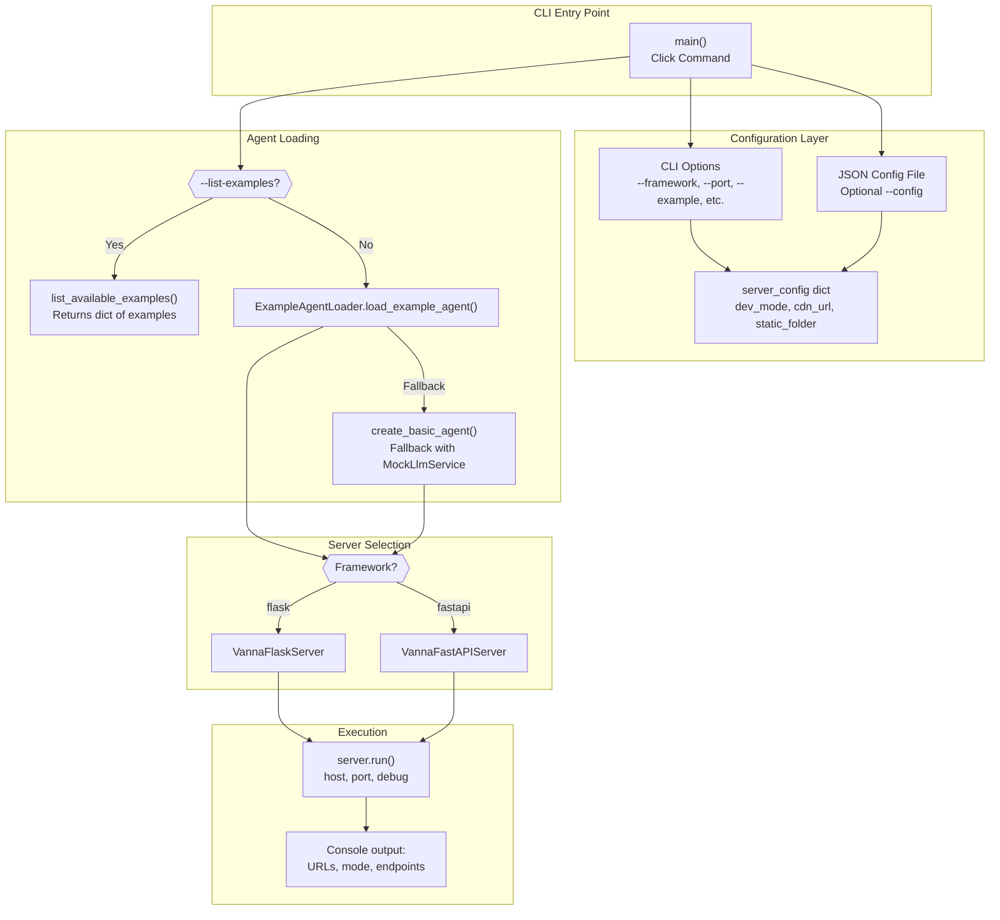
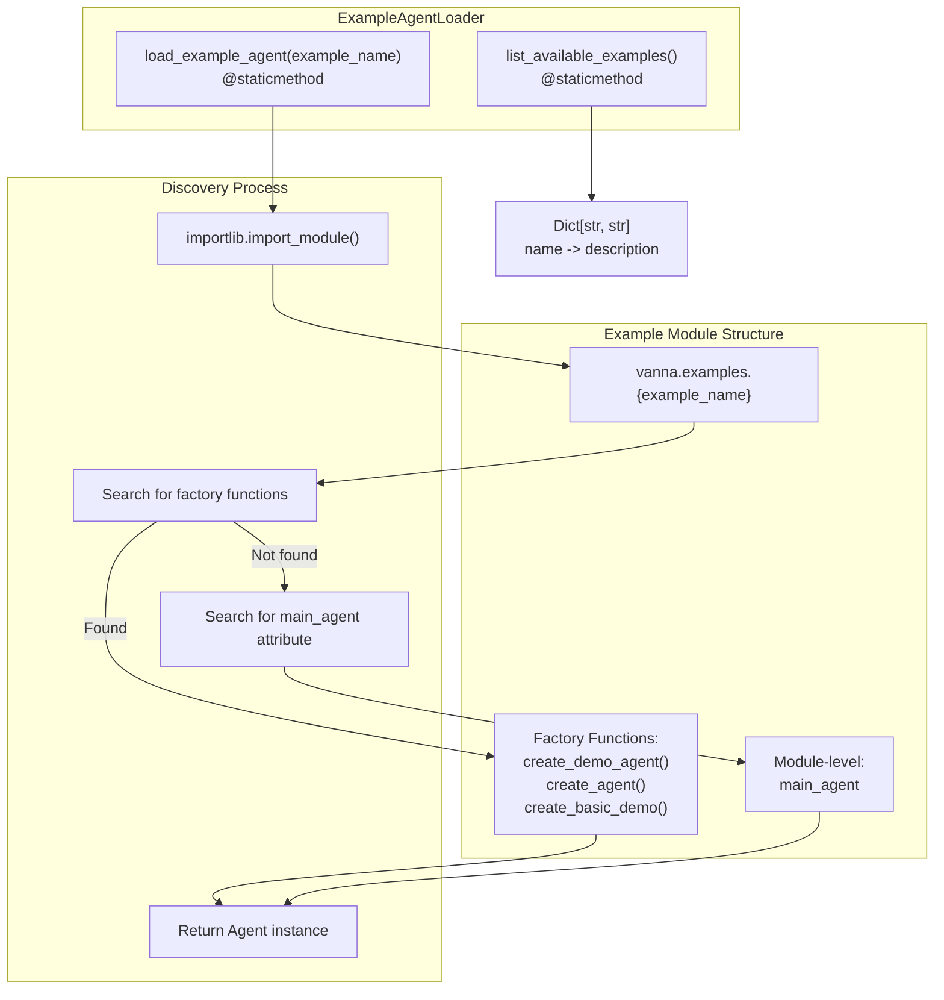
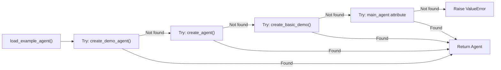
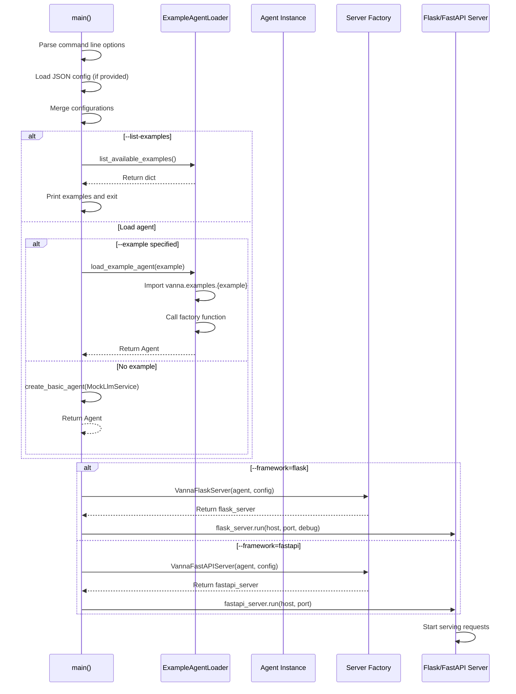
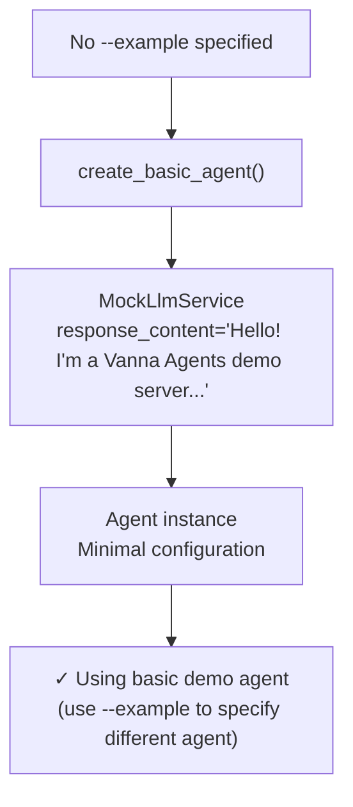
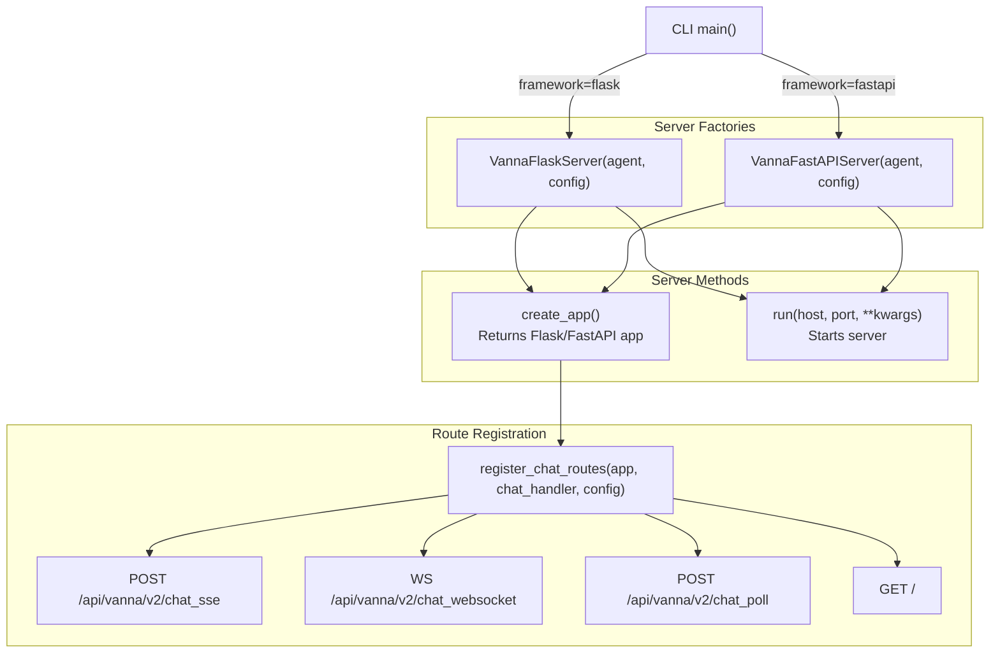

<!-- source: DeepWiki mcp.deepwiki.com · repo vanna-ai/vanna · page 8.5 CLI and Example Agents · fetched 2026-10-29 -->

# CLI and Example Agents

<details>
<summary>Relevant source files</summary>

The following files were used as context for generating this wiki page:

- [pyproject.toml](pyproject.toml)
- [src/vanna/__init__.py](src/vanna/__init__.py)
- [src/vanna/servers/__init__.py](src/vanna/servers/__init__.py)
- [src/vanna/servers/base/templates.py](src/vanna/servers/base/templates.py)
- [src/vanna/servers/cli/server_runner.py](src/vanna/servers/cli/server_runner.py)
- [src/vanna/servers/fastapi/routes.py](src/vanna/servers/fastapi/routes.py)
- [src/vanna/servers/flask/routes.py](src/vanna/servers/flask/routes.py)

</details>


## Purpose and Scope

This page documents the `vanna` command-line interface (CLI) and the example agent system. The CLI provides a quick way to run Vanna agent servers with pre-configured example agents for testing, development, and demonstration purposes. For information about the underlying server implementations, see [Server Architecture](#8.1). For web component integration, see [Web Component Integration](#8.6).

**Sources**: [src/vanna/servers/cli/server_runner.py:1-205]()

---

## CLI Command Overview

The `vanna` command is the primary entry point for running Vanna agent servers from the command line. It is implemented using the Click library and provides a unified interface for launching either Flask or FastAPI servers with optional example agents.

### Basic Usage

```bash
# List available examples
vanna --list-examples

# Run with a specific example
vanna --example anthropic_quickstart

# Run with FastAPI (default) on custom port
vanna --framework fastapi --port 8080

# Run with Flask
vanna --framework flask --port 5000

# Enable development mode (load components from local assets)
vanna --dev --static-folder ./frontend/webcomponent/static
```

**Sources**: [src/vanna/servers/cli/server_runner.py:74-201](), [README.md:32-41]()

---

## CLI Architecture



**Sources**: [src/vanna/servers/cli/server_runner.py:104-201]()

---

## ExampleAgentLoader Class

The `ExampleAgentLoader` class is responsible for discovering and loading pre-configured example agents. It provides a plugin-like system for example agents without requiring explicit registration.

### Architecture



**Sources**: [src/vanna/servers/cli/server_runner.py:14-72]()

---

## Available Example Agents

The following table lists all available example agents that can be loaded via the `--example` flag:

| Example Name | Description | LLM Provider | Database |
|--------------|-------------|--------------|----------|
| `mock_quickstart` | Basic agent with mock LLM service | Mock | None |
| `anthropic_quickstart` | Agent configured for Anthropic's Claude API | Anthropic | None |
| `openai_quickstart` | Agent configured for OpenAI's GPT models | OpenAI | None |
| `mock_custom_tool` | Agent with custom tool demonstration | Mock | None |
| `mock_quota_example` | Agent with usage quota management | Mock | None |
| `mock_rich_components_demo` | Rich components demonstration with cards, tasks, and progress | Mock | None |
| `coding_agent_example` | Coding agent with file system tools (list, read, write files) | Varies | None |
| `email_auth_example` | Email-based authentication demonstration | Mock | None |
| `claude_sqlite_example` | Claude agent with SQLite database querying capabilities | Anthropic | SQLite |
| `mock_sqlite_example` | Mock agent with SQLite database demonstration | Mock | SQLite |

**Sources**: [src/vanna/servers/cli/server_runner.py:18-31]()

---

## Factory Function Pattern

Example agents follow a standardized factory function pattern for instantiation. The `ExampleAgentLoader` searches for these functions in order:



Example structure:

```python
# vanna/examples/my_example.py
def create_demo_agent() -> Agent:
    """Factory function that returns a configured agent."""
    llm = AnthropicLlmService(model="claude-sonnet-4-5")
    tools = ToolRegistry()
    # ... configure tools ...
    return Agent(llm_service=llm, tool_registry=tools, ...)
```

**Sources**: [src/vanna/servers/cli/server_runner.py:34-71]()

---

## CLI Options Reference

### Server Options

| Option | Type | Default | Description |
|--------|------|---------|-------------|
| `--framework` | choice | `fastapi` | Web framework to use (`flask` or `fastapi`) |
| `--port` | int | `8000` | Port to bind server to |
| `--host` | string | `0.0.0.0` | Host address to bind to |
| `--debug` | flag | `False` | Enable debug mode (Flask only) |

### Example Selection

| Option | Type | Default | Description |
|--------|------|---------|-------------|
| `--example` | string | None | Name of example agent to load |
| `--list-examples` | flag | `False` | List all available example agents and exit |

### Development Options

| Option | Type | Default | Description |
|--------|------|---------|-------------|
| `--dev` | flag | `False` | Enable development mode (load components from local assets) |
| `--static-folder` | string | Varies | Path to static assets folder (defaults based on `--dev`) |
| `--cdn-url` | string | `https://img.vanna.ai/vanna-components.js` | CDN URL for web components |

### Configuration

| Option | Type | Default | Description |
|--------|------|---------|-------------|
| `--config` | file | None | Path to JSON configuration file |

**Sources**: [src/vanna/servers/cli/server_runner.py:75-103]()

---

## Configuration File Format

The CLI accepts an optional JSON configuration file via `--config` that is merged with command-line options:

```json
{
  "dev_mode": false,
  "static_folder": "static",
  "cdn_url": "https://img.vanna.ai/vanna-components.js",
  "api_base_url": "",
  "fastapi": {
    "title": "My Custom API",
    "version": "1.0.0"
  },
  "cors": {
    "enabled": true,
    "allow_origins": ["*"]
  }
}
```

The configuration is passed to the server constructors and affects:
- Component loading strategy (local vs CDN)
- CORS settings
- FastAPI app metadata
- API endpoint base URLs

**Sources**: [src/vanna/servers/cli/server_runner.py:126-142]()

---

## Server Creation Flow



**Sources**: [src/vanna/servers/cli/server_runner.py:104-201]()

---

## Development Mode vs Production Mode

The CLI supports two operational modes that affect how web components are loaded:

### Production Mode (Default)

```bash
vanna --example anthropic_quickstart
```

- Loads web components from CDN: `https://img.vanna.ai/vanna-components.js`
- Suitable for deployment
- No local static files required
- Console output: `🌍 Production mode: loading web components from CDN`

### Development Mode

```bash
vanna --example anthropic_quickstart --dev --static-folder ./my-components
```

- Loads web components from local filesystem
- Default static folder: `frontend/webcomponent/static` if `--dev` is set
- Enables component development and testing
- Console output: `📦 Development mode: loading web components from ./my-components/`

The mode is passed to the server configuration and affects the HTML template rendering:

```python
server_config.update({
    "dev_mode": dev,
    "static_folder": static_folder,
    "cdn_url": cdn_url,
    "api_base_url": "",
})
```

**Sources**: [src/vanna/servers/cli/server_runner.py:131-196](), [src/vanna/servers/base/templates.py:31-48]()

---

## Example: Running the Quickstart

The quickstart example demonstrates the minimal setup required for a Vanna agent with database querying capabilities:

```bash
# Install dependencies
pip install 'vanna[flask,anthropic]'

# Run the quickstart example
vanna --example anthropic_quickstart --port 8000

# Output:
# ✓ Loaded example agent: anthropic_quickstart
# 🚀 Starting FastAPI server on http://0.0.0.0:8000
# 📖 API docs available at http://0.0.0.0:8000/docs
# 🌍 Production mode: loading web components from CDN
```

This example includes:
- Anthropic Claude LLM service
- SQLite database runner (Chinook.sqlite)
- RunSqlTool for executing queries
- VisualizeDataTool for creating charts
- Memory tools for learning from successful queries
- SimpleUserResolver for cookie-based authentication

The agent is fully functional and serves:
- Web UI at `http://localhost:8000/`
- SSE endpoint at `http://localhost:8000/api/vanna/v2/chat_sse`
- WebSocket endpoint at `http://localhost:8000/api/vanna/v2/chat_websocket`
- Polling endpoint at `http://localhost:8000/api/vanna/v2/chat_poll`

**Sources**: [notebooks/quickstart.ipynb:1-169](), [README.md:32-41]()

---

## Fallback Agent Creation

If no example is specified, the CLI creates a minimal agent with mock responses:



This fallback ensures the CLI always produces a runnable server, even without explicit configuration. The mock agent responds to all queries with a static message and is useful for:
- Testing server infrastructure
- Verifying deployment configuration
- Demonstrating the web UI without API keys

**Sources**: [src/vanna/servers/cli/server_runner.py:153-167]()

---

## Console Output Examples

### Successful Launch (FastAPI)

```
✓ Loaded example agent: claude_sqlite_example
🚀 Starting FastAPI server on http://0.0.0.0:8000
📖 API docs available at http://0.0.0.0:8000/docs
🌍 Production mode: loading web components from CDN
```

### Development Mode (Flask)

```
✓ Loaded example agent: mock_rich_components_demo
🚀 Starting Flask server on http://0.0.0.0:5000
📦 Development mode: loading web components from ./frontend/webcomponent/static/
```

### List Examples

```bash
$ vanna --list-examples
Available example agents:
  mock_quickstart      - Basic agent with mock LLM service
  anthropic_quickstart - Agent configured for Anthropic's Claude API
  openai_quickstart    - Agent configured for OpenAI's GPT models
  ...
```

**Sources**: [src/vanna/servers/cli/server_runner.py:118-200]()

---

## Integration with Server Implementations

The CLI delegates to the appropriate server implementation based on the `--framework` option:



Both server implementations expose identical endpoints, ensuring consistent behavior regardless of framework choice. The key differences are:
- **FastAPI**: Native async support, automatic OpenAPI documentation at `/docs`
- **Flask**: Synchronous with async wrapper, simpler debugging

**Sources**: [src/vanna/servers/cli/server_runner.py:169-200](), [src/vanna/servers/fastapi/app.py:16-81](), [src/vanna/servers/flask/app.py:16-59]()

---

