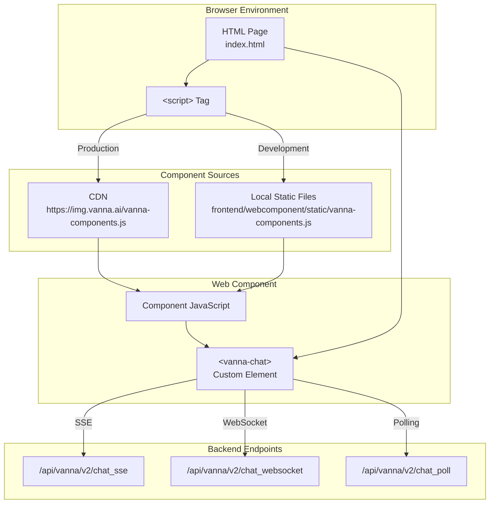
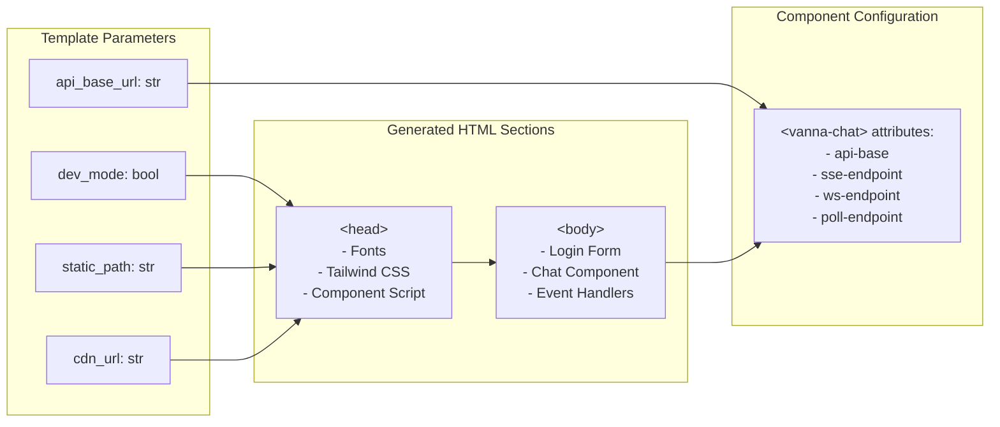
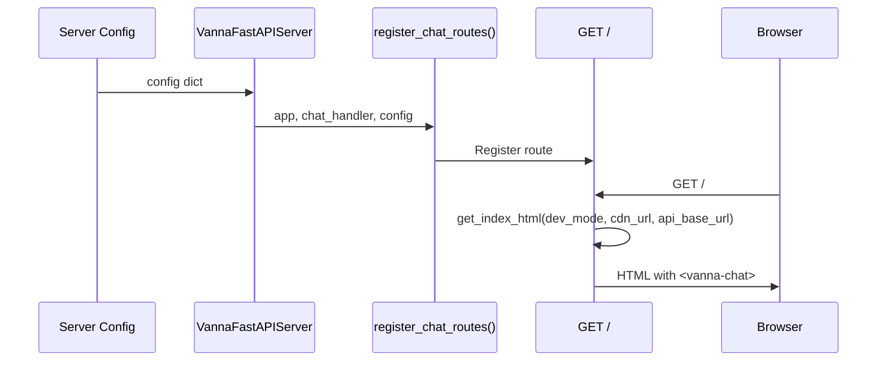
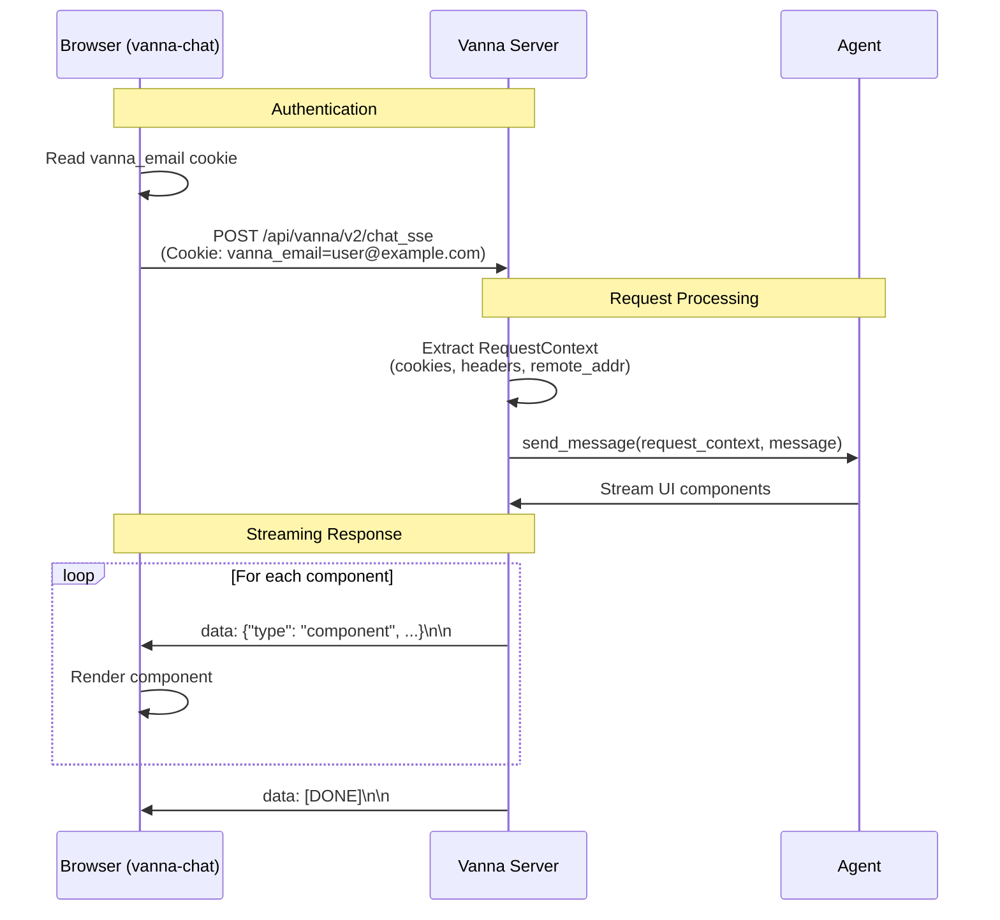
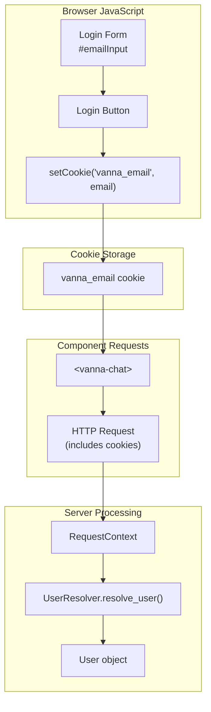
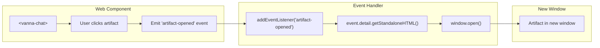

<!-- source: DeepWiki mcp.deepwiki.com · repo vanna-ai/vanna · page 8.6 Web Component Integration · fetched 2026-10-29 -->

# Web Component Integration

<details>
<summary>Relevant source files</summary>

The following files were used as context for generating this wiki page:

- [MIGRATION_GUIDE.md](MIGRATION_GUIDE.md)
- [README.md](README.md)
- [img/architecture.png](img/architecture.png)
- [img/vanna2.svg](img/vanna2.svg)
- [notebooks/quickstart.ipynb](notebooks/quickstart.ipynb)
- [src/vanna/integrations/anthropic/llm.py](src/vanna/integrations/anthropic/llm.py)
- [src/vanna/integrations/openai/llm.py](src/vanna/integrations/openai/llm.py)
- [src/vanna/servers/__init__.py](src/vanna/servers/__init__.py)
- [src/vanna/servers/base/templates.py](src/vanna/servers/base/templates.py)
- [src/vanna/servers/cli/server_runner.py](src/vanna/servers/cli/server_runner.py)
- [src/vanna/servers/fastapi/app.py](src/vanna/servers/fastapi/app.py)
- [src/vanna/servers/fastapi/routes.py](src/vanna/servers/fastapi/routes.py)
- [src/vanna/servers/flask/app.py](src/vanna/servers/flask/app.py)
- [src/vanna/servers/flask/routes.py](src/vanna/servers/flask/routes.py)

</details>


This document explains how to integrate the Vanna web component (`<vanna-chat>`) into web applications to provide a chat interface for Vanna agents. This covers component loading strategies, configuration options, and the communication flow between frontend and backend.

For information about the backend server implementations that serve the web component, see [Server Architecture](#8.1). For details about the communication protocols themselves (SSE, WebSocket, polling), see [Communication Protocols](#8.4).

---

## Overview

The Vanna framework provides a pre-built web component `<vanna-chat>` that renders a complete chat interface for interacting with Vanna agents. The component is distributed as a JavaScript module and can be loaded via CDN (production) or local static files (development). It communicates with backend servers through standardized endpoints and handles authentication via cookies or headers.

**Sources**: [README.md:42-53](), [src/vanna/servers/base/templates.py:1-332]()

---

## Component Loading Architecture



**Component Loading Modes**:

| Mode | Script Source | Use Case | Configuration |
|------|---------------|----------|---------------|
| **Production** | CDN (`https://img.vanna.ai/vanna-components.js`) | Deployed applications | Default mode |
| **Development** | Local static files (`/static/vanna-components.js`) | Local development, customization | `dev_mode=True` in config |

The `get_vanna_component_script()` function generates the appropriate script tag based on the mode.

**Sources**: [src/vanna/servers/base/templates.py:8-28](), [src/vanna/servers/cli/server_runner.py:91-102]()

---

## HTML Template Generation

### Template Function

The `get_index_html()` function in [src/vanna/servers/base/templates.py:31-327]() generates a complete HTML page with the Vanna web component embedded. This function is called by both FastAPI and Flask server implementations.



**Key HTML Elements**:

| Element | Purpose | Location |
|---------|---------|----------|
| `<script src="...vanna-components.js">` | Load web component module | `<head>` section |
| `<vanna-chat>` | Instantiate chat interface | `<body>` section |
| Login form (`#loginContainer`) | Demo authentication UI | Before chat component |
| Event listeners | Handle authentication and artifacts | `<script>` at end of body |

**Sources**: [src/vanna/servers/base/templates.py:31-327]()

---

## Component Attributes and Configuration

The `<vanna-chat>` custom element accepts several attributes to configure its behavior:

```html
<vanna-chat
  api-base="/custom-base"
  sse-endpoint="/custom-base/api/vanna/v2/chat_sse"
  ws-endpoint="/custom-base/api/vanna/v2/chat_websocket"
  poll-endpoint="/custom-base/api/vanna/v2/chat_poll">
</vanna-chat>
```

### Configuration Attributes

| Attribute | Type | Purpose | Default |
|-----------|------|---------|---------|
| `api-base` | string | Base URL for API endpoints | `""` (same origin) |
| `sse-endpoint` | string | Server-Sent Events streaming endpoint | `/api/vanna/v2/chat_sse` |
| `ws-endpoint` | string | WebSocket endpoint | `/api/vanna/v2/chat_websocket` |
| `poll-endpoint` | string | Polling endpoint | `/api/vanna/v2/chat_poll` |
| `theme` | string | Visual theme | `"light"` |

The template generation function accepts a `config` dictionary that controls these values:

```python
config = {
    "dev_mode": False,              # Load from CDN or local files
    "cdn_url": "https://...",       # CDN URL for production
    "api_base_url": "",             # Base URL for endpoints
    "static_folder": "static"       # Local static files location (dev mode)
}
```

**Sources**: [src/vanna/servers/base/templates.py:31-48](), [README.md:45-50]()

---

## Server Integration

### FastAPI Integration



The FastAPI server registers the index route that serves the web component:

[src/vanna/servers/fastapi/routes.py:29-38]()
```python
@app.get("/", response_class=HTMLResponse)
async def index() -> str:
    """Serve the main chat interface."""
    dev_mode = config.get("dev_mode", False)
    cdn_url = config.get("cdn_url", "https://img.vanna.ai/vanna-components.js")
    api_base_url = config.get("api_base_url", "")
    
    return get_index_html(
        dev_mode=dev_mode, cdn_url=cdn_url, api_base_url=api_base_url
    )
```

**Sources**: [src/vanna/servers/fastapi/routes.py:17-38](), [src/vanna/servers/fastapi/app.py:30-80]()

### Flask Integration

The Flask server follows the same pattern:

[src/vanna/servers/flask/routes.py:29-38]()
```python
@app.route("/")
def index() -> str:
    """Serve the main chat interface."""
    dev_mode = config.get("dev_mode", False)
    cdn_url = config.get("cdn_url", "https://img.vanna.ai/vanna-components.js")
    api_base_url = config.get("api_base_url", "")
    
    return get_index_html(
        dev_mode=dev_mode, cdn_url=cdn_url, api_base_url=api_base_url
    )
```

**Sources**: [src/vanna/servers/flask/routes.py:17-38](), [src/vanna/servers/flask/app.py:30-58]()

---

## Communication Flow



The web component automatically includes cookies and headers with each request. The server extracts authentication information from the `RequestContext`:

[src/vanna/servers/fastapi/routes.py:46-52]()
```python
chat_request.request_context = RequestContext(
    cookies=dict(http_request.cookies),
    headers=dict(http_request.headers),
    remote_addr=http_request.client.host if http_request.client else None,
    query_params=dict(http_request.query_params),
    metadata=chat_request.metadata,
)
```

**Sources**: [src/vanna/servers/fastapi/routes.py:40-80](), [src/vanna/servers/flask/routes.py:40-92]()

---

## Authentication Integration

The generated HTML includes a demo authentication system using cookies:



### Cookie-Based Authentication Flow

The template includes JavaScript helper functions for cookie management:

[src/vanna/servers/base/templates.py:219-233]()
```javascript
const getCookie = (name) => {
    const value = `; ${document.cookie}`;
    const parts = value.split(`; ${name}=`);
    return parts.length === 2 ? parts.pop().split(';').shift() : null;
};

const setCookie = (name, value) => {
    const expires = new Date(Date.now() + 365 * 864e5).toUTCString();
    document.cookie = `${name}=${value}; expires=${expires}; path=/; SameSite=Lax`;
};
```

The login button handler sets the cookie and reveals the chat interface:

[src/vanna/servers/base/templates.py:248-259]()
```javascript
loginButton.addEventListener('click', () => {
    const email = emailInput.value.trim();
    if (!email) {
        alert('Please select an email address');
        return;
    }
    setCookie('vanna_email', email);
    loginContainer.classList.add('hidden');
    loggedInStatus.classList.remove('hidden');
    chatSections.classList.remove('hidden');
    loggedInEmail.textContent = email;
});
```

**Note**: This is a **demonstration authentication system** for local development. In production, implement proper authentication using JWT tokens, OAuth, or your existing authentication system.

**Sources**: [src/vanna/servers/base/templates.py:150-275](), [notebooks/quickstart.ipynb:81-93]()

---

## Artifact Event Handling

The web component emits custom events when users interact with artifacts (visualizations, code blocks, etc.). The template includes an event handler that demonstrates external artifact rendering:



### Event Details

The `artifact-opened` event provides:

| Property | Type | Description |
|----------|------|-------------|
| `event.detail.artifactId` | string | Unique identifier for artifact |
| `event.detail.type` | string | Artifact type (e.g., "chart", "code") |
| `event.detail.title` | string | Artifact title |
| `event.detail.trigger` | string | How event was triggered |
| `event.detail.getStandaloneHTML()` | function | Returns standalone HTML for artifact |
| `event.detail.preventDefault()` | function | Prevent default in-chat rendering |

[src/vanna/servers/base/templates.py:284-303]()
```javascript
vannaChat.addEventListener('artifact-opened', (event) => {
    const { artifactId, type, title, trigger } = event.detail;
    
    console.log('🎨 Artifact Event:', { artifactId, type, title, trigger });
    
    // Open artifact in new window
    setTimeout(() => {
        const newWindow = window.open('', '_blank', 'width=900,height=700');
        if (newWindow) {
            newWindow.document.write(event.detail.getStandaloneHTML());
            newWindow.document.close();
            newWindow.document.title = title || 'Vanna Artifact';
        }
    }, 100);
    
    // Prevent default in-chat rendering
    event.detail.preventDefault();
});
```

**Sources**: [src/vanna/servers/base/templates.py:278-307]()

---

## Development vs Production Setup

### CLI Configuration

The Vanna CLI provides flags to control component loading:

```bash
# Production mode (CDN)
vanna --framework fastapi --port 8000

# Development mode (local static files)
vanna --framework fastapi --port 8000 --dev --static-folder frontend/webcomponent/static

# Custom CDN URL
vanna --framework fastapi --port 8000 --cdn-url https://custom-cdn.com/vanna.js
```

[src/vanna/servers/cli/server_runner.py:91-143]()
```python
@click.option(
    "--dev",
    is_flag=True,
    help="Enable development mode (load components from local assets)",
)
@click.option(
    "--static-folder", default=None, help="Static folder path for development mode"
)
@click.option(
    "--cdn-url",
    default="https://img.vanna.ai/vanna-components.js",
    help="CDN URL for web components",
)
```

The CLI merges these options into the server configuration:

[src/vanna/servers/cli/server_runner.py:135-142]()
```python
server_config.update(
    {
        "dev_mode": dev,
        "static_folder": static_folder,
        "cdn_url": cdn_url,
        "api_base_url": "",  # Can be overridden in config file
    }
)
```

**Sources**: [src/vanna/servers/cli/server_runner.py:74-201]()

### Static File Serving

In development mode, the FastAPI server mounts static files:

[src/vanna/servers/fastapi/app.py:58-70]()
```python
# Add static file serving in dev mode
dev_mode = self.config.get("dev_mode", False)
if dev_mode:
    static_folder = self.config.get("static_folder", "static")
    try:
        import os
        
        if os.path.exists(static_folder):
            app.mount(
                "/static", StaticFiles(directory=static_folder), name="static"
            )
    except Exception:
        pass  # Static files not available
```

The Flask server follows a similar pattern:

[src/vanna/servers/flask/app.py:36-40]()
```python
# Check if dev mode is enabled
dev_mode = self.config.get("dev_mode", False)
static_folder = self.config.get("static_folder", "static") if dev_mode else None

app = Flask(__name__, static_folder=static_folder, static_url_path="/static")
```

**Sources**: [src/vanna/servers/fastapi/app.py:16-80](), [src/vanna/servers/flask/app.py:16-58]()

---

## Embedding in Existing Applications

### Minimal Integration

To embed the web component in an existing application:

```html
<!DOCTYPE html>
<html>
<head>
    <script type="module" src="https://img.vanna.ai/vanna-components.js"></script>
</head>
<body>
    <vanna-chat
        sse-endpoint="https://your-api.com/api/vanna/v2/chat_sse"
        ws-endpoint="https://your-api.com/api/vanna/v2/chat_websocket"
        poll-endpoint="https://your-api.com/api/vanna/v2/chat_poll">
    </vanna-chat>
</body>
</html>
```

### Framework Integration

The web component works with any framework:

**React Example**:
```jsx
function App() {
  return (
    <div>
      <vanna-chat
        sse-endpoint="/api/vanna/v2/chat_sse"
        ws-endpoint="/api/vanna/v2/chat_websocket"
        poll-endpoint="/api/vanna/v2/chat_poll"
      />
    </div>
  );
}
```

**Vue Example**:
```vue
<template>
  <vanna-chat
    :sse-endpoint="sseEndpoint"
    :ws-endpoint="wsEndpoint"
    :poll-endpoint="pollEndpoint"
  />
</template>

<script>
export default {
  data() {
    return {
      sseEndpoint: '/api/vanna/v2/chat_sse',
      wsEndpoint: '/api/vanna/v2/chat_websocket',
      pollEndpoint: '/api/vanna/v2/chat_poll'
    };
  }
};
</script>
```

**Sources**: [README.md:42-53](), [README.md:194-197]()

---

## Endpoint API Reference

The web component expects the following backend endpoints:

| Endpoint | Method | Protocol | Purpose |
|----------|--------|----------|---------|
| `/api/vanna/v2/chat_sse` | POST | SSE | Streaming chat responses |
| `/api/vanna/v2/chat_websocket` | WS | WebSocket | Real-time bidirectional chat |
| `/api/vanna/v2/chat_poll` | POST | HTTP | Request/response polling |
| `/` | GET | HTTP | Serve web component page (optional) |
| `/health` | GET | HTTP | Health check (optional) |

### Request Format

All chat endpoints accept a JSON request body:

```json
{
  "message": "Show me the top customers",
  "conversation_id": "conv-123",
  "request_id": "req-456",
  "metadata": {}
}
```

The `RequestContext` is automatically populated from HTTP headers and cookies:

- `cookies`: Dictionary of cookies
- `headers`: Dictionary of HTTP headers
- `remote_addr`: Client IP address
- `query_params`: Query string parameters
- `metadata`: Additional metadata from request body

**Sources**: [src/vanna/servers/fastapi/routes.py:40-80](), [src/vanna/servers/flask/routes.py:40-137]()

---

## Summary

The Vanna web component integration provides:

1. **Flexible Loading**: CDN for production, local files for development
2. **Simple Embedding**: Single `<script>` tag and custom element
3. **Framework Agnostic**: Works with React, Vue, plain HTML
4. **Authentication Support**: Cookie/header-based authentication
5. **Event Handling**: Custom events for artifact interactions
6. **Multiple Protocols**: SSE, WebSocket, and polling support

The component communicates with backend servers through standardized endpoints that extract user context from request metadata. The generated HTML template provides a complete working example with demo authentication and artifact handling.

**Sources**: [README.md:42-53](), [README.md:88-93](), [src/vanna/servers/base/templates.py:1-332](), [src/vanna/servers/fastapi/routes.py:17-184](), [src/vanna/servers/flask/routes.py:17-138]()

---

