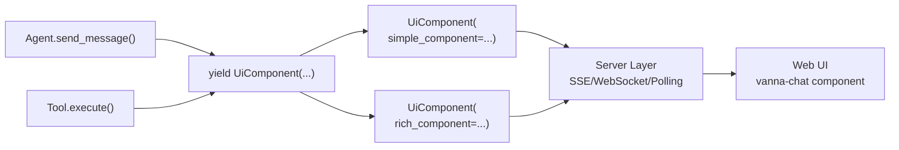
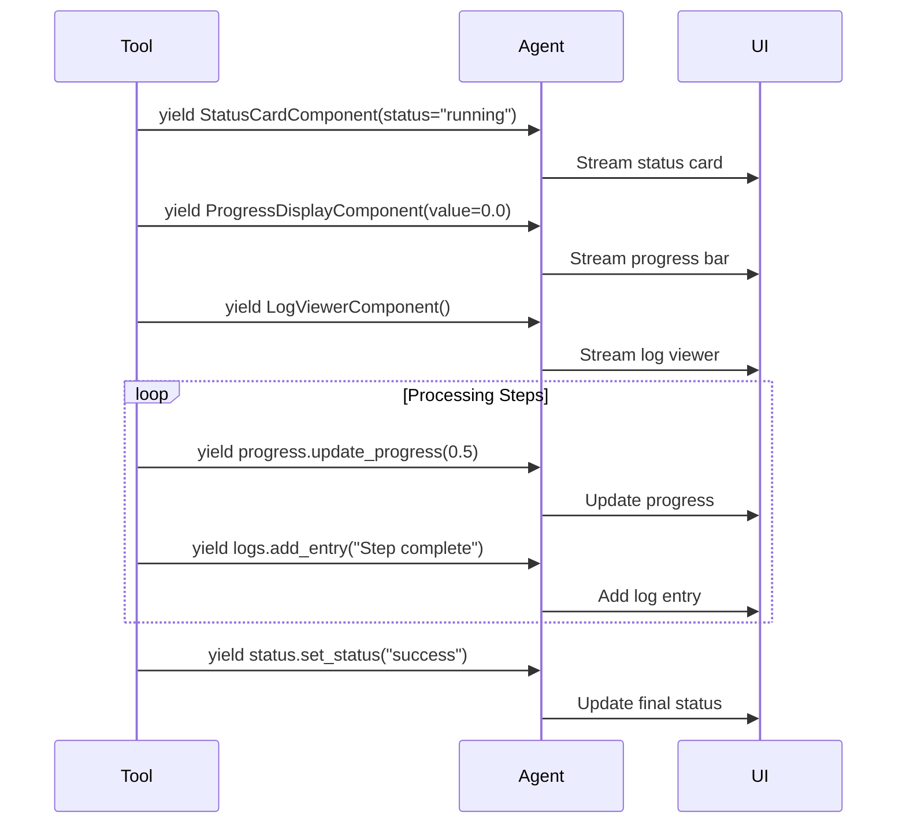
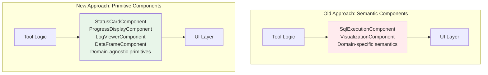

<!-- source: DeepWiki mcp.deepwiki.com · repo vanna-ai/vanna · page 9 User Interface Components · fetched 2026-10-29 -->

# User Interface Components

<details>
<summary>Relevant source files</summary>

The following files were used as context for generating this wiki page:

- [pyproject.toml](pyproject.toml)
- [src/vanna/__init__.py](src/vanna/__init__.py)
- [src/vanna/components/__init__.py](src/vanna/components/__init__.py)
- [src/vanna/components/rich/__init__.py](src/vanna/components/rich/__init__.py)
- [src/vanna/components/rich/specialized/__init__.py](src/vanna/components/rich/specialized/__init__.py)
- [src/vanna/examples/mock_rich_components_demo.py](src/vanna/examples/mock_rich_components_demo.py)
- [src/vanna/examples/primitive_components_demo.py](src/vanna/examples/primitive_components_demo.py)

</details>


## Purpose and Scope

This document covers the **UI Component System** in Vanna Agents, which provides a rich set of building blocks for creating interactive agent interfaces. The component system enables agents and tools to yield presentational components that are streamed to users through server endpoints, creating dynamic, real-time user experiences.

**Scope**: This document focuses on the component types, their properties, usage patterns, and design philosophy. For information about how components are streamed to users through server endpoints, see [Server and Deployment](#8). For how tools yield components during execution, see [Tool System](#7).

**Sources**: [src/vanna/__init__.py:33-83](), [src/vanna/components/__init__.py:1-93]()

---

## Component System Architecture

The Vanna UI component system follows a two-tiered architecture: a lightweight `UiComponent` wrapper that contains either a **SimpleComponent** (basic text, images, links) or a **RichComponent** (complex, stateful UI elements).

### Component Type Hierarchy

```mermaid
graph TB
    UiComponent["UiComponent<br/>Wrapper"]
    
    subgraph "Simple Components"
        SimpleComponent["SimpleComponent<br/>Base"]
        SimpleText["SimpleTextComponent<br/>Plain text"]
        SimpleImage["SimpleImageComponent<br/>Image URLs"]
        SimpleLink["SimpleLinkComponent<br/>Hyperlinks"]
    end
    
    subgraph "Rich Components"
        RichComponent["RichComponent<br/>Base + ComponentType + ComponentLifecycle"]
        
        subgraph "Feedback"
            StatusCard["StatusCardComponent<br/>status: running/success/error"]
            ProgressDisplay["ProgressDisplayComponent<br/>value: 0.0-1.0 + animated"]
            LogViewer["LogViewerComponent<br/>entries[] + timestamps"]
            Badge["BadgeComponent<br/>variant: primary/success/warning/error"]
            IconText["IconTextComponent<br/>icon + text + variant"]
            Notification["NotificationComponent<br/>level: info/warning/error"]
        end
        
        subgraph "Interactive"
            TaskList["TaskListComponent<br/>tasks[] + operations"]
            Button["ButtonComponent<br/>label + action"]
            ButtonGroup["ButtonGroupComponent<br/>buttons[]"]
            StatusBarUpdate["StatusBarUpdateComponent<br/>Update status bar"]
            TaskTrackerUpdate["TaskTrackerUpdateComponent<br/>Update task state"]
            ChatInputUpdate["ChatInputUpdateComponent<br/>Update chat input"]
        end
        
        subgraph "Data/Container"
            DataFrame["DataFrameComponent<br/>pandas DataFrame"]
            Chart["ChartComponent<br/>Plotly figures"]
            Card["CardComponent<br/>title + content"]
            RichText["RichTextComponent<br/>markdown support"]
        end
        
        subgraph "Specialized"
            Artifact["ArtifactComponent<br/>title + content + language"]
        end
    end
    
    UiComponent --> SimpleComponent
    UiComponent --> RichComponent
    
    SimpleComponent --> SimpleText
    SimpleComponent --> SimpleImage
    SimpleComponent --> SimpleLink
    
    RichComponent --> StatusCard
    RichComponent --> ProgressDisplay
    RichComponent --> LogViewer
    RichComponent --> Badge
    RichComponent --> IconText
    RichComponent --> Notification
    
    RichComponent --> TaskList
    RichComponent --> Button
    RichComponent --> ButtonGroup
    RichComponent --> StatusBarUpdate
    RichComponent --> TaskTrackerUpdate
    RichComponent --> ChatInputUpdate
    
    RichComponent --> DataFrame
    RichComponent --> Chart
    RichComponent --> Card
    RichComponent --> RichText
    
    RichComponent --> Artifact
```



**Sources**: [src/vanna/components/__init__.py:1-93](), [src/vanna/components/rich/__init__.py:1-84]()

---

## The UiComponent Wrapper

`UiComponent` is the top-level wrapper that agents and tools yield. It contains either a `simple_component` or a `rich_component`, but not both.

### UiComponent Structure



### Usage Pattern

Agents and tools yield `UiComponent` instances during execution:

```python
# Yielding a simple text component
yield UiComponent(
    simple_component=SimpleTextComponent(text="Processing request...")
)

# Yielding a rich status card
yield UiComponent(
    rich_component=StatusCardComponent(
        id="status-123",
        title="Data Analysis",
        status="running",
        description="Analyzing customer data..."
    )
)
```

**Sources**: [src/vanna/examples/primitive_components_demo.py:49-64](), [src/vanna/examples/mock_rich_components_demo.py:48-76]()

---

## Simple Components

Simple components are lightweight, stateless primitives for basic content types. They are defined in [src/vanna/components/simple]().

### SimpleComponentType Enum

| Type | Description | Use Case |
|------|-------------|----------|
| `text` | Plain text content | Status messages, simple responses |
| `image` | Image URLs | Display generated visualizations |
| `link` | Hyperlinks | Reference external resources |

### SimpleTextComponent

```python
SimpleTextComponent(text: str)
```

Basic text content without formatting.

### SimpleImageComponent

```python
SimpleImageComponent(url: str, alt_text: Optional[str] = None)
```

Display an image from a URL. The `alt_text` provides accessibility support.

### SimpleLinkComponent

```python
SimpleLinkComponent(url: str, text: str)
```

A clickable hyperlink with display text.

**Sources**: [src/vanna/components/simple](), [src/vanna/__init__.py:36-39]()

---

## Rich Components: Base Infrastructure

Rich components are complex, stateful UI elements with unique identifiers and lifecycle management.

### RichComponent Base Properties

All rich components inherit from `RichComponent` and include:

| Property | Type | Description |
|----------|------|-------------|
| `id` | `str` | Unique identifier for the component instance |
| `type` | `ComponentType` | Enum defining the component type |
| `lifecycle` | `ComponentLifecycle` | Either `"create"` (new) or `"update"` (modify existing) |

### ComponentType Enum

```mermaid
graph TB
    ComponentType["ComponentType<br/>Enum"]
    
    Feedback["Feedback Types"]
    Interactive["Interactive Types"]
    Data["Data Types"]
    Container["Container Types"]
    Specialized["Specialized Types"]
    
    ComponentType --> Feedback
    ComponentType --> Interactive
    ComponentType --> Data
    ComponentType --> Container
    ComponentType --> Specialized
    
    Feedback --> status_card
    Feedback --> progress_display
    Feedback --> progress_bar
    Feedback --> log_viewer
    Feedback --> badge
    Feedback --> icon_text
    Feedback --> notification
    Feedback --> status_indicator
    
    Interactive --> task_list
    Interactive --> button
    Interactive --> button_group
    Interactive --> status_bar_update
    Interactive --> task_tracker_update
    Interactive --> chat_input_update
    
    Data --> dataframe
    Data --> chart
    Data --> rich_text
    
    Container --> card
    
    Specialized --> artifact
```



### ComponentLifecycle

Components can be created or updated:

- **`"create"`**: A new component instance being displayed for the first time
- **`"update"`**: Modifying an existing component (matched by `id`)

**Example: Creating and Updating**

```python
# Create a status card
status_card = StatusCardComponent(
    id="analysis-1",
    title="Data Analysis",
    status="running",
    description="Starting analysis..."
)
yield UiComponent(rich_component=status_card)
# lifecycle = "create" (default)

# Update the same status card
yield UiComponent(
    rich_component=status_card.set_status(
        "success",
        "Analysis complete!"
    )
)
# lifecycle = "update" (same id)
```

**Sources**: [src/vanna/components/rich/__init__.py:4](), [src/vanna/examples/primitive_components_demo.py:98-104]()

---

## Feedback Components

Feedback components provide status information, progress indicators, and notifications to users.

### StatusCardComponent

Displays the status of an operation or process.

**Properties:**

| Property | Type | Description |
|----------|------|-------------|
| `id` | `str` | Unique identifier |
| `title` | `str` | Card title |
| `status` | `str` | One of: `"running"`, `"success"`, `"error"`, `"warning"`, `"completed"`, `"pending"` |
| `description` | `str` | Status description |
| `icon` | `Optional[str]` | Emoji or icon |

**Methods:**

```python
def set_status(self, status: str, description: str) -> StatusCardComponent:
    """Returns a new instance with updated status and description."""
```

**Usage Example:**

```python
# Tool execution status
tool_status = StatusCardComponent(
    id="sql-exec-1",
    title="SQL Query Execution",
    status="running",
    description="Executing query on database...",
    icon="🔍"
)
yield UiComponent(rich_component=tool_status)

# Update to success
yield UiComponent(
    rich_component=tool_status.set_status(
        "success",
        "Query returned 1,234 rows in 0.8s"
    )
)
```

**Sources**: [src/vanna/components/rich/feedback](), [src/vanna/examples/primitive_components_demo.py:57-64](), [src/vanna/examples/mock_rich_components_demo.py:59-76]()

---

### ProgressDisplayComponent

Displays a progress bar with status information.

**Properties:**

| Property | Type | Description |
|----------|------|-------------|
| `id` | `str` | Unique identifier |
| `label` | `str` | Progress bar label |
| `value` | `float` | Progress value (0.0 to 1.0) |
| `description` | `Optional[str]` | Current step description |
| `status` | `Optional[str]` | Status variant (info/success/warning/error) |
| `animated` | `bool` | Whether to animate the progress bar |

**Methods:**

```python
def update_progress(self, value: float, description: Optional[str] = None) -> ProgressDisplayComponent:
    """Returns a new instance with updated progress."""
```

**Usage Example:**

```python
progress = ProgressDisplayComponent(
    id="analysis-progress",
    label="Data Analysis Progress",
    value=0.0,
    description="Initializing...",
    animated=True
)
yield UiComponent(rich_component=progress)

# Update progress through stages
for i, stage in enumerate(["Loading", "Processing", "Analyzing", "Complete"]):
    progress_value = (i + 1) / 4
    yield UiComponent(
        rich_component=progress.update_progress(
            progress_value,
            f"Step {i + 1}: {stage}"
        )
    )
```

**Sources**: [src/vanna/components/rich/feedback](), [src/vanna/examples/primitive_components_demo.py:67-74](), [src/vanna/examples/mock_rich_components_demo.py:109-117]()

---

### LogViewerComponent

Displays a scrollable log of entries with timestamps.

**Properties:**

| Property | Type | Description |
|----------|------|-------------|
| `id` | `str` | Unique identifier |
| `title` | `str` | Log viewer title |
| `entries` | `List[LogEntry]` | List of log entries |
| `show_timestamps` | `bool` | Whether to display timestamps |
| `auto_scroll` | `bool` | Auto-scroll to latest entry |

**LogEntry Structure:**

```python
class LogEntry:
    message: str
    level: str  # "info", "warning", "error", "debug"
    timestamp: datetime
```

**Methods:**

```python
def add_entry(self, message: str, level: str = "info") -> LogViewerComponent:
    """Returns a new instance with an added log entry."""
```

**Usage Example:**

```python
log_viewer = LogViewerComponent(
    id="tool-logs",
    title="Tool Execution Log",
    entries=[],
    show_timestamps=True,
    auto_scroll=True
)
yield UiComponent(rich_component=log_viewer)

# Add log entries during execution
yield UiComponent(
    rich_component=log_viewer.add_entry("Starting data load...", "info")
)
yield UiComponent(
    rich_component=log_viewer.add_entry("Data loaded: 1000 rows", "info")
)
yield UiComponent(
    rich_component=log_viewer.add_entry("Warning: 5 null values detected", "warning")
)
```

**Sources**: [src/vanna/components/rich/feedback](), [src/vanna/examples/primitive_components_demo.py:77-84](), [src/vanna/examples/mock_rich_components_demo.py:120-121]()

---

### BadgeComponent

Small labeled badge for status or categorization.

**Properties:**

| Property | Type | Description |
|----------|------|-------------|
| `id` | `str` | Unique identifier |
| `text` | `str` | Badge text |
| `variant` | `str` | Color variant: `"default"`, `"primary"`, `"success"`, `"warning"`, `"error"`, `"info"` |
| `size` | `str` | Size: `"small"`, `"medium"`, `"large"` |
| `icon` | `Optional[str]` | Optional icon/emoji |

**Usage Example:**

```python
# Status badges
yield UiComponent(
    rich_component=BadgeComponent(
        id="status-badge",
        text="Processing",
        variant="primary",
        size="medium"
    )
)

yield UiComponent(
    rich_component=BadgeComponent(
        id="status-badge",
        text="Complete",
        variant="success",
        size="medium",
        icon="✅"
    )
)
```

**Sources**: [src/vanna/components/rich/feedback](), [src/vanna/examples/primitive_components_demo.py:150-158]()

---

### IconTextComponent

Combines an icon with text for visual emphasis.

**Properties:**

| Property | Type | Description |
|----------|------|-------------|
| `id` | `str` | Unique identifier |
| `icon` | `str` | Icon or emoji |
| `text` | `str` | Display text |
| `variant` | `str` | Style variant: `"default"`, `"primary"`, `"secondary"`, `"success"`, `"warning"`, `"error"` |
| `size` | `str` | Size: `"small"`, `"medium"`, `"large"` |

**Usage Example:**

```python
yield UiComponent(
    rich_component=IconTextComponent(
        id="results-summary",
        icon="📊",
        text="Analysis complete: 1,234 records processed",
        variant="success",
        size="large"
    )
)
```

**Sources**: [src/vanna/components/rich/feedback](), [src/vanna/examples/primitive_components_demo.py:160-180](), [src/vanna/examples/mock_rich_components_demo.py:48-56]()

---

### NotificationComponent

Displays a notification message with level-based styling.

**Properties:**

| Property | Type | Description |
|----------|------|-------------|
| `id` | `str` | Unique identifier |
| `message` | `str` | Notification message |
| `level` | `str` | Level: `"info"`, `"success"`, `"warning"`, `"error"` |
| `title` | `Optional[str]` | Notification title |
| `dismissible` | `bool` | Whether user can dismiss |

**Sources**: [src/vanna/components/rich/feedback]()

---

## Interactive Components

Interactive components enable user interaction and dynamic UI updates.

### TaskListComponent

Displays a list of tasks with status indicators.

**Properties:**

| Property | Type | Description |
|----------|------|-------------|
| `id` | `str` | Unique identifier |
| `title` | `str` | Task list title |
| `tasks` | `List[Task]` | List of task items |

**Task Structure:**

```python
class Task:
    id: str
    text: str
    status: str  # "pending", "running", "complete", "error"
    icon: Optional[str]
```

**Sources**: [src/vanna/components/rich/interactive]()

---

### ButtonComponent and ButtonGroupComponent

Buttons for user actions.

**ButtonComponent Properties:**

| Property | Type | Description |
|----------|------|-------------|
| `id` | `str` | Unique identifier |
| `label` | `str` | Button label |
| `action` | `str` | Action identifier |
| `variant` | `str` | Style variant |
| `disabled` | `bool` | Whether button is disabled |

**ButtonGroupComponent** groups multiple buttons together.

**Sources**: [src/vanna/components/rich/interactive]()

---

### Update Components

Update components modify existing UI elements:

- **StatusBarUpdateComponent**: Updates a status bar
- **TaskTrackerUpdateComponent**: Updates task status in a tracker
- **ChatInputUpdateComponent**: Modifies the chat input field

These components use `lifecycle="update"` and target specific UI elements by ID.

**Sources**: [src/vanna/components/rich/interactive]()

---

## Data and Container Components

### DataFrameComponent

Displays a pandas DataFrame in tabular format.

**Properties:**

| Property | Type | Description |
|----------|------|-------------|
| `id` | `str` | Unique identifier |
| `df` | `pandas.DataFrame` | Data to display |
| `title` | `Optional[str]` | Table title |
| `max_rows` | `int` | Maximum rows to display |

**Usage Example:**

```python
import pandas as pd

df = pd.DataFrame({
    'product': ['A', 'B', 'C'],
    'sales': [100, 150, 120]
})

yield UiComponent(
    rich_component=DataFrameComponent(
        id="sales-data",
        df=df,
        title="Sales Summary"
    )
)
```

**Sources**: [src/vanna/components/rich/data]()

---

### ChartComponent

Displays a Plotly chart figure.

**Properties:**

| Property | Type | Description |
|----------|------|-------------|
| `id` | `str` | Unique identifier |
| `figure` | `plotly.graph_objects.Figure` | Plotly figure |
| `title` | `Optional[str]` | Chart title |

**Usage Example:**

```python
import plotly.graph_objects as go

fig = go.Figure(data=[
    go.Bar(x=['A', 'B', 'C'], y=[100, 150, 120])
])

yield UiComponent(
    rich_component=ChartComponent(
        id="sales-chart",
        figure=fig,
        title="Sales Chart"
    )
)
```

**Sources**: [src/vanna/components/rich/data](), [pyproject.toml:26]()

---

### RichTextComponent

Displays formatted text with optional markdown support.

**Properties:**

| Property | Type | Description |
|----------|------|-------------|
| `id` | `str` | Unique identifier |
| `content` | `str` | Text content |
| `markdown` | `bool` | Whether to render as markdown |

**Usage Example:**

```python
yield UiComponent(
    rich_component=RichTextComponent(
        id="response-1",
        content="""
## Analysis Results

The data analysis revealed:
- **Total records**: 1,234
- **Average value**: 45.6
- **Completion rate**: 98.5%
        """,
        markdown=True
    )
)
```

**Sources**: [src/vanna/components/rich/text](), [src/vanna/examples/primitive_components_demo.py:50-54]()

---

### CardComponent

A container component with title and content.

**Properties:**

| Property | Type | Description |
|----------|------|-------------|
| `id` | `str` | Unique identifier |
| `title` | `str` | Card title |
| `content` | `str` | Card content |
| `footer` | `Optional[str]` | Optional footer text |

**Sources**: [src/vanna/components/rich/containers]()

---

## Specialized Components

### ArtifactComponent

Displays code or text artifacts with syntax highlighting.

**Properties:**

| Property | Type | Description |
|----------|------|-------------|
| `id` | `str` | Unique identifier |
| `title` | `str` | Artifact title |
| `content` | `str` | Artifact content |
| `language` | `str` | Syntax highlighting language (e.g., "sql", "python", "json") |
| `artifact_type` | `str` | Type: `"code"`, `"text"`, `"data"` |

**Usage Example:**

```python
# Display generated SQL
yield UiComponent(
    rich_component=ArtifactComponent(
        id="generated-sql",
        title="Generated SQL Query",
        content="SELECT * FROM customers WHERE region = 'West'",
        language="sql",
        artifact_type="code"
    )
)
```

**Sources**: [src/vanna/components/rich/specialized](), [src/vanna/components/rich/specialized/__init__.py:1-8]()

---

## Component Usage Patterns

### Pattern 1: Status + Progress + Logs

A common pattern for long-running operations:



**Code Example:**

```python
async def execute(self, context: ToolContext, args: MyArgs) -> ToolResult:
    # Create status card
    status = StatusCardComponent(
        id=f"status-{context.request_id}",
        title="Processing Data",
        status="running",
        icon="⚙️"
    )
    yield UiComponent(rich_component=status)
    
    # Create progress bar
    progress = ProgressDisplayComponent(
        id=f"progress-{context.request_id}",
        label="Overall Progress",
        value=0.0,
        animated=True
    )
    yield UiComponent(rich_component=progress)
    
    # Create log viewer
    logs = LogViewerComponent(
        id=f"logs-{context.request_id}",
        title="Execution Log"
    )
    yield UiComponent(rich_component=logs)
    
    # Execute with updates
    for i, step in enumerate(steps):
        yield UiComponent(
            rich_component=logs.add_entry(f"Executing {step}", "info")
        )
        
        result = await process_step(step)
        
        yield UiComponent(
            rich_component=progress.update_progress((i + 1) / len(steps))
        )
    
    # Final status
    yield UiComponent(
        rich_component=status.set_status("success", "Processing complete")
    )
```

**Sources**: [src/vanna/examples/primitive_components_demo.py:48-140]()

---

### Pattern 2: Component IDs and Updates

Components with the same `id` are treated as updates to the same UI element:

```python
# Create component
status_card = StatusCardComponent(
    id="my-status",  # Important: consistent ID
    title="Operation",
    status="running"
)
yield UiComponent(rich_component=status_card)
# UI creates new status card with id="my-status"

# Update component (same ID)
yield UiComponent(
    rich_component=status_card.set_status("success", "Done!")
)
# UI updates existing status card with id="my-status"
```

**ID Generation Pattern:**

Use request-specific IDs to avoid collisions:

```python
component_id = f"sql-execution-{context.request_id}"
```

**Sources**: [src/vanna/examples/primitive_components_demo.py:57-64](), [src/vanna/examples/mock_rich_components_demo.py:59-76]()

---

### Pattern 3: Streaming Multiple Component Types

Tools can yield different component types as needed:

```python
async def execute(self, context: ToolContext, args: SqlArgs) -> ToolResult:
    # Step 1: Show status
    yield UiComponent(
        rich_component=StatusCardComponent(
            id="sql-status",
            title="SQL Query",
            status="running",
            description="Executing query..."
        )
    )
    
    # Step 2: Show SQL as artifact
    yield UiComponent(
        rich_component=ArtifactComponent(
            id="sql-code",
            title="Generated SQL",
            content=args.sql,
            language="sql"
        )
    )
    
    # Step 3: Execute and show results
    df = await execute_sql(args.sql)
    
    yield UiComponent(
        rich_component=DataFrameComponent(
            id="sql-results",
            df=df,
            title="Query Results"
        )
    )
    
    # Step 4: Show chart if applicable
    if should_visualize(df):
        fig = create_chart(df)
        yield UiComponent(
            rich_component=ChartComponent(
                id="sql-chart",
                figure=fig
            )
        )
```

**Sources**: [src/vanna/examples/primitive_components_demo.py:48-217]()

---

## Design Philosophy: Primitive Components

The Vanna component system follows a **primitive, composable design philosophy** that separates business logic from presentation.

### Core Principles



### Key Benefits

| Benefit | Description | Example |
|---------|-------------|---------|
| **Separation of Concerns** | UI components are purely presentational, containing no business logic | `StatusCardComponent` shows status; doesn't know what "SQL execution" means |
| **Reusability** | Same components work across any tool or domain | `ProgressDisplayComponent` works for SQL, data analysis, image generation, etc. |
| **Composability** | Tools compose exactly the UI they need from primitives | Combine status + progress + logs for long operations |
| **Maintainability** | Changes to business logic don't affect UI components | Update SQL execution logic without touching status card component |
| **Extensibility** | New tools don't require new component types | New tool can use existing primitives immediately |

### Comparison Example

**Before (Semantic Components):**

```python
# Components coupled to domain
yield SqlExecutionComponent(
    query=sql,
    status="running",
    progress=0.5
)
# Problem: Only works for SQL execution
```

**After (Primitive Components):**

```python
# Compose from domain-agnostic primitives
yield UiComponent(
    rich_component=StatusCardComponent(
        title="SQL Execution",  # Tool provides context
        status="running"         # Primitive status state
    )
)
yield UiComponent(
    rich_component=ProgressDisplayComponent(
        label="Query Progress",
        value=0.5
    )
)
# Benefit: Same primitives work for any tool
```

**Sources**: [src/vanna/examples/primitive_components_demo.py:186-217](), [src/vanna/examples/mock_rich_components_demo.py:286-311]()

---

## Component Flow Through Architecture

### End-to-End Component Streaming

```mermaid
sequenceDiagram
    participant User
    participant Server["Server<br/>(FastAPI/Flask)"]
    participant Agent["Agent.send_message()"]
    participant Tool["Tool.execute()"]
    participant SSE["SSE/WebSocket<br/>Endpoint"]
    participant WebUI["vanna-chat<br/>Web Component"]
    
    User->>Server: POST /chat
    Server->>Agent: send_message()
    Agent->>Tool: execute()
    
    loop Component Streaming
        Tool->>Agent: yield UiComponent(rich_component=StatusCard)
        Agent->>Server: Stream component
        Server->>SSE: Serialize to JSON
        SSE->>WebUI: SSE event: component
        WebUI->>User: Render StatusCardComponent
        
        Tool->>Agent: yield UiComponent(rich_component=Progress)
        Agent->>Server: Stream component
        Server->>SSE: Serialize to JSON
        SSE->>WebUI: SSE event: component
        WebUI->>User: Update ProgressBar
        
        Tool->>Agent: yield UiComponent(rich_component=DataFrame)
        Agent->>Server: Stream component
        Server->>SSE: Serialize to JSON
        SSE->>WebUI: SSE event: component
        WebUI->>User: Render DataTable
    end
    
    Agent->>Server: Complete
    Server->>WebUI: SSE event: done
```

**Key Points:**

1. **Agents and Tools** yield `UiComponent` instances
2. **Server Layer** serializes components to JSON
3. **SSE/WebSocket** streams components in real-time
4. **Web UI** renders components based on `type` field
5. **Updates** are matched by `id` and update existing components

**Sources**: High-level diagrams (Diagram 1, Diagram 2), [src/vanna/servers]()

---

## Summary

The Vanna UI Component System provides a rich, composable toolkit for building interactive agent interfaces:

- **Two-tier architecture**: `UiComponent` wrapper with Simple or Rich components
- **Simple components**: Basic text, images, links
- **Rich components**: Stateful, updateable components across five categories
  - **Feedback**: Status cards, progress bars, logs, badges, notifications
  - **Interactive**: Task lists, buttons, UI updates
  - **Data/Container**: DataFrames, charts, cards, rich text
  - **Specialized**: Artifacts for code/data display
- **Primitive design philosophy**: Domain-agnostic building blocks that tools compose
- **Streaming architecture**: Components flow from tools → agent → server → UI in real-time
- **Component lifecycle**: Create once, update by ID

This architecture enables tools to build sophisticated, real-time UIs without coupling to specific business domains, making the system highly extensible and maintainable.

**Sources**: [src/vanna/__init__.py:33-83](), [src/vanna/components/__init__.py:1-93](), [src/vanna/components/rich/__init__.py:1-84](), [src/vanna/examples/primitive_components_demo.py:1-306](), [src/vanna/examples/mock_rich_components_demo.py:1-397]()

---

