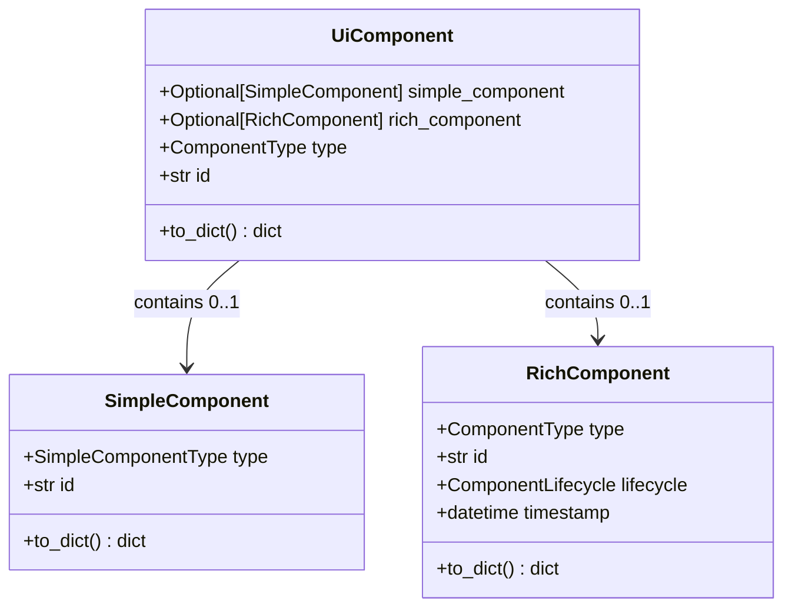
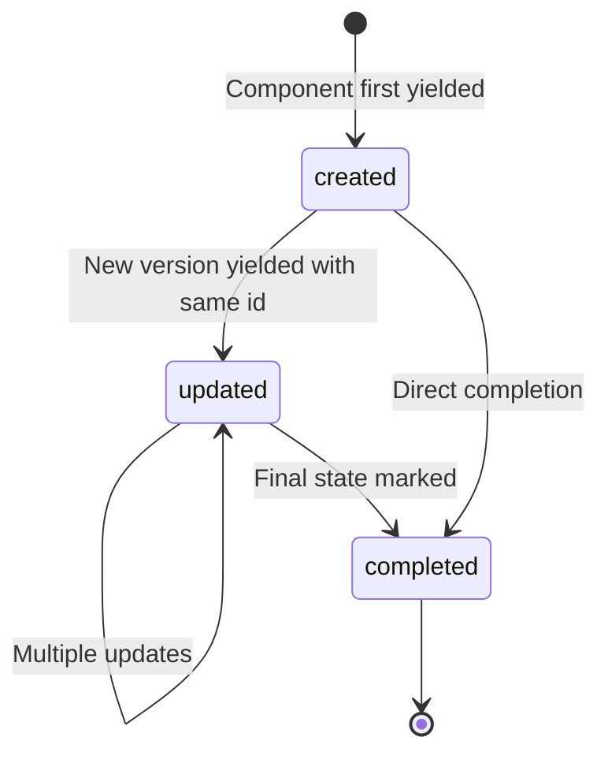
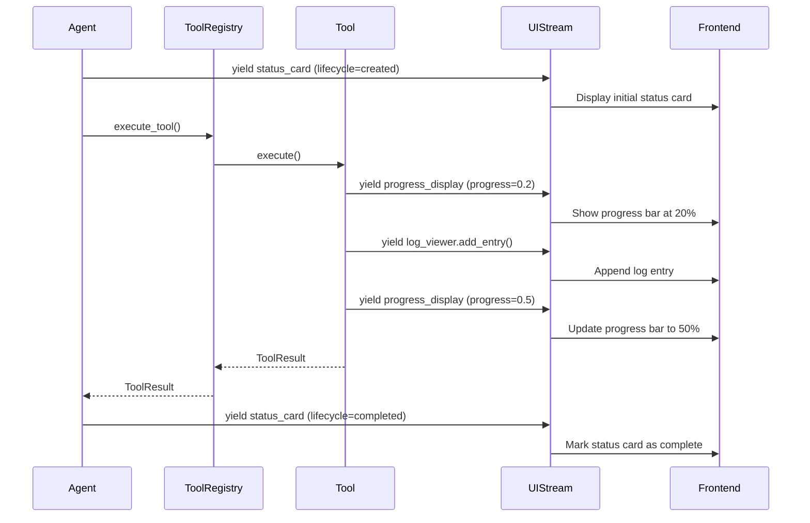
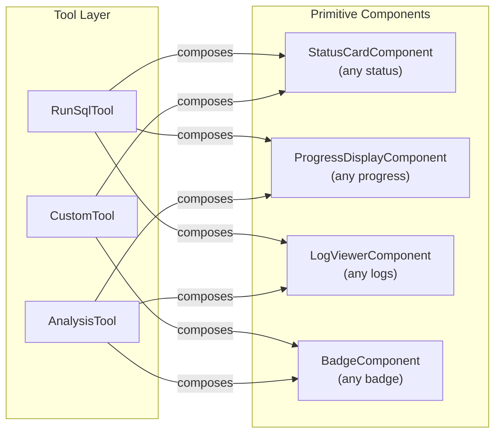
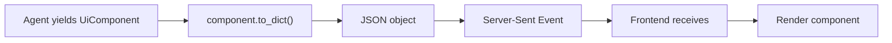

<!-- source: DeepWiki mcp.deepwiki.com · repo vanna-ai/vanna · page 9.1 UiComponent System · fetched 2026-10-29 -->

# UiComponent System

<details>
<summary>Relevant source files</summary>

The following files were used as context for generating this wiki page:

- [src/vanna/components/__init__.py](src/vanna/components/__init__.py)
- [src/vanna/components/rich/__init__.py](src/vanna/components/rich/__init__.py)
- [src/vanna/components/rich/specialized/__init__.py](src/vanna/components/rich/specialized/__init__.py)
- [src/vanna/examples/mock_rich_components_demo.py](src/vanna/examples/mock_rich_components_demo.py)
- [src/vanna/examples/primitive_components_demo.py](src/vanna/examples/primitive_components_demo.py)

</details>


## Purpose and Scope

This document explains the UiComponent system, which provides a structured way for Vanna agents to emit rich, interactive user interface elements during message processing. The system defines an abstraction layer between agent logic and UI rendering, enabling agents to stream progress updates, display structured data, and provide interactive controls to users.

This page covers the base `UiComponent` abstraction, the distinction between `SimpleComponent` and `RichComponent`, and the component lifecycle model. For specific component implementations, see:
- Feedback components: [9.2](#9.2)
- Interactive components: [9.3](#9.3)
- Data and container components: [9.4](#9.4)

For information about how agents yield components during message processing, see [Agent System](#2.1).

---

## Overview

The UiComponent system serves as the primary mechanism for agents to communicate rich, structured output to users. Instead of returning plain text, agents yield a stream of `UiComponent` instances that represent UI elements such as status cards, progress bars, data tables, charts, and interactive controls.

**Key Design Goals:**

1. **Separation of Concerns**: UI components are purely presentational, containing no business logic
2. **Streaming Support**: Components are yielded progressively as work completes, not all at once
3. **Statefulness**: Components can be updated by yielding new instances with the same `id`
4. **Type Safety**: Pydantic-based models ensure component data integrity
5. **Extensibility**: New component types can be added without modifying core agent logic

**Sources:** [src/vanna/components/__init__.py:1-92](), [src/vanna/examples/primitive_components_demo.py:1-306]()

---

## Component Architecture

The component system uses a hierarchical type structure with three layers:

```mermaid
graph TB
    subgraph "Base Layer"
        UiComponent["UiComponent<br/>(base wrapper)"]
    end
    
    subgraph "Component Type Layer"
        SimpleComponent["SimpleComponent<br/>(text, image, link)"]
        RichComponent["RichComponent<br/>(stateful, updateable)"]
    end
    
    subgraph "Concrete Components"
        SimpleTextComponent["SimpleTextComponent"]
        SimpleImageComponent["SimpleImageComponent"]
        SimpleLinkComponent["SimpleLinkComponent"]
        
        StatusCardComponent["StatusCardComponent"]
        ProgressDisplayComponent["ProgressDisplayComponent"]
        LogViewerComponent["LogViewerComponent"]
        DataFrameComponent["DataFrameComponent"]
        ChartComponent["ChartComponent"]
        TaskListComponent["TaskListComponent"]
        ButtonComponent["ButtonComponent"]
        BadgeComponent["BadgeComponent"]
        OtherRich["... other rich components"]
    end
    
    UiComponent -->|contains| SimpleComponent
    UiComponent -->|contains| RichComponent
    
    SimpleComponent -.->|subclass| SimpleTextComponent
    SimpleComponent -.->|subclass| SimpleImageComponent
    SimpleComponent -.->|subclass| SimpleLinkComponent
    
    RichComponent -.->|subclass| StatusCardComponent
    RichComponent -.->|subclass| ProgressDisplayComponent
    RichComponent -.->|subclass| LogViewerComponent
    RichComponent -.->|subclass| DataFrameComponent
    RichComponent -.->|subclass| ChartComponent
    RichComponent -.->|subclass| TaskListComponent
    RichComponent -.->|subclass| ButtonComponent
    RichComponent -.->|subclass| BadgeComponent
    RichComponent -.->|subclass| OtherRich
```



**Component Type Hierarchy:**

| Layer | Class | Purpose | Mutability |
|-------|-------|---------|------------|
| **Base** | `UiComponent` | Wrapper that holds either a `SimpleComponent` or `RichComponent` | Immutable wrapper |
| **Type** | `SimpleComponent` | Lightweight components for basic content | Immutable |
| **Type** | `RichComponent` | Complex components with lifecycle management | Updateable via `id` |
| **Concrete** | Various | Specific UI elements like status cards, progress bars, etc. | Varies by type |

**Sources:** [src/vanna/components/__init__.py:1-92](), [src/vanna/components/rich/__init__.py:1-84]()

---

## UiComponent Base Class

The `UiComponent` class is the base wrapper that agents yield. It contains either a `SimpleComponent` or a `RichComponent`, but never both.

### Structure



### Usage Pattern

Agents yield `UiComponent` instances by wrapping concrete component types:

```python
# Simple component (from examples/mock_rich_components_demo.py)
yield UiComponent(
    rich_component=IconTextComponent(
        id="welcome-message",
        icon="👋",
        text=f"Hello {user.username}!",
        variant="primary",
        size="large",
    )
)

# Rich component with status
yield UiComponent(
    rich_component=StatusCardComponent(
        id="processing-status",
        title="Processing Request",
        status="running",
        description="Processing your request...",
        icon="⚙️",
    )
)
```

**Key Properties:**

- **`simple_component`**: Contains a `SimpleComponent` instance if this is a simple component
- **`rich_component`**: Contains a `RichComponent` instance if this is a rich component
- **`type`**: Automatically derived from the contained component's type
- **`id`**: Automatically derived from the contained component's id

**Sources:** [src/vanna/components/__init__.py:1-13](), [src/vanna/examples/mock_rich_components_demo.py:48-76]()

---

## SimpleComponent vs RichComponent

The component system distinguishes between two fundamental component categories:

### SimpleComponent

**Purpose:** Lightweight, immutable components for basic content display.

**Characteristics:**
- **Immutable**: Cannot be updated after creation
- **No lifecycle**: No `created`, `updated`, or `completed` states
- **Lightweight**: Minimal metadata overhead
- **Basic types**: Text, images, links

**Component Types:**

| Type | Class | Purpose |
|------|-------|---------|
| `text` | `SimpleTextComponent` | Plain or markdown text |
| `image` | `SimpleImageComponent` | Image display with URL |
| `link` | `SimpleLinkComponent` | Clickable links |

**Example:**
```python
# From component exports (inferred usage)
SimpleTextComponent(
    id="greeting",
    type=SimpleComponentType.TEXT,
    content="Hello, world!",
    markdown=False
)
```

### RichComponent

**Purpose:** Complex, stateful components that can be updated and have lifecycle management.

**Characteristics:**
- **Updateable**: Can emit updated versions with the same `id` to replace previous instances
- **Lifecycle management**: Tracks `created`, `updated`, `completed` states via `ComponentLifecycle`
- **Timestamps**: Automatic timestamp tracking for updates
- **Rich metadata**: Includes status, progress, and other domain-specific fields

**Component Categories:**

| Category | Examples | Purpose |
|----------|----------|---------|
| **Feedback** | `StatusCardComponent`, `ProgressBarComponent`, `LogViewerComponent` | Status indicators and progress tracking |
| **Interactive** | `TaskListComponent`, `ButtonComponent`, `ButtonGroupComponent` | User interaction elements |
| **Data** | `DataFrameComponent`, `ChartComponent` | Structured data display |
| **Container** | `CardComponent` | Layout and grouping |
| **Specialized** | `ArtifactComponent` | Domain-specific functionality |

**Sources:** [src/vanna/components/__init__.py:1-92](), [src/vanna/components/rich/__init__.py:1-84]()

---

## ComponentLifecycle and Statefulness

Rich components use the `ComponentLifecycle` enum to track their state through their lifetime:



### ComponentLifecycle States

| State | Meaning | Usage |
|-------|---------|-------|
| `created` | Component is first emitted | Initial yield with new `id` |
| `updated` | Component state has changed | Yield updated version with existing `id` |
| `completed` | Component is in final state | Mark as finished, no more updates expected |

### Update Pattern

Components are updated by yielding a new instance with the same `id` but modified fields:

```python
# From examples/primitive_components_demo.py:97-104
# Initial creation
status_card = StatusCardComponent(
    id="operation-status",
    title="Data Analysis Pipeline",
    status="running",
    description="Processing data...",
    icon="⚙️",
)
yield UiComponent(rich_component=status_card)

# Later: update by yielding new instance with same id
yield UiComponent(
    rich_component=status_card.set_status(
        "success", 
        "Processing completed!"
    )
)
```

The `set_status()` method and similar update methods create a new component instance with:
- **Same `id`**: Identifies which component to replace
- **Updated `lifecycle`**: Automatically set to `updated`
- **New `timestamp`**: Reflects the update time
- **Modified fields**: Changed status, description, or other properties

**Sources:** [src/vanna/components/rich/__init__.py:1-84](), [src/vanna/examples/primitive_components_demo.py:95-140]()

---

## Component Streaming and Agent Integration

### Streaming Model

Agents yield components progressively during message processing, enabling real-time UI updates:



### Component Emission Pattern

The agent's `send_message()` method yields components throughout execution:

```python
# Pattern from examples/primitive_components_demo.py:45-75
async def send_message(
    self,
    user: User,
    message: str,
    *,
    conversation_id: Optional[str] = None,
) -> AsyncGenerator[UiComponent, None]:
    """Send message and yield UiComponents as work progresses."""
    
    # Initial status
    yield UiComponent(
        rich_component=StatusCardComponent(
            id="operation",
            title="Processing",
            status="running"
        )
    )
    
    # Progress updates
    for step in steps:
        # Update progress
        yield UiComponent(
            rich_component=progress.update_progress(step.value)
        )
        
        # Add logs
        yield UiComponent(
            rich_component=logs.add_entry(step.message)
        )
    
    # Final status
    yield UiComponent(
        rich_component=status.set_status("success", "Complete!")
    )
```

**Key Patterns:**

1. **Progressive Disclosure**: Yield components as information becomes available
2. **ID-based Updates**: Re-yield components with same `id` to update them
3. **Parallel Tracking**: Multiple components (status, progress, logs) can update independently
4. **Lifecycle Signaling**: Use `completed` lifecycle to indicate no more updates

**Sources:** [src/vanna/examples/primitive_components_demo.py:34-217](), [src/vanna/examples/mock_rich_components_demo.py:35-311]()

---

## Design Philosophy: Domain-Agnostic Primitives

The component system follows a **primitive composition** design philosophy where components are domain-agnostic building blocks rather than semantically-coupled tool-specific components.

### Before vs After

| Approach | Component Design | Example |
|----------|------------------|---------|
| **Before (Semantic)** | Tool-specific components | `ToolExecutionCard`, `SqlQueryProgress`, `DataAnalysisStatus` |
| **After (Primitive)** | Domain-agnostic primitives | `StatusCardComponent`, `ProgressDisplayComponent`, `LogViewerComponent` |

### Benefits of Primitive Components



**Advantages:**

1. **Reusability**: A `StatusCardComponent` works for any process (SQL execution, data analysis, API calls)
2. **Separation of Concerns**: UI components contain no business logic
3. **Composability**: Tools combine primitives to build exactly the UI they need
4. **Maintainability**: Changes to business logic don't affect component definitions
5. **Extensibility**: New tools don't require new component types

**Example from Demo:**

```python
# From examples/primitive_components_demo.py:186-217
# Tool composes UI from primitives, not semantic components
tool_status = StatusCardComponent(
    id="demo-tool",
    title="Analyze Data Tool",  # Tool-specific title
    status="running",            # Generic status primitive
    description="Running regression analysis",  # Tool-specific description
    icon="🔬"
)

tool_progress = ProgressDisplayComponent(
    id="tool-progress",
    label="Tool Execution",      # Generic label
    value=0.0,                   # Generic progress value
    description="Initializing tool..."
)

tool_logs = LogViewerComponent(
    id="tool-logs",
    title="Tool Execution Log"   # Tool-specific title
)
```

The same primitive components (`StatusCard`, `ProgressDisplay`, `LogViewer`) can be used by any tool with tool-specific content, avoiding the need for tool-specific component types like `SqlQueryCard` or `AnalysisProgressBar`.

**Sources:** [src/vanna/examples/primitive_components_demo.py:182-217](), [src/vanna/examples/mock_rich_components_demo.py:186-236]()

---

## Component Serialization

All components implement `to_dict()` for serialization to JSON, enabling transmission over HTTP/WebSocket:

### Serialization Pattern



### Serialized Format

Each component serializes to a dictionary with standard fields:

| Field | Type | Description |
|-------|------|-------------|
| `type` | `str` | Component type identifier (e.g., `"status_card"`, `"progress_display"`) |
| `id` | `str` | Unique identifier for update tracking |
| `lifecycle` | `str` | `"created"`, `"updated"`, or `"completed"` (rich components only) |
| `timestamp` | `str` | ISO-8601 timestamp (rich components only) |
| `...` | varies | Component-specific fields |

**Example Serialization:**

```python
# Component instance
status = StatusCardComponent(
    id="status-1",
    title="Processing",
    status="running",
    description="Analyzing data...",
    icon="⚙️"
)

# Serialized form (conceptual)
{
    "type": "status_card",
    "id": "status-1",
    "lifecycle": "created",
    "timestamp": "2024-01-15T10:30:00Z",
    "title": "Processing",
    "status": "running",
    "description": "Analyzing data...",
    "icon": "⚙️"
}
```

This serialized format is transmitted to the frontend via Server-Sent Events (SSE), WebSocket, or polling protocols. See [Communication Protocols](#8.4) for details on transport mechanisms.

**Sources:** [src/vanna/components/__init__.py:4-13](), [src/vanna/components/rich/__init__.py:1-84]()

---

## Component Type Registry

The component system exports all component types from a centralized location for easy import:

### Import Structure

```python
# From src/vanna/components/__init__.py
from vanna.components import (
    # Base
    UiComponent,
    
    # Simple components
    SimpleComponent,
    SimpleTextComponent,
    SimpleImageComponent,
    SimpleLinkComponent,
    
    # Rich components - Base
    RichComponent,
    ComponentType,
    ComponentLifecycle,
    
    # Rich components - Categories
    StatusCardComponent,
    ProgressBarComponent,
    DataFrameComponent,
    ChartComponent,
    TaskListComponent,
    ButtonComponent,
    # ... and many more
)
```

### Component Organization

Components are organized into subpackages by category:

| Subpackage | Path | Components |
|------------|------|------------|
| **Simple** | `vanna.components.simple` | Text, Image, Link |
| **Rich - Text** | `vanna.components.rich.text` | `RichTextComponent` |
| **Rich - Data** | `vanna.components.rich.data` | `DataFrameComponent`, `ChartComponent` |
| **Rich - Feedback** | `vanna.components.rich.feedback` | Status cards, progress bars, logs, badges |
| **Rich - Interactive** | `vanna.components.rich.interactive` | Task lists, buttons, input updates |
| **Rich - Containers** | `vanna.components.rich.containers` | `CardComponent` |
| **Rich - Specialized** | `vanna.components.rich.specialized` | `ArtifactComponent` |

**Sources:** [src/vanna/components/__init__.py:1-92](), [src/vanna/components/rich/__init__.py:1-84](), [src/vanna/components/rich/specialized/__init__.py:1-8]()

---

## Summary

The UiComponent system provides a flexible, type-safe framework for agents to emit structured UI elements during message processing:

**Key Concepts:**

1. **Base Wrapper**: `UiComponent` wraps either `SimpleComponent` or `RichComponent`
2. **Two Component Types**: Simple (immutable, lightweight) vs Rich (stateful, updateable)
3. **Lifecycle Management**: Rich components use `ComponentLifecycle` for state tracking
4. **Streaming**: Components are yielded progressively as work completes
5. **ID-based Updates**: Re-yield components with same `id` to update them
6. **Primitive Composition**: Domain-agnostic building blocks, not tool-specific types
7. **Serialization**: All components serialize to JSON for transport

For detailed information on specific component types:
- Feedback components (status, progress, logs): [9.2](#9.2)
- Interactive components (tasks, buttons): [9.3](#9.3)  
- Data and container components (tables, charts, cards): [9.4](#9.4)

**Sources:** [src/vanna/components/__init__.py:1-92](), [src/vanna/components/rich/__init__.py:1-84](), [src/vanna/examples/primitive_components_demo.py:1-306](), [src/vanna/examples/mock_rich_components_demo.py:1-397]()

---

