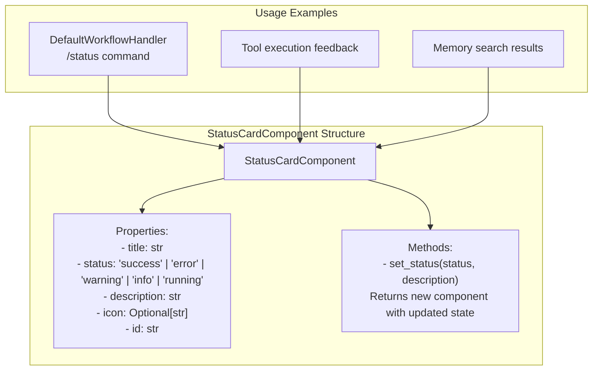
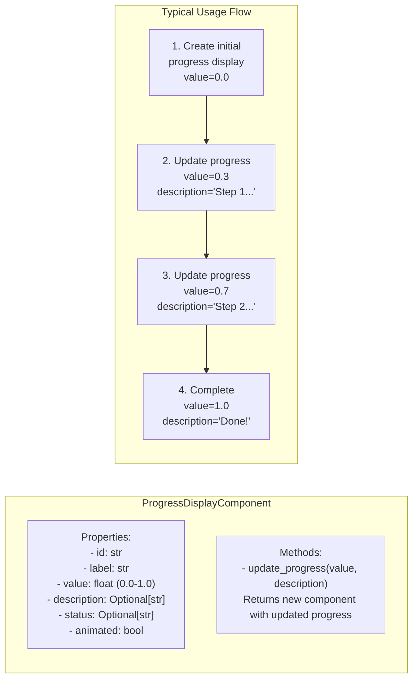
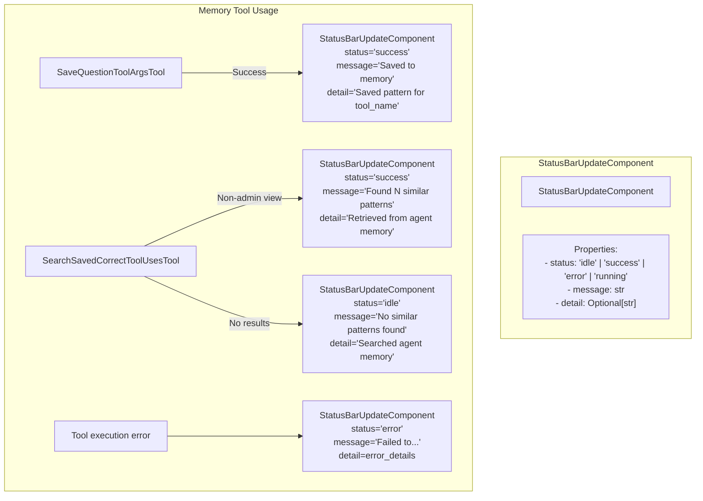
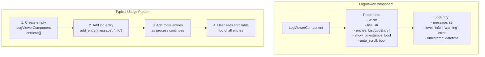
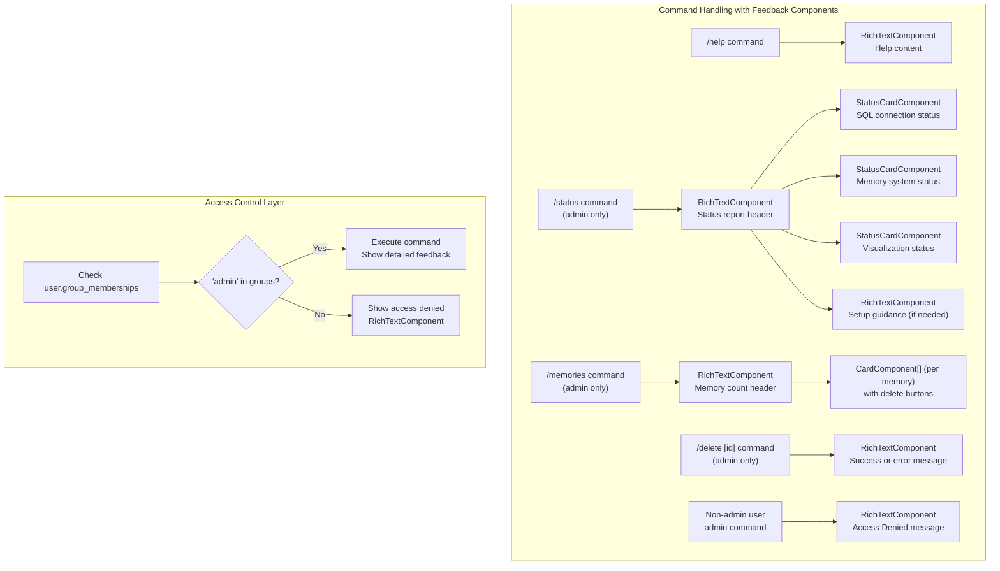
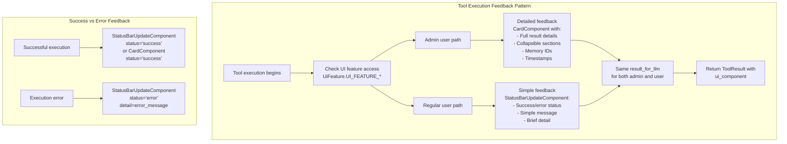
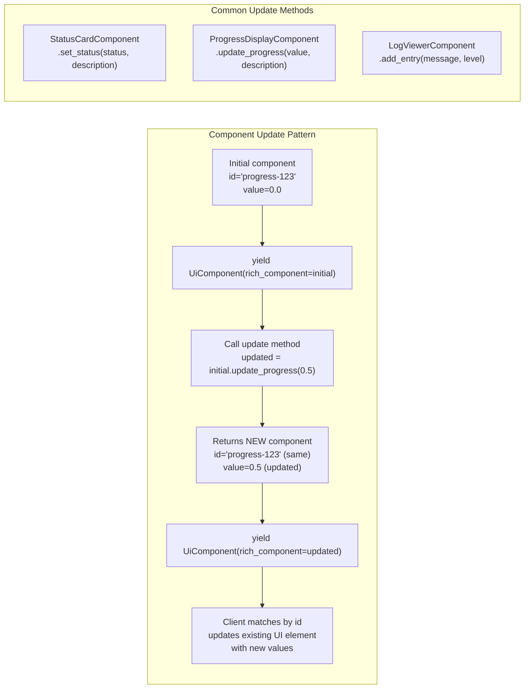
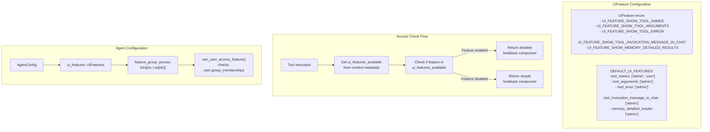

<!-- source: DeepWiki mcp.deepwiki.com · repo vanna-ai/vanna · page 9.2 Feedback Components · fetched 2026-10-29 -->

# Feedback Components

<details>
<summary>Relevant source files</summary>

The following files were used as context for generating this wiki page:

- [src/vanna/components/__init__.py](src/vanna/components/__init__.py)
- [src/vanna/components/rich/__init__.py](src/vanna/components/rich/__init__.py)
- [src/vanna/components/rich/containers/card.py](src/vanna/components/rich/containers/card.py)
- [src/vanna/components/rich/specialized/__init__.py](src/vanna/components/rich/specialized/__init__.py)
- [src/vanna/core/workflow/base.py](src/vanna/core/workflow/base.py)
- [src/vanna/core/workflow/default.py](src/vanna/core/workflow/default.py)
- [src/vanna/examples/mock_rich_components_demo.py](src/vanna/examples/mock_rich_components_demo.py)
- [src/vanna/examples/primitive_components_demo.py](src/vanna/examples/primitive_components_demo.py)
- [tests/test_memory_tools.py](tests/test_memory_tools.py)
- [tests/test_workflow.py](tests/test_workflow.py)

</details>


## Purpose and Scope

This page documents the feedback component system in Vanna, which provides user-facing status indicators, progress displays, and informational messages. Feedback components are purely presentational, domain-agnostic UI primitives that tools and workflows use to communicate execution state, progress, and results to users.

For general information about the UI component system and the `UiComponent` wrapper, see [UiComponent System](#9.1). For interactive components like buttons and task lists, see [Interactive Components](#9.3). For data display components like tables and charts, see [Data and Container Components](#9.4).

## Component Overview

Feedback components provide non-interactive visual feedback to users during agent and tool execution. All feedback components inherit from `RichComponent` [src/vanna/core/rich_component.py]() and use the `ComponentType` enum to identify their type.

The feedback component family includes:

| Component | Purpose | Primary Use Case |
|-----------|---------|------------------|
| `StatusCardComponent` | Display operation status with icon and description | Tool execution status, setup health checks |
| `ProgressDisplayComponent` | Show numerical progress with label and description | Long-running operations, multi-step processes |
| `ProgressBarComponent` | Visual progress bar indicator | Alternative to ProgressDisplayComponent |
| `StatusIndicatorComponent` | Compact status indicator | Inline status displays |
| `NotificationComponent` | User notifications and alerts | Success/error/warning messages |
| `StatusBarUpdateComponent` | Update persistent status bar | Background task status |
| `LogViewerComponent` | Display structured log entries | Detailed execution logs |
| `BadgeComponent` | Small status or category labels | Tags, stages, metadata |
| `IconTextComponent` | Icon paired with text | Compact information display |

**Sources:** [src/vanna/components/rich/__init__.py:15-26](), [src/vanna/components/__init__.py:26-36]()

## Status Components

### StatusCardComponent

`StatusCardComponent` displays operation status in a card format with title, status indicator, description, and optional icon. This is the primary component for showing tool execution status and system health.



**Key characteristics:**
- **Immutable updates**: `set_status()` returns a new component instance with updated values [src/vanna/examples/mock_rich_components_demo.py:72-76]()
- **Status variants**: `"success"`, `"error"`, `"warning"`, `"info"`, `"running"`, `"completed"`
- **Icon support**: Emoji or text icons for visual identification
- **Lifecycle tracking**: Components include `id` for updates

**Common usage pattern in workflows:**

The `DefaultWorkflowHandler` uses `StatusCardComponent` extensively for the `/status` command to display setup health:

```
# SQL Tool Status (Critical)
StatusCardComponent(
    title="SQL Connection",
    status="success",
    description="Database connection configured and ready",
    icon="✅",
)

# Memory Tools Status (Important)
StatusCardComponent(
    title="Memory System",
    status="warning",
    description="Partial memory setup - both search and save tools recommended",
    icon="⚠️",
)
```

**Sources:** [src/vanna/core/workflow/default.py:336-396](), [src/vanna/examples/mock_rich_components_demo.py:58-76](), [tests/test_workflow.py:119-128]()

### ProgressDisplayComponent

`ProgressDisplayComponent` shows numerical progress (0.0 to 1.0) with label, description, and optional animation for long-running operations.



**Usage example from primitive components demo:**

```python
# Initial creation
progress = ProgressDisplayComponent(
    id="demo-progress",
    label="Overall Progress",
    value=0.0,
    description="Starting analysis...",
    animated=True,
)
yield UiComponent(rich_component=progress)

# Updates during execution
yield UiComponent(
    rich_component=progress.update_progress(
        0.5, "Step 2 of 5: Processing data..."
    )
)
```

**Sources:** [src/vanna/examples/primitive_components_demo.py:66-110](), [src/vanna/examples/mock_rich_components_demo.py:109-137]()

### ProgressBarComponent and StatusIndicatorComponent

`ProgressBarComponent` provides an alternative visual progress representation, while `StatusIndicatorComponent` offers a compact status display for inline use.

These components follow the same immutable update pattern as other feedback components.

**Sources:** [src/vanna/components/rich/__init__.py:19-22]()

## Notification Components

### NotificationComponent

`NotificationComponent` displays user-facing notifications for success, error, warning, or informational messages. Typically used for transient messages that don't require persistent display.

### StatusBarUpdateComponent

`StatusBarUpdateComponent` updates a persistent status bar, commonly used for background task status or tool execution feedback. This component is heavily used by memory tools to provide user feedback.



**Access control consideration:**

`StatusBarUpdateComponent` is used as the non-admin view for memory search results, while admin users see detailed `CardComponent` displays. This pattern implements UI feature access control without changing the LLM's information:

```python
# Check if user has access to detailed results
show_detailed_results = (
    UiFeature.UI_FEATURE_SHOW_MEMORY_DETAILED_RESULTS
    in ui_features_available
)

if show_detailed_results:
    # Admin view: detailed CardComponent
    ui_component = UiComponent(rich_component=CardComponent(...))
else:
    # Non-admin view: simple StatusBarUpdateComponent
    ui_component = UiComponent(rich_component=StatusBarUpdateComponent(...))
```

**Sources:** [src/vanna/tools/agent_memory.py:89-117](), [src/vanna/tools/agent_memory.py:176-186](), [tests/test_memory_tools.py:100-143]()

## Display Components

### LogViewerComponent

`LogViewerComponent` displays structured log entries with timestamps, levels, and auto-scrolling support. Used for detailed execution logs during multi-step processes.



**Usage example:**

```python
# Create log viewer
log_viewer = LogViewerComponent(
    id="analysis-logs",
    title="Analysis Log",
    entries=[],
    show_timestamps=True,
    auto_scroll=True,
)
yield UiComponent(rich_component=log_viewer)

# Add entries as work progresses
yield UiComponent(
    rich_component=log_viewer.add_entry("Starting data loading", "info")
)
yield UiComponent(
    rich_component=log_viewer.add_entry("Data loaded: 1000 rows", "info")
)
yield UiComponent(
    rich_component=log_viewer.add_entry("Analysis complete", "info")
)
```

**Sources:** [src/vanna/examples/primitive_components_demo.py:76-139](), [src/vanna/examples/mock_rich_components_demo.py:120-152]()

### BadgeComponent

`BadgeComponent` displays small, compact status or category labels. Commonly used for tags, stage indicators, or metadata display.

**Properties:**
- `text`: str - Badge text
- `variant`: `"primary"` | `"success"` | `"warning"` | `"error"` | `"default"` | `"secondary"`
- `size`: `"small"` | `"medium"` | `"large"`
- `icon`: Optional[str] - Optional emoji or icon

**Common usage:**

```python
BadgeComponent(
    text="Complete",
    variant="success",
    size="medium",
    icon="✅"
)
```

**Sources:** [src/vanna/examples/primitive_components_demo.py:150-158](), [src/vanna/examples/mock_rich_components_demo.py:89-106]()

### IconTextComponent

`IconTextComponent` pairs an icon with text for compact information display. Useful for results, metrics, or status messages.

**Properties:**
- `icon`: str - Emoji or icon character
- `text`: str - Text content
- `variant`: `"primary"` | `"default"` | `"secondary"` | `"success"`
- `size`: `"small"` | `"medium"` | `"large"`

**Example usage:**

```python
IconTextComponent(
    icon="📊",
    text="Data Analysis Complete",
    variant="primary",
    size="large",
)
```

**Sources:** [src/vanna/examples/primitive_components_demo.py:161-180](), [src/vanna/examples/mock_rich_components_demo.py:48-56]()

## Workflow Integration

The `DefaultWorkflowHandler` demonstrates comprehensive feedback component usage for command handling and system status display.



**Status command implementation:**

The `/status` command uses multiple feedback components to provide comprehensive system health information:

1. **Status report header** (RichTextComponent): Overall system status summary
2. **Individual status cards** (StatusCardComponent): Per-component health (SQL, Memory, Visualization)
3. **Setup guidance** (RichTextComponent): Code examples for missing components (if applicable)

**Sources:** [src/vanna/core/workflow/default.py:95-113](), [src/vanna/core/workflow/default.py:332-510](), [tests/test_workflow.py:114-128]()

## Tool Feedback Patterns

Tools use feedback components to provide real-time execution status and results to users. The memory tools demonstrate canonical patterns.



**Memory search tool example:**

The `SearchSavedCorrectToolUsesTool` demonstrates the dual-feedback pattern:

```python
# Check UI feature access
ui_features_available = context.metadata.get("ui_features_available", [])
show_detailed_results = (
    UiFeature.UI_FEATURE_SHOW_MEMORY_DETAILED_RESULTS
    in ui_features_available
)

if show_detailed_results:
    # Admin view: detailed CardComponent
    ui_component = UiComponent(
        rich_component=CardComponent(
            title=f"🧠 Memory Search: {len(results)} Result(s)",
            content=detailed_content,  # Includes all memory details
            icon="🔍",
            status="info",
            collapsible=True,
            collapsed=True,
            markdown=True,
        )
    )
else:
    # Non-admin view: simple StatusBarUpdateComponent
    ui_component = UiComponent(
        rich_component=StatusBarUpdateComponent(
            status="success",
            message=f"Found {len(results)} similar pattern(s)",
            detail="Retrieved from agent memory",
        )
    )

# Both paths return same result_for_llm
return ToolResult(
    success=True,
    result_for_llm=results_text,  # Same for admin and user
    ui_component=ui_component,      # Different based on access
)
```

**Key principle:** The LLM receives identical information regardless of UI feature access. Only the user-facing presentation differs.

**Sources:** [src/vanna/tools/agent_memory.py:134-252](), [tests/test_memory_tools.py:45-143]()

## Component Lifecycle and Updates

Feedback components follow an immutable update pattern using the `ComponentLifecycle` enum and component `id` for tracking.



**Component identity:** All feedback components include an `id` property. When a component with the same `id` is yielded multiple times, the client updates the existing UI element rather than creating a new one.

**Update methods return new instances:**
- `StatusCardComponent.set_status()` returns a new component with updated status and description
- `ProgressDisplayComponent.update_progress()` returns a new component with updated value and description
- `LogViewerComponent.add_entry()` returns a new component with an additional log entry

**Sources:** [src/vanna/examples/mock_rich_components_demo.py:59-76](), [src/vanna/examples/primitive_components_demo.py:100-110]()

## UI Feature Access Control

Feedback components respect UI feature access control defined in `AgentConfig.ui_features`. The `UiFeature` enum defines which features are available to which user groups.



**Configuration example:**

```python
# Agent configuration with UI features
config = AgentConfig(
    ui_features=UiFeatures(
        feature_group_access={
            UiFeature.UI_FEATURE_SHOW_MEMORY_DETAILED_RESULTS: ["admin"],
            UiFeature.UI_FEATURE_SHOW_TOOL_ARGUMENTS: ["admin"],
            UiFeature.UI_FEATURE_SHOW_TOOL_ERROR: ["admin", "developer"],
        }
    )
)
```

**Tool implementation pattern:**

```python
# Tools receive ui_features_available in context.metadata
ui_features_available = context.metadata.get("ui_features_available", [])

# Check specific feature
if UiFeature.UI_FEATURE_SHOW_MEMORY_DETAILED_RESULTS in ui_features_available:
    # Show detailed feedback with CardComponent
    return detailed_component
else:
    # Show simple feedback with StatusBarUpdateComponent
    return simple_component
```

**Sources:** [src/vanna/core/agent/config.py:17-32](), [src/vanna/tools/agent_memory.py:153-246](), [tests/test_memory_tools.py:46-143]()

## Best Practices

### 1. Component Selection

Choose feedback components based on the information complexity and user needs:

| Use Case | Recommended Component | Rationale |
|----------|----------------------|-----------|
| Tool execution status | `StatusCardComponent` | Shows title, status, description, icon |
| Progress updates | `ProgressDisplayComponent` | Numerical progress with descriptive text |
| Simple status messages | `StatusBarUpdateComponent` | Compact, non-intrusive updates |
| Detailed logs | `LogViewerComponent` | Structured, scrollable log entries |
| Success/error notifications | `NotificationComponent` | Transient user notifications |
| Tags or labels | `BadgeComponent` | Compact visual indicators |
| Result summaries | `IconTextComponent` | Icon + text pairs |

### 2. Immutable Updates

Always use component update methods to create new instances rather than modifying existing components:

```python
# Good: Use update method
progress = ProgressDisplayComponent(id="prog", label="Progress", value=0.0)
yield UiComponent(rich_component=progress)

updated = progress.update_progress(0.5, "Processing...")
yield UiComponent(rich_component=updated)

# Bad: Don't modify component properties directly
progress.value = 0.5  # This won't work as expected
```

### 3. Consistent ID Usage

Use consistent IDs for components that should update in place:

```python
# Same ID = updates existing component
status = StatusCardComponent(id="tool-status", title="Processing", status="running")
yield UiComponent(rich_component=status)

# Later, same ID updates the same UI element
yield UiComponent(
    rich_component=status.set_status("success", "Complete")
)
```

### 4. Access-Aware Feedback

Respect UI feature access control when providing feedback:

```python
# Check feature access
show_details = (
    UiFeature.UI_FEATURE_SHOW_MEMORY_DETAILED_RESULTS
    in context.metadata.get("ui_features_available", [])
)

# Provide appropriate component
if show_details:
    component = CardComponent(...)  # Detailed view for admins
else:
    component = StatusBarUpdateComponent(...)  # Simple view for users

# Important: LLM gets same information regardless
return ToolResult(
    result_for_llm=same_text_for_everyone,
    ui_component=UiComponent(rich_component=component)
)
```

### 5. Status Consistency

Use consistent status values across components:

- `"success"` - Operation completed successfully
- `"error"` - Operation failed
- `"warning"` - Operation completed with warnings
- `"info"` - Informational status
- `"running"` - Operation in progress
- `"idle"` - No active operation

**Sources:** [src/vanna/examples/primitive_components_demo.py:1-218](), [src/vanna/tools/agent_memory.py:76-322](), [src/vanna/core/workflow/default.py:332-510]()

---

