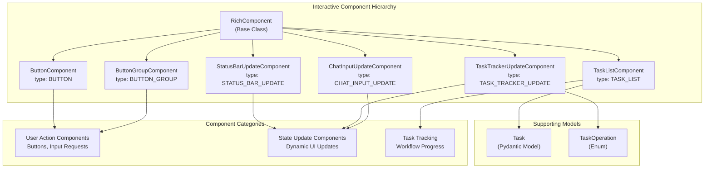
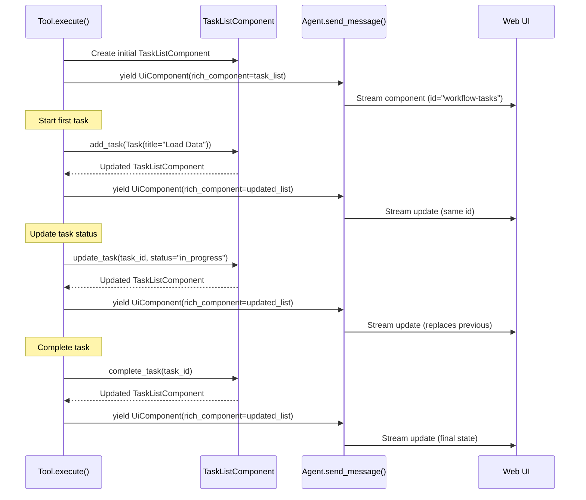
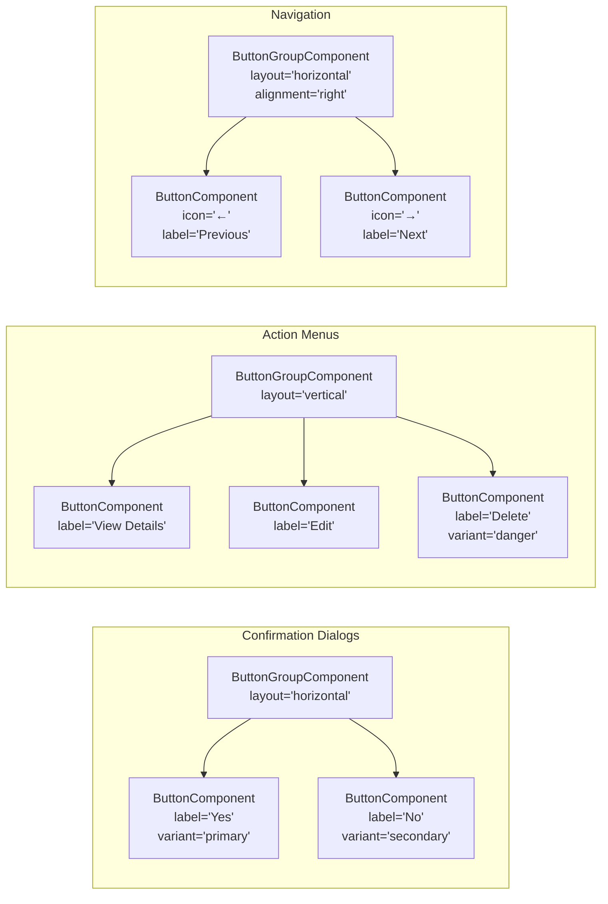
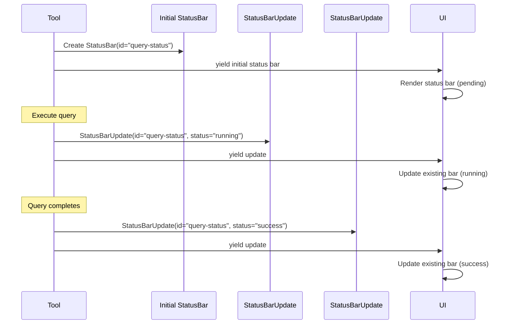
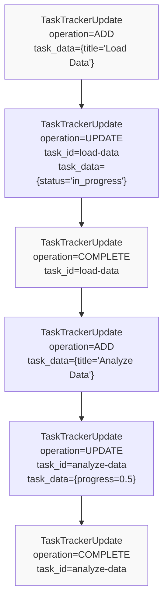
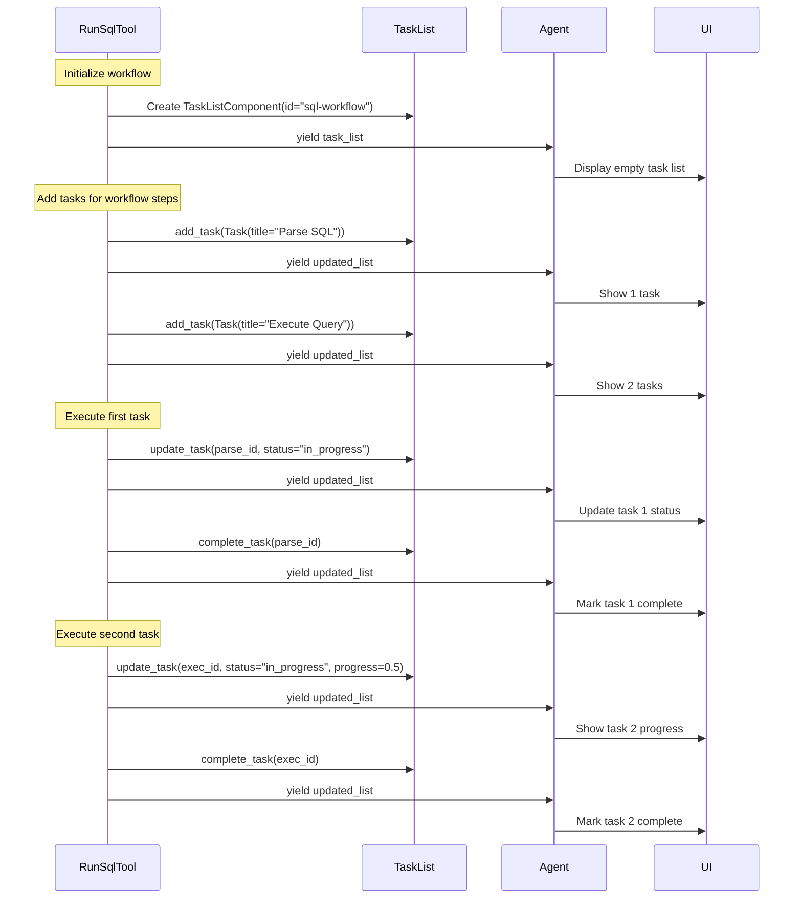
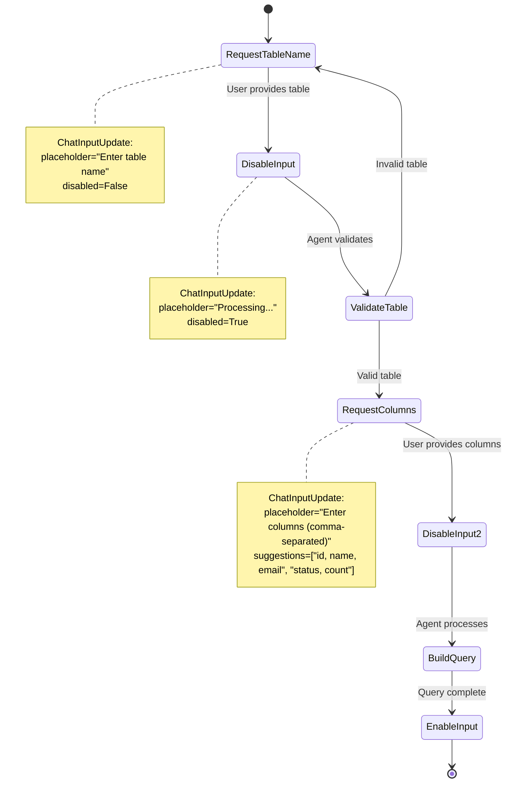
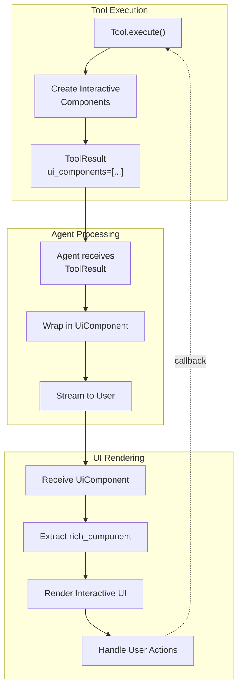
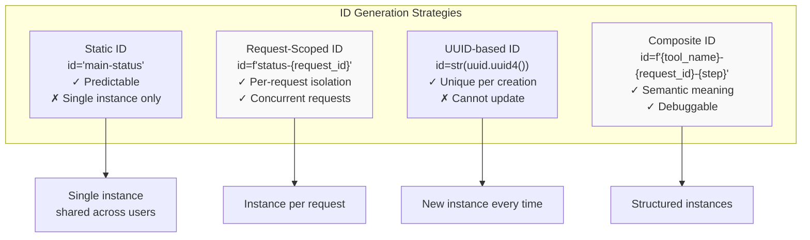

<!-- source: DeepWiki mcp.deepwiki.com · repo vanna-ai/vanna · page 9.3 Interactive Components · fetched 2026-10-29 -->

# Interactive Components

<details>
<summary>Relevant source files</summary>

The following files were used as context for generating this wiki page:

- [src/vanna/components/__init__.py](src/vanna/components/__init__.py)
- [src/vanna/components/rich/__init__.py](src/vanna/components/rich/__init__.py)
- [src/vanna/components/rich/interactive/task_list.py](src/vanna/components/rich/interactive/task_list.py)
- [src/vanna/components/rich/specialized/__init__.py](src/vanna/components/rich/specialized/__init__.py)
- [src/vanna/core/system_prompt/base.py](src/vanna/core/system_prompt/base.py)
- [src/vanna/core/system_prompt/default.py](src/vanna/core/system_prompt/default.py)
- [src/vanna/examples/mock_rich_components_demo.py](src/vanna/examples/mock_rich_components_demo.py)
- [src/vanna/examples/primitive_components_demo.py](src/vanna/examples/primitive_components_demo.py)

</details>


## Purpose and Scope

This page documents the interactive UI components in the Vanna Agents framework. Interactive components enable user interaction (buttons, input updates) and dynamic state updates (task tracking, status bars) within the agent interface. These components allow agents to build responsive, stateful UIs that update in real-time as workflows progress.

For static display components like status cards and progress displays, see [Feedback Components](#9.2). For data visualization and container components, see [Data and Container Components](#9.4). For the base component system architecture, see [UiComponent System](#9.1).

**Sources:** [src/vanna/components/rich/__init__.py:28-38](), [src/vanna/components/__init__.py:36-44]()

---

## Component Architecture Overview

Interactive components are specialized `RichComponent` instances that maintain internal state and support mutation operations. Unlike static feedback components, interactive components return new instances when updated, following an immutable update pattern that enables efficient UI reconciliation in streaming environments.



**Sources:** [src/vanna/components/rich/__init__.py:28-38](), [src/vanna/core/rich_component.py]()

---

## TaskListComponent and Task Model

### Task Model

The `Task` model represents an individual task in a workflow, with comprehensive tracking capabilities:

| Field | Type | Description | Default |
|-------|------|-------------|---------|
| `id` | `str` | Unique task identifier | Auto-generated UUID |
| `title` | `str` | Task title | Required |
| `description` | `Optional[str]` | Detailed description | `None` |
| `status` | `str` | Status: `"pending"`, `"in_progress"`, `"completed"`, `"error"` | `"pending"` |
| `progress` | `Optional[float]` | Progress value (0.0 to 1.0) | `None` |
| `created_at` | `str` | ISO timestamp of creation | Auto-generated |
| `completed_at` | `Optional[str]` | ISO timestamp of completion | `None` |
| `metadata` | `Dict[str, Any]` | Custom metadata | Empty dict |

**Sources:** [src/vanna/components/rich/interactive/task_list.py:10-21]()

### TaskListComponent

`TaskListComponent` provides interactive task tracking with real-time updates:

```python
class TaskListComponent(RichComponent):
    type: ComponentType = ComponentType.TASK_LIST
    title: str = "Tasks"
    tasks: List[Task] = []
    show_progress: bool = True
    allow_reorder: bool = False
    show_timestamps: bool = True
    filter_status: Optional[str] = None  # Filter by task status
```

**Key Methods:**

| Method | Signature | Description |
|--------|-----------|-------------|
| `add_task()` | `add_task(task: Task) -> TaskListComponent` | Adds a new task to the list, returns updated component |
| `update_task()` | `update_task(task_id: str, **updates) -> TaskListComponent` | Updates specific task fields by ID |
| `complete_task()` | `complete_task(task_id: str) -> TaskListComponent` | Marks task as completed with timestamp and 100% progress |

**Immutable Update Pattern:**

All mutation methods return new `TaskListComponent` instances rather than modifying in place. This enables efficient streaming updates where each component emission represents a discrete UI state change.

**Sources:** [src/vanna/components/rich/interactive/task_list.py:23-59]()

### Task Lifecycle Example



**Sources:** [src/vanna/components/rich/interactive/task_list.py:34-58]()

---

## Button Components

### ButtonComponent

`ButtonComponent` enables user interaction within agent workflows. Buttons can trigger callbacks, navigate to URLs, or send specific messages back to the agent.

**Component Structure:**

```python
class ButtonComponent(RichComponent):
    type: ComponentType = ComponentType.BUTTON
    label: str                          # Button text
    action: str                         # Action identifier or URL
    variant: str = "primary"            # Style: "primary", "secondary", "danger"
    size: str = "medium"                # Size: "small", "medium", "large"
    disabled: bool = False              # Interactive state
    icon: Optional[str] = None          # Optional icon (emoji or identifier)
    metadata: Dict[str, Any] = {}       # Custom action data
```

**Button Variants:**

| Variant | Use Case | Typical Actions |
|---------|----------|-----------------|
| `primary` | Main action | Confirm, Submit, Continue |
| `secondary` | Alternative action | Cancel, Back, Skip |
| `danger` | Destructive action | Delete, Remove, Reset |
| `success` | Positive action | Approve, Accept, Confirm |
| `warning` | Cautionary action | Retry, Override, Force |

**Sources:** [src/vanna/components/rich/__init__.py:36-37]()

### ButtonGroupComponent

`ButtonGroupComponent` groups related buttons into a single interactive unit:

```python
class ButtonGroupComponent(RichComponent):
    type: ComponentType = ComponentType.BUTTON_GROUP
    buttons: List[ButtonComponent]      # List of button components
    layout: str = "horizontal"          # "horizontal" or "vertical"
    spacing: str = "default"            # "tight", "default", "loose"
    alignment: str = "left"             # "left", "center", "right"
```

**Common Button Group Patterns:**



**Sources:** [src/vanna/components/rich/__init__.py:37-38]()

---

## Dynamic Update Components

Update components enable agents to modify existing UI elements in place without re-rendering the entire interface. These components use a target-based update model where the `id` field identifies which UI element to update.

### StatusBarUpdateComponent

Updates persistent status bars in the UI:

```python
class StatusBarUpdateComponent(RichComponent):
    type: ComponentType = ComponentType.STATUS_BAR_UPDATE
    id: str                             # Target status bar ID
    status: str                         # New status value
    message: Optional[str] = None       # Optional status message
    progress: Optional[float] = None    # Optional progress update (0.0-1.0)
    metadata: Dict[str, Any] = {}       # Additional state
```

**Update Sequence:**



**Sources:** [src/vanna/components/rich/__init__.py:32-33]()

### TaskTrackerUpdateComponent

Updates task tracker components with granular task operations:

```python
class TaskTrackerUpdateComponent(RichComponent):
    type: ComponentType = ComponentType.TASK_TRACKER_UPDATE
    id: str                             # Target task tracker ID
    operation: TaskOperation            # Operation type (enum)
    task_id: Optional[str] = None       # Target task ID (for updates)
    task_data: Optional[Dict] = None    # Task data (for add/update)
```

**TaskOperation Enum:**

| Operation | Description | Required Fields |
|-----------|-------------|----------------|
| `ADD` | Add new task | `task_data` |
| `UPDATE` | Update existing task | `task_id`, `task_data` |
| `REMOVE` | Remove task | `task_id` |
| `COMPLETE` | Mark task complete | `task_id` |
| `RESET` | Reset task to pending | `task_id` |
| `CLEAR_ALL` | Remove all tasks | None |

**Example: Multi-Step Workflow Updates**



**Sources:** [src/vanna/components/rich/__init__.py:33-35]()

### ChatInputUpdateComponent

Dynamically updates the chat input field to guide user interactions:

```python
class ChatInputUpdateComponent(RichComponent):
    type: ComponentType = ComponentType.CHAT_INPUT_UPDATE
    placeholder: Optional[str] = None   # Update placeholder text
    disabled: bool = False              # Enable/disable input
    value: Optional[str] = None         # Pre-fill input value
    suggestions: List[str] = []         # Show autocomplete suggestions
```

**Common Use Cases:**

| Scenario | Component Configuration | Purpose |
|----------|------------------------|---------|
| Request specific input | `placeholder="Enter table name..."`, `disabled=False` | Guide user to provide specific data |
| Disable during processing | `disabled=True`, `placeholder="Processing..."` | Prevent input while agent is working |
| Provide suggestions | `suggestions=["option1", "option2"]` | Offer autocomplete options |
| Pre-fill input | `value="SELECT * FROM users"` | Suggest starting point for modification |

**Sources:** [src/vanna/components/rich/__init__.py:34-35]()

---

## Usage Patterns and Best Practices

### Pattern 1: Progressive Task Workflow



**Sources:** [src/vanna/components/rich/interactive/task_list.py:34-58]()

### Pattern 2: Conditional Button Groups

Tools can dynamically generate button groups based on execution results:

```python
async def execute(self, context: ToolContext, args: SqlToolArgs) -> ToolResult:
    # Execute query
    result_df = await self.sql_runner.run_sql(args.sql)
    
    # Create conditional button group based on results
    if len(result_df) > 100:
        buttons = [
            ButtonComponent(
                label="View First 100",
                action="limit_100",
                variant="primary"
            ),
            ButtonComponent(
                label="Download Full Results",
                action="download_csv",
                variant="secondary"
            ),
            ButtonComponent(
                label="Visualize",
                action="create_chart",
                variant="secondary"
            )
        ]
    else:
        buttons = [
            ButtonComponent(
                label="Visualize",
                action="create_chart",
                variant="primary"
            )
        ]
    
    button_group = ButtonGroupComponent(
        id=f"actions-{context.request_id}",
        buttons=buttons,
        layout="horizontal"
    )
    
    return ToolResult(
        success=True,
        data=result_df,
        ui_components=[button_group]
    )
```

**Sources:** [src/vanna/components/rich/__init__.py:36-38]()

### Pattern 3: Input Guidance Flow

Agents can guide users through multi-step input collection:



**Sources:** [src/vanna/components/rich/__init__.py:34-35]()

### Pattern 4: Atomic Status Updates

Use `StatusBarUpdateComponent` for targeted updates without re-rendering entire status displays:

```python
# Initial setup - create status bar
initial_status = StatusCardComponent(
    id="query-execution",
    title="Query Execution",
    status="pending"
)
yield UiComponent(rich_component=initial_status)

# Atomic updates - only send changes
yield UiComponent(
    rich_component=StatusBarUpdateComponent(
        id="query-execution",
        status="running",
        message="Executing query...",
        progress=0.3
    )
)

# Another atomic update
yield UiComponent(
    rich_component=StatusBarUpdateComponent(
        id="query-execution",
        status="success",
        message="Query completed successfully",
        progress=1.0
    )
)
```

This pattern reduces network overhead and UI re-rendering compared to repeatedly yielding full `StatusCardComponent` instances.

**Sources:** [src/vanna/components/rich/__init__.py:32-33]()

---

## Integration with Agent Workflow

### Component Emission in Tools

Tools emit interactive components through `ToolResult.ui_components`:



**Sources:** [src/vanna/examples/primitive_components_demo.py:48-84](), [src/vanna/examples/mock_rich_components_demo.py:58-76]()

### Component Lifecycle Management

Interactive components follow a specific lifecycle pattern:

| Phase | Description | Example |
|-------|-------------|---------|
| **Create** | Initial component creation with unique ID | `TaskListComponent(id="workflow-123")` |
| **Update** | Emit updated component with same ID | `task_list.add_task(new_task)` |
| **Replace** | UI replaces previous component with matching ID | Client receives update, replaces in DOM |
| **Destroy** | Component removed when conversation ends | Garbage collection |

**ID Consistency:** All updates to a component must use the same `id` value. The UI layer uses component IDs to determine whether to create a new UI element or update an existing one.

**Sources:** [src/vanna/components/rich/interactive/task_list.py:34-58]()

---

## Error Handling and Edge Cases

### Invalid Task IDs

When updating non-existent tasks, `TaskListComponent.update_task()` silently ignores the update:

```python
# Task with ID "task-999" doesn't exist
updated_list = task_list.update_task("task-999", status="completed")
# Result: task_list unchanged, no error raised
```

**Best Practice:** Track task IDs when creating tasks and validate before updates.

### Button Action Routing

Button actions are string identifiers interpreted by the agent or server layer. Undefined actions may be logged but won't crash the system:

```python
# Undefined action
button = ButtonComponent(label="Mystery Action", action="undefined_action")
# Agent receives action but has no handler - logs warning
```

**Best Practice:** Document action identifiers and implement handlers in workflow system.

### Update Component Target Missing

Update components targeting non-existent IDs are ignored by the UI:

```python
# Status bar with ID "status-abc" was never created
update = StatusBarUpdateComponent(id="status-abc", status="success")
# UI receives update but finds no matching component - no-op
```

**Best Practice:** Always create initial component before emitting updates.

**Sources:** [src/vanna/components/rich/interactive/task_list.py:39-49]()

---

## Performance Considerations

### Update Granularity

| Approach | Network Overhead | UI Rendering | Use Case |
|----------|-----------------|--------------|----------|
| Full component re-emission | High (entire component) | Full re-render | Infrequent updates, complex state changes |
| Atomic updates (Update components) | Low (delta only) | Targeted update | Frequent updates, simple state changes |
| Batch updates | Medium (multiple deltas) | Multiple targeted updates | Coordinated multi-component updates |

**Recommendation:** Use `StatusBarUpdateComponent`, `TaskTrackerUpdateComponent`, and `ChatInputUpdateComponent` for frequent status updates. Use full component re-emission for structural changes (adding/removing tasks, reorganizing button groups).

### Component ID Strategy



**Best Practice:** Use request-scoped or composite IDs for most interactive components. Reserve static IDs for global UI elements (e.g., main chat input). Avoid UUIDs unless the component is truly ephemeral.

**Sources:** [src/vanna/components/rich/interactive/task_list.py:13](), [src/vanna/examples/primitive_components_demo.py:46-84]()

---

## Cross-References

- **Base Component System:** See [UiComponent System](#9.1) for component wrapping and serialization
- **Feedback Components:** See [Feedback Components](#9.2) for non-interactive status displays
- **Container Components:** See [Data and Container Components](#9.4) for layout and data visualization
- **Tool Integration:** See [Tool System](#7) for emitting components from tool executions
- **Agent Streaming:** See [Agent System](#2.1) for streaming component delivery

**Sources:** [src/vanna/components/__init__.py:1-92]()

---

