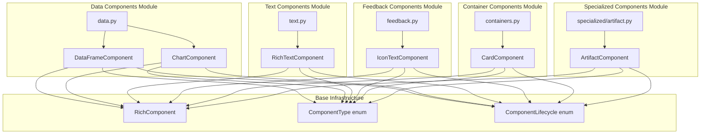
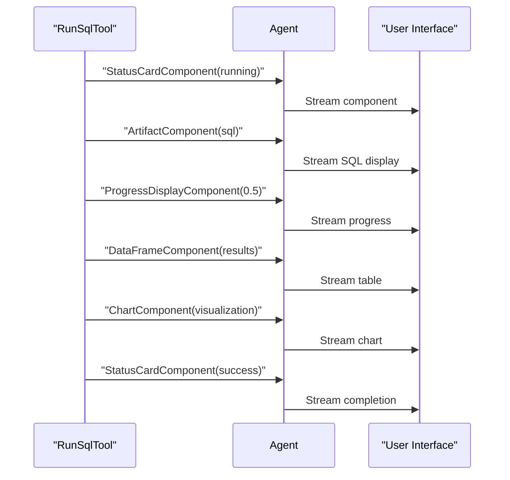
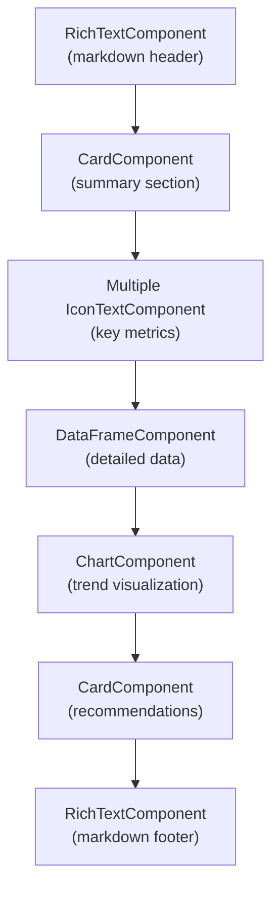

<!-- source: DeepWiki mcp.deepwiki.com · repo vanna-ai/vanna · page 9.4 Data and Container Components · fetched 2026-10-29 -->

# Data and Container Components

<details>
<summary>Relevant source files</summary>

The following files were used as context for generating this wiki page:

- [src/vanna/components/__init__.py](src/vanna/components/__init__.py)
- [src/vanna/components/rich/__init__.py](src/vanna/components/rich/__init__.py)
- [src/vanna/components/rich/specialized/__init__.py](src/vanna/components/rich/specialized/__init__.py)
- [src/vanna/core/agent/config.py](src/vanna/core/agent/config.py)
- [src/vanna/examples/mock_rich_components_demo.py](src/vanna/examples/mock_rich_components_demo.py)
- [src/vanna/examples/primitive_components_demo.py](src/vanna/examples/primitive_components_demo.py)
- [src/vanna/integrations/__init__.py](src/vanna/integrations/__init__.py)
- [src/vanna/tools/run_sql.py](src/vanna/tools/run_sql.py)

</details>


## Purpose and Scope

This page documents the data display, text rendering, and container components in the Vanna UI component system. These components enable agents and tools to present structured data (tables, charts), formatted text content, and organize UI elements within containers.

For information about status indicators and progress displays, see [Feedback Components](#9.2). For information about task lists and interactive buttons, see [Interactive Components](#9.3). For the overall component system architecture, see [UiComponent System](#9.1).

**Sources:** [src/vanna/components/rich/__init__.py:1-84]()

---

## Component Categories

Data and container components fall into four categories:

| Category | Components | Purpose |
|----------|-----------|---------|
| **Data Display** | `DataFrameComponent`, `ChartComponent` | Display structured data and visualizations |
| **Text Content** | `RichTextComponent`, `IconTextComponent` | Render formatted text and icon+text combinations |
| **Containers** | `CardComponent` | Group and organize UI elements |
| **Specialized** | `ArtifactComponent` | Handle downloadable artifacts and code snippets |

All components extend the `RichComponent` base class and follow the lifecycle model: `CREATE` → `UPDATE` → `COMPLETE`.

**Sources:** [src/vanna/components/rich/__init__.py:1-84](), [src/vanna/components/__init__.py:1-93]()

---

## Architecture Overview



**Sources:** [src/vanna/components/rich/__init__.py:1-84](), [src/vanna/components/__init__.py:1-93]()

---

## Data Display Components

### DataFrameComponent

`DataFrameComponent` displays tabular data in table format. It is typically yielded by tools after executing SQL queries or data analysis operations.

**Component Type:** `ComponentType.DATAFRAME`

**Key Properties:**
- `data`: The pandas DataFrame or dict representation of tabular data
- `title`: Optional table caption
- `max_rows`: Maximum rows to display (for large datasets)
- `format_options`: Formatting configuration for columns (decimals, currency, etc.)

**Common Usage Pattern:**
```python
# After running SQL query
df = await sql_runner.run_sql(query)

yield UiComponent(
    rich_component=DataFrameComponent(
        id=f"results-{request_id}",
        data=df,
        title="Query Results",
        max_rows=100
    )
)
```

**Lifecycle:**
- Usually created with `lifecycle=ComponentLifecycle.COMPLETE` since data is fully loaded
- Updates are rare unless implementing pagination or filtering

**Sources:** [src/vanna/components/rich/__init__.py:10-13](), [src/vanna/components/__init__.py:24-25]()

---

### ChartComponent

`ChartComponent` displays data visualizations generated from query results or analysis outputs. It supports multiple chart types and rendering backends.

**Component Type:** `ComponentType.CHART`

**Key Properties:**
- `chart_type`: Type of chart (line, bar, pie, scatter, etc.)
- `data`: Chart data structure (depends on rendering backend)
- `config`: Chart configuration (axes, legends, colors, etc.)
- `title`: Chart title
- `width`: Chart width
- `height`: Chart height

**Common Usage Pattern:**
```python
# After data analysis
chart_config = {
    "type": "bar",
    "x_axis": "category",
    "y_axis": "value",
    "title": "Sales by Region"
}

yield UiComponent(
    rich_component=ChartComponent(
        id=f"chart-{request_id}",
        chart_type="bar",
        data=chart_data,
        config=chart_config,
        title="Sales Analysis"
    )
)
```

**Integration Points:**
- `VisualizeDataTool` generates `ChartComponent` instances
- Supports Plotly, matplotlib, and other visualization backends
- Chart configurations can be LLM-generated based on data patterns

**Sources:** [src/vanna/components/rich/__init__.py:10-13](), [src/vanna/components/__init__.py:24-25]()

---

## Text and Content Components

### RichTextComponent

`RichTextComponent` renders formatted text content with optional Markdown support. It is the primary component for displaying explanations, instructions, and narrative content from agents.

**Component Type:** `ComponentType.TEXT`

**Key Properties:**
- `content`: Text content (string)
- `markdown`: Boolean flag to enable Markdown rendering
- `format`: Text format specification (plain, markdown, html)

**Common Usage Pattern:**
```python
# Display formatted explanation
yield UiComponent(
    rich_component=RichTextComponent(
        content="""## Analysis Results

The query returned **1,234** records across 5 categories.

Key findings:
- Category A: 45% of total
- Category B: 30% of total
- Category C: 25% of total
""",
        markdown=True
    )
)
```

**Usage Contexts:**
1. **Agent responses**: Final text responses from LLM
2. **Tool documentation**: Explaining what a tool does
3. **Workflow output**: Summary text from commands like `/help`
4. **Error explanations**: Human-readable error messages

**Example from demos:**
[src/vanna/examples/primitive_components_demo.py:49-54]() shows `RichTextComponent` used for demo headers:
```python
yield UiComponent(
    rich_component=RichTextComponent(
        content="## Primitive Components Demo\n\nShowing how tools now compose UI from primitive components:",
        markdown=True,
    )
)
```

[src/vanna/examples/mock_rich_components_demo.py:285-311]() shows comprehensive Markdown usage for final summaries.

**Sources:** [src/vanna/components/rich/__init__.py:7](), [src/vanna/components/__init__.py:22](), [src/vanna/examples/primitive_components_demo.py:49-54]()

---

### IconTextComponent

`IconTextComponent` combines an icon with text to create visually distinct labels, status indicators, or result summaries. While technically in the feedback module, it is commonly used for data presentation contexts.

**Component Type:** `ComponentType.ICON_TEXT`

**Key Properties:**
- `icon`: Emoji or icon character
- `text`: Associated text content
- `variant`: Visual style (primary, success, error, warning, default, secondary)
- `size`: Display size (small, medium, large)

**Common Usage Pattern:**
```python
# Display analysis result
yield UiComponent(
    rich_component=IconTextComponent(
        id="analysis-result",
        icon="📊",
        text="Data Analysis Complete: R² = 0.85",
        variant="success",
        size="large"
    )
)
```

**Usage Contexts:**
1. **Result summaries**: Displaying key metrics with visual markers
2. **Step completion**: Indicating completed phases in multi-step processes
3. **Category labels**: Tagging content with semantic meaning
4. **Quick facts**: Presenting single data points with context

**Example from demos:**
[src/vanna/examples/primitive_components_demo.py:162-180]() demonstrates multiple `IconTextComponent` instances:
```python
icon_texts = [
    IconTextComponent(
        icon="📊",
        text="Data Analysis Complete",
        variant="primary",
        size="large",
    ),
    IconTextComponent(
        icon="✅", 
        text="All tests passed", 
        variant="default", 
        size="medium"
    ),
    IconTextComponent(
        icon="⏱️",
        text="Processing time: 2.3s",
        variant="secondary",
        size="small",
    ),
]
```

**Sources:** [src/vanna/components/rich/__init__.py:25,69](), [src/vanna/examples/primitive_components_demo.py:162-180](), [src/vanna/examples/mock_rich_components_demo.py:239-247]()

---

## Container Components

### CardComponent

`CardComponent` provides a container for grouping related UI elements. It adds visual structure through borders, padding, and optional headers/footers.

**Component Type:** `ComponentType.CARD`

**Key Properties:**
- `title`: Card header text
- `content`: Main card content (can contain other components)
- `footer`: Optional footer content
- `variant`: Visual style (default, primary, success, warning, error)
- `collapsible`: Whether card can be collapsed
- `collapsed`: Initial collapsed state

**Common Usage Pattern:**
```python
# Group related information
yield UiComponent(
    rich_component=CardComponent(
        id="query-info",
        title="Query Information",
        content=[
            IconTextComponent(icon="📊", text=f"Database: {db_name}"),
            IconTextComponent(icon="⏱️", text=f"Execution time: {duration}s"),
            IconTextComponent(icon="📝", text=f"Rows returned: {row_count}")
        ],
        variant="primary"
    )
)
```

**Usage Contexts:**
1. **Grouping tool results**: Organizing output from a single tool execution
2. **Section organization**: Creating visual sections in complex UIs
3. **Information panels**: Displaying metadata or contextual information
4. **Multi-step workflows**: Showing progress through workflow stages

**Composition Patterns:**
Cards can contain any other components, enabling nested structures:
- Card → StatusCardComponent + DataFrameComponent
- Card → ProgressDisplayComponent + LogViewerComponent
- Card → Multiple BadgeComponent instances

**Sources:** [src/vanna/components/rich/__init__.py:41-43](), [src/vanna/components/__init__.py:46]()

---

## Specialized Components

### ArtifactComponent

`ArtifactComponent` handles downloadable content like generated SQL queries, code snippets, configuration files, or data exports. It provides both display and download capabilities.

**Component Type:** `ComponentType.ARTIFACT`

**Key Properties:**
- `content`: Artifact content (text or binary data)
- `artifact_type`: Type of artifact (sql, python, json, csv, etc.)
- `filename`: Suggested filename for downloads
- `language`: Syntax highlighting language for code
- `downloadable`: Whether artifact can be downloaded
- `copyable`: Whether content can be copied to clipboard

**Common Usage Pattern:**
```python
# Display generated SQL query
yield UiComponent(
    rich_component=ArtifactComponent(
        id=f"sql-{request_id}",
        content=generated_sql,
        artifact_type="sql",
        filename="query.sql",
        language="sql",
        downloadable=True,
        copyable=True
    )
)
```

**Usage Contexts:**
1. **SQL query display**: Showing generated queries with syntax highlighting
2. **Code generation**: Displaying Python/JavaScript code from LLM
3. **Data exports**: Providing downloadable CSV/JSON files
4. **Configuration files**: Showing generated config with download option
5. **Analysis reports**: Full-text reports with copy/download functionality

**Integration with Tools:**
- `RunSqlTool` generates SQL artifacts before execution
- Custom code generation tools create Python/JavaScript artifacts
- Export tools produce CSV/JSON artifacts

**Access Control:**
The visibility and downloadability of artifacts can be controlled via `UiFeatures`:
- Admins might see full SQL with download
- Regular users might see redacted queries without download
- Public users might not see queries at all

**Sources:** [src/vanna/components/rich/__init__.py:45-48](), [src/vanna/components/__init__.py:48](), [src/vanna/components/rich/specialized/__init__.py:1-8]()

---

## Component Composition Patterns

### Pattern 1: Query Execution Flow



**Implementation Example:**
```python
class QueryExecutionTool(Tool):
    async def execute(self, context, args):
        # 1. Show execution status
        yield ToolResult(
            ui_components=[StatusCardComponent(
                title="Executing Query",
                status="running"
            )]
        )
        
        # 2. Display SQL artifact
        yield ToolResult(
            ui_components=[ArtifactComponent(
                content=args.sql,
                artifact_type="sql",
                downloadable=True
            )]
        )
        
        # 3. Execute and show results
        df = await self.sql_runner.run_sql(args.sql)
        
        yield ToolResult(
            ui_components=[DataFrameComponent(
                data=df,
                title="Query Results"
            )]
        )
        
        # 4. Generate visualization if appropriate
        if should_visualize(df):
            yield ToolResult(
                ui_components=[ChartComponent(
                    data=prepare_chart_data(df),
                    chart_type="bar"
                )]
            )
```

**Sources:** [src/vanna/examples/primitive_components_demo.py:48-140]()

---

### Pattern 2: Analysis Report Generation



**Implementation Example:**
```python
async def generate_analysis_report(data):
    # Header
    yield RichTextComponent(
        content="## Monthly Sales Analysis Report",
        markdown=True
    )
    
    # Summary card with key metrics
    yield CardComponent(
        title="Executive Summary",
        content=[
            IconTextComponent(icon="💰", text=f"Total Revenue: ${total_revenue:,.2f}"),
            IconTextComponent(icon="📈", text=f"Growth: {growth_pct:.1f}%"),
            IconTextComponent(icon="🎯", text=f"Target Achievement: {achievement:.0f}%")
        ]
    )
    
    # Detailed data table
    yield DataFrameComponent(
        data=detailed_df,
        title="Sales by Region"
    )
    
    # Trend visualization
    yield ChartComponent(
        data=trend_data,
        chart_type="line",
        title="Monthly Trend"
    )
    
    # Recommendations card
    yield CardComponent(
        title="Recommendations",
        content=RichTextComponent(
            content=recommendations_markdown,
            markdown=True
        )
    )
```

**Sources:** [src/vanna/examples/mock_rich_components_demo.py:285-311]()

---

### Pattern 3: Multi-Artifact Display

When tools generate multiple related artifacts (SQL, results, chart, export):

```python
async def execute_with_artifacts(self, context, args):
    request_id = context.request_id
    
    # SQL artifact
    yield ToolResult(
        ui_components=[ArtifactComponent(
            id=f"sql-{request_id}",
            content=generated_sql,
            artifact_type="sql",
            filename="query.sql",
            copyable=True
        )]
    )
    
    # Execute and show results
    df = await self.sql_runner.run_sql(generated_sql)
    
    # Results table
    yield ToolResult(
        ui_components=[DataFrameComponent(
            id=f"results-{request_id}",
            data=df,
            title=f"Results: {len(df)} rows"
        )]
    )
    
    # CSV export artifact
    csv_content = df.to_csv(index=False)
    yield ToolResult(
        ui_components=[ArtifactComponent(
            id=f"export-{request_id}",
            content=csv_content,
            artifact_type="csv",
            filename="results.csv",
            downloadable=True
        )]
    )
    
    # Visualization
    if should_visualize(df):
        yield ToolResult(
            ui_components=[ChartComponent(
                id=f"chart-{request_id}",
                data=prepare_chart_data(df),
                chart_type=determine_chart_type(df)
            )]
        )
```

**Sources:** [src/vanna/examples/primitive_components_demo.py:48-140]()

---

## Integration with Tool System

### Tool Result Structure

Tools return data and container components via `ToolResult`:

```python
from vanna.core.tool.models import ToolResult

@dataclass
class ToolResult:
    """Result from tool execution."""
    tool_name: str
    success: bool
    llm_message: str  # Message for LLM
    ui_components: List[RichComponent]  # Components for user
    error: Optional[str] = None
```

**Component Flow:**
1. Tool executes logic
2. Tool creates `RichComponent` instances
3. Tool wraps components in `ToolResult`
4. Agent wraps in `UiComponent` and yields to server
5. Server streams to client

**Sources:** Documentation context

---

### Access Control for Data Components

Data components respect `UiFeatures` access control:

| Component | Access Level | Visibility |
|-----------|-------------|------------|
| `DataFrameComponent` | `user` | Full results |
| `DataFrameComponent` | `limited` | Limited rows |
| `ChartComponent` | `user` | Full chart |
| `ArtifactComponent` | `admin` | Download enabled |
| `ArtifactComponent` | `user` | View only |
| `RichTextComponent` | All | Always visible |

**Implementation Example:**
```python
def get_dataframe_component(df, user_features):
    if "admin" in user_features:
        max_rows = None  # No limit
    elif "user" in user_features:
        max_rows = 1000
    else:
        max_rows = 100
    
    return DataFrameComponent(
        data=df.head(max_rows) if max_rows else df,
        title=f"Results ({len(df)} total rows)"
    )
```

**Sources:** Documentation context from security architecture

---

## Best Practices

### 1. Component Granularity

**Do:** Yield components as data becomes available
```python
# Stream components incrementally
yield RichTextComponent(content="Starting analysis...")
await analyze_data()
yield DataFrameComponent(data=results)
yield ChartComponent(data=chart_data)
```

**Don't:** Batch all components at the end
```python
# Don't wait to yield everything
components = []
components.append(RichTextComponent(...))
components.append(DataFrameComponent(...))
components.append(ChartComponent(...))
yield components  # User waits for everything
```

### 2. Component IDs

Always provide unique IDs for updatable components:
```python
# Good: Unique, traceable ID
request_id = context.request_id
yield DataFrameComponent(
    id=f"results-{request_id}",
    data=df
)

# Bad: No ID or generic ID
yield DataFrameComponent(
    id="results",  # Will conflict with concurrent requests
    data=df
)
```

### 3. Container Organization

Use `CardComponent` to group related information:
```python
# Good: Organized in card
yield CardComponent(
    title="Query Execution",
    content=[
        ArtifactComponent(content=sql, artifact_type="sql"),
        DataFrameComponent(data=results),
        IconTextComponent(icon="⏱️", text=f"Duration: {duration}s")
    ]
)

# Acceptable but less organized: Flat structure
yield ArtifactComponent(content=sql, artifact_type="sql")
yield DataFrameComponent(data=results)
yield IconTextComponent(icon="⏱️", text=f"Duration: {duration}s")
```

### 4. Error Handling in Data Display

Handle data errors gracefully:
```python
try:
    df = await sql_runner.run_sql(query)
    yield DataFrameComponent(data=df)
except Exception as e:
    yield RichTextComponent(
        content=f"**Error executing query:** {str(e)}",
        markdown=True
    )
    # Still show the SQL artifact for debugging
    yield ArtifactComponent(
        content=query,
        artifact_type="sql"
    )
```

### 5. Markdown Formatting

Use semantic Markdown in `RichTextComponent`:
```python
# Good: Semantic structure
yield RichTextComponent(
    content="""## Analysis Results

**Key Findings:**
- Finding 1
- Finding 2

**Recommendation:** Take action X
""",
    markdown=True
)

# Avoid: Plain text walls
yield RichTextComponent(
    content="Analysis Results Key Findings: Finding 1, Finding 2. Recommendation: Take action X",
    markdown=False
)
```

**Sources:** [src/vanna/examples/primitive_components_demo.py:1-306](), [src/vanna/examples/mock_rich_components_demo.py:1-397]()

---

## Complete Example: Data Analysis Tool

This example demonstrates all data and container components working together:

```python
from vanna.core.tool import Tool, ToolContext
from vanna.core.tool.models import ToolResult
from vanna.components import (
    RichTextComponent,
    DataFrameComponent,
    ChartComponent,
    CardComponent,
    ArtifactComponent,
    IconTextComponent,
    StatusCardComponent,
    ProgressDisplayComponent
)

class DataAnalysisTool(Tool):
    """Comprehensive data analysis with rich UI."""
    
    name = "analyze_data"
    description = "Analyze dataset and generate report"
    
    async def execute(
        self, 
        context: ToolContext, 
        args: AnalysisArgs
    ) -> ToolResult:
        request_id = context.request_id
        
        # 1. Show analysis status
        yield ToolResult(
            tool_name=self.name,
            success=True,
            llm_message="Starting data analysis",
            ui_components=[
                StatusCardComponent(
                    id=f"status-{request_id}",
                    title="Data Analysis",
                    status="running",
                    icon="🔬"
                )
            ]
        )
        
        # 2. Display query artifact
        sql = self._generate_sql(args)
        yield ToolResult(
            tool_name=self.name,
            success=True,
            llm_message="Generated SQL query",
            ui_components=[
                ArtifactComponent(
                    id=f"sql-{request_id}",
                    content=sql,
                    artifact_type="sql",
                    filename="analysis_query.sql",
                    downloadable=True,
                    copyable=True
                )
            ]
        )
        
        # 3. Execute query with progress
        progress = ProgressDisplayComponent(
            id=f"progress-{request_id}",
            label="Querying database",
            value=0.5,
            animated=True
        )
        yield ToolResult(
            tool_name=self.name,
            success=True,
            llm_message="Executing query",
            ui_components=[progress]
        )
        
        df = await self.sql_runner.run_sql(sql)
        
        # 4. Display results in card
        yield ToolResult(
            tool_name=self.name,
            success=True,
            llm_message=f"Retrieved {len(df)} rows",
            ui_components=[
                CardComponent(
                    id=f"results-card-{request_id}",
                    title="Query Results",
                    content=[
                        IconTextComponent(
                            icon="📊",
                            text=f"Rows: {len(df):,}",
                            size="medium"
                        ),
                        IconTextComponent(
                            icon="📝",
                            text=f"Columns: {len(df.columns)}",
                            size="medium"
                        ),
                        DataFrameComponent(
                            id=f"data-{request_id}",
                            data=df,
                            max_rows=100
                        )
                    ]
                )
            ]
        )
        
        # 5. Generate visualization
        chart_data = self._prepare_chart_data(df)
        yield ToolResult(
            tool_name=self.name,
            success=True,
            llm_message="Generated visualization",
            ui_components=[
                ChartComponent(
                    id=f"chart-{request_id}",
                    data=chart_data,
                    chart_type="bar",
                    title="Analysis Results",
                    config={
                        "x_axis": args.x_column,
                        "y_axis": args.y_column
                    }
                )
            ]
        )
        
        # 6. Export artifact
        csv_content = df.to_csv(index=False)
        yield ToolResult(
            tool_name=self.name,
            success=True,
            llm_message="Created export file",
            ui_components=[
                ArtifactComponent(
                    id=f"export-{request_id}",
                    content=csv_content,
                    artifact_type="csv",
                    filename="analysis_results.csv",
                    downloadable=True
                )
            ]
        )
        
        # 7. Summary report
        summary = self._generate_summary(df)
        yield ToolResult(
            tool_name=self.name,
            success=True,
            llm_message="Analysis complete",
            ui_components=[
                RichTextComponent(
                    content=summary,
                    markdown=True
                ),
                StatusCardComponent(
                    id=f"status-{request_id}",
                    title="Data Analysis",
                    status="success",
                    description="Analysis completed successfully",
                    icon="✅"
                )
            ]
        )
```

**Sources:** [src/vanna/examples/primitive_components_demo.py:1-306](), [src/vanna/examples/mock_rich_components_demo.py:1-397]()

---

