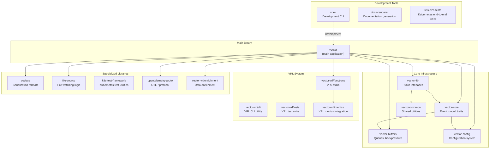
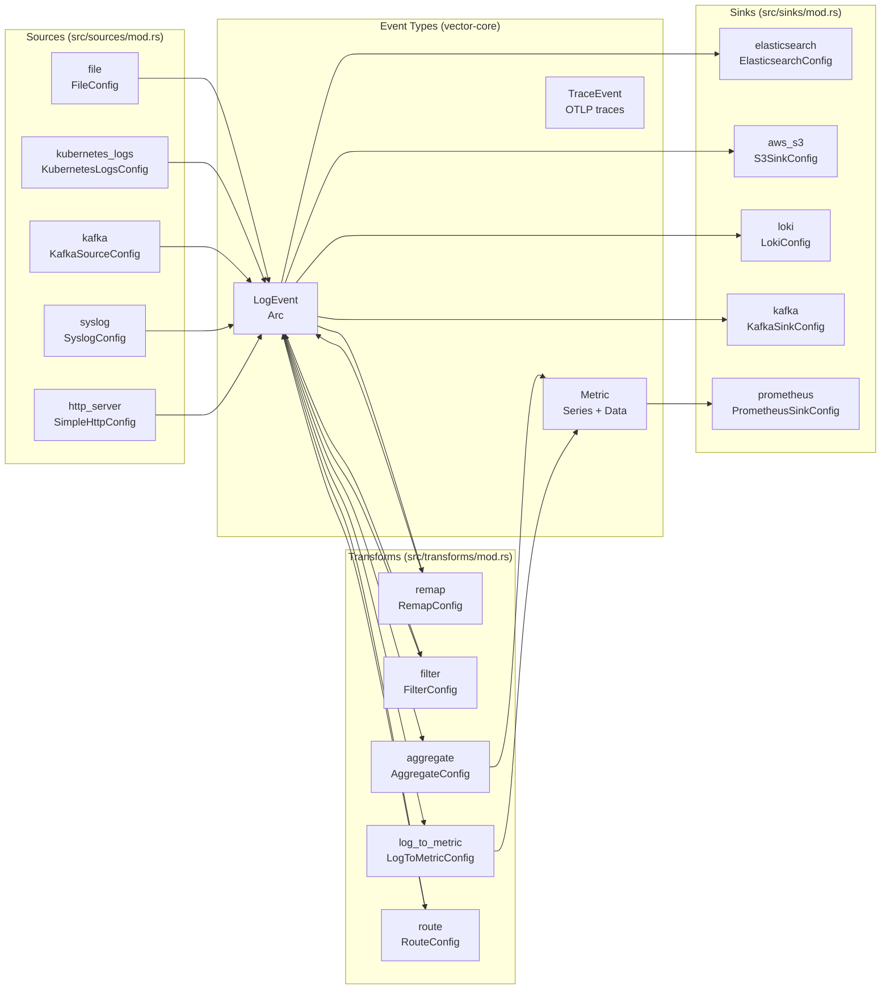
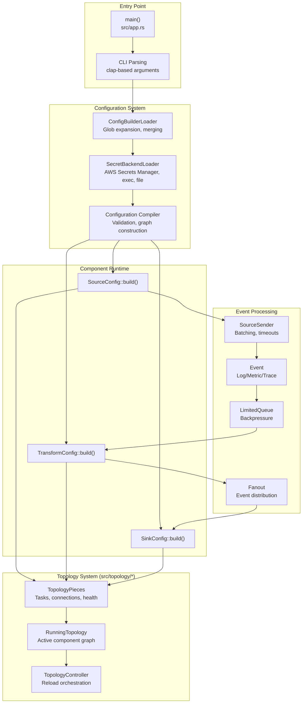
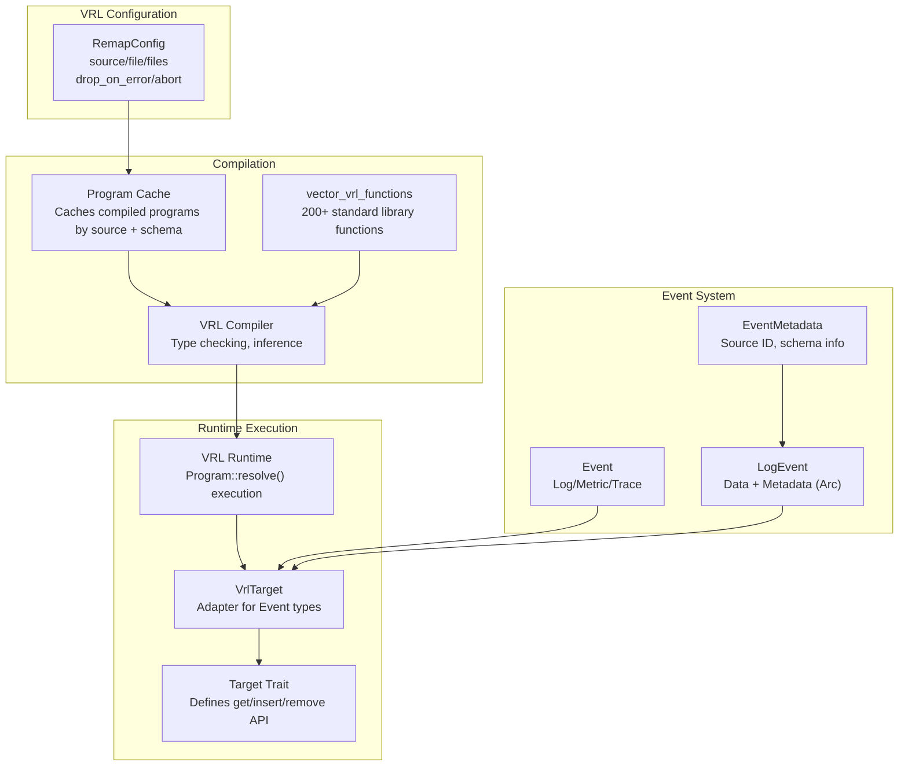

<!-- source: DeepWiki mcp.deepwiki.com · repo vectordotdev/vector · page 1 Vector Overview · fetched 2026-10-29 -->

# Vector Overview

<details>
<summary>Relevant source files</summary>

The following files were used as context for generating this wiki page:

- [.gitignore](.gitignore)
- [Cargo.lock](Cargo.lock)
- [Cargo.toml](Cargo.toml)
- [LICENSE-3rdparty.csv](LICENSE-3rdparty.csv)
- [README.md](README.md)
- [Tiltfile](Tiltfile)
- [agents/skills/vector-components-maturity-eval/SKILL.md](agents/skills/vector-components-maturity-eval/SKILL.md)
- [deny.toml](deny.toml)
- [docs/REVIEWING.md](docs/REVIEWING.md)
- [docs/USER_EXPERIENCE_DESIGN.md](docs/USER_EXPERIENCE_DESIGN.md)
- [docs/specs/buffer.md](docs/specs/buffer.md)
- [docs/specs/component.md](docs/specs/component.md)
- [docs/specs/configuration.md](docs/specs/configuration.md)
- [docs/specs/instrumentation.md](docs/specs/instrumentation.md)
- [docs/specs/target.md](docs/specs/target.md)
- [lib/codecs/Cargo.toml](lib/codecs/Cargo.toml)
- [lib/docs-renderer/Cargo.toml](lib/docs-renderer/Cargo.toml)
- [lib/file-source/Cargo.toml](lib/file-source/Cargo.toml)
- [lib/k8s-e2e-tests/Cargo.toml](lib/k8s-e2e-tests/Cargo.toml)
- [lib/k8s-test-framework/Cargo.toml](lib/k8s-test-framework/Cargo.toml)
- [lib/loki-logproto/Cargo.toml](lib/loki-logproto/Cargo.toml)
- [lib/opentelemetry-proto/Cargo.toml](lib/opentelemetry-proto/Cargo.toml)
- [lib/prometheus-parser/Cargo.toml](lib/prometheus-parser/Cargo.toml)
- [lib/vector-api-client/Cargo.toml](lib/vector-api-client/Cargo.toml)
- [lib/vector-buffers/Cargo.toml](lib/vector-buffers/Cargo.toml)
- [lib/vector-buffers/src/variants/disk_v2/tests/model/action.rs](lib/vector-buffers/src/variants/disk_v2/tests/model/action.rs)
- [lib/vector-buffers/src/variants/disk_v2/tests/model/sequencer.rs](lib/vector-buffers/src/variants/disk_v2/tests/model/sequencer.rs)
- [lib/vector-common/Cargo.toml](lib/vector-common/Cargo.toml)
- [lib/vector-config-common/Cargo.toml](lib/vector-config-common/Cargo.toml)
- [lib/vector-config-macros/Cargo.toml](lib/vector-config-macros/Cargo.toml)
- [lib/vector-config/Cargo.toml](lib/vector-config/Cargo.toml)
- [lib/vector-core/Cargo.toml](lib/vector-core/Cargo.toml)
- [lib/vector-core/src/config/global_options.rs](lib/vector-core/src/config/global_options.rs)
- [lib/vector-lookup/Cargo.toml](lib/vector-lookup/Cargo.toml)
- [lib/vector-stream/Cargo.toml](lib/vector-stream/Cargo.toml)
- [lib/vector-tap/Cargo.toml](lib/vector-tap/Cargo.toml)
- [license-tool.toml](license-tool.toml)
- [rust-toolchain.toml](rust-toolchain.toml)
- [src/config/vars.rs](src/config/vars.rs)
- [src/internal_events/mod.rs](src/internal_events/mod.rs)
- [src/kubernetes/meta_cache.rs](src/kubernetes/meta_cache.rs)
- [src/kubernetes/mod.rs](src/kubernetes/mod.rs)
- [src/kubernetes/pod_manager_logic.rs](src/kubernetes/pod_manager_logic.rs)
- [src/kubernetes/reflector.rs](src/kubernetes/reflector.rs)
- [src/sinks/mod.rs](src/sinks/mod.rs)
- [src/sources/host_metrics/tcp.rs](src/sources/host_metrics/tcp.rs)
- [src/sources/kubernetes_logs/k8s_paths_provider.rs](src/sources/kubernetes_logs/k8s_paths_provider.rs)
- [src/sources/mod.rs](src/sources/mod.rs)
- [src/sources/prometheus/mod.rs](src/sources/prometheus/mod.rs)
- [src/transforms/mod.rs](src/transforms/mod.rs)
- [vdev/Cargo.toml](vdev/Cargo.toml)
- [website/content/en/docs/reference/configuration/_index.md](website/content/en/docs/reference/configuration/_index.md)
- [website/content/en/docs/reference/configuration/sources/prometheus_pushgateway.md](website/content/en/docs/reference/configuration/sources/prometheus_pushgateway.md)
- [website/content/en/docs/setup/installation/platforms/docker.md](website/content/en/docs/setup/installation/platforms/docker.md)
- [website/cue/reference/configuration.cue](website/cue/reference/configuration.cue)
- [website/cue/reference/urls.cue](website/cue/reference/urls.cue)
- [website/data/redirects.yaml](website/data/redirects.yaml)

</details>


## Purpose and Scope

This document provides a high-level technical overview of the Vector observability data pipeline, explaining its architecture, core subsystems, and how they integrate. Vector is a Rust-based tool for collecting, transforming, and routing logs, metrics, and traces at scale.

This page covers the overall system structure, workspace organization, and the three-component pipeline architecture. For detailed information about specific subsystems, see:

- Workspace organization and internal libraries: [Workspace Structure](#1.1)  
- Detailed library architecture: [Core Libraries](#1.2)  
- Component types and pipeline patterns: [Component Architecture](#1.3)  

---

## What is Vector

Vector is defined in [Cargo.toml:1-16]() as "a lightweight and ultra-fast tool for building observability pipelines". It is implemented as a Rust workspace containing 93+ crates organized into a monorepo structure.

**Key Characteristics:**

- **Language**: Rust (minimum version 1.95 as specified in [Cargo.toml:15]())  
- **License**: MPL-2.0 ([Cargo.toml:8]())  
- **Current Version**: 0.58.0 ([Cargo.toml:3]())  
- **Architecture**: Modular workspace with extensive feature flags for conditional compilation.

Vector processes observability data through a directed acyclic graph (DAG) of components: **sources** (data ingestion), **transforms** (data processing), and **sinks** (data output).

Sources, transforms, and sinks consume and emit events of various types: logs, metrics, and traces.

Sources: [Cargo.toml:1-16]()

---

## Cargo Workspace Structure

Vector uses a Cargo workspace defined in [Cargo.toml:98-137]() to organize its codebase into modular, reusable crates.

### Workspace Members Overview



**Diagram: Cargo Workspace Dependency Structure**

This diagram demonstrates Vector's modular workspace architecture with a focus on the main binary, core infrastructure crates, VRL submodules, specialized libraries, and development tools.

Sources: [Cargo.toml:98-137](), [lib/vector-core/Cargo.toml:1-115](), [lib/vector-buffers/Cargo.toml:1-60](), [vdev/Cargo.toml:1-51]()

### Key Workspace Crates

| Crate                  | Location           | Purpose                                             |
|------------------------|--------------------|-----------------------------------------------------|
| `vector`               | `.` (root)         | Main binary and application logic                   |
| `vector-core`          | `lib/vector-core`  | Event data model, core traits, buffering mechanisms |
| `vector-buffers`       | `lib/vector-buffers` | In-memory and disk-based buffering, backpressure   |
| `vector-config`        | `lib/vector-config` | Configuration parsing, validation, schema support   |
| `vector-lib`           | `lib/vector-lib`   | Public API surface for embedding Vector as a library|
| `vector-vrl-functions` | `lib/vector-vrl/functions` | VRL standard library functions (200+ functions)    |
| `codecs`               | `lib/codecs`       | Event encoding/decoding (JSON, Avro, CSV, etc.)     |
| `file-source`          | `lib/file-source`  | File watching and tailing infrastructure             |
| `vdev`                 | `vdev`             | Development CLI tool for Vector build and testing    |

Sources: [Cargo.toml:98-137](), [lib/vector-core/Cargo.toml:1-7](), [lib/vector-buffers/Cargo.toml:1-7](), [lib/vector-config/Cargo.toml:1-8](), [vdev/Cargo.toml:1-51]()

---

## Component-Based Architecture

Vector's runtime is composed of three tightly integrated component types that form a data processing pipeline:

- **Sources**: Ingest observability data (logs, metrics, traces) from external systems.  
- **Transforms**: Process, enrich, and convert data.  
- **Sinks**: Export processed data to destinations like storage or observability services.

Each component type is implemented as configurable Rust structs with standard interfaces.

### Component Type System and Event Flow



**Diagram: Component Types and Event Flow**

This diagram maps key source, transform, and sink components to the event types they consume and produce, highlighting the flow of logs, metrics, and traces through the pipeline.

Sources: [src/sources/mod.rs](), [src/transforms/mod.rs](), [src/sinks/mod.rs](), [lib/vector-core/src/event/mod.rs]()

---

## Core Runtime Architecture

### Application Lifecycle and Topology

Vector's application lifecycle and topology management involve several subsystems responsible for parsing configuration, instantiating components, and managing the running data pipeline.



**Diagram: Vector Runtime Architecture with Code Entities**

This diagram aligns core runtime concepts to code entities, illustrating how configuration is loaded, compiled, and used to build the pipeline topology composed of sources, transforms, and sinks. Events are batched and buffered, then flow through transforms and finally fan out to sinks.

Sources: [Cargo.toml:1-16](), [src/sources/mod.rs](), [src/sinks/mod.rs](), [src/app.rs:main()]()

### Feature Flag System

Vector employs a flexible feature flag system to enable or disable component groups and platform integrations at compile time, allowing tailored builds.

Relevant feature flags are defined in [Cargo.toml:504-685]() such as:

```toml
[features]
default = ["api", "api-client", "enrichment-tables", "sinks", "sources", "transforms", "unix"]
sinks = ["sinks-logs", "sinks-metrics"]
sources = ["sources-logs", "sources-metrics"]
transforms = ["transforms-logs", "transforms-metrics"]
```

This modular design supports selective enabling of sources, transforms, sinks, and integrations with cloud providers.

Sources: [Cargo.toml:504-685]()

---

## Internal Events and Observability

Vector incorporates "internal events" to monitor the health and performance of its own components. These events are emitted from specialized modules under `src/internal_events/mod.rs`.

### Internal Event Categories

| Module                | Purpose                           |
|-----------------------|---------------------------------|
| `adaptive_concurrency` | Telemetry for adaptive concurrency |
| `aws`                  | Metrics related to AWS SDK usage  |
| `remap`                | VRL transform execution metrics   |
| `batch`                | Batching statistics and performance|

These internal events integrate with the `internal_metrics` source, enabling self-observability of Vector.

Sources: [lib/vector-core/Cargo.toml:31-33](), [src/internal_events/mod.rs]()

---

## VRL (Vector Remap Language) Integration

Vector features a domain-specific language (DSL) called VRL for custom data transformation logic, realized by the `remap` transform component.

### VRL Architecture and Components



**Diagram: VRL Transform Integration Architecture**

This diagram captures the flow from VRL configuration through compilation and runtime execution, adapted for Vector's event types. The remap transform supports features like inline sources, external files, and configurable error handling such as `drop_on_error` or `abort`.

Sources: [lib/vector-vrl/functions/Cargo.toml:1-10](), [lib/vector-core/Cargo.toml:66-103]()

---

## Deployment Models

Vector supports flexible deployment options to fit different environments and scales:

| Deployment Type        | Description                                                             |
|-----------------------|-------------------------------------------------------------------------|
| Binary (Linux/macOS)   | Platform-specific archives for manual or scripted installation.          |
| Docker Images          | Variants: Alpine, Debian, Distroless for containerized environments.     |
| Kubernetes Agent       | DaemonSet role for node-level data collection in K8s clusters.          |
| Kubernetes Aggregator  | StatefulSet or deployment for centralized data processing in K8s.       |
| System Packages        | DEB/RPM packages including systemd service units for Linux distros.     |

Systemd units and package metadata are defined in [Cargo.toml:54-77]().

Sources: [Cargo.toml:54-77](), [lib/k8s-e2e-tests/Cargo.toml:1-44]()

---

## Third-Party Dependencies

Vector builds on a large ecosystem of open-source Rust libraries to provide performant and safe functionality.

Some key categories include:

- **Async Runtime**: `tokio`, `futures`, `async-trait` ([Cargo.toml:153-155]())  
- **Serialization**: `serde`, `serde_json`, `toml`, `prost` ([Cargo.toml:194-200]())  
- **Networking and RPC**: `hyper`, `tonic` ([lib/vector-core/Cargo.toml:25-57]())  
- **Observability**: `metrics`, `tracing` ([lib/vector-core/Cargo.toml:31-58]())

The full list and licensing info is provided in [LICENSE-3rdparty.csv:1-500]().

Sources: [LICENSE-3rdparty.csv:1-200](), [Cargo.lock:1-100](), [Cargo.toml:148-200]()

---

## Development Infrastructure

### Development CLI Tool

The `vdev` crate provides command-line utilities to support development workflows including build, test, release, and CI automation.

```toml
[package]
name = "vdev"
description = "CLI utilities for Vector development and CI workflows"
```

Configured in [vdev/Cargo.toml:1-51]().

### Testing Framework

Vector employs a comprehensive testing strategy covering:

- **Unit Tests**: Component-level tests within libraries and source modules.  
- **Integration Tests**: Included in `tests/integration/` ([Cargo.toml:30-31]()).  
- **End-to-End Tests**: Located in `tests/e2e/` ([Cargo.toml:34-35]()).  
- **Kubernetes E2E Tests**: Specialized tests in `lib/k8s-e2e-tests/` ([lib/k8s-e2e-tests/Cargo.toml:1-41]()).

This infrastructure supports robust validation of system behavior across releases.

Sources: [Cargo.toml:30-35](), [lib/k8s-e2e-tests/Cargo.toml:1-41]()

---

This concludes the high-level overview of Vector, its workspace structure, component architecture, core runtime, and development environment. For detailed technical information, please navigate to the child pages:

- [Workspace Structure](#1.1)  
- [Core Libraries](#1.2)  
- [Component Architecture](#1.3)  

Sources: Entire document with references as noted above.

---

