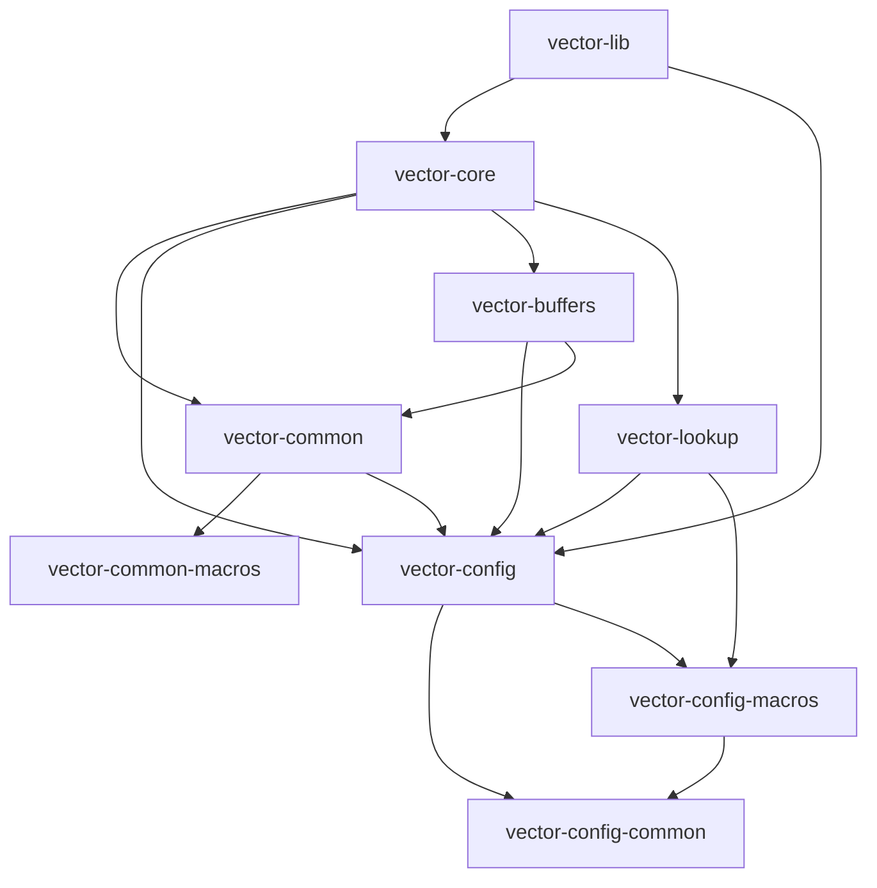
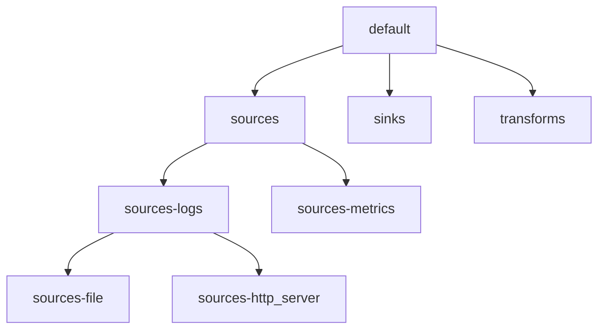

<!-- source: DeepWiki mcp.deepwiki.com · repo vectordotdev/vector · page 1.1 Workspace Structure · fetched 2026-10-29 -->

# Workspace Structure

<details>
<summary>Relevant source files</summary>

The following files were used as context for generating this wiki page:

- [.github/workflows/custom_builds.yml](.github/workflows/custom_builds.yml)
- [Cargo.lock](Cargo.lock)
- [Cargo.toml](Cargo.toml)
- [LICENSE-3rdparty.csv](LICENSE-3rdparty.csv)
- [build.rs](build.rs)
- [deny.toml](deny.toml)
- [distribution/msi/build.sh](distribution/msi/build.sh)
- [lib/codecs/Cargo.toml](lib/codecs/Cargo.toml)
- [lib/docs-renderer/Cargo.toml](lib/docs-renderer/Cargo.toml)
- [lib/file-source/Cargo.toml](lib/file-source/Cargo.toml)
- [lib/k8s-e2e-tests/Cargo.toml](lib/k8s-e2e-tests/Cargo.toml)
- [lib/k8s-test-framework/Cargo.toml](lib/k8s-test-framework/Cargo.toml)
- [lib/loki-logproto/Cargo.toml](lib/loki-logproto/Cargo.toml)
- [lib/opentelemetry-proto/Cargo.toml](lib/opentelemetry-proto/Cargo.toml)
- [lib/prometheus-parser/Cargo.toml](lib/prometheus-parser/Cargo.toml)
- [lib/vector-api-client/Cargo.toml](lib/vector-api-client/Cargo.toml)
- [lib/vector-buffers/Cargo.toml](lib/vector-buffers/Cargo.toml)
- [lib/vector-common/Cargo.toml](lib/vector-common/Cargo.toml)
- [lib/vector-config-common/Cargo.toml](lib/vector-config-common/Cargo.toml)
- [lib/vector-config-macros/Cargo.toml](lib/vector-config-macros/Cargo.toml)
- [lib/vector-config/Cargo.toml](lib/vector-config/Cargo.toml)
- [lib/vector-core/Cargo.toml](lib/vector-core/Cargo.toml)
- [lib/vector-lookup/Cargo.toml](lib/vector-lookup/Cargo.toml)
- [lib/vector-stream/Cargo.toml](lib/vector-stream/Cargo.toml)
- [lib/vector-tap/Cargo.toml](lib/vector-tap/Cargo.toml)
- [license-tool.toml](license-tool.toml)
- [src/config/watcher.rs](src/config/watcher.rs)
- [src/internal_events/heartbeat.rs](src/internal_events/heartbeat.rs)
- [src/internal_events/process.rs](src/internal_events/process.rs)
- [src/internal_telemetry/allocations/allocator/mod.rs](src/internal_telemetry/allocations/allocator/mod.rs)
- [src/internal_telemetry/allocations/allocator/stack.rs](src/internal_telemetry/allocations/allocator/stack.rs)
- [src/internal_telemetry/allocations/allocator/token.rs](src/internal_telemetry/allocations/allocator/token.rs)
- [src/internal_telemetry/allocations/allocator/tracing_allocator.rs](src/internal_telemetry/allocations/allocator/tracing_allocator.rs)
- [src/internal_telemetry/allocations/mod.rs](src/internal_telemetry/allocations/mod.rs)
- [src/lib.rs](src/lib.rs)
- [src/main.rs](src/main.rs)
- [src/signal.rs](src/signal.rs)
- [src/sources/host_metrics/tcp.rs](src/sources/host_metrics/tcp.rs)
- [src/vector_windows.rs](src/vector_windows.rs)
- [vdev/Cargo.toml](vdev/Cargo.toml)

</details>


## Purpose and Scope

This document describes the organization of Vector's Cargo workspace, covering the monorepo structure with 93+ crates, dependency management, and how internal libraries are organized. For information about the runtime component architecture (sources, transforms, sinks), see [Component Architecture](#1.3). For details about the core libraries’ APIs and functionality, see [Core Libraries](#1.2).

---

## Workspace Organization

Vector uses a **Cargo workspace** to manage its monorepo structure, defined in [Cargo.toml:98-137](). The workspace includes the main `vector` binary crate located at the repository root and 36 library crates primarily under the `lib/` directory.

The workspace members cover a wide range of functionality including core logic, configuration, protocol parsing, data encoding, tooling, and testing infrastructure.

### System Entity Mapping

The diagram below connects the conceptual system components with their respective Cargo crates and codebase locations, bridging the "Natural Language Space" to "Code Entity Space". This enables developers to quickly locate the code responsible for each subsystem.

```mermaid
graph TB
    %% Root binary
    root["vector (binary)<br/>Cargo.toml"]

    %% Core infrastructure
    vcore["vector-core<br/>lib/vector-core"]
    vbuffers["vector-buffers<br/>lib/vector-buffers"]
    vconfig["vector-config<br/>lib/vector-config"]
    vcommon["vector-common<br/>lib/vector-common"]
    vlib["vector-lib<br/>lib/vector-lib"]

    %% Configuration schema helpers
    vconfigcommon["vector-config-common<br/>lib/vector-config-common"]
    vconfigmacros["vector-config-macros<br/>lib/vector-config-macros"]

    %% VRL (Vector Remap Language)
    vrlcategory["vector-vrl/category<br/>lib/vector-vrl/category"]
    vrlcli["vector-vrl/cli<br/>lib/vector-vrl/cli"]
    vrldnstap["vector-vrl/dnstap-parser<br/>lib/vector-vrl/dnstap-parser"]
    vrldocbuilder["vector-vrl/doc-builder<br/>lib/vector-vrl/doc-builder"]
    vrlenrichment["vector-vrl/enrichment<br/>lib/vector-vrl/enrichment"]
    vrlfunctions["vector-vrl/functions<br/>lib/vector-vrl/functions"]
    vrlmetrics["vector-vrl/metrics<br/>lib/vector-vrl/metrics"]
    vrltests["vector-vrl/tests<br/>lib/vector-vrl/tests"]
    vrlplayground["vector-vrl/web-playground<br/>lib/vector-vrl/web-playground"]

    %% Data processing crates
    codecs["codecs<br/>lib/codecs"]
    lookup["vector-lookup<br/>lib/vector-lookup"]
    stream["vector-stream<br/>lib/vector-stream"]

    %% Protocol parser crates
    dnsmsg["dnsmsg-parser<br/>lib/dnsmsg-parser"]
    loki["loki-logproto<br/>lib/loki-logproto"]
    prometheus["prometheus-parser<br/>lib/prometheus-parser"]
    otel["opentelemetry-proto<br/>lib/opentelemetry-proto"]

    %% File source processing
    filesource["file-source<br/>lib/file-source"]
    filesourcecommon["file-source-common<br/>lib/file-source-common"]

    %% Utilities & tooling
    fakedata["fakedata<br/>lib/fakedata"]
    apiclient["vector-api-client<br/>lib/vector-api-client"]
    tap["vector-tap<br/>lib/vector-tap"]
    top["vector-top<br/>lib/vector-top"]
    tracinglimit["tracing-limit<br/>lib/tracing-limit"]
    vdev["vdev<br/>vdev"]

    %% Testing infrastructure
    k8sframework["k8s-test-framework<br/>lib/k8s-test-framework"]
    k8se2e["k8s-e2e-tests<br/>lib/k8s-e2e-tests"]

    %% Documentation
    docsrenderer["docs-renderer<br/>lib/docs-renderer"]

    %% Relations
    root --> vcore
    root --> vbuffers
    root --> vconfig
    root --> codecs
    root --> filesource

    vcore --> vcommon
    vcore --> vbuffers
    vcore --> vconfig
    vcore --> lookup

    vconfig --> vconfigcommon
    vconfig --> vconfigmacros

    codecs --> lookup
    codecs --> vcore
```



**Sources:** [Cargo.toml:98-137](), [lib/vector-core/Cargo.toml:62-65](), [lib/codecs/Cargo.toml:59-63]()

---

## Workspace Member Categories

Vector's workspace is logically categorized to separate fundamental system components, domain-specific protocols, and developer support tools:

| Category             | Crates                                                                                  | Purpose                                                                                              |
|----------------------|-----------------------------------------------------------------------------------------|----------------------------------------------------------------------------------------------------|
| **Core Infrastructure** | `vector-core`, `vector-buffers`, `vector-config`, `vector-common`, `vector-lib`          | Core event model, buffering system, configuration management, and shared utilities.                 |
| **VRL Integration**     | `vector-vrl/category`, `vector-vrl/cli`, `vector-vrl/functions`, etc.                   | Implementation of Vector Remap Language (VRL) runtime, standard library, parsers, and playground.  |
| **Data Processing**     | `codecs`, `vector-lookup`, `vector-stream`                                             | Encoding, decoding (Avro, Protobuf, JSON, etc.) and field path/value lookup mechanisms.            |
| **Protocol Parsing**    | `dnsmsg-parser`, `loki-logproto`, `prometheus-parser`, `opentelemetry-proto`            | Specialized protocol parsers for different observability formats.                                  |
| **File Processing**     | `file-source`, `file-source-common`                                                    | Core logic and utilities for file tailing, rotation, and checkpointing.                            |
| **Configuration**      | `vector-config-common`, `vector-config-macros`                                         | Procedural macros and common config utilities supporting the configuration system.                  |
| **Utilities**          | `fakedata`, `tracing-limit`                                                           | Test data generation and tracing rate limiting utilities.                                          |
| **API & Tooling**      | `vector-api-client`, `vector-tap`, `vector-top`, `vdev`                                | Internal API clients, CLI tools for debugging, monitoring, and development workflows.              |
| **Testing**            | `k8s-test-framework`, `k8s-e2e-tests`                                                  | Infrastructure and end-to-end testing tools for Kubernetes environments.                            |
| **Documentation**      | `docs-renderer`                                                                        | Documentation generation and rendering utilities.                                                  |

**Sources:** [Cargo.toml:98-137](), [vdev/Cargo.toml:1-12](), [lib/k8s-e2e-tests/Cargo.toml:1-6]()

---

## Workspace Dependency Management

Dependency versioning and feature flags are centrally managed for consistent builds across all workspace members. This is primarily defined in the workspace-level dependencies section at [Cargo.toml:148-194]().

Key shared dependencies include:

```toml
[workspace.dependencies]
# Async runtime and utilities
tokio = { version = "1.45.1", default-features = false }
futures = { version = "0.3.32", default-features = false, features = ["std"] }
async-trait = { version = "0.1.89", default-features = false }

# Serialization libraries
serde = { version = "1.0.219", default-features = false, features = ["derive", "rc"] }
serde_json = { version = "1.0.143", default-features = false, features = ["raw_value"] }
toml = { version = "0.9.8", default-features = false, features = ["parse", "display"] }

# Vector internal libraries via path deps
vector-config = { path = "lib/vector-config" }
vector-core = { path = "lib/vector-core" }
vector-common = { path = "lib/vector-common" }
```

Individual workspace members then refer to these dependencies via `.workspace = true` to ensure coherent versions across the build. For instance, `vector-core` depends on `tokio` and `serde` from the workspace, visible in [lib/vector-core/Cargo.toml:12-67]().

**Sources:** [Cargo.toml:148-194](), [lib/vector-core/Cargo.toml:12-67]()

---

## Core Library Dependency Graph

Vector’s core libraries are designed with a layered dependency pattern to reduce coupling and facilitate clear separation of responsibilities.



### Dependency Flow Explanation

1. **Foundation Layer**:  
   - `vector-common-macros` provides procedural macro utilities.  
   - `vector-config-common` offers shared config utilities and base traits.  

2. **Configuration Layer**:  
   - `vector-config` is the configuration core, managing parsing, validation, and schema.

3. **Infrastructure Layer**:  
   - `vector-buffers` provides buffering and queue mechanisms for event flow.

4. **Core Logic**:  
   - `vector-core` centralizes event types, processing abstractions, and core logic integrating config, buffering, and other common utilities.

5. **High-level Utilities**:  
   - `vector-lib` builds upon the core to offer higher-level application abstractions.

**Sources:** [lib/vector-core/Cargo.toml:62-65](), [lib/vector-buffers/Cargo.toml:33-34](), [lib/vector-config/Cargo.toml:33-34]()

---

## Binary Targets

The workspace declares multiple binary targets, each serving a distinct role in the Vector ecosystem:

| Binary                   | Path                                      | Purpose                                                  | Required Features           |
|--------------------------|-------------------------------------------|----------------------------------------------------------|-----------------------------|
| `vector`                 | `src/main.rs`                             | Primary vector observability pipeline executable          | None                        |
| `secret-backend-example` | `src/config/loading/secret_backend_example.rs` | Example backend for secret management integration          | `secret-backend-example`    |
| `vdev`                   | `vdev/src/main.rs`                        | Developer workflow CLI for tasks like build, test, check  | None                        |
| `generate-fixtures`      | `lib/vector-core/src/bin/generate_fixtures.rs` | Generate event fixture data for testing                    | `generate-fixtures`         |
| `generate-avro-fixtures` | `lib/codecs/tests/bin/generate-avro-fixtures.rs` | Generate example Avro-encoded data for test suites         | None                        |

This modular approach allows separation of concerns, facilitating development and testing workflows.

**Sources:** [Cargo.toml:17-27](), [vdev/Cargo.toml:1-12](), [lib/vector-core/Cargo.toml:107-110](), [lib/codecs/Cargo.toml:11-13]()

---

## Feature Flag Architecture

Vector employs a comprehensive feature flag system rooted in Cargo features to manage optionality of components and integrations. This enables building minimal binaries tailored to specific use cases or enabling full functionality with all sources, transforms, and sinks.

Key structures in the feature flag organization:

- Top-level feature flags for major groups: `sources`, `sinks`, and `transforms`.
- Sub-features for more granular control: e.g. `sources-logs`, `sources-metrics`.
- Examples include: `sources-file`, `sources-http_server`, and feature flags for VRL and Lua support.

The following diagram illustrates the hierarchical structure of feature flags related to sources:



This setup provides precise control over enabled capabilities, reducing build size and dependencies when components are not needed.

**Sources:** [Cargo.toml:504-1182]()

---

## Build Profiles and Minimum Supported Rust Version (MSRV)

### Build Profiles

Vector defines optimized build profiles in the root `[profile]` section at [Cargo.toml:42-49]().

- **Release Profile**:  
  - No debug symbols (`debug = false`)  
  - Single codegen unit for better optimization (`codegen-units = 1`)  
  - Link Time Optimization enabled (`lto = "fat"`)  

- **Bench Profile**:  
  - Includes debug symbols for benchmarking and formatting analysis (`debug = true`).

These profiles are chosen to balance runtime performance and developer usability.

### Minimum Supported Rust Version (MSRV)

Vector requires Rust **1.95** as the minimum compiler version, ensuring use of modern Rust language features and ecosystem compatibility [Cargo.toml:15]().

**Sources:** [Cargo.toml:15-49]()

---

## External Dependency Management and Patching

Vector sometimes patches external crates in the `[patch.crates-io]` section of [Cargo.toml:496-502]() to fix bugs or add enhancements not yet upstreamed.

Patches include:

| Crate      | Patch Source                                          | Purpose                                       |
|------------|------------------------------------------------------|-----------------------------------------------|
| `tokio-util` | `vectordotdev/tokio` fork                           | Bugfix for framed read error handling          |
| `nix`       | `vectordotdev/nix` fork                             | Adds support for `memfd` on musl targets       |
| `ntapi`     | Maintained at `MSxDOS/ntapi`                        | Fixes unaligned access bug on Windows platforms|

This approach enables fast iteration and fixes in dependent crates as needed by Vector development.

**Sources:** [Cargo.toml:496-502]()

---

## License Compliance

The workspace maintains a detailed third-party license catalog in [LICENSE-3rdparty.csv]() tracking licenses of 1000+ transitive dependencies. This file is critical during release automation to ensure legal and compliance verification for the distributed binary.

The file includes components, sources, licenses, and copyright information.

**Sources:** [LICENSE-3rdparty.csv:1-70]()

---

# Summary

This page provides a comprehensive overview of the Vector Cargo workspace architecture, including member organization, dependency management, build profiles, licensing, and tooling. The workspace is architected for modularity, scalability, and maintainability of the 93+ crates comprising the observability pipeline system.

- The system entities align closely with workspace crates aligned for clarity.
- Core libraries are layered for clear responsibility separation.
- Feature flags enable configurable builds tailored to diverse deployment needs.
- Dependency versions and patches are centrally managed for uniformity.
- Multiple binaries serve core runtime, tooling, and test data generation roles.
- Testing and Kubernetes infrastructure are isolated into dedicated workspace crates.

For deeper dives into Vector's internals, developers should explore documentation pages related to [Core Libraries](#1.2), [Component Architecture](#1.3), and subsequent subsystem pages.

---

**Sources Summary:**  
- Cargo.toml:15-137,148-194,496-502  
- lib/vector-core/Cargo.toml:12-67  
- lib/vector-buffers/Cargo.toml:33-34  
- lib/vector-config/Cargo.toml:33-34  
- lib/codecs/Cargo.toml:59-63  
- vdev/Cargo.toml:1-12  
- lib/k8s-e2e-tests/Cargo.toml:1-6  
- LICENSE-3rdparty.csv:1-70

---

