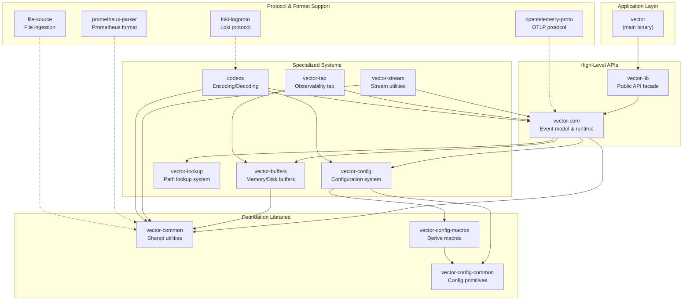
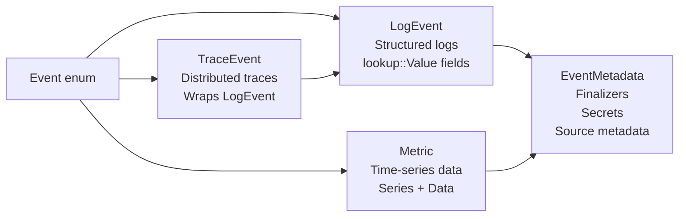
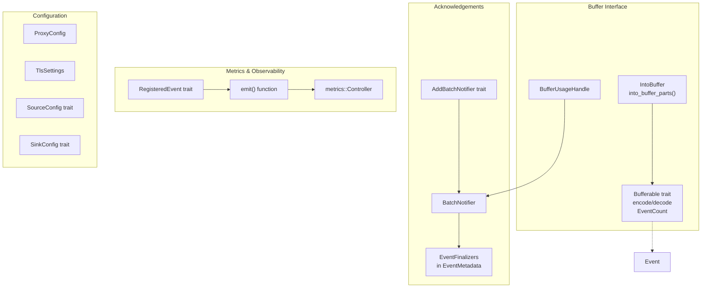
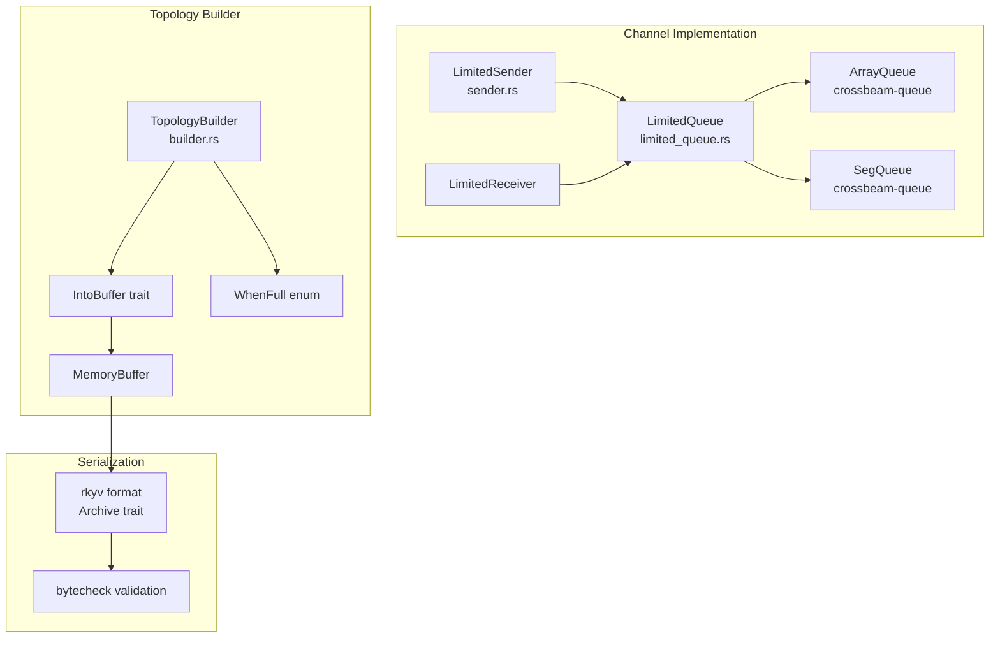
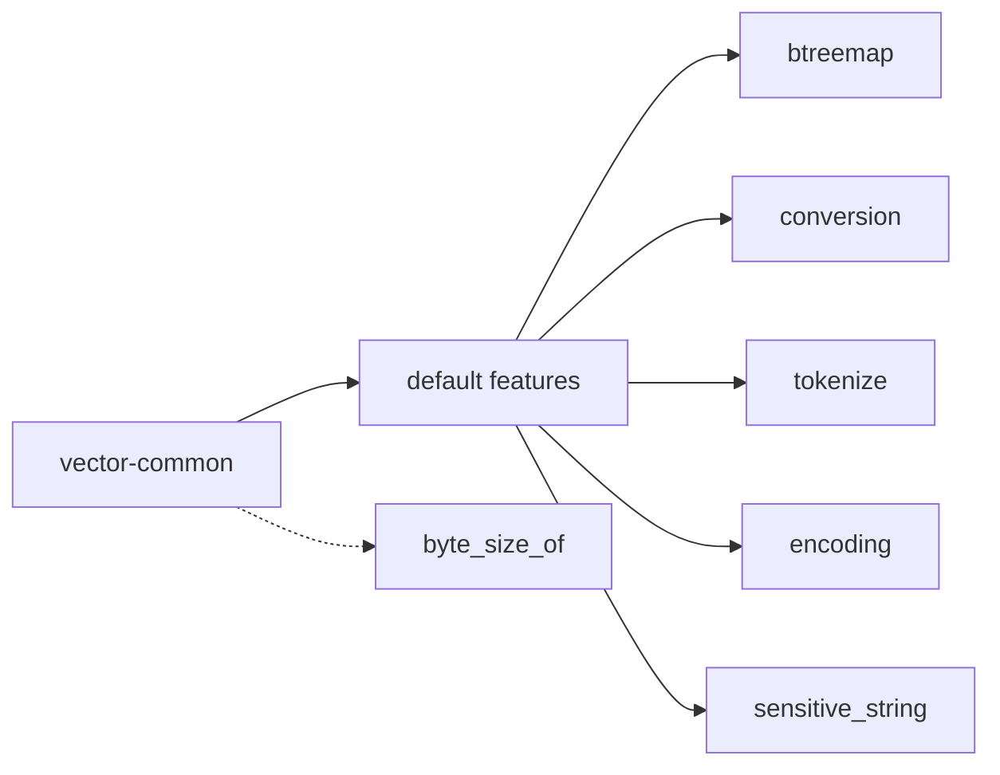
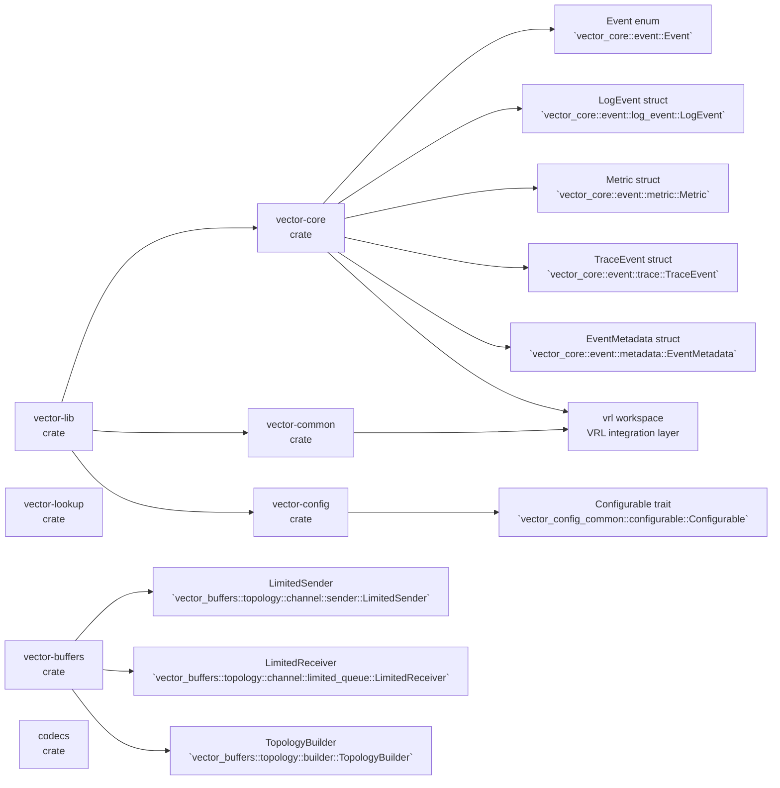

<!-- source: DeepWiki mcp.deepwiki.com · repo vectordotdev/vector · page 1.2 Core Libraries · fetched 2026-10-29 -->

# Core Libraries

<details>
<summary>Relevant source files</summary>

The following files were used as context for generating this wiki page:

- [Cargo.lock](Cargo.lock)
- [Cargo.toml](Cargo.toml)
- [LICENSE-3rdparty.csv](LICENSE-3rdparty.csv)
- [deny.toml](deny.toml)
- [lib/codecs/Cargo.toml](lib/codecs/Cargo.toml)
- [lib/docs-renderer/Cargo.toml](lib/docs-renderer/Cargo.toml)
- [lib/file-source/Cargo.toml](lib/file-source/Cargo.toml)
- [lib/k8s-e2e-tests/Cargo.toml](lib/k8s-e2e-tests/Cargo.toml)
- [lib/k8s-test-framework/Cargo.toml](lib/k8s-test-framework/Cargo.toml)
- [lib/loki-logproto/Cargo.toml](lib/loki-logproto/Cargo.toml)
- [lib/opentelemetry-proto/Cargo.toml](lib/opentelemetry-proto/Cargo.toml)
- [lib/prometheus-parser/Cargo.toml](lib/prometheus-parser/Cargo.toml)
- [lib/vector-api-client/Cargo.toml](lib/vector-api-client/Cargo.toml)
- [lib/vector-buffers/Cargo.toml](lib/vector-buffers/Cargo.toml)
- [lib/vector-common/Cargo.toml](lib/vector-common/Cargo.toml)
- [lib/vector-config-common/Cargo.toml](lib/vector-config-common/Cargo.toml)
- [lib/vector-config-macros/Cargo.toml](lib/vector-config-macros/Cargo.toml)
- [lib/vector-config-macros/src/configurable.rs](lib/vector-config-macros/src/configurable.rs)
- [lib/vector-config/Cargo.toml](lib/vector-config/Cargo.toml)
- [lib/vector-config/src/configurable.rs](lib/vector-config/src/configurable.rs)
- [lib/vector-config/src/external/chrono.rs](lib/vector-config/src/external/chrono.rs)
- [lib/vector-config/src/external/encoding_rs.rs](lib/vector-config/src/external/encoding_rs.rs)
- [lib/vector-config/src/external/indexmap.rs](lib/vector-config/src/external/indexmap.rs)
- [lib/vector-config/src/external/no_proxy.rs](lib/vector-config/src/external/no_proxy.rs)
- [lib/vector-config/src/external/serde_with.rs](lib/vector-config/src/external/serde_with.rs)
- [lib/vector-config/src/external/tz.rs](lib/vector-config/src/external/tz.rs)
- [lib/vector-config/src/external/url.rs](lib/vector-config/src/external/url.rs)
- [lib/vector-config/src/lib.rs](lib/vector-config/src/lib.rs)
- [lib/vector-config/src/metadata.rs](lib/vector-config/src/metadata.rs)
- [lib/vector-config/src/ser.rs](lib/vector-config/src/ser.rs)
- [lib/vector-config/src/stdlib.rs](lib/vector-config/src/stdlib.rs)
- [lib/vector-core/Cargo.toml](lib/vector-core/Cargo.toml)
- [lib/vector-core/src/config/log_schema.rs](lib/vector-core/src/config/log_schema.rs)
- [lib/vector-core/src/event/array.rs](lib/vector-core/src/event/array.rs)
- [lib/vector-core/src/event/log_event.rs](lib/vector-core/src/event/log_event.rs)
- [lib/vector-core/src/event/metadata.rs](lib/vector-core/src/event/metadata.rs)
- [lib/vector-core/src/event/metric/mod.rs](lib/vector-core/src/event/metric/mod.rs)
- [lib/vector-core/src/event/metric/value.rs](lib/vector-core/src/event/metric/value.rs)
- [lib/vector-core/src/event/mod.rs](lib/vector-core/src/event/mod.rs)
- [lib/vector-core/src/event/proto.rs](lib/vector-core/src/event/proto.rs)
- [lib/vector-core/src/event/trace.rs](lib/vector-core/src/event/trace.rs)
- [lib/vector-core/src/event/vrl_target.rs](lib/vector-core/src/event/vrl_target.rs)
- [lib/vector-core/src/lib.rs](lib/vector-core/src/lib.rs)
- [lib/vector-core/src/metrics/ddsketch.rs](lib/vector-core/src/metrics/ddsketch.rs)
- [lib/vector-core/src/metrics/mod.rs](lib/vector-core/src/metrics/mod.rs)
- [lib/vector-core/src/metrics/recency.rs](lib/vector-core/src/metrics/recency.rs)
- [lib/vector-core/src/metrics/recorder.rs](lib/vector-core/src/metrics/recorder.rs)
- [lib/vector-core/src/metrics/storage.rs](lib/vector-core/src/metrics/storage.rs)
- [lib/vector-lib/Cargo.toml](lib/vector-lib/Cargo.toml)
- [lib/vector-lib/src/lib.rs](lib/vector-lib/src/lib.rs)
- [lib/vector-lookup/Cargo.toml](lib/vector-lookup/Cargo.toml)
- [lib/vector-stream/Cargo.toml](lib/vector-stream/Cargo.toml)
- [lib/vector-tap/Cargo.toml](lib/vector-tap/Cargo.toml)
- [lib/vector-vrl/metrics/Cargo.toml](lib/vector-vrl/metrics/Cargo.toml)
- [license-tool.toml](license-tool.toml)
- [src/sinks/gcp_chronicle/compression.rs](src/sinks/gcp_chronicle/compression.rs)
- [src/sinks/util/buffer/compression.rs](src/sinks/util/buffer/compression.rs)
- [src/sinks/util/service/concurrency.rs](src/sinks/util/service/concurrency.rs)
- [src/sources/host_metrics/tcp.rs](src/sources/host_metrics/tcp.rs)
- [src/test_util/mod.rs](src/test_util/mod.rs)
- [vdev/Cargo.toml](vdev/Cargo.toml)

</details>


## Purpose and Scope

This document details the foundational Rust libraries that comprise Vector's core functionality. These libraries provide the building blocks for event processing, configuration management, buffering, and internal communication. The workspace contains 90+ crates, with the core libraries forming the base layer upon which sources, transforms, and sinks are built.

For information about the component architecture built on top of these libraries, see [Component Architecture (1.3)](). For application-level integration and topology construction, see [Application System (2)]().

---

## Library Dependency Structure

The core libraries are organized in a layered architecture where higher-level libraries depend on lower-level primitives:

**Diagram: Library Dependency Hierarchy**


Sources: [Cargo.toml:98-137](), [lib/vector-core/Cargo.toml:1-69](), [lib/vector-common/Cargo.toml:1-62](), [lib/vector-buffers/Cargo.toml:1-39](), [lib/vector-config/Cargo.toml:1-35]()

---

## vector-core

`vector-core` is the foundational library containing Vector's event data model, runtime primitives, and core processing abstractions.

### Event Data Model

The library defines three primary event types:

**Diagram: Event Model Entities**


**Key Components:**

| Component | Purpose | Location |
|-----------|---------|----------|
| `Event` | Top-level enum discriminating event types | [lib/vector-core/src/event/mod.rs]() |
| `LogEvent` | Structured log with `lookup::Value` fields | [lib/vector-core/src/event/log_event.rs]() |
| `Metric` | Time-series metric with series metadata | [lib/vector-core/src/event/metric/mod.rs]() |
| `TraceEvent` | Distributed trace wrapping `LogEvent` | [lib/vector-core/src/event/trace.rs]() |
| `EventMetadata` | Shared metadata across event types | [lib/vector-core/src/event/metadata.rs]() |

Sources: [lib/vector-core/src/event/mod.rs]()

### Runtime Abstractions

`vector-core` provides fundamental runtime abstractions for event buffering, acknowledgements, and metrics integration.

**Diagram: Core Runtime Traits and Types**


**Key abstractions:**

- `Bufferable`: Defines types that can be encoded/decoded for buffering, with associated `EventCount`.
- `IntoBuffer<T>`: Trait to convert a type into buffer components (such as buffer writer parts).
- `BatchNotifier`: Coordinates batched acknowledgements for event processing.
- `AddBatchNotifier`: Trait to add batch notifiers to event finalizers.
- `EventFinalizers`: Manages callbacks for finalizing event processing lifecycle.
- `RegisteredEvent`: Trait for emitting internal events for observability.
- Configuration traits such as `SourceConfig` and `SinkConfig` define construction and validation of sources and sinks.
- `TlsSettings` and `ProxyConfig` abstractions help standardize TLS and proxy network configuration.

**Dependencies:**

- VRL Integration (`vrl` workspace) is tightly coupled providing transformation support.  
- Networking uses `tonic` (gRPC) and `hyper-proxy` for HTTP proxy support.  
- Metrics are integrated with the `metrics` ecosystem (`metrics`, `metrics-tracing-context`, and `metrics-util`).  
- Async runtime powered by `tokio` with networking features enabled.

Sources: [lib/vector-core/Cargo.toml:11-68](), [lib/vector-core/src/lib.rs]()

---

## vector-buffers

Provides both in-memory and disk-based buffering abstractions with end-to-end acknowledgements for reliable event delivery.

### Buffer Architecture

**Diagram: Buffer Implementation Hierarchy**


### Channel Implementation Details

- `LimitedQueue` is a bounded multi-producer multi-consumer (MPMC) queue used as the core channel for event buffering. It is implemented in `limited_queue.rs`.
- `LimitedSender<T>` exposes an API to send events with backpressure support. It provides both blocking (`send()`) and non-blocking (`try_send()`) methods.
- `LimitedReceiver<T>` implements the `Stream` trait, allowing asynchronous consumption of buffered events.
- Internally, `LimitedQueue` uses `ArrayQueue` from `crossbeam-queue` for bounded capacity and `SegQueue` for unbounded segments when needed.

### Topology Builder

`TopologyBuilder<T>` facilitates construction of complex buffering topologies with controlled overflow policies.

- The `.stage()` method adds buffering stages with a defined `WhenFull` policy such as `Block`, `Drop`, or `Fail`.
- `.build()` consumes the builder producing a sender/receiver pair with full instrumentation and backpressure support.

This abstraction enables building adaptable buffering pipelines for sources, sinks, or intermediate transforms to control flow and buffering behavior reliably.

Sources: [lib/vector-buffers/Cargo.toml:1-39](), [lib/vector-buffers/src/topology/channel/limited_queue.rs:1-348](), [lib/vector-buffers/src/topology/builder.rs:1-187]()

---

## vector-lookup

`vector-lookup` implements the path-based event field querying system using efficient zero-copy path segments, crucial for querying and transforming event data.

### Core Types

| Type | Description |
|-------|-------------|
| `PathPrefix` | Enum defining path root types: event data (`.`) or event metadata (`%`). This is key for VRL path semantics distinguishing between data and metadata fields. |
| `OwnedValuePath` | An owned representation of a full lookup path, combining a prefix and a sequence of path segments as owned strings. Useful for configuration and caching scenarios. |
| `BorrowedSegment` | A zero-copy, borrowed segment type for efficient on-the-fly path traversal without allocation overhead. |

This library underpins Vector's dynamic field access and manipulation system, supporting serialization/deserialization for config and runtime performance.

### Integration

- Implements `serde::Serialize` and `Deserialize` traits to enable JSON and YAML configuration interoperability.
- Fully integrated with the configuration system to enable schema-based validation and component composition.

Sources: [lib/vector-lookup/Cargo.toml:1-22]()

---

## vector-lib

`vector-lib` is the stable public API facade of Vector’s core functionality. It selectively re-exports key types, traits, and modules from `vector-core` and related crates to provide a concise, stable interface for downstream users and extensions.

```toml
# Cargo.toml example usage
vector-lib = { path = "lib/vector-lib", default-features = false, features = ["vrl"] }
```

This crate abstracts internal engine details while exposing the necessary interfaces for event construction, runtime integration, and configuration.

Sources: [Cargo.toml:121](), [lib/vector-lib/Cargo.toml:1-20]()

---

## vector-common

`vector-common` houses shared types, utilities, and traits used across multiple Vector crates.

### Feature Gates and Modules

**Diagram: vector-common Feature Structure**


- The default feature set includes `btreemap`, `conversion`, `tokenize`, `encoding`, and `sensitive_string`.
- Provides utilities such as measuring deep byte size of types (`byte_size_of` feature), data encoding helpers, token parsing utilities, and sensitive string wrappers for safe data handling in logs.
- These utilities facilitate uniform implementations and optimizations shared across the Vector ecosystem.

Sources: [lib/vector-common/Cargo.toml:12-38]()

---

## vector-config

The `vector-config` crate provides robust configuration management, supporting configuration validation, schema generation, and type-safe abstractions for Vector's entire config ecosystem.

### Key Components

| Component | Purpose | Location |
|-----------|---------|----------|
| `Configurable` trait | A generic trait that marks types as configurable, enabling validation and value extraction | [lib/vector-config-common/src/configurable.rs]() |
| `#[configurable_component]` derive macro | Generates configuration traits and builders for components automatically | [lib/vector-config-macros/src/lib.rs]() |

### Supported Types

- `HumanDuration` wraps `chrono::Duration` for user-friendly duration specification in configuration.
- `url::Url` for validated URL fields.
- `no-proxy::NoProxy` type for defining proxy exclusion lists.
- `encoding_rs::Encoding` for specifying encoding schemes.

This crate efficiently uses `serde`, `indexmap`, and `snafu` for serialization, mapping, and error handling during config loading and validation.

Sources: [lib/vector-config/Cargo.toml:1-35](), [lib/vector-config-macros/Cargo.toml:1-21](), [lib/vector-config-common/Cargo.toml:1-16]()

---

## codecs

`codecs` provides serialization and deserialization support for many data formats used in log and metric processing.

### Format Support

- **Text-based:** JSON, NDJSON, CSV, logfmt, raw text logs.
- **Binary:** Protocol Buffers (via `prost`), Apache Avro.
- **Syslog:** RFC 3164 and 5424, powered by the `syslog_loose` crate.

### Feature Flags

- `arrow` feature enables Apache Arrow IPC format encoding/decoding.
- `opentelemetry` feature supports OTLP encoding formats.

The codecs library is essential for data ingestion, parsing, and data sink encoding.

Sources: [lib/codecs/Cargo.toml:1-85]()

---

## Protocol Libraries

Several specialized protocol libraries support Vector's interoperability with observability protocols:

- **loki-logproto:** Protobuf definitions and client/server bindings for Grafana Loki's streaming protocol, generated by `prost-build`.
- **opentelemetry-proto:** Protobuf messages and gRPC services implementing OTLP logs, metrics, and trace protocol, generated by `tonic-build`.
- **prometheus-parser:** A parser library using `nom` combinators for Prometheus exposition format (text-based metrics).

These libraries ensure Vector can send and receive telemetry data using widely-adopted open standards.

Sources: [lib/loki-logproto/Cargo.toml:1-19](), [lib/opentelemetry-proto/Cargo.toml:1-23](), [lib/prometheus-parser/Cargo.toml:1-21]()

---

## Workspace Organization

The core libraries follow a consistent organizational pattern within the workspace:

```
lib/
├── vector-core/          # Event model and runtime primitives
├── vector-lib/           # Public API facade over vector-core and related libraries
├── vector-common/        # Shared utilities and data structures
├── vector-config/        # Configuration system with validation and schema generation
├── vector-buffers/       # Buffer implementations for memory and disk
├── vector-lookup/        # Path querying system for event fields
├── vector-stream/        # Stream handling utilities
├── codecs/               # Encoding and decoding implementations
└── ...                   # Additional libraries like protocol formats, tap, top, etc.
```

All core libraries:

- Use Rust edition 2024.
- Marked as `publish = false` to prevent external publishing.
- Licensed under MPL-2.0.

Sources: [Cargo.toml:1-137]()

---

# Mapping Natural Language Names to Code Entities

To bridge between conceptual terminology and code entities, here is a diagram associating main core libraries and key structs or traits identified by their Rust module or crate names.



Sources: Multiple files in `lib/vector-core/src`, `lib/vector-buffers/src`, `lib/vector-config-common/src`, [lib/vector-core/Cargo.toml:11-68](), [lib/vector-buffers/Cargo.toml:1-39](), [lib/vector-config/Cargo.toml:1-35]()

---

# Summary

The core libraries form a robust foundation enabling high-performance, extensible, and reliable observability data pipeline components. `vector-core` establishes the event model and critical runtime abstractions. `vector-buffers` delivers flexible, efficient buffering and flow control. `vector-config` enables comprehensive configuration management with schema and validation support. `vector-common` hosts shared utilities widely leveraged across Vector.

Supplementary protocol and codec libraries ensure compatibility with a variety of telemetry formats and standards.

Together, these foundational crates support Vector’s entire observability pipeline from low-level event processing, through configuration-driven component composition, to live user interaction.

Sources: Aggregated from all cited files above.

---

