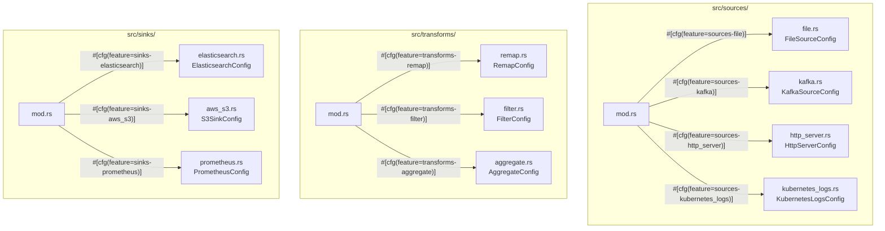
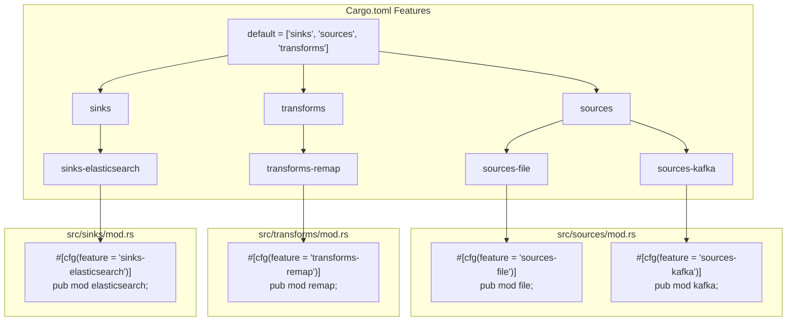
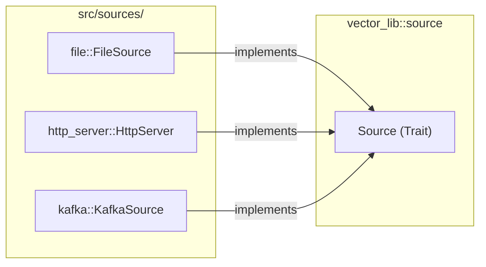
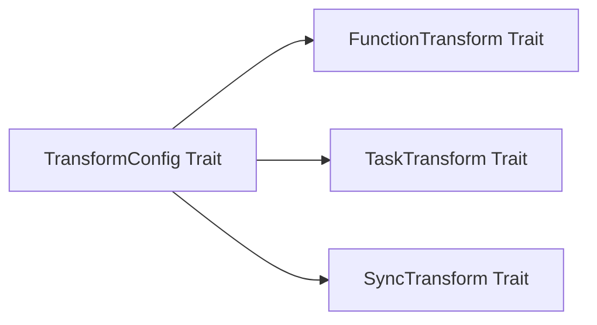
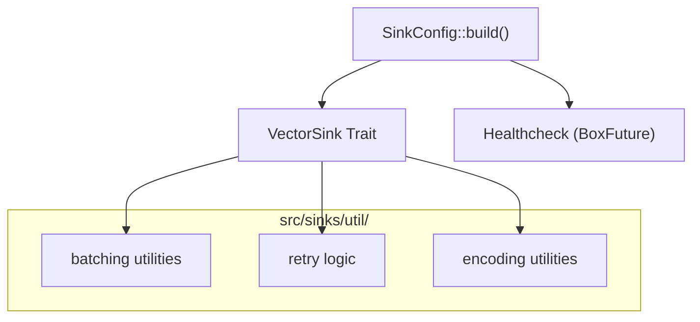

<!-- source: DeepWiki mcp.deepwiki.com · repo vectordotdev/vector · page 1.3 Component Architecture · fetched 2026-10-29 -->

# Component Architecture

Relevant source files

The following files were used as context for generating this wiki page:

- [docs/REVIEWING.md](docs/REVIEWING.md)
- [docs/USER_EXPERIENCE_DESIGN.md](docs/USER_EXPERIENCE_DESIGN.md)
- [docs/specs/buffer.md](docs/specs/buffer.md)
- [docs/specs/component.md](docs/specs/component.md)
- [docs/specs/configuration.md](docs/specs/configuration.md)
- [docs/specs/instrumentation.md](docs/specs/instrumentation.md)
- [docs/specs/target.md](docs/specs/target.md)
- [lib/vector-core/src/config/global_options.rs](lib/vector-core/src/config/global_options.rs)
- [src/config/vars.rs](src/config/vars.rs)
- [src/internal_events/mod.rs](src/internal_events/mod.rs)
- [src/sinks/mod.rs](src/sinks/mod.rs)
- [src/sources/mod.rs](src/sources/mod.rs)
- [src/sources/prometheus/mod.rs](src/sources/prometheus/mod.rs)
- [src/test_util/components.rs](src/test_util/components.rs)
- [src/transforms/mod.rs](src/transforms/mod.rs)
- [website/content/en/docs/reference/configuration/_index.md](website/content/en/docs/reference/configuration/_index.md)
- [website/content/en/docs/reference/configuration/sources/prometheus_pushgateway.md](website/content/en/docs/reference/configuration/sources/prometheus_pushgateway.md)
- [website/cue/reference.cue](website/cue/reference.cue)
- [website/cue/reference/components.cue](website/cue/reference/components.cue)
- [website/cue/reference/components/sinks.cue](website/cue/reference/components/sinks.cue)
- [website/cue/reference/components/sources.cue](website/cue/reference/components/sources.cue)
- [website/cue/reference/components/sources/internal_metrics.cue](website/cue/reference/components/sources/internal_metrics.cue)
- [website/cue/reference/components/transforms.cue](website/cue/reference/components/transforms.cue)
- [website/cue/reference/components/transforms/remap.cue](website/cue/reference/components/transforms/remap.cue)
- [website/cue/reference/configuration.cue](website/cue/reference/configuration.cue)
- [website/cue/reference/remap.cue](website/cue/reference/remap.cue)
- [website/cue/reference/remap/concepts/metrics.cue](website/cue/reference/remap/concepts/metrics.cue)
- [website/cue/reference/remap/expressions.cue](website/cue/reference/remap/expressions.cue)
- [website/cue/reference/remap/expressions/function_call.cue](website/cue/reference/remap/expressions/function_call.cue)
- [website/cue/reference/urls.cue](website/cue/reference/urls.cue)
- [website/data/redirects.yaml](website/data/redirects.yaml)
- [website/layouts/partials/badge.html](website/layouts/partials/badge.html)
- [website/layouts/partials/data.html](website/layouts/partials/data.html)

Vector's codebase is architected around three fundamental component types — **sources**, **transforms**, and **sinks** — which together form the data processing pipeline. Each component type implements a distinct configuration trait used by the topology system to instantiate and connect runtime components. This page documents the modular organization of these components, the feature flag system enabling selective compilation, and the component specification rules ensuring consistent behavior and observability.

---

## Module Organization

The three component types live in separate top-level modules within `src/`, each containing numerous component implementations. These modules leverage Rust's **conditional compilation** with feature flags to include only the needed components.

- `src/sources/` contains all source components (data inputs).
- `src/transforms/` contains all transform components (data processing).
- `src/sinks/` contains all sink components (data outputs).

Each module’s `mod.rs` declares submodules guarded by feature flags.

| Module            | File       | Key Exports                                    |
|-------------------|------------|------------------------------------------------|
| `src/sources/`    | `mod.rs`   | `pub use vector_lib::source::Source`          |
| `src/transforms/` | `mod.rs`   | Transform traits such as `FunctionTransform`, `TaskTransform`, `SyncTransform` |
| `src/sinks/`      | `mod.rs`   | `pub use vector_lib::sink::VectorSink`, `Healthcheck`        |

Sources: [src/sources/mod.rs:1-113](), [src/transforms/mod.rs:1-109](), [src/sinks/mod.rs:1-149]()

---

## Feature Flag System and Conditional Compilation

Vector supports selective compilation of components using Cargo feature flags. Feature flags follow a prefix convention enabling granular builds tailored to specific integrations:

| Component Type | Feature Prefix   | Example                | Aggregate Feature |
|----------------|------------------|------------------------|-------------------|
| Source         | `sources-`       | `sources-file`          | `sources`         |
| Transform      | `transforms-`    | `transforms-remap`      | `transforms`      |
| Sink           | `sinks-`         | `sinks-elasticsearch`   | `sinks`           |

These flags conditionally compile only the components enabled, reducing binary size and dependencies.

Sources: [src/sources/mod.rs:4-99](), [src/transforms/mod.rs:10-39](), [src/sinks/mod.rs:8-122]()

---

## Component Specification

The **Component Specification** (documented in [docs/specs/component.md]) prescribes behavior and naming rules to guarantee uniformity and observability of sources, transforms, and sinks.

### Naming Conventions

- **Sources and Sinks:**
  - Contain only ASCII lowercase alphanumeric characters and underscores.
  - Named as nouns after integrated protocols or services.
  - May have event type suffixes (`logs`, `metrics`, `traces`) if event-type specific, e.g., `kubernetes_logs`.
  
- **Transforms:**
  - Contain only ASCII lowercase alphanumeric characters and underscores.
  - Named as verbs describing their purpose, e.g., `remap`, `filter`.

### Configuration Rules

- Components connecting downstream SHOULD expose either:
  - An `endpoint` string option for a single destination.
  - Or an `endpoints` array of strings for multiple destinations.

- Components listening for incoming connections SHOULD expose a `listen` option formatted as `<protocol>:<address>`, with possible protocols:

  - `unix+stream`, `unix+datagram`, or `unix` (alias for `unix+stream`)
  - `tcp`
  - `udp`

These patterns promote consistent address configuration.

### Instrumentation and Observability Events

Components MUST emit internal telemetry events providing lifecycle insights:

| Event                 | Description                                             | Metric Impact                       |
|-----------------------|---------------------------------------------------------|------------------------------------|
| `ComponentEventsReceived`  | Emitted immediately after receiving Vector events.     | Increments `component_received_events_total` counter. |
| `ComponentEventsSent`      | Emitted immediately before sending events downstream.  | Increments `component_sent_events_total` counter.     |
| `ComponentError`           | Emitted on component errors.                            | Increments `component_errors_total` counter.          |
| `ComponentEventsDropped`   | Emitted when events are dropped (e.g., filtered out).  | Increments `component_discarded_events_total` counter.|

Event emission can include component-specific context and may batch events for performance, ensuring metrics reflect actual counts.

Instrumentation events and their code exist under feature gates corresponding to each component.

Sources: [docs/specs/component.md:51-241](), [src/internal_events/mod.rs:1-157]()

---

## Sources: Data Ingestion Components

Sources ingest external data and convert them into Vector's internal `Event` structure. They implement the `Source` trait from `vector_lib::source` and provide configuration via `SourceConfig`.

Sources commonly rely on utility submodules (found in `src/sources/util/`) providing shared infrastructure like multiline log handling, handshake, framing, or HTTP parsing.

Sources: [src/sources/mod.rs:1-113]()

---

## Transforms: Event Processing Components

Transforms modify, filter, enrich, and route streams of events. They are implemented using one or more concurrency models defined via traits:

| Trait                  | Characteristics                                 | Example Transforms                   |
|------------------------|-----------------------------------------------|-----------------------------------|
| `FunctionTransform`     | Sync; process one event: emit zero or more events | `remap`, `filter`                 |
| `SyncTransform`        | Synchronous batch processing                   | `dedupe`                          |
| `TaskTransform`        | Async, spawn tasks, can involve await points  | `aggregate`, `reduce`             |

Transforms provide `TransformConfig` implementations to instantiate and compose runtime transforms in the topology.

Sources: [src/transforms/mod.rs:41-44](), [src/transforms/mod.rs:76-81]()

---

## Sinks: Data Output Components

Sinks deliver processed events to external systems such as HTTP endpoints, databases, or messaging queues. They implement the `VectorSink` trait from `vector_lib::sink`.

Sinks usually provide advanced features including:

- Batching and compression
- Event encoding formats (JSON, Avro, Protobuf, Arrow, etc.)
- Adaptive concurrency control and retries with `tower::Service` integration
- Healthcheck futures to verify external service availability on start

Sources: [src/sinks/mod.rs:1-149](), [website/cue/reference/components/sinks.cue:3-50]()

---

# Summary

Vector's component architecture centralizes sources, transforms, and sinks as independent modular units forming directed acyclic graphs for observability data pipelines. This architecture, combined with feature flags and conditional compilation, allows creating custom, optimized Vector binaries including only needed functionality. The formal component specification enforces consistent naming, configuration, and instrumentation across well over 100 components, enabling production-grade reliability and monitoring.

---

# References

- Component Specification: [docs/specs/component.md]()
- Source Module: [src/sources/mod.rs]()
- Transform Module: [src/transforms/mod.rs]()
- Sink Module: [src/sinks/mod.rs]()
- Internal Events and Instrumentation: [src/internal_events/mod.rs]()
- Feature Flags and Conditional Compilation: [src/sources/mod.rs:4-99](), [src/transforms/mod.rs:10-39](), [src/sinks/mod.rs:8-122]()

---

