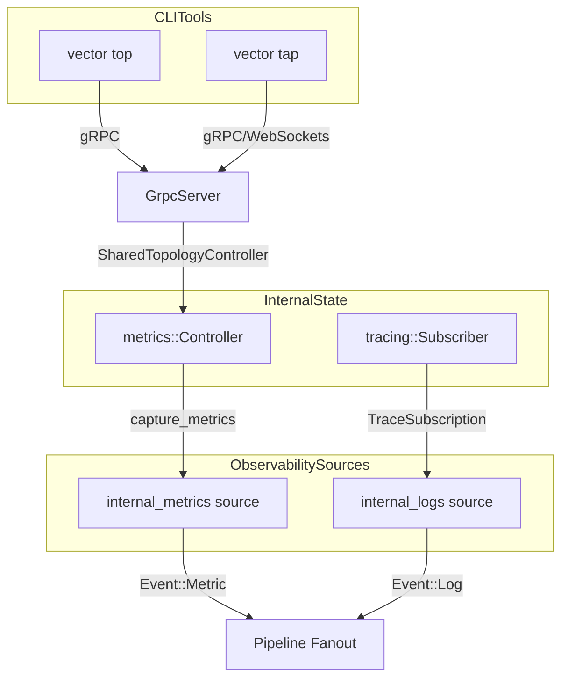
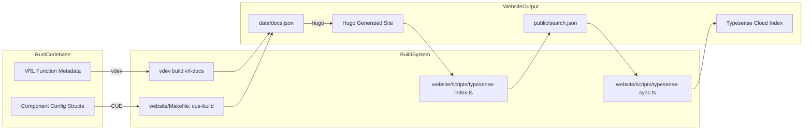

<!-- source: DeepWiki mcp.deepwiki.com · repo vectordotdev/vector · page 10 Observability and API · fetched 2026-10-29 -->

# Observability and API

Relevant source files

The following files were used as context for generating this wiki page:

- [lib/vector-top/Cargo.toml](lib/vector-top/Cargo.toml)
- [lib/vector-top/src/dashboard.rs](lib/vector-top/src/dashboard.rs)
- [lib/vector-top/src/events.rs](lib/vector-top/src/events.rs)
- [lib/vector-top/src/input.rs](lib/vector-top/src/input.rs)
- [lib/vector-top/src/lib.rs](lib/vector-top/src/lib.rs)
- [lib/vector-top/src/metrics.rs](lib/vector-top/src/metrics.rs)
- [lib/vector-top/src/state.rs](lib/vector-top/src/state.rs)
- [src/internal_telemetry/mod.rs](src/internal_telemetry/mod.rs)
- [src/tap/cmd.rs](src/tap/cmd.rs)
- [src/tap/mod.rs](src/tap/mod.rs)
- [src/top/cmd.rs](src/top/cmd.rs)
- [src/top/mod.rs](src/top/mod.rs)
- [website/.nvmrc](website/.nvmrc)
- [website/Dockerfile](website/Dockerfile)
- [website/Makefile](website/Makefile)
- [website/README.md](website/README.md)
- [website/assets/js/app.js](website/assets/js/app.js)
- [website/assets/js/dd-browser-logs-rum.js](website/assets/js/dd-browser-logs-rum.js)
- [website/babel.config.js](website/babel.config.js)
- [website/docker-compose.yml](website/docker-compose.yml)
- [website/layouts/partials/javascript/below.html](website/layouts/partials/javascript/below.html)
- [website/layouts/partials/javascript/head.html](website/layouts/partials/javascript/head.html)
- [website/package.json](website/package.json)
- [website/scripts/typesense-index.ts](website/scripts/typesense-index.ts)
- [website/scripts/typesense-sync.ts](website/scripts/typesense-sync.ts)
- [website/tsconfig.json](website/tsconfig.json)
- [website/typesense.config.json](website/typesense.config.json)
- [website/yarn.lock](website/yarn.lock)

Vector provides a suite of self-observability features designed to monitor its own performance, inspect live data flows, and provide comprehensive documentation for its extensive component library. These features are exposed through a unified gRPC API, specialized CLI tools, and a metadata-driven documentation system.

## Self-Observability Architecture

Vector's internal state is exposed via several mechanisms that allow users to monitor the health and performance of the pipeline.

*   **Internal Metrics & Logs**: Vector emits its own telemetry using the `internal_metrics` source. This source captures data such as `api_started_total`, `connection_established_total`, and `reloaded_total`.
*   **Component Telemetry**: Individual components emit specific metrics, such as `adaptive_concurrency_in_flight` for sinks or `aggregate_events_recorded_total` for transforms.
*   **Allocation Tracing**: On Unix systems, Vector can track memory allocations per component, which is visualized in the `top` dashboard as the `MEMORY_USED` column [lib/vector-top/src/dashboard.rs:36-38](), [lib/vector-top/src/dashboard.rs:160-162]().
*   **VRL Playground**: For observability into transform logic, Vector provides a WebAssembly-based VRL playground used in the documentation website.

### Telemetry Flow Diagram

This diagram shows how internal telemetry is collected and exposed back into the pipeline and external CLI tools.

**Sources:** [src/api/grpc/service.rs:1-15](), [lib/vector-top/src/state.rs:32-54](), [src/internal_telemetry/mod.rs:1-10]()

## Vector API and CLI Tools

The Vector API server acts as the central hub for live inspection and monitoring. It implements a gRPC interface that allows external tools to query the running topology and inspect events.

*   **GrpcServer**: The primary interface for administrative and observability queries.
*   **Top**: A CLI tool implemented in `vector-top` that provides a real-time terminal dashboard of component utilization (throughput, errors, and memory) [src/top/cmd.rs:20-53](). It uses `ratatui` for the TUI implementation [lib/vector-top/src/dashboard.rs:12-22]().
*   **Tap**: A tool for live event inspection, allowing users to "tap" into a specific component's output stream via the `vector-tap` crate [src/tap/cmd.rs:41-43](). It supports sampling intervals and limits [src/tap/mod.rs:15-26]().
*   **API Client**: A dedicated `Client` struct in `vector-api-client` handles the gRPC communication, health checks, and reconnection logic [src/tap/cmd.rs:19-21](), [src/top/cmd.rs:34-36]().

For details, see [Vector API and Tap/Top](#10.1).

**Sources:** [src/top/mod.rs:14-56](), [lib/vector-top/src/state.rs:117-128](), [lib/vector-top/src/dashboard.rs:146-176](), [src/tap/cmd.rs:13-38]()

## Website and Documentation System

Vector's documentation is treated as code. The system ensures that the website, CLI help text, and configuration validation remain in sync by using a schema-driven approach based on CUE and Hugo.

*   **CUE Metadata**: Vector uses the CUE configuration language to define the schema for all components. The website builds this into a structured `docs.json` [website/README.md:33-39]().
*   **Hugo Website**: The frontend is a Hugo-based site located in the `website/` directory [website/README.md:25-28](). It uses Tailwind CSS for styling and Alpine.js for interactivity [website/README.md:43-58]().
*   **Search System**: Vector uses a custom search pipeline. A script `typesense-index.ts` parses the generated HTML to create a search index [website/scripts/typesense-index.ts:233-238](), which is then synced to a Typesense backend via `typesense-sync.ts` [website/package.json:5-7]().
*   **VRL Documentation**: VRL function documentation is generated via `vdev build vrl-docs` and output as CUE files [website/Makefile:37-39]().

For details, see [Website and Documentation System](#10.2).

### Documentation Pipeline Entity Mapping

This diagram bridges the documentation generation scripts to the final website entities.

**Sources:** [website/Makefile:27-40](), [website/README.md:68-75](), [website/typesense.config.json:1-10](), [website/package.json:4-7]()

## Internal Libraries

Vector includes several specialized internal libraries to support its observability and parsing needs:
*   **`vector-api-client`**: A client library for interacting with the Vector gRPC API [src/tap/cmd.rs:4-6]().
*   **`vector-top`**: Logic for the component monitor dashboard, including TUI rendering and metric formatting [lib/vector-top/src/dashboard.rs:79-108](). It includes a `ThousandsFormatter` and `HumanFormatter` for readable metrics [lib/vector-top/src/dashboard.rs:46-108]().
*   **`vector-vrl-web-playground`**: WASM-compatible library for the VRL playground integrated into the website.

**Sources:** [lib/vector-top/Cargo.toml:1-20](), [src/top/cmd.rs:9-15](), [lib/vector-top/src/dashboard.rs:110-138]()

---

