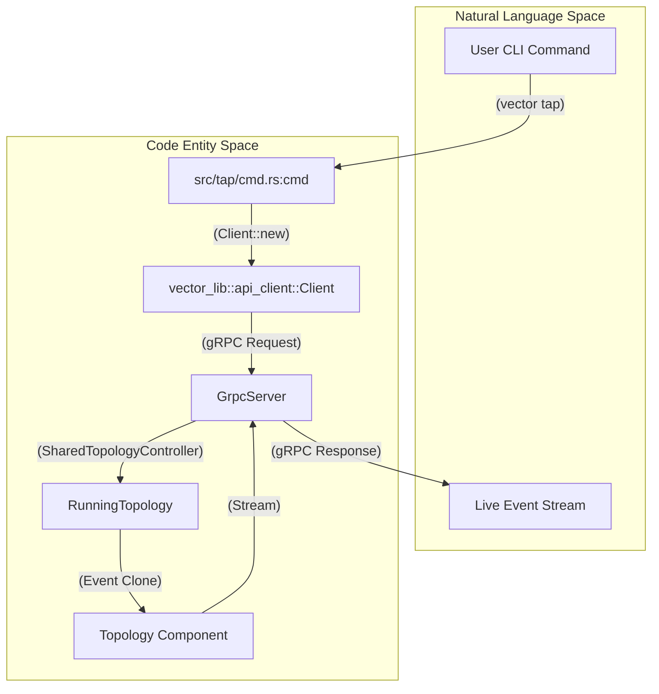

<!-- source: DeepWiki mcp.deepwiki.com · repo vectordotdev/vector · page 10.1 Vector API and Tap/Top · fetched 2026-10-29 -->

# Vector API and Tap/Top

Relevant source files

The following files were used as context for generating this wiki page:

- [lib/vector-top/Cargo.toml](lib/vector-top/Cargo.toml)
- [lib/vector-top/src/dashboard.rs](lib/vector-top/src/dashboard.rs)
- [lib/vector-top/src/events.rs](lib/vector-top/src/events.rs)
- [lib/vector-top/src/input.rs](lib/vector-top/src/input.rs)
- [lib/vector-top/src/lib.rs](lib/vector-top/src/lib.rs)
- [lib/vector-top/src/metrics.rs](lib/vector-top/src/metrics.rs)
- [lib/vector-top/src/state.rs](lib/vector-top/src/state.rs)
- [src/dns.rs](src/dns.rs)
- [src/internal_events/adaptive_concurrency.rs](src/internal_events/adaptive_concurrency.rs)
- [src/internal_events/open.rs](src/internal_events/open.rs)
- [src/internal_telemetry/mod.rs](src/internal_telemetry/mod.rs)
- [src/sinks/util/adaptive_concurrency/controller.rs](src/sinks/util/adaptive_concurrency/controller.rs)
- [src/sinks/util/adaptive_concurrency/future.rs](src/sinks/util/adaptive_concurrency/future.rs)
- [src/sinks/util/adaptive_concurrency/mod.rs](src/sinks/util/adaptive_concurrency/mod.rs)
- [src/sinks/util/adaptive_concurrency/service.rs](src/sinks/util/adaptive_concurrency/service.rs)
- [src/sinks/util/buffer/partition.rs](src/sinks/util/buffer/partition.rs)
- [src/tap/cmd.rs](src/tap/cmd.rs)
- [src/tap/mod.rs](src/tap/mod.rs)
- [src/top/cmd.rs](src/top/cmd.rs)
- [src/top/mod.rs](src/top/mod.rs)
- [src/utilization.rs](src/utilization.rs)

Vector provides a built-in gRPC API for live monitoring and inspection of the running pipeline. This API powers the `vector tap` and `vector top` CLI commands, enabling real-time event observation and resource utilization tracking.

## gRPC API Server

The `GrpcServer` is the primary entry point for external interaction with a running Vector instance. It is managed by the `Application` and runs as a background task on the Tokio runtime.

The API server is enabled via the `api` configuration block. If `api.enabled` is set to `true`, the `ApplicationConfig` initializes the server using the current topology's configuration and a watch channel for topology updates.

### Key Responsibilities
*   **Configuration Access**: Provides the current compiled configuration of the Vector instance.
*   **Topology Monitoring**: Watches for changes in the running topology.
*   **Tap Subsystem**: Manages event tapping requests from clients by interacting with the topology.
*   **Metrics/Utilization**: Exposes component-level utilization data aggregated by internal controllers, including throughput and memory allocation [lib/vector-top/src/metrics.rs:11-14]().

### SharedTopologyController
The API interacts with the core engine through the `SharedTopologyController`. This interface allows the API to query the state of the pipeline and coordinate with the `TopologyController` for operations like reloading or component inspection.

**Sources:**
* [lib/vector-top/src/metrics.rs:11-14]()

---

## Tap Subsystem

The Tap subsystem allows users to "tap" into specific components (sources, transforms, or sinks) to view events as they flow through the pipeline in real-time.

### Implementation and Data Flow
When a tap request is initiated (usually via `vector tap`), the following occurs:
1.  **Request**: The `vector-api-client` sends a gRPC request specifying the component ID and optional filtering criteria [src/tap/cmd.rs:13-19]().
2.  **Wiring**: The `TapRunner` orchestrates the connection. It uses the `url` provided in `Opts` (defaulting to the local API port) to establish a stream [src/tap/mod.rs:80-85]().
3.  **Event Capture**: The `TapRunner` executes `run_tap` or `run_tap_with_client`, which initiates the gRPC stream to the server [src/tap/cmd.rs:63-80]().
4.  **Streaming**: Events are formatted via `EventFormatter` and output to the specified `OutputChannel` (usually `Stdout`) [src/tap/cmd.rs:51-57]().

### Tap Components
*   **`vector-api-client`**: A client library used by the CLI to communicate with the gRPC server [src/tap/cmd.rs:4-6]().
*   **`tap` Module**: Contains the CLI logic and option parsing for the `tap` subcommand, supporting interval, limit, and format settings [src/tap/mod.rs:13-59]().
*   **`TapRunner`**: Orchestrates the execution of a tap session, handling connection logic and event formatting [src/tap/cmd.rs:52-57]().

### API to Topology Interaction
The following diagram illustrates how the `GrpcServer` interacts with the pipeline to facilitate tapping.

**Topology Tap Wiring**

**Sources:**
* [src/tap/cmd.rs:13-106]()
* [src/tap/mod.rs:1-85]()

---

## Top Command and Utilization

The `vector top` command provides a terminal-based UI for monitoring the resource utilization and throughput of every component in the topology.

### Utilization Tracking
Vector tracks utilization through specialized logic that measures poll intervals and wait times.

1.  **`Utilization<S>` Wrapper**: A stream wrapper that measures the time between when a caller requests an event and when it is ready [src/utilization.rs:33-38]().
2.  **`poll_next` Measurement**: The wrapper calls `try_send_start_wait` before polling the inner stream and `try_send_stop_wait` after the event is ready [src/utilization.rs:74-89]().
3.  **`Timer` and EWMA**: The `Timer` calculates a `wait_ratio` and updates an Exponentially Weighted Moving Average (EWMA) to estimate utilization [src/utilization.rs:145-167]().
4.  **Allocation Tracing**: On Unix systems, Vector can track memory allocations per component via the `allocated_bytes` gRPC stream [lib/vector-top/src/metrics.rs:129-156]().

### Dashboard and State Management
The `top` command uses a decoupled architecture for UI and data:
*   **`state::updater`**: A background task that consumes gRPC metric streams (Events In/Out, Bytes In/Out, Errors) and updates the local `State` [src/top/cmd.rs:69]().
*   **`init_dashboard`**: Initializes the `ratatui` terminal interface, rendering the `State` into tables [src/top/cmd.rs:76-85]().
*   **`ThousandsFormatter` / `HumanFormatter`**: Traits used to format raw metric values into readable strings (e.g., "1.2k" or "5.4 MB/s") [lib/vector-top/src/dashboard.rs:47-108]().

**Utilization Data Flow**

```mermaid
graph LR
    subgraph "Natural Language Space"
        Monitor["Monitoring Terminal"]
    end

    subgraph "Code Entity Space"
        Utilization["src/utilization.rs:Utilization"] -->|"(UtilizationTimerMessage)"| Emitter["src/utilization.rs:UtilizationEmitter"]
        Emitter -->|"(Gauge Update)"| InternalMetrics["metrics::Gauge"]
        InternalMetrics -.->|"(Query)"| GrpcServer["GrpcServer"]
        GrpcServer -->|"(gRPC Subscription)"| TopCmd["src/top/cmd.rs:subscription"]
        TopCmd -->|"(EventType::InitializeState)"| StateUpdater["lib/vector-top/src/state.rs:updater"]
        StateUpdater -->|"(state_rx)"| Dashboard["lib/vector-top/src/dashboard.rs:init_dashboard"]
        Dashboard --> Monitor
    end
```

**Sources:**
* [src/utilization.rs:33-177]()
* [src/top/cmd.rs:20-168]()
* [lib/vector-top/src/dashboard.rs:1-240]()
* [lib/vector-top/src/metrics.rs:32-87]()
* [lib/vector-top/src/state.rs:32-54]()

---

## Adaptive Concurrency Monitoring
The API also tracks internal states of the `AdaptiveConcurrencyLimit` layer used in sinks.

*   **`Controller`**: Manages the semaphore and calculates RTT (Round Trip Time) deviations [src/sinks/util/adaptive_concurrency/controller.rs:27-40]().
*   **Internal Events**: Emits `AdaptiveConcurrencyLimit`, `AdaptiveConcurrencyInFlight`, and RTT metrics which are observable via the API [src/sinks/util/adaptive_concurrency/controller.rs:89-92]().

### Internal Gauge Management
Vector uses an `OpenGauge` system to track active connections and endpoints. This implementation uses atomic synchronization (`gauge_add`) to ensure consistency across threads without heavy locking [src/internal_events/open.rs:37-119]().

**Sources:**
* [src/sinks/util/adaptive_concurrency/controller.rs:63-94]()
* [src/internal_events/open.rs:37-119]()

---

