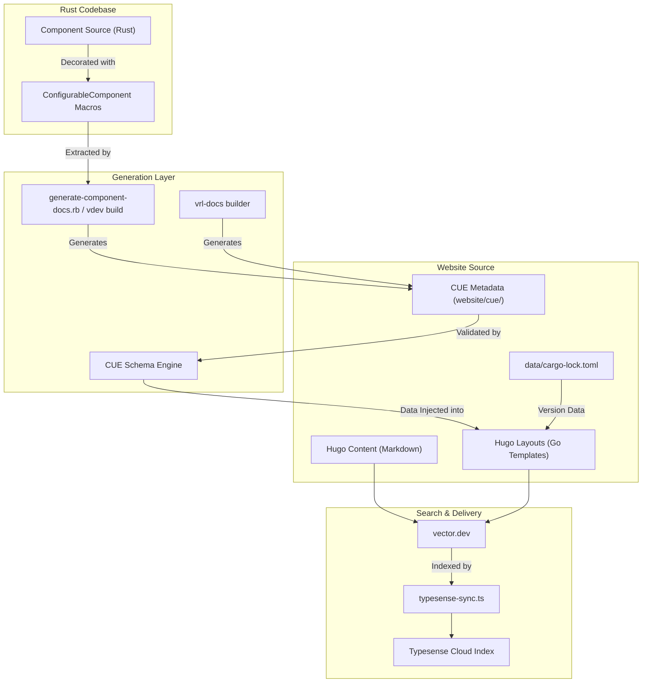

<!-- source: DeepWiki mcp.deepwiki.com · repo vectordotdev/vector · page 10.2 Website and Documentation System · fetched 2026-10-29 -->

# Website and Documentation System

Relevant source files

The following files were used as context for generating this wiki page:

- [lib/vector-config-macros/src/ast/container.rs](lib/vector-config-macros/src/ast/container.rs)
- [lib/vector-config-macros/src/ast/field.rs](lib/vector-config-macros/src/ast/field.rs)
- [lib/vector-config-macros/src/ast/util.rs](lib/vector-config-macros/src/ast/util.rs)
- [lib/vector-config-macros/src/ast/variant.rs](lib/vector-config-macros/src/ast/variant.rs)
- [lib/vector-config/tests/integration/smoke.rs](lib/vector-config/tests/integration/smoke.rs)
- [src/test_util/components.rs](src/test_util/components.rs)
- [vdev/src/commands/build/component_docs/schema_resolve.rs](vdev/src/commands/build/component_docs/schema_resolve.rs)
- [vdev/src/commands/build/component_docs/schema_utils.rs](vdev/src/commands/build/component_docs/schema_utils.rs)
- [website/.env.example](website/.env.example)
- [website/.nvmrc](website/.nvmrc)
- [website/Dockerfile](website/Dockerfile)
- [website/Makefile](website/Makefile)
- [website/README.md](website/README.md)
- [website/assets/js/app.js](website/assets/js/app.js)
- [website/assets/js/below.js](website/assets/js/below.js)
- [website/assets/js/dd-browser-logs-rum.js](website/assets/js/dd-browser-logs-rum.js)
- [website/assets/js/home.tsx](website/assets/js/home.tsx)
- [website/assets/js/search.tsx](website/assets/js/search.tsx)
- [website/assets/js/tracking-marketing.js](website/assets/js/tracking-marketing.js)
- [website/babel.config.js](website/babel.config.js)
- [website/config.toml](website/config.toml)
- [website/cue/reference.cue](website/cue/reference.cue)
- [website/cue/reference/components.cue](website/cue/reference/components.cue)
- [website/cue/reference/components/sinks.cue](website/cue/reference/components/sinks.cue)
- [website/cue/reference/components/sources.cue](website/cue/reference/components/sources.cue)
- [website/cue/reference/components/sources/internal_metrics.cue](website/cue/reference/components/sources/internal_metrics.cue)
- [website/cue/reference/components/transforms.cue](website/cue/reference/components/transforms.cue)
- [website/cue/reference/components/transforms/generated/remap.cue](website/cue/reference/components/transforms/generated/remap.cue)
- [website/cue/reference/components/transforms/generated/sample.cue](website/cue/reference/components/transforms/generated/sample.cue)
- [website/cue/reference/components/transforms/remap.cue](website/cue/reference/components/transforms/remap.cue)
- [website/cue/reference/remap.cue](website/cue/reference/remap.cue)
- [website/cue/reference/remap/concepts/metrics.cue](website/cue/reference/remap/concepts/metrics.cue)
- [website/cue/reference/remap/expressions.cue](website/cue/reference/remap/expressions.cue)
- [website/cue/reference/remap/expressions/function_call.cue](website/cue/reference/remap/expressions/function_call.cue)
- [website/docker-compose.yml](website/docker-compose.yml)
- [website/layouts/_default/baseof.html](website/layouts/_default/baseof.html)
- [website/layouts/partials/badge.html](website/layouts/partials/badge.html)
- [website/layouts/partials/button-modal.html](website/layouts/partials/button-modal.html)
- [website/layouts/partials/data.html](website/layouts/partials/data.html)
- [website/layouts/partials/footer.html](website/layouts/partials/footer.html)
- [website/layouts/partials/form-on-page.html](website/layouts/partials/form-on-page.html)
- [website/layouts/partials/javascript/below.html](website/layouts/partials/javascript/below.html)
- [website/layouts/partials/javascript/head.html](website/layouts/partials/javascript/head.html)
- [website/layouts/partials/javascript/home.html](website/layouts/partials/javascript/home.html)
- [website/layouts/partials/javascript/search.html](website/layouts/partials/javascript/search.html)
- [website/package.json](website/package.json)
- [website/scripts/typesense-index.ts](website/scripts/typesense-index.ts)
- [website/scripts/typesense-sync.ts](website/scripts/typesense-sync.ts)
- [website/tsconfig.json](website/tsconfig.json)
- [website/typesense.config.json](website/typesense.config.json)
- [website/yarn.lock](website/yarn.lock)

The Vector documentation system is a sophisticated multi-stage pipeline that bridges the gap between Rust source code and a high-performance, searchable web interface. It leverages **Hugo** for static site generation, **CUE** for rigorous metadata schema validation, and specialized scripts to synchronize component configurations directly from the Rust codebase.

## System Architecture

The documentation pipeline ensures that as components (sources, transforms, sinks) are added or modified in the Rust crates, their documentation, configuration options, and telemetry data remain perfectly in sync.

### Documentation Data Flow

**Sources:** [website/README.md:15-75](), [website/Makefile:23-44](), [website/config.toml:47-58]()

---

## Component Metadata and CUE Schema

Vector uses the **CUE (Configure Unify Execute)** language to define the structure of component documentation. This provides a type-safe way to manage complex metadata such as delivery guarantees, deployment roles, and configuration schemas.

### Key Schema Entities
*   **`#Component`**: The base definition for every source, transform, and sink [website/cue/reference/components.cue:36-152]().
*   **`#Classes`**: Classifies components by `delivery` guarantees (at_least_once, etc.), `deployment_roles`, and `development` status [website/cue/reference/components.cue:5-34]().
*   **`#Features`**: Defines what capabilities a component supports, such as `acknowledgements`, `proxy`, `tls`, or `batching` [website/cue/reference/components.cue:169-225]().
*   **`#EgressMethod`**: Specifies how a component outputs events (e.g., `batch`, `stream`, `expose`) [website/cue/reference/components.cue:161-167]().

### Metadata Organization
Metadata is split between hand-written component descriptions and auto-generated configuration details:
1.  **Component Definitions**: Files like `website/cue/reference/components/sources/internal_metrics.cue` define high-level behavior, such as delivery guarantees (`at_least_once`) and deployment roles [website/cue/reference/components/sources/internal_metrics.cue:3-17]().
2.  **Specialized Schemas**: Sources and sinks have specific CUE files to handle their unique features like `multiline` parsing for sources [website/cue/reference/components/sources.cue:33-81]() or `compression` and `batch` settings for sinks [website/cue/reference/components/sinks.cue:53-134]().
3.  **Global Reference**: `website/cue/reference.cue` defines shared types like `#DeliveryStatus`, `#Arch`, and `#OperatingSystemFamily` [website/cue/reference.cue:18-57]().

**Sources:** [website/cue/reference/components.cue:1-230](), [website/cue/reference/components/sources/internal_metrics.cue:1-145](), [website/cue/reference/components/sinks.cue:1-200](), [website/cue/reference.cue:1-250]()

---

## Documentation Generation Pipeline

The synchronization logic bridges the gap between the Rust compiler's view of the world and the documentation's view. This is largely managed through `vdev` commands and CUE definitions.

### The `vdev` Generation Workflow
The `vdev` tool automates the synchronization of metadata via the `Makefile`:
*   **`vdev build docs-json`**: Compiles CUE sources into `data/docs.json` for Hugo consumption [website/Makefile:27-29]().
*   **`vdev build vrl-docs`**: Extracts documentation from VRL functions in the Rust codebase and outputs them to `cue/reference/remap/functions` [website/Makefile:37-40]().
*   **`vdev build component-examples`**: Produces example configuration snippets for the website [website/Makefile:33-35]().
*   **`vdev deprecation generate`**: Produces a JSON file tracking deprecated components and features [website/Makefile:41-42]().

### Integration with Rust Macros and Testing
The system verifies documentation compliance through internal testing frameworks. The `ComponentTests` struct in `src/test_util/components.rs` enforces that components emit the metrics and events documented in their CUE metadata:
*   **`SOURCE_TESTS`**: Requires `BytesReceived`, `EventsReceived`, and `EventsSent` [src/test_util/components.rs:112-122]().
*   **`TRANSFORM_TESTS`**: Requires `EventsReceived` and `EventsSent` [src/test_util/components.rs:133-143]().
*   **`SINK_TESTS`**: Requires `BytesSent` and `EventsSent` [src/test_util/components.rs:146-156]().

**Sources:** [website/Makefile:23-44](), [src/test_util/components.rs:100-170](), [website/README.md:33-39]()

---

## Search Indexing with Typesense

Vector documentation utilizes **Typesense** for high-performance full-text search. The indexing process is decoupled from the site build.

### Indexing Workflow
1.  **Extraction**: The `typesense-index.ts` script parses the generated Hugo site to create search records [website/package.json:5](), [website/scripts/typesense-index.ts:1-20]().
2.  **Syncing**: The `typesense-sync.ts` script pushes the document records to the Typesense Cloud [website/package.json:6-7](), [website/scripts/typesense-sync.ts:1-20]().
3.  **Frontend**: The website uses `@algolia/autocomplete-js` (configured for Typesense) to provide the search UI [website/package.json:11-12](), [website/yarn.lock:13-23]().

### Search Configuration
Search parameters are defined in the global Hugo config, including the public API keys and host identifiers for both development and production environments [website/config.toml:47-58]().

**Sources:** [website/package.json:1-60](), [website/config.toml:47-60](), [website/yarn.lock:5-46](), [website/Makefile:83-89]()

---

## Frontend Rendering System

The website uses Hugo's template system to render the complex CUE-based data into human-readable HTML.

### Layout Logic
The `website/layouts/partials/data.html` file is the primary engine for rendering component configuration tables. It handles:
*   **Requirement Badges**: Automatically labels fields as `required`, `optional`, or `common` [website/layouts/partials/data.html:19-29]().
*   **Type Badges**: Renders badges for types like `string`, `array`, or `enum` [website/layouts/partials/data.html:31-55]().
*   **Syntax Highlighting**: Links specific syntax types like `vrl_program` or `template` to their respective documentation [website/layouts/partials/data.html:42-50]().
*   **Deprecation Notices**: Displays warning boxes if a field is marked as deprecated in the CUE metadata [website/layouts/partials/data.html:59-92]().

### Implementation Mapping

| System Concept | Code Entity / File | Role |
| :--- | :--- | :--- |
| **CUE Root** | `website/cue/reference.cue` | Base types (`#DeliveryStatus`, `#Arch`) and global values [website/cue/reference.cue:1-58]() |
| **Source Metadata** | `website/cue/reference/components/sources.cue` | Logic for `multiline`, `framing`, and `decoding` features [website/cue/reference/components/sources.cue:33-171]() |
| **Sink Metadata** | `website/cue/reference/components/sinks.cue` | Logic for `batch`, `compression`, and `encoding` features [website/cue/reference/components/sinks.cue:53-138]() |
| **Release Prep** | `vdev build docs-json` | Orchestrates CUE generation via `vdev` [website/Makefile:27-29]() |
| **Compliance Testing**| `src/test_util/components.rs` | `SOURCE_TESTS` and `TRANSFORM_TESTS` definitions [src/test_util/components.rs:112-143]() |
| **Template Engine** | `website/layouts/partials/data.html` | Renders CUE data structures into HTML [website/layouts/partials/data.html:5-166]() |

**Sources:** [website/layouts/partials/data.html:1-166](), [website/cue/reference/components/sinks.cue:1-138](), [website/cue/reference/components/sources.cue:1-171](), [src/test_util/components.rs:112-143](), [website/Makefile:1-50]()

---

