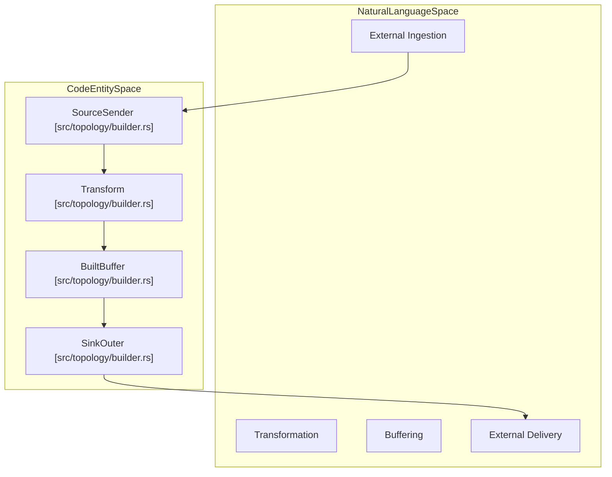
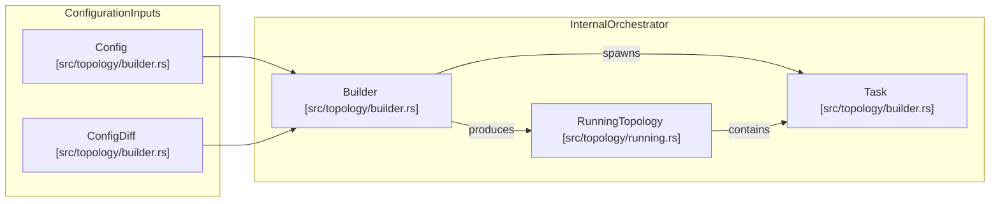

<!-- source: DeepWiki mcp.deepwiki.com · repo vectordotdev/vector · page 11 Glossary · fetched 2026-10-29 -->

# Glossary

Relevant source files

The following files were used as context for generating this wiki page:

- [Cargo.lock](Cargo.lock)
- [Cargo.toml](Cargo.toml)
- [LICENSE-3rdparty.csv](LICENSE-3rdparty.csv)
- [changelog.d/disk_v2_buffer_size_recompute_on_restart.fix.md](changelog.d/disk_v2_buffer_size_recompute_on_restart.fix.md)
- [deny.toml](deny.toml)
- [lib/codecs/Cargo.toml](lib/codecs/Cargo.toml)
- [lib/docs-renderer/Cargo.toml](lib/docs-renderer/Cargo.toml)
- [lib/file-source/Cargo.toml](lib/file-source/Cargo.toml)
- [lib/k8s-e2e-tests/Cargo.toml](lib/k8s-e2e-tests/Cargo.toml)
- [lib/k8s-test-framework/Cargo.toml](lib/k8s-test-framework/Cargo.toml)
- [lib/loki-logproto/Cargo.toml](lib/loki-logproto/Cargo.toml)
- [lib/opentelemetry-proto/Cargo.toml](lib/opentelemetry-proto/Cargo.toml)
- [lib/prometheus-parser/Cargo.toml](lib/prometheus-parser/Cargo.toml)
- [lib/vector-api-client/Cargo.toml](lib/vector-api-client/Cargo.toml)
- [lib/vector-buffers/Cargo.toml](lib/vector-buffers/Cargo.toml)
- [lib/vector-buffers/src/variants/disk_v2/checkpoint_recovery.rs](lib/vector-buffers/src/variants/disk_v2/checkpoint_recovery.rs)
- [lib/vector-buffers/src/variants/disk_v2/common.rs](lib/vector-buffers/src/variants/disk_v2/common.rs)
- [lib/vector-buffers/src/variants/disk_v2/io.rs](lib/vector-buffers/src/variants/disk_v2/io.rs)
- [lib/vector-buffers/src/variants/disk_v2/ledger.rs](lib/vector-buffers/src/variants/disk_v2/ledger.rs)
- [lib/vector-buffers/src/variants/disk_v2/mod.rs](lib/vector-buffers/src/variants/disk_v2/mod.rs)
- [lib/vector-buffers/src/variants/disk_v2/reader.rs](lib/vector-buffers/src/variants/disk_v2/reader.rs)
- [lib/vector-buffers/src/variants/disk_v2/tests/initialization.rs](lib/vector-buffers/src/variants/disk_v2/tests/initialization.rs)
- [lib/vector-buffers/src/variants/disk_v2/tests/invariants.rs](lib/vector-buffers/src/variants/disk_v2/tests/invariants.rs)
- [lib/vector-buffers/src/variants/disk_v2/tests/known_errors.rs](lib/vector-buffers/src/variants/disk_v2/tests/known_errors.rs)
- [lib/vector-buffers/src/variants/disk_v2/tests/mod.rs](lib/vector-buffers/src/variants/disk_v2/tests/mod.rs)
- [lib/vector-buffers/src/variants/disk_v2/tests/model/filesystem.rs](lib/vector-buffers/src/variants/disk_v2/tests/model/filesystem.rs)
- [lib/vector-buffers/src/variants/disk_v2/tests/model/mod.rs](lib/vector-buffers/src/variants/disk_v2/tests/model/mod.rs)
- [lib/vector-buffers/src/variants/disk_v2/tests/model/record.rs](lib/vector-buffers/src/variants/disk_v2/tests/model/record.rs)
- [lib/vector-buffers/src/variants/disk_v2/tests/record.rs](lib/vector-buffers/src/variants/disk_v2/tests/record.rs)
- [lib/vector-buffers/src/variants/disk_v2/tests/size_limits.rs](lib/vector-buffers/src/variants/disk_v2/tests/size_limits.rs)
- [lib/vector-buffers/src/variants/disk_v2/writer.rs](lib/vector-buffers/src/variants/disk_v2/writer.rs)
- [lib/vector-common/Cargo.toml](lib/vector-common/Cargo.toml)
- [lib/vector-config-common/Cargo.toml](lib/vector-config-common/Cargo.toml)
- [lib/vector-config-macros/Cargo.toml](lib/vector-config-macros/Cargo.toml)
- [lib/vector-config/Cargo.toml](lib/vector-config/Cargo.toml)
- [lib/vector-core/Cargo.toml](lib/vector-core/Cargo.toml)
- [lib/vector-core/src/config/log_schema.rs](lib/vector-core/src/config/log_schema.rs)
- [lib/vector-core/src/event/array.rs](lib/vector-core/src/event/array.rs)
- [lib/vector-core/src/event/log_event.rs](lib/vector-core/src/event/log_event.rs)
- [lib/vector-core/src/event/metadata.rs](lib/vector-core/src/event/metadata.rs)
- [lib/vector-core/src/event/metric/mod.rs](lib/vector-core/src/event/metric/mod.rs)
- [lib/vector-core/src/event/metric/value.rs](lib/vector-core/src/event/metric/value.rs)
- [lib/vector-core/src/event/mod.rs](lib/vector-core/src/event/mod.rs)
- [lib/vector-core/src/event/proto.rs](lib/vector-core/src/event/proto.rs)
- [lib/vector-core/src/event/trace.rs](lib/vector-core/src/event/trace.rs)
- [lib/vector-core/src/event/vrl_target.rs](lib/vector-core/src/event/vrl_target.rs)
- [lib/vector-core/src/lib.rs](lib/vector-core/src/lib.rs)
- [lib/vector-core/src/metrics/ddsketch.rs](lib/vector-core/src/metrics/ddsketch.rs)
- [lib/vector-core/src/metrics/mod.rs](lib/vector-core/src/metrics/mod.rs)
- [lib/vector-core/src/metrics/recency.rs](lib/vector-core/src/metrics/recency.rs)
- [lib/vector-core/src/metrics/recorder.rs](lib/vector-core/src/metrics/recorder.rs)
- [lib/vector-core/src/metrics/storage.rs](lib/vector-core/src/metrics/storage.rs)
- [lib/vector-lib/Cargo.toml](lib/vector-lib/Cargo.toml)
- [lib/vector-lib/src/lib.rs](lib/vector-lib/src/lib.rs)
- [lib/vector-lookup/Cargo.toml](lib/vector-lookup/Cargo.toml)
- [lib/vector-stream/Cargo.toml](lib/vector-stream/Cargo.toml)
- [lib/vector-tap/Cargo.toml](lib/vector-tap/Cargo.toml)
- [lib/vector-vrl/cli/Cargo.toml](lib/vector-vrl/cli/Cargo.toml)
- [lib/vector-vrl/functions/Cargo.toml](lib/vector-vrl/functions/Cargo.toml)
- [lib/vector-vrl/metrics/Cargo.toml](lib/vector-vrl/metrics/Cargo.toml)
- [lib/vector-vrl/tests/Cargo.toml](lib/vector-vrl/tests/Cargo.toml)
- [lib/vector-vrl/web-playground/Cargo.toml](lib/vector-vrl/web-playground/Cargo.toml)
- [lib/vector-vrl/web-playground/build.rs](lib/vector-vrl/web-playground/build.rs)
- [lib/vector-vrl/web-playground/public/assets/dd_icon_rgb.svg](lib/vector-vrl/web-playground/public/assets/dd_icon_rgb.svg)
- [lib/vector-vrl/web-playground/public/index.css](lib/vector-vrl/web-playground/public/index.css)
- [lib/vector-vrl/web-playground/public/index.html](lib/vector-vrl/web-playground/public/index.html)
- [lib/vector-vrl/web-playground/public/index.js](lib/vector-vrl/web-playground/public/index.js)
- [lib/vector-vrl/web-playground/src/lib.rs](lib/vector-vrl/web-playground/src/lib.rs)
- [license-tool.toml](license-tool.toml)
- [src/config/diff.rs](src/config/diff.rs)
- [src/config/enrichment_table.rs](src/config/enrichment_table.rs)
- [src/config/sink_validated.rs](src/config/sink_validated.rs)
- [src/dns.rs](src/dns.rs)
- [src/internal_events/adaptive_concurrency.rs](src/internal_events/adaptive_concurrency.rs)
- [src/internal_events/open.rs](src/internal_events/open.rs)
- [src/sinks/util/adaptive_concurrency/controller.rs](src/sinks/util/adaptive_concurrency/controller.rs)
- [src/sinks/util/adaptive_concurrency/future.rs](src/sinks/util/adaptive_concurrency/future.rs)
- [src/sinks/util/adaptive_concurrency/mod.rs](src/sinks/util/adaptive_concurrency/mod.rs)
- [src/sinks/util/adaptive_concurrency/service.rs](src/sinks/util/adaptive_concurrency/service.rs)
- [src/sinks/util/buffer/partition.rs](src/sinks/util/buffer/partition.rs)
- [src/sources/host_metrics/tcp.rs](src/sources/host_metrics/tcp.rs)
- [src/test_util/components.rs](src/test_util/components.rs)
- [src/test_util/mod.rs](src/test_util/mod.rs)
- [src/topology/builder.rs](src/topology/builder.rs)
- [src/topology/controller.rs](src/topology/controller.rs)
- [src/topology/mod.rs](src/topology/mod.rs)
- [src/topology/running.rs](src/topology/running.rs)
- [src/topology/test/backpressure.rs](src/topology/test/backpressure.rs)
- [src/topology/test/doesnt_reload.rs](src/topology/test/doesnt_reload.rs)
- [src/topology/test/mod.rs](src/topology/test/mod.rs)
- [src/topology/test/reload.rs](src/topology/test/reload.rs)
- [src/topology/test/transient_state.rs](src/topology/test/transient_state.rs)
- [src/utilization.rs](src/utilization.rs)
- [vdev/Cargo.toml](vdev/Cargo.toml)
- [website/cue/reference.cue](website/cue/reference.cue)
- [website/cue/reference/components.cue](website/cue/reference/components.cue)
- [website/cue/reference/components/sinks.cue](website/cue/reference/components/sinks.cue)
- [website/cue/reference/components/sources.cue](website/cue/reference/components/sources.cue)
- [website/cue/reference/components/sources/internal_metrics.cue](website/cue/reference/components/sources/internal_metrics.cue)
- [website/cue/reference/components/transforms.cue](website/cue/reference/components/transforms.cue)
- [website/cue/reference/components/transforms/remap.cue](website/cue/reference/components/transforms/remap.cue)
- [website/cue/reference/remap.cue](website/cue/reference/remap.cue)
- [website/cue/reference/remap/concepts/metrics.cue](website/cue/reference/remap/concepts/metrics.cue)
- [website/cue/reference/remap/expressions.cue](website/cue/reference/remap/expressions.cue)
- [website/cue/reference/remap/expressions/function_call.cue](website/cue/reference/remap/expressions/function_call.cue)
- [website/layouts/partials/badge.html](website/layouts/partials/badge.html)
- [website/layouts/partials/data.html](website/layouts/partials/data.html)

This glossary defines codebase-specific terms, jargon, and domain concepts used within the Vector project. It is intended to help onboarding engineers navigate the internal abstractions and their corresponding implementations.

## Core Concepts

### Event
The fundamental unit of data in Vector. It is a tagged union (enum) that can represent different types of observability data.
*   **Implementation**: `Event` enum in [lib/vector-core/src/event/mod.rs:1-100]().
*   **Variants**:
    *   `Log`: Structured log data, implemented as `LogEvent` [lib/vector-core/src/event/log_event.rs:155-161]().
    *   `Metric`: Observability metrics (counters, gauges, etc.) [lib/vector-core/src/event/mod.rs:50-80]().
    *   `Trace`: Distributed tracing spans [lib/vector-core/src/event/mod.rs:80-100]().
*   **Metadata**: Every event carries `EventMetadata` which includes internal state like `EventFinalizers` for acknowledgement tracking [lib/vector-core/src/event/metadata.rs:1-50]().

### Topology
The directed acyclic graph (DAG) representing the data flow from sources to transforms and finally to sinks.
*   **Construction**: Built using `Builder` (internal to `TopologyPiecesBuilder`) which validates component dependencies and handles instantiation [src/topology/builder.rs:131-178]().
*   **Implementation**: `RunningTopology` represents the active, spawned tasks and configuration of a pipeline [src/topology/running.rs:53-73]().
*   **Management**: `TopologyController` handles the lifecycle, including the four-phase hot reload process.

### Component
A generic term for a node in the topology. There are three types:
1.  **Source**: Ingests data from external systems (e.g., `file`, `kafka`, `http`).
2.  **Transform**: Processes, filters, or modifies events (e.g., `remap`, `filter`).
3.  **Sink**: Sends data to external destinations (e.g., `s3`, `elasticsearch`, `datadog`).
*   **Configuration**: Components are represented by traits and outer structs like `SourceOuter`, `TransformOuter`, and `SinkOuter` [src/topology/builder.rs:53-55]().

### VRL (Vector Remap Language)
A domain-specific language designed for high-performance observability data transformation.
*   **Crate**: `vector-vrl` workspace members handle compilation, functions, and the web playground [Cargo.toml:126-134]().
*   **Integration**: Used for transforming events and as a target for logic execution via `VrlTarget` [lib/vector-core/src/event/vrl_target.rs:1-50]().

---

## Technical Jargon & Abbreviations

| Term | Definition | Code Pointer |
| :--- | :--- | :--- |
| **Ack** | Acknowledgement. A mechanism for at-least-once delivery. | [lib/vector-core/src/event/metadata.rs:1-50]() |
| **CoW** | Copy-on-Write. Used in `LogEvent` for memory efficiency via `Arc<Inner>`. | [lib/vector-core/src/event/log_event.rs:155-157]() |
| **Backpressure** | Flow control mechanism where sinks signal sources to slow down when buffers are full. | [lib/vector-buffers/src/topology/channel/mod.rs:1-50]() |
| **Finalizer** | Logic executed when an event is successfully processed or dropped to signal completion. | [lib/vector-core/src/event/log_event.rs:221-225]() |
| **SMP** | Single Machine Performance. Regression benchmarks used in CI. | [Cargo.toml:12-12]() |

---

## System Architecture Mapping

The following diagrams map high-level system concepts to their specific Rust entities in the codebase.

### Data Flow: From Source to Sink
This diagram associates natural language concepts with the core traits and structs that facilitate data movement.

**Sources:** [src/topology/builder.rs:51-64](), [src/topology/builder.rs:138-142]()

### Application Lifecycle Mapping
This diagram bridges configuration and building to the internal orchestrators.

**Sources:** [src/topology/builder.rs:131-145](), [src/topology/running.rs:53-73](), [src/topology/builder.rs:48-48]()

---

## Internal Libraries (Workspace Members)

Vector is organized as a monorepo with specialized crates under the `lib/` directory to improve build times and modularity.

| Crate | Purpose | Code Pointer |
| :--- | :--- | :--- |
| `vector-core` | Base traits and types for all components and events. | [lib/vector-core/Cargo.toml:2-2]() |
| `vector-buffers` | Implementations of memory and disk-backed buffers. | [lib/vector-buffers/Cargo.toml:2-2]() |
| `vector-config` | Shared logic for component configuration and validation. | [lib/vector-config/Cargo.toml:2-2]() |
| `codecs` | Encoders/decoders for formats (JSON, Avro, Protobuf, Arrow). | [lib/codecs/Cargo.toml:2-2]() |
| `file-source` | Low-level file watching and rotation logic. | [lib/file-source/Cargo.toml:2-2]() |

**Sources:** [Cargo.toml:99-137](), [lib/vector-core/Cargo.toml:1-63](), [lib/vector-buffers/Cargo.toml:1-33]()

## Domain Concepts

### Fingerprinting
The process of uniquely identifying a file to track progress (checkpoints) even if the file is renamed or rotated.
*   **Implementation**: Metrics related to fingerprinting are tracked in internal telemetry [website/cue/reference/components/sources/internal_metrics.cue:197-204]().

### Adaptive Concurrency
A mechanism in sinks that dynamically adjusts the number of concurrent requests based on downstream performance.
*   **Logic**: Metrics for observed RTT and concurrency limits are exposed via internal metrics [website/cue/reference/components/sources/internal_metrics.cue:149-190]().

### Fanout
The mechanism for distributing a single event stream to multiple downstream components.
*   **Implementation**: `Fanout` handles the distribution and control messages [src/topology/builder.rs:46-46]().

### Enrichment Tables
A system for joining event data with external data sources (like GeoIP or CSV files) at runtime.
*   **Implementation**: Managed via `TableRegistry` and `EnrichmentTableConfig` [src/topology/builder.rs:34-72]().

### Internal Events & Metrics
Vector monitors itself using an internal event system. Components emit metrics about their own health and throughput.
*   **Sources**: `internal_metrics` [website/cue/reference/components/sources/internal_metrics.cue:3-9]() and `internal_logs` [src/topology/builder.rs:129-129]().

**Sources:** [src/topology/builder.rs:71-77](), [website/cue/reference/components/sources/internal_metrics.cue:1-20]()