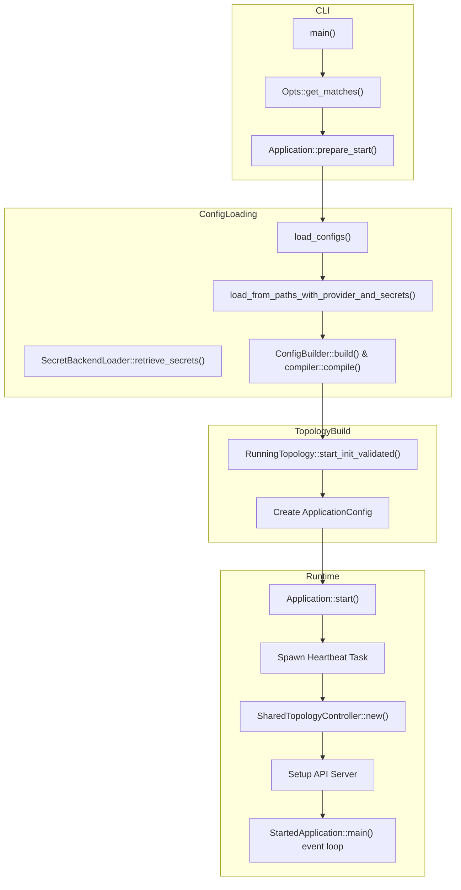
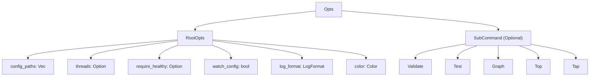
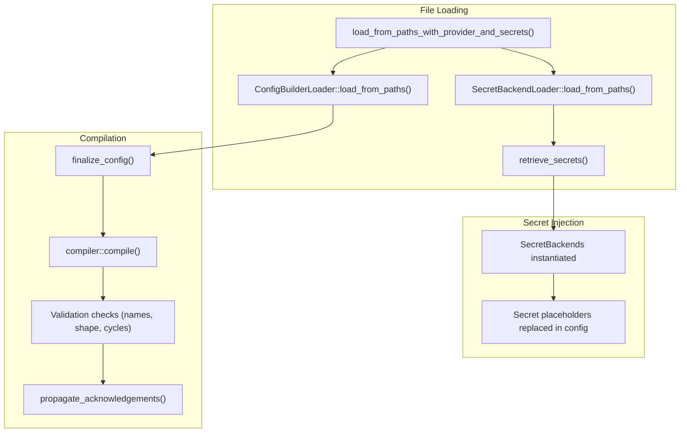
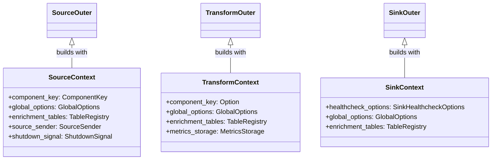
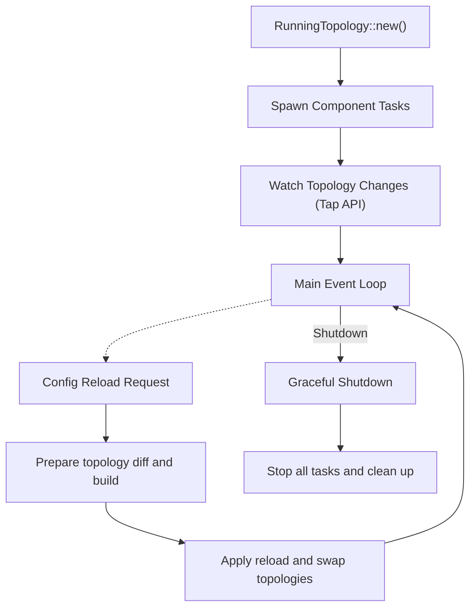

<!-- source: DeepWiki mcp.deepwiki.com · repo vectordotdev/vector · page 2 Application System · fetched 2026-10-29 -->

# Application System

Relevant source files

The following files were used as context for generating this wiki page:

- [changelog.d/19963_config_null.fix.md](changelog.d/19963_config_null.fix.md)
- [changelog.d/config_error_paths.fix.md](changelog.d/config_error_paths.fix.md)
- [src/app.rs](src/app.rs)
- [src/cli.rs](src/cli.rs)
- [src/config/builder.rs](src/config/builder.rs)
- [src/config/compiler.rs](src/config/compiler.rs)
- [src/config/diff.rs](src/config/diff.rs)
- [src/config/enrichment_table.rs](src/config/enrichment_table.rs)
- [src/config/loading/config_builder.rs](src/config/loading/config_builder.rs)
- [src/config/loading/loader.rs](src/config/loading/loader.rs)
- [src/config/loading/mod.rs](src/config/loading/mod.rs)
- [src/config/loading/representation.rs](src/config/loading/representation.rs)
- [src/config/loading/secret.rs](src/config/loading/secret.rs)
- [src/config/loading/source.rs](src/config/loading/source.rs)
- [src/config/mod.rs](src/config/mod.rs)
- [src/config/sink_validated.rs](src/config/sink_validated.rs)
- [src/config/unit_test/mod.rs](src/config/unit_test/mod.rs)
- [src/graph.rs](src/graph.rs)
- [src/service.rs](src/service.rs)
- [src/topology/builder.rs](src/topology/builder.rs)
- [src/topology/controller.rs](src/topology/controller.rs)
- [src/topology/mod.rs](src/topology/mod.rs)
- [src/topology/running.rs](src/topology/running.rs)
- [src/topology/test/backpressure.rs](src/topology/test/backpressure.rs)
- [src/topology/test/doesnt_reload.rs](src/topology/test/doesnt_reload.rs)
- [src/topology/test/mod.rs](src/topology/test/mod.rs)
- [src/topology/test/reload.rs](src/topology/test/reload.rs)
- [src/topology/test/transient_state.rs](src/topology/test/transient_state.rs)
- [src/unit_test.rs](src/unit_test.rs)
- [src/validate.rs](src/validate.rs)
- [tests/integration/cli.rs](tests/integration/cli.rs)
- [tests/integration/shutdown.rs](tests/integration/shutdown.rs)
- [website/cue/reference/cli.cue](website/cue/reference/cli.cue)

The Application System governs the entire runtime lifecycle of Vector, encompassing stages from initial CLI argument parsing, through configuration loading and compilation, to topology construction and runtime orchestration including graceful shutdown and hot-reloading. It acts as the core engine managing how Vector starts, runs, adapts to configuration changes, and stops safely.

This page offers a high-level overview of the system and how its major subcomponents interrelate. For detailed technical information, refer to the child pages:
- [Application Lifecycle and CLI](#2.1)
- [Configuration Loading and Compilation](#2.2)
- [Topology Construction](#2.3)
- [Runtime Management and Hot Reloading](#2.4)

---

## Application Lifecycle Overview

Vector’s application runtime proceeds through well-defined stages:

1. **Command-Line Interface (CLI) Parsing**  
   The application begins by parsing CLI arguments and subcommands, configuring global options, and setting up logging.

2. **Configuration Loading and Compilation**  
   Vector merges configurations from multiple sources/formats (YAML/TOML/JSON, environment variables, CLI overrides), resolves secrets, and compiles a validated configuration with enriched metadata.

3. **Topology Construction**  
   Based on the compiled config, Vector builds the data pipeline topology, instantiating sources, transforms, sinks, and enrichment tables, wiring dependencies, and preparing concurrent tasks.

4. **Runtime Execution and Signal Handling**  
   The application runs the constructed topology asynchronously, handling signals for reload or shutdown, supporting graceful termination and dynamic reconfiguration via hot reloads.

### Initialization Sequence

This starting sequence encapsulates how Vector transitions from command-line invocation to a live, running topology capable of processing observability data streams.

**Sources:**  
[src/app.rs:177-511](), [src/cli.rs:22-63]()

---

## CLI Argument Parsing and Application Lifecycle

Vector uses the `clap` crate to parse command-line arguments, structuring them into root options and numerous subcommands:

- **Root Options (`RootOpts`)** govern global runtime settings such as:
  - Config file and directory paths (multiple formats supported).
  - Thread count and concurrency tuning.
  - Logging format, verbosity, and colors.
  - Hot reload/watch configuration flags.
  - Secret environment interpolation.

- **Subcommands** include utilities like `validate`, `test`, `graph`, `top`, and `tap` for different lifecycle-related workflows.

The CLI parser produces an `Opts` struct (with `RootOpts` and an optional `SubCommand`). Initialization uses these options to configure logging, concurrency, and environment before application runtime begins.

This CLI layer defines initial runtime parameters and subsequent command execution strategies.

For comprehensive details of CLI parsing and application startup procedures, see [Application Lifecycle and CLI](#2.1).

**Sources:** [src/cli.rs:22-263](), [website/cue/reference/cli.cue:84-215]()

---

## Configuration Loading and Compilation

Vector’s configuration system supports multiple input sources, formats, and dynamic resolution mechanisms:

- **Inputs**: Reads configuration from paths specified as files, directories, or globs in YAML, TOML, JSON formats. Environment variable interpolation is optionally enabled.

- **Secret Resolution**: Secret backends (exec commands, files, cloud providers) are instantiated to replace sensitive config placeholders securely.

- **Provider Integration**: Configuration providers allow fetching or overlaying configuration from remote or dynamic sources during startup.

- **Compilation**: The raw config builder converts to a fully compiled `Config` struct with:
  - Component name validations.
  - Shape, resource type, and output correctness checks.
  - Graph validation for cycles and type correctness.
  - Acknowledgement propagation through sinks and upstream nodes.
  - Sink validation and enrichment table handling.

Upon success, this pipeline outputs a validated runtime configuration object ready for topology construction.

For detailed mechanics of configuration file parsing, secret backends, and compilation validation, see [Configuration Loading and Compilation](#2.2).

**Sources:**  
[src/config/loading/mod.rs:56-185](), [src/config/compiler.rs:9-152](), [src/config/builder.rs:139-151](), [src/config/mod.rs:79-232]()

---

## Topology Construction

Topology construction instantiates and wires the configured data pipeline components at runtime:

- **TopologyPiecesBuilder** asynchronously builds pieces of the topology for sources, transforms, sinks, and enrichment tables.

- **Component Contexts** provide global options, enrichment tables, buffer channels, and shutdown coordination needed to instantiate each component's task:

  - `SourceContext` — keys, global config, enrichment table registry, source sender, and signal for shutdown.
  - `TransformContext` — global config, enrichment tables, and metrics storage.
  - `SinkContext` — healthcheck options, global config, and enrichment tables.

- **Dependency Graph** is wired with buffers and fanout channels connecting components according to input/output links.

- **Task Spawning** creates async tasks for each component to process events concurrently.

- **Validation** applies type checks, cycle detection, and acknowledgement propagation across the graph.

- The built `TopologyPieces` group holds all running buffer channels, tasks, and related component handles.

### Component Build Context Overview

This modular context usage enables clean component instantiation while managing complexity of cross-cutting concerns.

For an in-depth explanation of topology building logic, task management, and graph linking, see [Topology Construction](#2.3).

**Sources:**  
[src/topology/builder.rs:120-178](), [src/config/source.rs:63-64](), [src/config/transform.rs:65-67](), [src/config/sink.rs:63-64]()

---

## Runtime Management and Hot Reloading

Vector’s runtime manages lifecycle of topology execution dynamically:

- **RunningTopology** maintains live data structures holding:
  - Component task handles for sources, transforms, and sinks.
  - Channel senders/receivers for buffered event flow.
  - Shutdown coordination signals.
  - Utilization tracking and metrics task handles.
  - Pending reload sets and abort/error channels.
  - Topology configuration snapshot.

- **TopologyController** mediates configuration hot reloads via a multi-phase approach:
  - Compute diffs and validate the new topology.
  - Spawn new tasks and buffers safely.
  - Swap running topologies without data loss.
  - Gracefully shut down old topology components.
  
- **Signal Handling** listens for OS signals to initiate shutdown or reload cycles.

- **Graceful Shutdown** waits up to a configured timeout for sources and tasks to finish cleanly before forceful termination.

### RunningTopology Architecture and Manager Flow

| Field                       | Type                                          | Description                          |
|-----------------------------|-----------------------------------------------|------------------------------------|
| `tasks`                     | `HashMap<ComponentKey, TaskHandle>`           | Active component task handles       |
| `config`                    | `Config`                                       | The current active configuration    |
| `abort_tx`                  | `mpsc::UnboundedSender<ShutdownError>`        | Channel for fatal error signaling   |
| `shutdown_coordinator`      | `SourceShutdownCoordinator`                    | Coordinates source shutdown signals |
| `utilization_registry`      | `Option<UtilizationRegistry>`                  | Tracks component utilization        |
| `watch`                     | `(WatchTx, WatchRx)`                           | For topology change subscriptions   |
| `pending_reload`            | `Option<HashSet<ComponentKey>>`                | Tracks components pending reload    |

This lifecycle enables live updates and robust shutdown behavior without dropping event data or leaving tasks hanging.

For comprehensive details about runtime orchestration, signal integration, and reload algorithms, see [Runtime Management and Hot Reloading](#2.4).

**Sources:**  
[src/topology/running.rs:1-160](), [src/topology/controller.rs:1-115]()

---

# Summary

Vector’s Application System is a multi-layered architecture coordinating how the system parses CLI input, loads and compiles configurations, constructs the data processing pipeline topology, and manages runtime execution with observability, hot reload capability, and graceful shutdown.

Its primary components and responsibilities are:

| Subsystem                          | Responsibility                                                    | Child Page Link                     |
|-----------------------------------|-----------------------------------------------------------------|-----------------------------------|
| Application Lifecycle & CLI       | Parsing CLI arguments, executing subcommands, launching runtime   | [Application Lifecycle and CLI](#2.1)           |
| Configuration Loading & Compilation| Loading multi-format config files, secret resolution, compilation, and validation | [Configuration Loading and Compilation](#2.2)  |
| Topology Construction              | Building component instances, wiring data pipeline tasks, buffering, and validation | [Topology Construction](#2.3)                 |
| Runtime Management & Hot Reloading | Running topology components, signal handling, graceful shutdown, reload phases | [Runtime Management and Hot Reloading](#2.4)   |

Understanding the Application System provides essential context for navigating how Vector becomes operational, adapts to user changes, and maintains stable observability data pipelines.

---

**Document Sources:**  
[src/app.rs:1-453](), [src/cli.rs:1-263](), [src/config/mod.rs:1-232](), [src/config/builder.rs:1-151](), [src/config/compiler.rs:1-152](), [src/topology/builder.rs:120-178](), [src/topology/running.rs:1-160](), [src/topology/controller.rs:1-115]()

---

