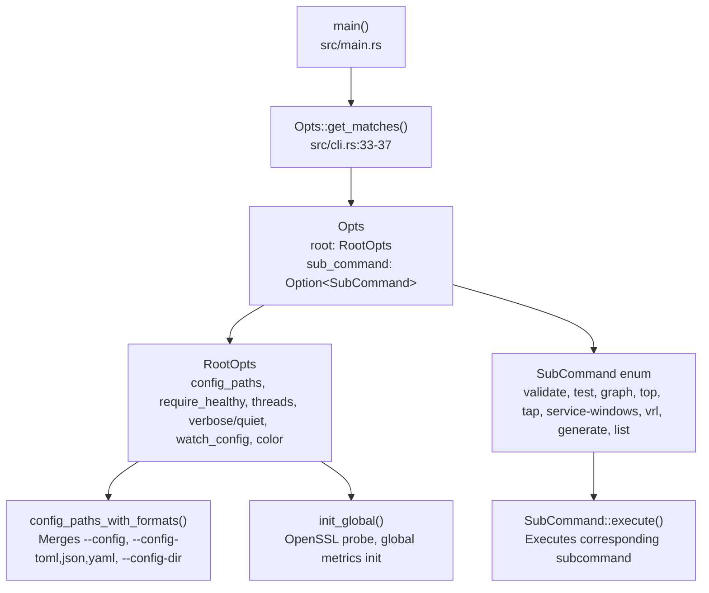
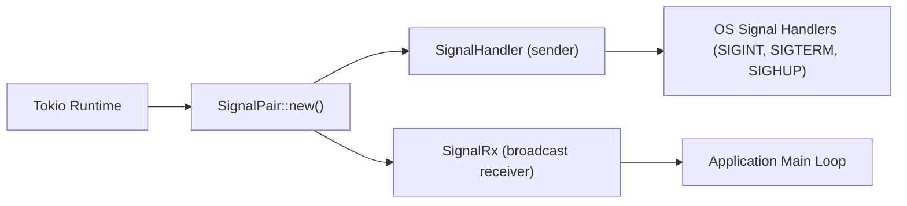
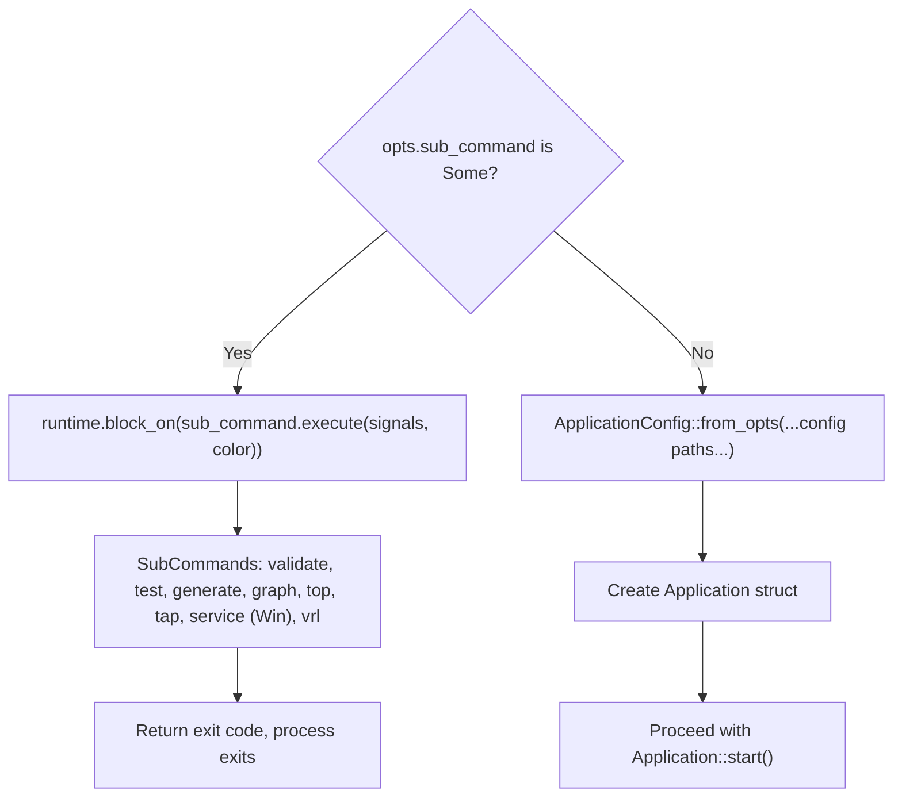
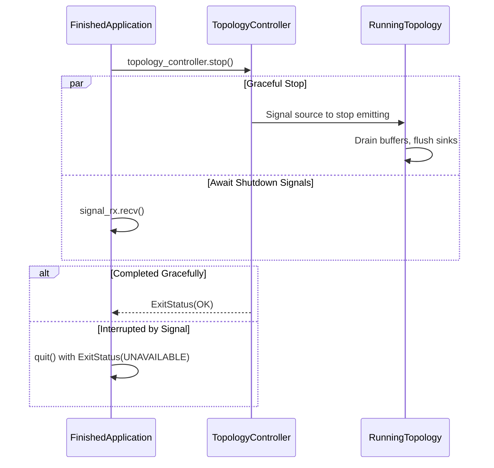
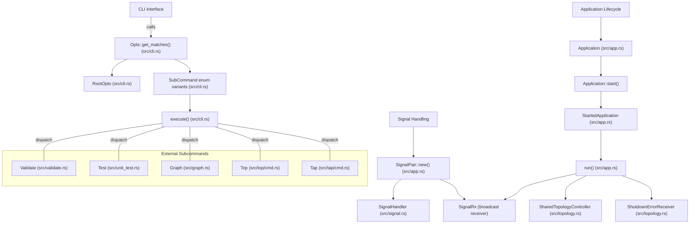
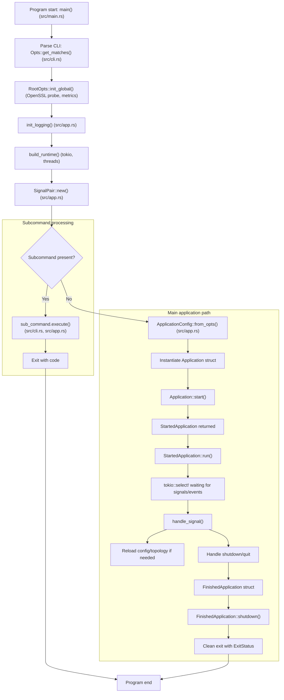

<!-- source: DeepWiki mcp.deepwiki.com · repo vectordotdev/vector · page 2.1 Application Lifecycle and CLI · fetched 2026-10-29 -->

# Application Lifecycle and CLI

<details>
<summary>Relevant source files</summary>

The following files were used as context for generating this wiki page:

- [.github/workflows/custom_builds.yml](.github/workflows/custom_builds.yml)
- [build.rs](build.rs)
- [changelog.d/19963_config_null.fix.md](changelog.d/19963_config_null.fix.md)
- [changelog.d/config_error_paths.fix.md](changelog.d/config_error_paths.fix.md)
- [distribution/msi/build.sh](distribution/msi/build.sh)
- [src/app.rs](src/app.rs)
- [src/cli.rs](src/cli.rs)
- [src/config/builder.rs](src/config/builder.rs)
- [src/config/compiler.rs](src/config/compiler.rs)
- [src/config/loading/config_builder.rs](src/config/loading/config_builder.rs)
- [src/config/loading/loader.rs](src/config/loading/loader.rs)
- [src/config/loading/mod.rs](src/config/loading/mod.rs)
- [src/config/loading/representation.rs](src/config/loading/representation.rs)
- [src/config/loading/secret.rs](src/config/loading/secret.rs)
- [src/config/loading/source.rs](src/config/loading/source.rs)
- [src/config/mod.rs](src/config/mod.rs)
- [src/config/unit_test/mod.rs](src/config/unit_test/mod.rs)
- [src/config/watcher.rs](src/config/watcher.rs)
- [src/graph.rs](src/graph.rs)
- [src/internal_events/heartbeat.rs](src/internal_events/heartbeat.rs)
- [src/internal_events/process.rs](src/internal_events/process.rs)
- [src/internal_telemetry/allocations/allocator/mod.rs](src/internal_telemetry/allocations/allocator/mod.rs)
- [src/internal_telemetry/allocations/allocator/stack.rs](src/internal_telemetry/allocations/allocator/stack.rs)
- [src/internal_telemetry/allocations/allocator/token.rs](src/internal_telemetry/allocations/allocator/token.rs)
- [src/internal_telemetry/allocations/allocator/tracing_allocator.rs](src/internal_telemetry/allocations/allocator/tracing_allocator.rs)
- [src/internal_telemetry/allocations/mod.rs](src/internal_telemetry/allocations/mod.rs)
- [src/lib.rs](src/lib.rs)
- [src/main.rs](src/main.rs)
- [src/service.rs](src/service.rs)
- [src/signal.rs](src/signal.rs)
- [src/unit_test.rs](src/unit_test.rs)
- [src/validate.rs](src/validate.rs)
- [src/vector_windows.rs](src/vector_windows.rs)
- [tests/integration/cli.rs](tests/integration/cli.rs)
- [tests/integration/shutdown.rs](tests/integration/shutdown.rs)
- [website/cue/reference/cli.cue](website/cue/reference/cli.cue)

</details>


## Purpose and Scope

This page documents Vector's main entrypoint, CLI argument parsing, subcommand execution, and the full lifecycle of the application from startup through graceful shutdown. It covers in detail the flow of configuration loading, topology creation, signal handling, and shutdown sequences. This complements related pages on configuration processing ([Configuration Loading and Compilation](#2.2)) and topology orchestration ([Topology Construction](#2.3)), focusing specifically on runtime and CLI behavior.

---

## CLI Architecture Overview

Vector's CLI is implemented using the `clap` crate and centralized around the `Opts` struct, which contains:

- A `RootOpts` struct holding core runtime flags, such as config paths, logging, threading, and behavior toggles.
- An optional `SubCommand` enum that represents different subcommands exposed by the CLI (e.g., `validate`, `test`, `graph`, `top`, `tap`, etc.).

This design supports flexible invocation modes—running Vector normally or executing specialized subcommands.

### CLI Option Parsing Flow



Sources: [src/cli.rs:22-37](), [src/app.rs:185-200]()

---

## Application Entrypoint and Initialization

The application starts from `main` in `src/main.rs`, which calls `Application::run(extra_context)`. The initialization proceeds in phases in `src/app.rs`.

### Application Initialization Flow

```mermaid
stateDiagram-v2
    [*] --> ParseCLI: "main() calls Opts::get_matches()"
    ParseCLI --> GlobalInit: "opts.root.init_global()"
    GlobalInit --> InitLogging: "init_logging()"
    InitLogging --> BuildRuntime: "build_runtime()"
    BuildRuntime --> CreateSignalPair: "SignalPair::new()"
    CreateSignalPair --> SubcommandCheck: "Check if opts.sub_command is Some?"

    SubcommandCheck --> ExecuteSubcommand: "If Some(subcmd), call sub_command.execute()"
    SubcommandCheck --> LoadConfig: "If None, ApplicationConfig::from_opts()"

    LoadConfig --> CreateApp: "Create Application { root_opts, config, signals }"
    CreateApp --> StartApp: "app.start()"
    StartApp --> RunApp: "started_app.run()"
    RunApp --> Shutdown: "On completion, call finished_app.shutdown()"
    Shutdown --> [*]
```

Sources: [src/app.rs:178-183](), [src/app.rs:185-201]()

---

### Initialization Phases Explained

#### Phase 1: CLI Parsing and Global Initialization

- CLI arguments are parsed with `Opts::get_matches()` which handles all flags and subcommands.
- After parsing, the root opts are initialized globally via `opts.root.init_global()`, which performs:
  - Conditional OpenSSL certificate probing (if enabled).
  - Initial setup of global telemetry and metrics.
- Logging setup runs via `init_logging()` adapting to the chosen colorization, format, and verbosity.

Example snippet from [src/app.rs:185-211]:

```rust
let opts = Opts::get_matches()?;
opts.root.init_global();

init_logging(
  opts.root.color.use_color(),
  opts.root.log_format,
  opts.log_level(),
  opts.root.internal_log_rate_limit,
  opts.root.internal_logs_source_rate_limit,
);
```

Sources: [src/app.rs:185-211](), [src/cli.rs:283-291]()

---

#### Phase 2: Tokio Runtime Construction and Thread Pool Setup

- The Tokio runtime is built with a configurable number of worker threads:
  - `--threads` CLI option overrides thread count.
  - Defaults to number of available CPU cores.
- A special atomic variable `WORKER_THREADS` holds the configured count, accessible system-wide.
- Runtime uses:
  - Worker thread pool named `"vector-worker"`.
  - 20,000 maximum blocking threads.
  - All Tokio features enabled (I/O, timers, synchronization).

Sources: [src/app.rs:42-46](), [src/app.rs:526-543]()

---

#### Phase 3: Signal Handler Initialization

- Creates a `SignalPair` which contains both:
  - A `SignalHandler` allowing the injection of signals internally.
  - A `SignalRx` broadcast receiver to listen for signals.
- Installs OS-level signal handlers (e.g., SIGINT, SIGTERM, SIGHUP) that forward signals into `SignalHandler`.
- Allows signal-driven control of runtime events like reloads or shutdown.



Sources: [src/app.rs:223](), [src/signal.rs:10-50]()

---

## Subcommand Dispatch vs Main Application Flow

Once initialization completes, Vector branches depending on presence of a subcommand.



Sources: [src/app.rs:225-227](), [src/cli.rs:355-379]()

### Subcommand Execution

Each subcommand implements a `execute()` async method that performs that subcommand's logic and returns an `ExitCode`. Supported primary subcommands include:

- `validate`: config and environment validation.
- `test`: runs configured unit tests.
- `graph`: outputs topology visualization graph.
- `top`, `tap`: interact with running topology via API.
- Windows-only: `service` manages Vector as a Windows service.
- Others: `vrl`, `generate`, `list`, `convert-config`, etc.

Subcommands bypass the main Vector runtime lifecycle.

---

## Main Application Lifecycle

This section describes the runtime lifecycle when no subcommand is specified.

### `Application` Struct — Preparation/Static Phase

```rust
pub struct Application {
    pub root_opts: RootOpts,
    pub config: ApplicationConfig,
    pub signals: SignalPair,
}
```

- Holds global root CLI options parsed.
- Contains the loaded configuration and running topology wrapped in `ApplicationConfig`.
- Holds the signal handling pair for runtime control.

`ApplicationConfig` carries:

- Config file paths loaded.
- The main running topology (`RunningTopology`).
- Graceful crash notification receiver.
- Internal topologies vector.
- API options (if enabled).
- Extra contextual metadata.

Sources: [src/app.rs:58-62](), [src/app.rs:48-118]()

---

### `StartedApplication` Struct — Running Phase

Returned by `Application::start()`, encapsulating active runtime context:

```rust
pub struct StartedApplication {
    pub config_paths: Vec<ConfigPath>,
    pub internal_topologies: Vec<RunningTopology>,
    pub graceful_crash_receiver: ShutdownErrorReceiver,
    pub signals: SignalPair,
    pub topology_controller: SharedTopologyController,
    pub allow_empty_config: bool,
    pub interpolate_env: bool,
}
```

During start:

- `RunningTopology::start_init_validated()` is called to start the data pipeline topology.
- Emits `VectorStarted` event.
- Launches heartbeat tasks for liveness observability.
- If API is enabled, starts the gRPC server.
- Wraps topology in a `SharedTopologyController` for reload and shutdown commands.

Sources: [src/app.rs:245-278](), [src/app.rs:137-174]()

---

### API Server Initialization

`ApplicationConfig::setup_api()` conditionally starts the gRPC API server if enabled:

- On success:
  - Emits `ApiStarted` internal event with server address.
  - Returns the server handle.
- On failure:
  - Logs an error.
  - Signals an immediate shutdown abort to prevent inconsistent state.
- If disabled, logs info indicating the API features (`top`, `tap`) are not available.

This API supports live CLI commands to inspect the running topology.

Sources: [src/app.rs:137-174]()

---

## Main Event Loop — `StartedApplication::run()`

The application's main loop uses `tokio::select!` to concurrently await multiple event sources:

- OS and internal signals via `SignalRx`.
- Signals from `graceful_crash_receiver` indicating topology runtime errors.
- Completion notification from all topology sources (if present).

The loop responds to signals such as reload requests or shutdown/quit commands.

```mermaid
graph TB
    Loop["tokio::select! main loop"] --> HasSources{"Topology has sources?"}
    
    HasSources -->|Yes| SelectWithSources["Wait on:<br>- signal_rx.recv()<br>- graceful_crash_receiver.next()<br>- topology.sources_finished()"]
    HasSources -->|No| SelectNoSources["Wait on:<br>- signal_rx.recv()<br>- graceful_crash_receiver.next()"]

    SelectWithSources --> HandleSignal["Dispatch signal with handle_signal()"]
    SelectNoSources --> HandleSignal

    HandleSignal --> SignalChoice{"Signal variant?"}
    
    SignalChoice -->|ReloadComponents(set)| ExtendSet["topology.extend_reload_set(set)"]
    ExtendSet --> LoadNewConfig["load_from_paths()"]
    LoadNewConfig --> ReloadTopology["topology_controller.reload(new_config, set)"]
    ReloadTopology --> Loop

    SignalChoice -->|ReloadFromDisk| ReloadDisk["load config from disk"]
    ReloadDisk --> HandleReloadResult["On success call reload, else log errors"]
    HandleReloadResult --> Loop

    SignalChoice -->|ReloadEnrichmentTables| ReloadTables["topology.reload_enrichment_tables()"]
    ReloadTables --> Loop

    SignalChoice -->|Shutdown| ExitLoop["Break main loop for graceful shutdown"]

    SignalChoice -->|Quit| ExitLoop
```

Sources: [src/app.rs:295-446]()

---

### Signal Handling in Detail

The key method `handle_signal()` branches on different signal variants:

| Signal Variant           | Purpose                         | Behavior                                                       |
|-------------------------|---------------------------------|----------------------------------------------------------------|
| `ReloadComponents(set)`  | Request reload of certain components | Extends topology reload set and performs topology reload using new config loaded from disk. |
| `ReloadFromDisk`         | Reload complete configuration from disk | Reads config, applies enrichment tables and external transforms, triggers full topology reload. |
| `ReloadEnrichmentTables` | Reload only enrichment tables    | Calls `running_topology.reload_enrichment_tables()`.           |
| `Shutdown(error)`        | Graceful application shutdown   | Exits main loop, returning appropriate exit code.              |
| `Quit`                   | Immediate forced quit            | Exits main loop immediately for rapid termination.             |

Sources: [src/app.rs:343-429]()

---

## `FinishedApplication` Struct — Shutdown Phase

After the run loop terminates, this struct manages graceful shutdown procedures:

```rust
pub struct FinishedApplication {
    pub config_paths: Vec<ConfigPath>,
    pub internal_topologies: Vec<RunningTopology>,
    pub graceful_crash_receiver: ShutdownErrorReceiver,
    pub signals: SignalPair,
    pub topology_controller: SharedTopologyController,
    pub exit_status: ExitStatus,
}
```

The `shutdown()` method:

- Commands the topology controller to stop all components.
- Waits for all sources to finish emitting events.
- Waits for any graceful shutdown timeout or further signals.
- If shutdown is interrupted (by signals), executes immediate quit with error exit code.



Sources: [src/app.rs:448-511]()

---

## Subcommand Reference Summary

Vector supports the following important CLI subcommands, each implemented as a variant of `SubCommand` with an async `execute()` method invoked on the main runtime:

| Subcommand | Purpose | Location |
|------------|---------|----------|
| `validate` | Validates configuration syntax, environment, and healthcheck readiness | [src/validate.rs:68-187]() |
| `test` | Runs unit tests specified in the configuration | [src/unit_test.rs:101-118]() |
| `graph` | Outputs pipeline topology graph in DOT format | [src/graph.rs]() |
| `top` | Interactively displays component stats via API | [src/top/cmd.rs]() |
| `tap` | Interactively inspects live events via API | [src/tap/cmd.rs]() |
| `service` (Windows) | Manages Vector as Windows service | [src/vector_windows.rs]() |

Sources: [src/validate.rs](), [src/unit_test.rs](), [src/graph.rs](), [src/top/cmd.rs](), [src/tap/cmd.rs](), [src/vector_windows.rs]()

---

## Runtime and Threading Configuration

### Worker Thread Pool Sizing

- Determined from CLI `--threads` option or defaults to number of available CPU cores.
- Stored in the atomic `WORKER_THREADS`.
- Worker threads govern the size of the Tokio threadpool for asynchronous task execution.

Example from [src/app.rs:42-46], [src/app.rs:526-543]:

```rust
let threads = opts.root.threads.unwrap_or_else(|| {
    std::thread::available_parallelism()
        .map_or(1, |n| n.get())
});
WORKER_THREADS.store(threads, Ordering::Relaxed);

let runtime = tokio::runtime::Builder::new_multi_thread()
    .worker_threads(threads)
    .thread_name("vector-worker")
    .max_blocking_threads(20_000)
    .enable_all()
    .build()?;
```

Sources: [src/app.rs:42-46](), [src/app.rs:526-543]()

---

### Runtime Configuration

- `new_multi_thread()` runtime with all features enabled to support timers, I/O, synchronization.
- Sets thread name prefix `"vector-worker"`.
- Allows large pool for blocking tasks (`max_blocking_threads(20_000)`).

This runtime handles all asynchronous IO, task scheduling, and drives the Vector pipeline.

---

## Logging and Observability Initialization

Vector configures tracing and metrics early via `init_logging()`:

- Supports ANSI colorization based on CLI `--color`.
- Allows log formats (text, json) via `--log-format`.
- Internal telemetry through special components `internal_logs` and `internal_metrics` sources.
- These expose Vector's internal event and metrics streams, usable via API and CLI subcommands (`top`, `tap`).

Sources: [src/app.rs:643-656](), [src/sources/internal_logs.rs](), [src/sources/internal_metrics.rs]()

---

## Exit Codes and Error Handling

Vector uses standardized exit codes from the external `exitcode` crate:

| Code | Meaning                            |
|-------|----------------------------------|
| 0     | Success                          |
| 64    | Usage error (CLI arg failure)   |
| 69    | Service unavailable (immediate quit) |
| 78    | Config error (parsing/validation) |

The method `handle_config_errors()` logs config errors and returns the appropriate code.

Sources: [src/cli.rs:420-426](), [src/app.rs:484-510]()

---

## Summary Diagram: Natural Language to Key Code Entities



---

## Summary Diagram: Application Lifecycle Detailed Flow



---

## References

- CLI parsing and options: [src/cli.rs:22-37]()
- Application lifecycle, startup, run, shutdown: [src/app.rs:42-643]()
- Signal handling system: [src/signal.rs:10-50]()
- Subcommand implementations: validate ([src/validate.rs]()), unit tests ([src/unit_test.rs]()), graph ([src/graph.rs]()), top ([src/top/cmd.rs]()), tap ([src/tap/cmd.rs]())
- Configuration loading: [src/config/loading/mod.rs]()
- Runtime and threading: [src/app.rs:526-543]()
- API server setup: [src/app.rs:137-174]()
- Exit codes and error handling: [src/cli.rs:420-426](), [src/app.rs:484-510]()

---

This technical overview thoroughly connects vector’s critical application lifecycle phases and CLI functionality to the core Rust code entities and functions managing these operations. It provides an engineering reference for understanding and evolving Vector’s startup, CLI processing, and graceful runtime management.

---

