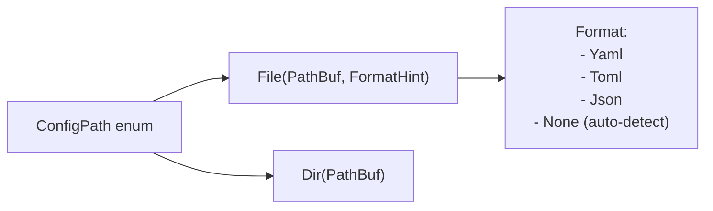
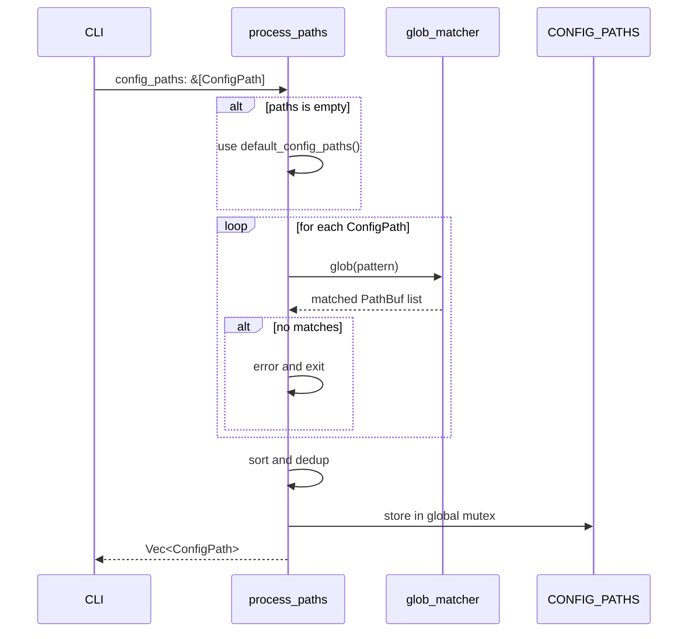
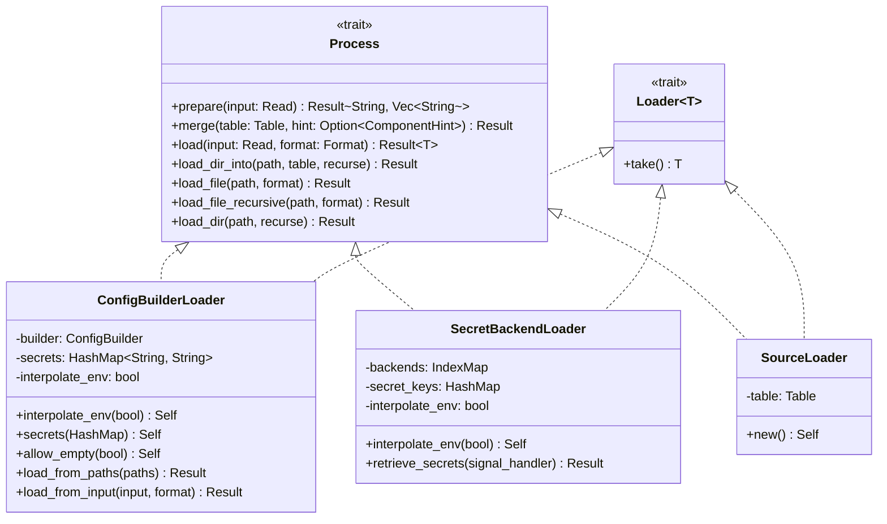
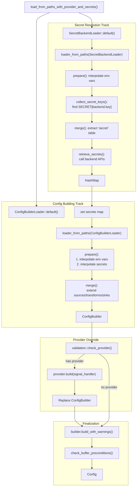
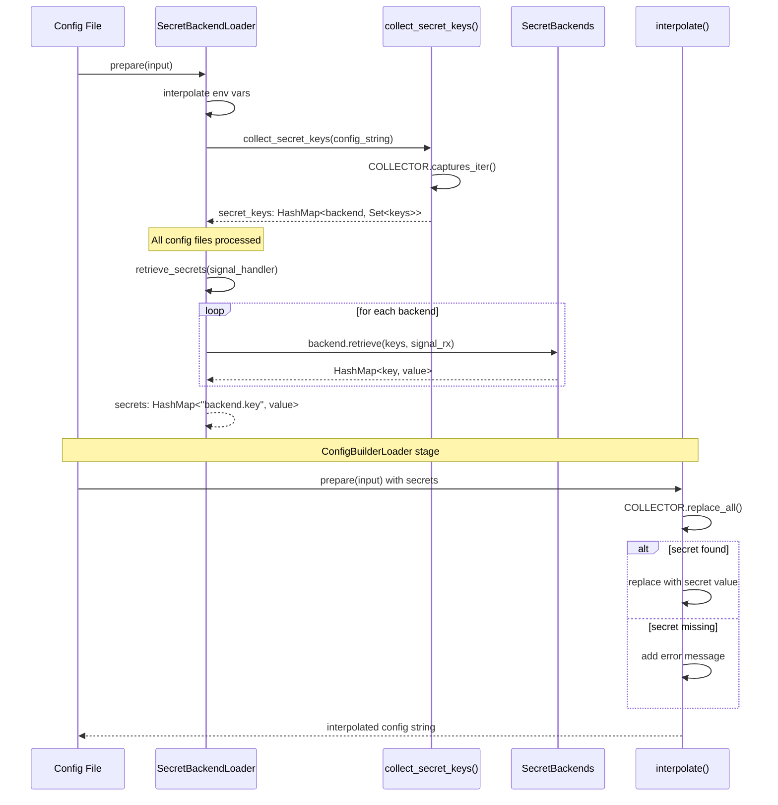
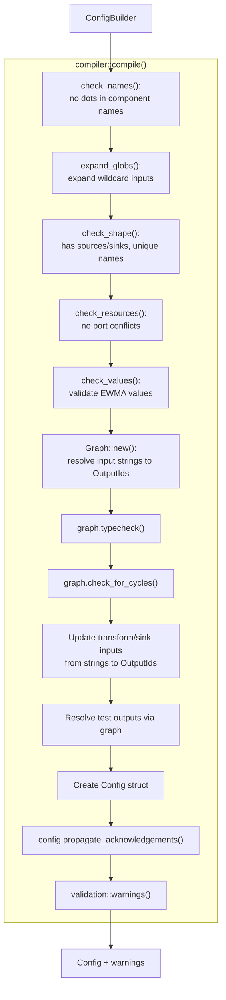
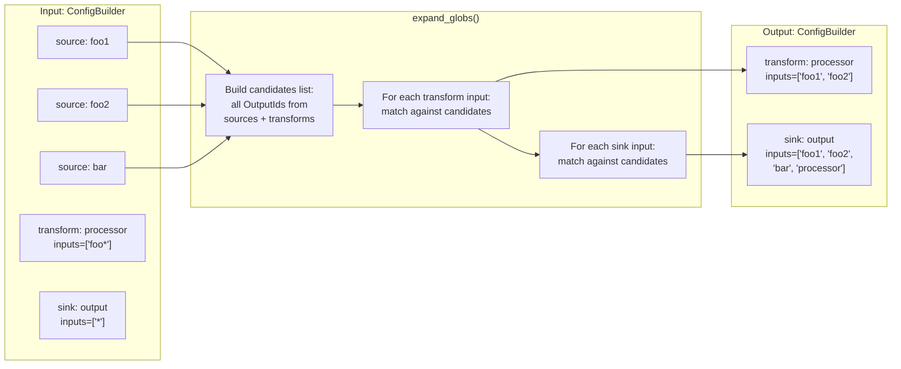
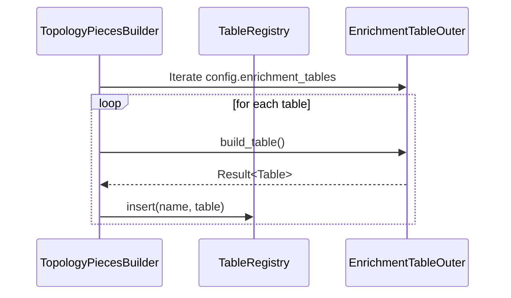
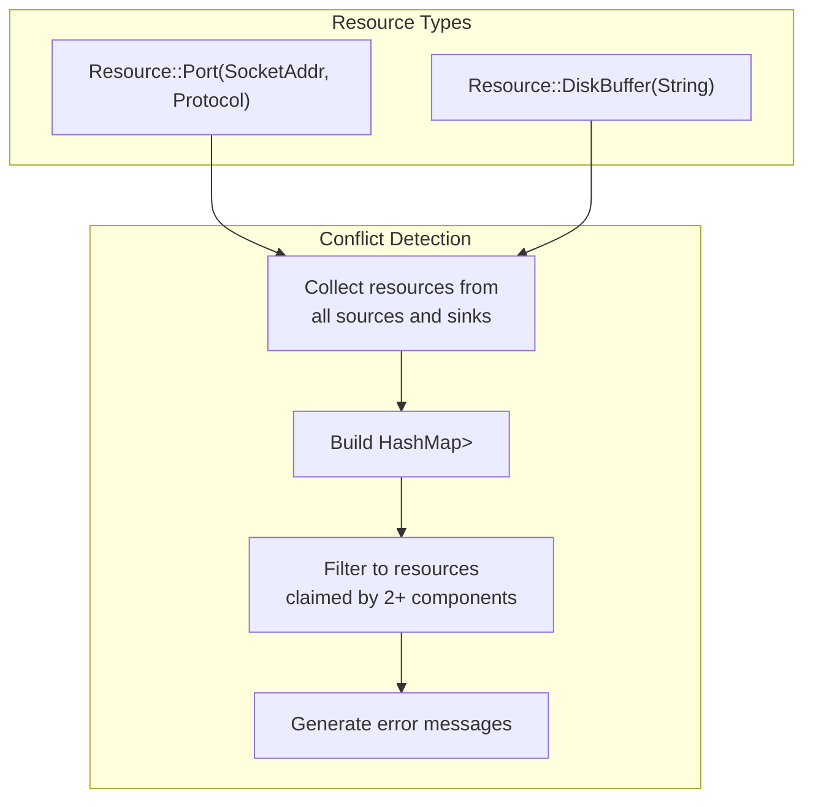

<!-- source: DeepWiki mcp.deepwiki.com · repo vectordotdev/vector · page 2.2 Configuration Loading and Compilation · fetched 2026-10-29 -->

# Configuration Loading and Compilation

Relevant source files

The following files were used as context for generating this wiki page:

- [changelog.d/19963_config_null.fix.md](changelog.d/19963_config_null.fix.md)
- [changelog.d/25143_enrichment_table_memory_cuckoo_filter.feature.md](changelog.d/25143_enrichment_table_memory_cuckoo_filter.feature.md)
- [changelog.d/25154_enrichment_table_memory_bloom_filter.feature.md](changelog.d/25154_enrichment_table_memory_bloom_filter.feature.md)
- [changelog.d/config_error_paths.fix.md](changelog.d/config_error_paths.fix.md)
- [lib/vector-common/src/internal_event/metric_name.rs](lib/vector-common/src/internal_event/metric_name.rs)
- [lib/vector-config-common/src/schema/json_schema.rs](lib/vector-config-common/src/schema/json_schema.rs)
- [lib/vector-config-common/src/schema/mod.rs](lib/vector-config-common/src/schema/mod.rs)
- [lib/vector-config-common/src/schema/visit.rs](lib/vector-config-common/src/schema/visit.rs)
- [lib/vector-config/src/component/description.rs](lib/vector-config/src/component/description.rs)
- [lib/vector-config/src/external/datetime.rs](lib/vector-config/src/external/datetime.rs)
- [lib/vector-config/src/schema/helpers.rs](lib/vector-config/src/schema/helpers.rs)
- [lib/vector-config/src/schema/visitors/inline_single.rs](lib/vector-config/src/schema/visitors/inline_single.rs)
- [lib/vector-config/src/schema/visitors/merge.rs](lib/vector-config/src/schema/visitors/merge.rs)
- [lib/vector-config/src/schema/visitors/mod.rs](lib/vector-config/src/schema/visitors/mod.rs)
- [lib/vector-config/src/schema/visitors/test.rs](lib/vector-config/src/schema/visitors/test.rs)
- [lib/vector-config/src/schema/visitors/unevaluated.rs](lib/vector-config/src/schema/visitors/unevaluated.rs)
- [src/app.rs](src/app.rs)
- [src/cli.rs](src/cli.rs)
- [src/config/builder.rs](src/config/builder.rs)
- [src/config/compiler.rs](src/config/compiler.rs)
- [src/config/format.rs](src/config/format.rs)
- [src/config/loading/config_builder.rs](src/config/loading/config_builder.rs)
- [src/config/loading/loader.rs](src/config/loading/loader.rs)
- [src/config/loading/mod.rs](src/config/loading/mod.rs)
- [src/config/loading/representation.rs](src/config/loading/representation.rs)
- [src/config/loading/secret.rs](src/config/loading/secret.rs)
- [src/config/loading/source.rs](src/config/loading/source.rs)
- [src/config/mod.rs](src/config/mod.rs)
- [src/config/provider.rs](src/config/provider.rs)
- [src/config/unit_test/mod.rs](src/config/unit_test/mod.rs)
- [src/enrichment_tables/file.rs](src/enrichment_tables/file.rs)
- [src/enrichment_tables/geoip.rs](src/enrichment_tables/geoip.rs)
- [src/enrichment_tables/memory/bloom_table.rs](src/enrichment_tables/memory/bloom_table.rs)
- [src/enrichment_tables/memory/config.rs](src/enrichment_tables/memory/config.rs)
- [src/enrichment_tables/memory/cuckoo_table.rs](src/enrichment_tables/memory/cuckoo_table.rs)
- [src/enrichment_tables/memory/internal_events.rs](src/enrichment_tables/memory/internal_events.rs)
- [src/enrichment_tables/memory/mod.rs](src/enrichment_tables/memory/mod.rs)
- [src/enrichment_tables/memory/table.rs](src/enrichment_tables/memory/table.rs)
- [src/enrichment_tables/mmdb.rs](src/enrichment_tables/mmdb.rs)
- [src/enrichment_tables/mod.rs](src/enrichment_tables/mod.rs)
- [src/generate.rs](src/generate.rs)
- [src/graph.rs](src/graph.rs)
- [src/list.rs](src/list.rs)
- [src/providers/http.rs](src/providers/http.rs)
- [src/providers/mod.rs](src/providers/mod.rs)
- [src/serde.rs](src/serde.rs)
- [src/service.rs](src/service.rs)
- [src/unit_test.rs](src/unit_test.rs)
- [src/validate.rs](src/validate.rs)
- [tests/integration/cli.rs](tests/integration/cli.rs)
- [tests/integration/shutdown.rs](tests/integration/shutdown.rs)
- [website/cue/reference/cli.cue](website/cue/reference/cli.cue)
- [website/cue/reference/generated/configuration.cue](website/cue/reference/generated/configuration.cue)
- [website/cue/reference/remap/functions.cue](website/cue/reference/remap/functions.cue)

## Purpose and Scope

This document details the entire pipeline Vector uses to load configuration from various sources and compile it into a validated, ready-to-use `Config` object. The configuration sources include multiple file formats (YAML, TOML, JSON), directories, environment variables, and CLI arguments. The pipeline extends through the handling of secret resolution, provider integration, enrichment table loading, and rigorous validation. It further covers the secrets backend subsystem supporting multiple providers such as `exec`, AWS Secrets Manager, file, and directory backends.

This page is a technical guide to how Vector’s configuration loading, secret resolution, and compilation components work together internally. For runtime usage of the compiled `Config`, see [Topology Construction](#2.3) and for hot reloading details, see [Runtime Management and Hot Reloading](#2.4).

---

## Configuration Path Processing

Vector supports flexible config file inputs, allowing users to specify individual files or directories with glob patterns. The config paths are encapsulated in the `ConfigPath` enum with variants for either a single file or a directory:

When paths are provided via CLI flags or environment variables, they are merged into a unified list with format hints using `merge_path_lists()`. The function `process_paths()` subsequently expands each path using glob patterns and filters invalid or missing files.

The process flow of path processing involves:

- Using default config paths (such as `/etc/vector/vector.yaml`) if none are specified.
- Expanding glob patterns to actual file or directory paths.
- Sorting and deduplicating the resulting list.
- Storing the result in the global mutex-protected `CONFIG_PATHS` for later reference.

**Key functions:**

- `process_paths()` ([src/config/loading/mod.rs:91-141]())
- `merge_path_lists()` ([src/config/loading/mod.rs:81-87]())

**Sources:** [src/config/mod.rs:124-146](), [src/config/loading/mod.rs:65-141]()

---

## Loader Architecture

Vector employs a trait-based loader architecture to modularize configuration loading and processing logic:

- The **`Process` trait** manages steps like input preparation, merging config tables, recursive directory traversal, and format handling.

- The **`Loader<T>` trait** extracts a constructed object of type `T` after loading.

There are three key loader implementations involved:

### ComponentHint Namespace Scoping

When loading configuration from directories, subdirectories are mapped to distinct component namespaces via `ComponentHint`. This allows logical separation of sources, transforms, sinks, tests, and enrichment tables.

| ComponentHint     | Directory Name       | Key in Config Table         |
|-------------------|----------------------|----------------------------|
| `Source`          | `sources/`           | `sources`                  |
| `Transform`       | `transforms/`        | `transforms`               |
| `Sink`            | `sinks/`             | `sinks`                    |
| `Test`            | `tests/`             | `tests`                    |
| `EnrichmentTable` | `enrichment_tables/` | `enrichment_tables`        |

This scheme enables modular config organization and better reload efficiency.

**Sources:** [src/config/loading/loader.rs:9-38](), [src/config/loading/loader.rs:40-267](), [src/config/loading/config_builder.rs:12-66](), [src/config/loading/secret.rs:41-108](), [src/config/loading/source.rs:8-47]()

---

## Configuration Loading Pipeline

The overall configuration loading involves two primary asynchronous tracks that interleave:

1. **Secret Resolution Track**:
   - Scans all configuration files for secret placeholders (`SECRET[backend.key]`).
   - Aggregates all secret keys for configured secret backends.
   - Retrieves secret values asynchronously from backends.
   - Builds a map of secret names to secret values.

2. **Config Building Track**:
   - Loads normal configuration files, merging sections for sources, transforms, sinks, and enrichment tables.
   - Performs environment variable interpolation if enabled.
   - Substitutes secrets using the retrieved secret map.
   - If a configuration provider is configured, loads remote configuration overriding local files.

Finally, the fully merged `ConfigBuilder` is compiled into a validated `Config` struct.

### Details:

- The secret loader walks all configuration files to collect secret usage with `collect_secret_keys()`.
- Secret backends, such as `exec`, `aws_secrets_manager`, `file`, and `directory`, asynchronously retrieve the secrets.
- These secrets are then passed as a map to the general config loader which interpolates placeholders.
- The config loader aggregates component configurations from multiple files/directories and environment variables.
- If a `provider` is configured, it can replace the local config builder with a remote config builder after provider validation.
- Finally, the composed ConfigBuilder is compiled and validated into a `Config` struct.

**Sources:** [src/config/loading/mod.rs:146-183](), [src/config/loading/secret.rs:80-170](), [src/config/loading/config_builder.rs:67-117]()

---

## Secret Resolution

Vector supports dynamic referencing of secrets inside configuration files using the `SECRET[backend.key]` syntax. This decouples secret values from static configuration and enables integration with multiple secrets backends.

### Secret Resolution Process

### Supported Secret Backends

1. **Exec Backend**: Runs a configured command to obtain secret value output, e.g., CLI utilities or scripts.

2. **AWS Secrets Manager Backend**: Retrieves secret values from AWS Secrets Manager using configured credentials.

3. **File Backend**: Reads secrets from individual files on disk.

4. **Directory Backend**: Reads all files from a directory, mapping file names as secret keys.

Secrets retrieved are cached locally as a `HashMap<String, String>` keyed by `"backend.key"` strings.

**Sources:** [src/config/loading/secret.rs:33-150](), [src/config/loading/config_builder.rs:67-77](), [src/secrets/mod.rs]()

---

## Configuration Compilation

After loading the raw configuration into a `ConfigBuilder`—which supports flexible types, input globs, and enriched fields—the compilation step validates and transforms it into a final typed `Config` struct.

### Compilation Pipeline

### Important notes:

- Component names are validated to forbid disallowed characters like `.` which can break graph construction.
- Wildcards in transform and sink inputs (e.g. `"foo*"` or `"*"` ) are expanded into actual component identifiers through the `expand_globs()` function.
- A dependency graph (`Graph`) representing sources, transforms, sinks, and enrichment tables is constructed and fully type checked.
- Cycles in the graph are detected and returned as errors.
- The actual `Config` struct is constructed with strongly typed fields for inputs and resolved components.
- Acknowledgement propagation is performed across sinks and sources to ensure correct at-least-once delivery semantics.
- Build warnings, if any, are collected and logged.

**Sources:** [src/config/compiler.rs:9-152]()

---

## Glob Expansion

The compilation supports wildcard globs in transform and sink input lists, allowing expressions like `"foo*"` to match multiple source or transform outputs automatically.

### Expansion Concept

The `expand_globs()` function compiles all candidate output identifiers (from sources and transforms) and matches input patterns using `glob::Pattern`. Matching inputs are replaced with explicitly enumerated output IDs.

**Sources:** [src/config/compiler.rs:154-221]()

---

## Enrichment Table Loading

Enrichment tables are configuration components specialized for providing lookup tables for data enrichment during event processing. They are declared as `EnrichmentTableOuter` in configuration and are loaded during topology building.

### Loading Flow

This mechanism allows enrichment tables to be referenced in VRL transforms at compile-time for validation and at runtime for fast lookup.

**Sources:** [src/config/mod.rs:54](), [src/validate.rs:21-64]() (stub enrichment table)

---

## Validation System

Vector implements a layered validation framework that checks configuration correctness, topology integrity, and environment readiness.

### Summary of Key Validators

| Validator Function               | Purpose                                  | Error Conditions                                   | Source Lines            |
|--------------------------------|------------------------------------------|--------------------------------------------------|-------------------------|
| `check_provider`               | Ensures provider and topology exclusivity| Provider config disables any local sources, transforms, or sinks | [src/config/validation.rs:61-71]() |
| `check_names`                  | Validates component names                 | Component keys must not contain '.' character    | [src/config/validation.rs:73-89]() |
| `check_shape`                  | Validates topology structure              | Requires at least one source and sink, unique keys, no missing or duplicated inputs | [src/config/validation.rs:91-170]() |
| `check_resources`              | Checks resource conflicts                  | Network ports, disk buffer paths cannot be claimed by multiple components | [src/config/validation.rs:172-194]() |
| `check_values`                 | Validates global EWMA and alpha values    | EWMA alpha or half-life values outside allowed ranges | [src/config/validation.rs:197-216]() |
| `check_buffer_preconditions`  | Async environment checks for buffer space | Disk buffer size must not exceed available disk space | [src/config/validation.rs:217-331]() |

### Resource Conflict Validation Diagram

Vector detects and reports when multiple components attempt to claim the same system resource such as a network port or disk buffer path:

**Sources:** [src/config/validation.rs:1-331]()

---

# Summary

- Vector accepts configuration from files (YAML/TOML/JSON), directories, and supports glob patterns.
- A modular, trait-driven loader system manages configuration loading from multiple sources with secret backend integration.
- Secret placeholders `SECRET[backend.key]` in configuration files are resolved asynchronously against multiple backends such as `exec`, AWS Secrets Manager, file, and directory.
- Loaded configurations are merged, including environment variable and secret interpolation.
- Configuration compilation validates, expands globs, constructs a topology graph, checks for cycles, and builds a typed Config struct.
- Enrichment tables are loaded and registered to allow VRL transform integration and runtime table lookups.
- A comprehensive validation pipeline checks component names, topology shapes, resource conflicts, and environment preconditions.
- The final result is a validated, complete `Config` object ready to be instantiated as a running topology.

This architecture ensures flexibly sourced, highly validated configuration that is dynamically aware of secrets and environment prerequisites.

---

# References to Key Files

- [src/app.rs:64-120]() — Application config loading entry points initializing config pipeline.
- [src/config/mod.rs:124-157]() — Core config types `ConfigPath`, `Config`, and component wrapping.
- [src/config/loading/mod.rs:30-183]() — Core config loading, secret resolution, and finalization functions.
- [src/config/loading/loader.rs:9-267]() — Loader and Process trait implementations for config and secrets.
- [src/config/loading/secret.rs:33-170]() — Secrets backend retrieval and interpolation system.
- [src/config/loading/config_builder.rs:12-135]() — ConfigBuilderLoader and compilation pipeline integration.
- [src/config/compiler.rs:9-152]() — Configuration compiler: validation, graph building, glob expansion.
- [src/config/validation.rs:1-331]() — Validation functions for topology and environment correctness.
- [src/validate.rs:12-250]() — Transform validation with VRL and environment checks.
- [src/config/cmd.rs:10-199]() — CLI argument parsing and initial config path population.

# End of page 2.2

---

