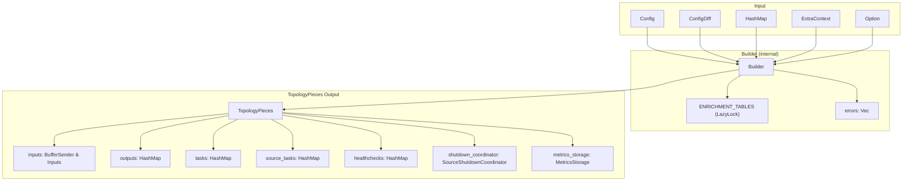
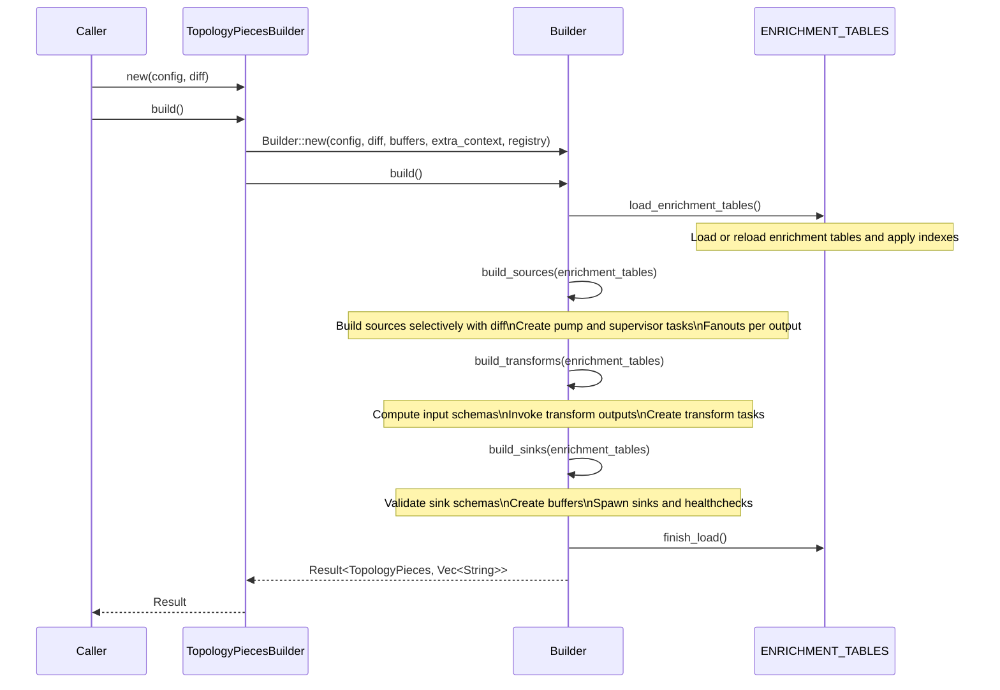
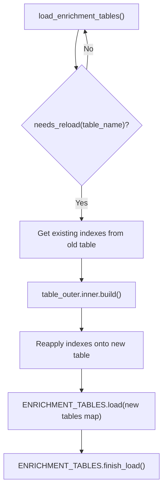
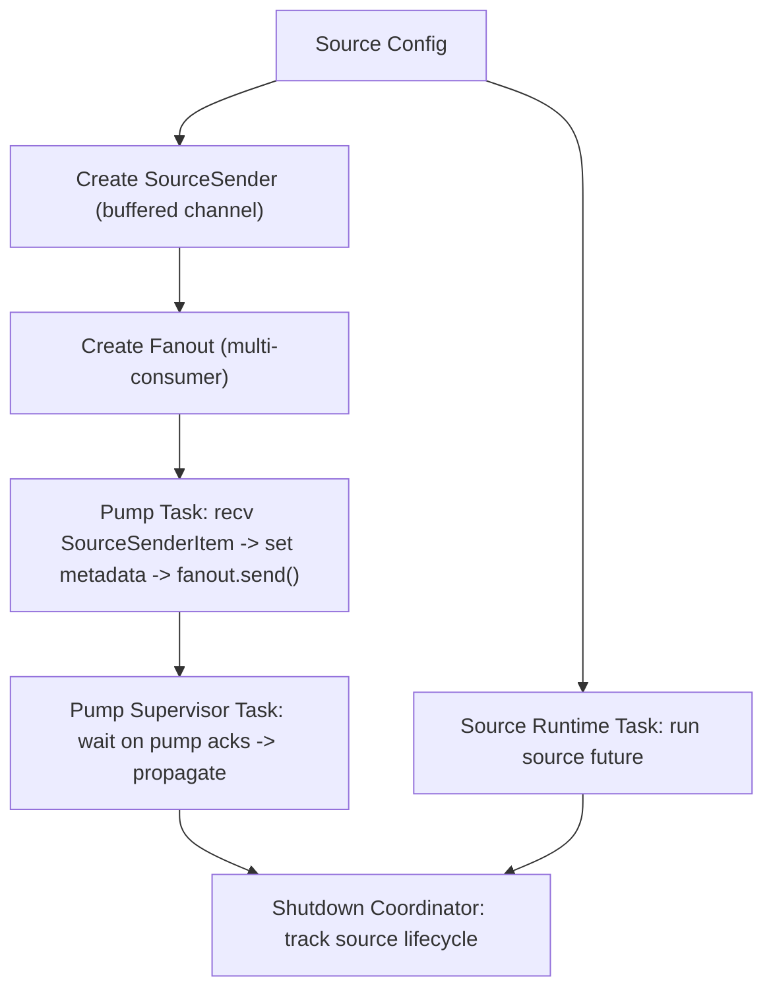
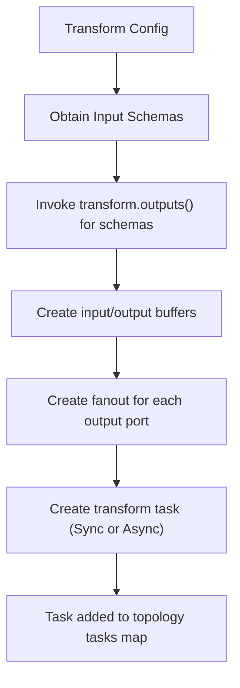
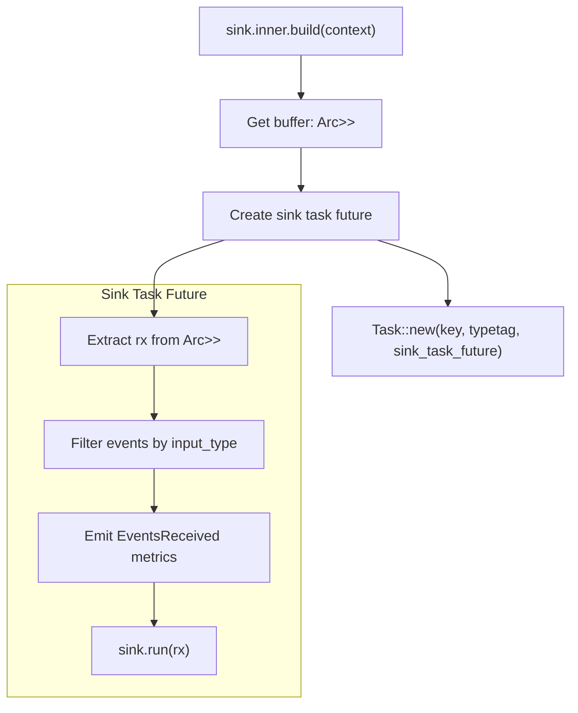
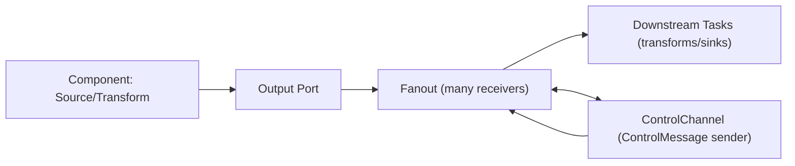
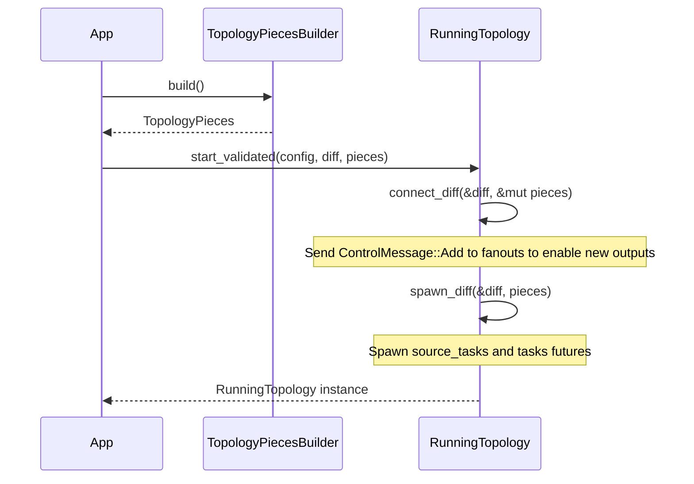

<!-- source: DeepWiki mcp.deepwiki.com · repo vectordotdev/vector · page 2.3 Topology Construction · fetched 2026-10-29 -->

# Topology Construction

<details>
<summary>Relevant source files</summary>

The following files were used as context for generating this wiki page:

- [lib/codecs/src/decoding/format/bytes.rs](lib/codecs/src/decoding/format/bytes.rs)
- [lib/codecs/src/decoding/format/gelf.rs](lib/codecs/src/decoding/format/gelf.rs)
- [lib/codecs/src/decoding/format/json.rs](lib/codecs/src/decoding/format/json.rs)
- [lib/codecs/src/decoding/format/native.rs](lib/codecs/src/decoding/format/native.rs)
- [lib/codecs/src/decoding/format/native_json.rs](lib/codecs/src/decoding/format/native_json.rs)
- [lib/codecs/src/decoding/format/syslog.rs](lib/codecs/src/decoding/format/syslog.rs)
- [lib/codecs/src/decoding/mod.rs](lib/codecs/src/decoding/mod.rs)
- [lib/vector-config/src/external/vrl.rs](lib/vector-config/src/external/vrl.rs)
- [lib/vector-core/src/config/mod.rs](lib/vector-core/src/config/mod.rs)
- [lib/vector-core/src/schema/definition.rs](lib/vector-core/src/schema/definition.rs)
- [lib/vector-core/src/schema/requirement.rs](lib/vector-core/src/schema/requirement.rs)
- [src/config/diff.rs](src/config/diff.rs)
- [src/config/enrichment_table.rs](src/config/enrichment_table.rs)
- [src/config/graph.rs](src/config/graph.rs)
- [src/config/sink_validated.rs](src/config/sink_validated.rs)
- [src/config/unit_test/tests.rs](src/config/unit_test/tests.rs)
- [src/config/unit_test/unit_test_components.rs](src/config/unit_test/unit_test_components.rs)
- [src/topology/builder.rs](src/topology/builder.rs)
- [src/topology/controller.rs](src/topology/controller.rs)
- [src/topology/mod.rs](src/topology/mod.rs)
- [src/topology/running.rs](src/topology/running.rs)
- [src/topology/schema.rs](src/topology/schema.rs)
- [src/topology/test/backpressure.rs](src/topology/test/backpressure.rs)
- [src/topology/test/doesnt_reload.rs](src/topology/test/doesnt_reload.rs)
- [src/topology/test/mod.rs](src/topology/test/mod.rs)
- [src/topology/test/reload.rs](src/topology/test/reload.rs)
- [src/topology/test/transient_state.rs](src/topology/test/transient_state.rs)

</details>


## Purpose and Scope

This document details how Vector constructs its processing topology from a validated configuration. The construction process involves instantiating sources, transforms, sinks, connecting them via buffer channels, spawning their execution tasks, and building the data dependency graph. Key concerns include selective component instantiation using diffing, enrichment table loading, schema checking, acknowledgement propagation, and managing fanouts for output distribution.

This page focuses on `TopologyPiecesBuilder` and the underlying `Builder` struct, the process of task spawning, graph building and validation, and how acknowledgements flow through the topology. It complements configuration loading and runtime management described on other pages.

---

## Core Architecture

### Overview

Topology construction is managed primarily by the internal `Builder` struct, which creates and connects all pipeline components according to the current `Config` and `ConfigDiff`. It outputs a `TopologyPieces` struct, encapsulating all instantiated parts necessary to run the topology.

The process:

- Loads enrichment tables in a global singleton registry.
- Builds sources, transforms, and sinks according to the diff.
- Creates buffer channels and fanout control channels for outputs.
- Spawns async tasks to run component logic.
- Validates configuration via schema compatibility and graph correctness.
- Sets up acknowledgement propagation via `SourceShutdownCoordinator`.

The `TopologyPiecesBuilder` struct provides a fluent public API on top of the internal builder.

### Topology Construction Overview



**Sources:** [src/topology/builder.rs:1-180](), [src/topology/running.rs:75-120]()

---

## TopologyPieces Structure

The `TopologyPieces` struct represents all components and infrastructure needed to run the topology:

| Field                 | Type                                                                         | Purpose                                                                                  |
|-----------------------|-------------------------------------------------------------------------------|------------------------------------------------------------------------------------------|
| `inputs`              | `HashMap<ComponentKey, (BufferSender<EventArray>, Inputs<OutputId>)>`        | Output buffers and upstream connection sets, used as inputs for transforms & sinks.     |
| `outputs`             | `HashMap<ComponentKey, HashMap<Option<String>, ControlChannel>>`              | Control channels for component output fanouts, for dynamic downstream management.        |
| `tasks`               | `HashMap<ComponentKey, Task>`                                                 | Spawnable async tasks for transforms and sinks.                                         |
| `source_tasks`        | `HashMap<ComponentKey, Task>`                                                 | Async tasks exclusively for sources (pump tasks, source runtime futures).                |
| `healthchecks`        | `HashMap<ComponentKey, Task>`                                                 | Healthcheck tasks for sinks.                                                             |
| `shutdown_coordinator`| `SourceShutdownCoordinator`                                                   | Coordinates acknowledgements and orderly shutdown of source components.                  |
| `detach_triggers`     | `HashMap<ComponentKey, Trigger>`                                              | Triggers to detach sinks during shutdown or reload.                                     |
| `metrics_storage`     | `MetricsStorage`                                                              | In-memory storage for VRL metrics associated with transforms.                            |

**Sources:** [src/topology/builder.rs:770-790]()

---

## ConfigDiff and Selective Building

`ConfigDiff` holds sets of components categorized as new, changed, or removed. The topology builder uses these to instantiate only required parts:

```rust
for (key, source) in self.config.sources()
    .filter(|(key, _)| self.diff.sources.contains_new(key))
{
    // Only build sources new or changed per diff
}
```

This selective building enables efficient hot reloads by reusing existing components when possible.

**Sources:** [src/topology/builder.rs:236-240](), [src/topology/builder.rs:443-447](), [src/topology/builder.rs:553-557]()

---

## Builder API and Topology Construction Flow

### `TopologyPiecesBuilder`

`TopologyPiecesBuilder` is the public interface for building a topology. It wraps the internal `Builder` and provides:

- Construction entry points with config and diff.
- Optional settings like existing buffers and extra context.
- Async `build` method returning `Result<TopologyPieces, Vec<String>>`.
- Methods to log errors on failures without aborting.

Typical usage:

```rust
let builder = TopologyPiecesBuilder::new(&config, &diff)
    .with_buffers(existing_buffers)
    .with_extra_context(extra_context);

let result = builder.build().await;
```

### Topology Construction Sequence



**Sources:** [src/topology/builder.rs:181-220](), [src/topology/builder.rs:803-872]()

---

## Enrichment Tables

Enrichment tables are loaded via a globally shared `TableRegistry` (`ENRICHMENT_TABLES` LazyLock). They provide lookup data accessible during VRL transformations and event processing.

### Loading Process

The topology builder locks the enrichment tables registry to avoid concurrent modifications.

For each table marked as changed or new in the diff:

- Extract existing indexes (from the old table).
- Instantiate a new table instance from the configuration (`build()`).
- Reapply the indexes to the new table for faster lookups.
- Register the rebuilt table in the global registry.

After loading all tables, `finish_load()` is called to finalize the registry's state.

### Diagram: Enrichment Table Loading Logic



**Sources:** [src/topology/builder.rs:71-75](), [src/topology/builder.rs:725-768]()

---

## Building Sources

### Source Instantiation and Task Spawning

Sources produce events at the pipeline intake. For each source identified as new or changed:

- Retrieve source outputs and associated schemas.
- For every output port:
  - Create a `SourceSender` channel with buffer size based on configuration.
  - Build a `Fanout` instance to support multiple downstream consumers.
- Create one **pump task per output**, responsible for receiving batched events (`SourceSenderItem`), setting event metadata (`source_id`, `source_type`), and pushing to fanout receivers.
- Create a **pump supervisor task** monitoring all pumps’ acknowledgements, propagating backpressure and coordinating acknowledgements use.
- Spawn the source implementation itself as an async task, passing it a `SourceSender` to produce events.
- Register the component's pumps and tasks in the outputs and `tasks` collections.
- Add source keys to the `shutdown_coordinator` for coordinated shutdown and acknowledgements.

This setup ensures consistent metadata annotation for events, backpressure signals traversing the pipeline, and task lifecycle management.

### Diagram: Source Task Setup and Fanout



**Sources:** [src/topology/builder.rs:221-430](), [src/topology/builder.rs:152-165](), [src/topology/builder.rs:273-307]()

---

## Building Transforms

Transforms process incoming events and produce transformed outputs. For each transform identified as new or changed:

- Collect input schemas from upstream outputs to understand expected event formats.
- Invoke the transform's `outputs()` method to determine output schemas per output port.
- Create buffer receivers and senders connecting to upstream and downstream pipelines.
- For transform implementations, two main types exist:

  1. **Synchronous transforms (`SyncTransform`)** - run a function for each event synchronously.
  2. **Async task transforms (`TaskTransform`)** - run an asynchronous task managing event batches.

- Build spawnable tasks wrapping transform processing futures.
- Create fanout control channels for transform outputs, allowing downstream reconfiguration when topology changes.

### Diagram: Transform Task and Fanout Setup



**Sources:** [src/topology/builder.rs:432-535](), [src/topology/builder.rs:961-1095]()

---

## Building Sinks

Sinks output events from Vector to external systems. The builder handles sink instantiation as follows:

- Each sink is assigned a buffer, reused from previous topology builds if available, else freshly created.
- The buffer is encapsulated as a `BuiltBuffer`, which is `(BufferSender<EventArray>, Arc<Mutex<Option<BufferReceiverStream<EventArray>>>>)`.
- The sink's `build()` method is called with a SinkContext containing runtime handles.
- A sink task future is created which:
  - Extracts a buffer receiver from the `Arc<Mutex<Option<_>>>`.
  - Filters events by expected data types.
  - Emits metrics such as `EventsReceived`.
  - Runs the sink's main processing loop.
- The sink task future is wrapped as a `Task` struct for spawning.
- If the sink supports healthchecks, a separate healthcheck task is spawned and added to `healthchecks`.
- Output fanouts for the sink are established with control channels.
- Each sink's shutdown coordination and detachment triggers are set.

### Diagram: Sink Task Preparation



**Sources:** [src/topology/builder.rs:537-723](), [src/topology/task.rs:1-40](), [src/topology/mod.rs:45-58]()

---

## Schema Validation and Propagation

Vector performs thorough schema validation during topology construction to guarantee datatype correctness:

- **Sources** declare output schemas using `outputs()` returning `SourceOutput`.
- **Transforms** receive input definitions and produce multiple output schemas per port via `outputs()`.
- **Sinks** specify expected schema and validate incoming data against these expectations using `schema::validate_sink_expectations()`.
- The topology builder recursively traces input sources and transforms to propagate and validate schemas.
- Errors such as incompatible schema definitions or missing compatible outputs cause build failure, preventing invalid pipeline constructions.
- This compile-time like schema checking ensures data types and semantic meanings remain consistent across the pipeline graph.

**Sources:** [src/topology/builder.rs:450-471](), [src/topology/builder.rs:585-592]()

---

## Task Structure and Preparation

For each component runnable in a Tokio runtime, Vector wraps it in a `Task`:

- Contains the component's key and type string for logging.
- Holds a boxed Future that drives component logic.
- Tasks are stored in `tasks` or `source_tasks` maps keyed by component ID.
- The builder spawns these tasks asynchronously at topology startup.
- Tasks incorporate cancellation handling, error reporting, and instrumentation via `tracing::Instrument`.
  
This task abstraction allows unified management of lifecycle and errors across components.

**Sources:** [src/topology/builder.rs:647-685](), [src/topology/task.rs:1-40]()

---

## Healthcheck Tasks

Sinks that implement healthchecks expose async futures which the topology spawns as separate tasks:

- Healthcheck tasks are stored in `healthchecks`.
- Their purpose is to asynchronously validate sink readiness before normal operation.
- The system can run these healthchecks independently or during reloads.
- Failed healthchecks result in topology reload failures or degraded states.

**Sources:** [src/topology/builder.rs:690-723](), [src/topology/mod.rs:50-58]()

---

## Output Fanouts and Control Channels

Vector supports multiple output ports per component with potentially many downstream consumers. To manage this:

- Each output port has a `Fanout` instance that fans events out over multiple channels.
- These fanouts are controlled via `ControlChannel`s, allowing dynamic subscription changes when reloading topology.
- Control channels receive `ControlMessage`s (e.g., Add, Remove receiver).
- The topology builder creates and stores these channels in the `outputs` map keyed by the component and output port.
- Fanout internals handle backpressure and buffering for efficient event distribution.

### Diagram: Output Fanout and Control Flow



Control channels allow adding or removing downstream receivers dynamically on reload.

**Sources:** [src/topology/builder.rs:152-165](), [src/topology/builder.rs:273-307]()

---

## Integration with `RunningTopology`

After the topology pieces are constructed, `RunningTopology::start_validated()` receives them to start the runtime orchestration:

- Incorporates the `ConfigDiff` to send `ControlMessage::Add` events to updated output fanouts for downstream reconfiguration.
- Spawns all source and transform tasks asynchronously.
- Manages shutdown coordination and acknowledgement tracking via `SourceShutdownCoordinator`.
- Provides interfaces for external API, metrics, and graceful shutdown.

### Diagram: Topology Startup with RunningTopology



This contract links construction phase with runtime control and hot reload capabilities in Vector.

**Sources:** [src/topology/running.rs:75-120](), [src/topology/running.rs:850-911]()

---

# Summary

Vector topology construction involves:

- Building an interconnected graph of sources, transforms, and sinks by instantiating components based on config diffs.
- Loading and applying enrichment tables globally.
- Instantiating buffered channels and fanouts for output event distribution.
- Building and validating schema expectations, ensuring type correctness.
- Wrapping component execution as async Tokio tasks.
- Preparing healthcheck tasks and shutdown coordination.
- Establishing control channels for runtime reconfiguration.

This systematic approach supports efficient incremental reloads, rigorous validation, and flexible topology evolution.

---

# References and Source Files

- Topology builder implementation: [src/topology/builder.rs:1-1190]()
- Task management: [src/topology/task.rs:1-40]()
- Running topology orchestration: [src/topology/running.rs:75-120]()
- Configuration diff and graph validation: [src/config/diff.rs]()
- Enrichment tables loading and application: [src/topology/builder.rs:720-770]()
- Schema definition and validation: [lib/vector-core/src/schema/definition.rs]()

---

