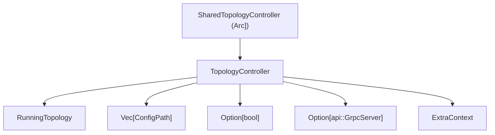
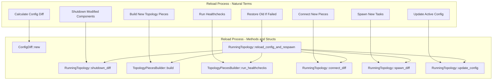

<!-- source: DeepWiki mcp.deepwiki.com · repo vectordotdev/vector · page 2.4 Runtime Management and Hot Reloading · fetched 2026-10-29 -->

# Runtime Management and Hot Reloading

<details>
<summary>Relevant source files</summary>

The following files were used as context for generating this wiki page:

- [src/config/diff.rs](src/config/diff.rs)
- [src/config/enrichment_table.rs](src/config/enrichment_table.rs)
- [src/config/sink_validated.rs](src/config/sink_validated.rs)
- [src/dns.rs](src/dns.rs)
- [src/internal_events/adaptive_concurrency.rs](src/internal_events/adaptive_concurrency.rs)
- [src/internal_events/open.rs](src/internal_events/open.rs)
- [src/sinks/util/adaptive_concurrency/controller.rs](src/sinks/util/adaptive_concurrency/controller.rs)
- [src/sinks/util/adaptive_concurrency/future.rs](src/sinks/util/adaptive_concurrency/future.rs)
- [src/sinks/util/adaptive_concurrency/mod.rs](src/sinks/util/adaptive_concurrency/mod.rs)
- [src/sinks/util/adaptive_concurrency/service.rs](src/sinks/util/adaptive_concurrency/service.rs)
- [src/sinks/util/buffer/partition.rs](src/sinks/util/buffer/partition.rs)
- [src/topology/builder.rs](src/topology/builder.rs)
- [src/topology/controller.rs](src/topology/controller.rs)
- [src/topology/mod.rs](src/topology/mod.rs)
- [src/topology/running.rs](src/topology/running.rs)
- [src/topology/test/backpressure.rs](src/topology/test/backpressure.rs)
- [src/topology/test/doesnt_reload.rs](src/topology/test/doesnt_reload.rs)
- [src/topology/test/mod.rs](src/topology/test/mod.rs)
- [src/topology/test/reload.rs](src/topology/test/reload.rs)
- [src/topology/test/transient_state.rs](src/topology/test/transient_state.rs)
- [src/utilization.rs](src/utilization.rs)

</details>


This document describes Vector's runtime management system, detailing how Vector runs and manages its active topology and components, supports incremental (hot) config reloads without downtime, handles graceful shutdowns, and tracks utilization metrics. It explains the core runtime entities (`RunningTopology`, `TopologyController`), the four-phase reload lifecycle, signal handling integration, and utilization tracking.

For initial topology construction details, see [Topology Construction](). For configuration loading and validation, see [Configuration Loading and Compilation]().

---

## Overview

Vector's runtime management revolves around a live, running pipeline represented by the `RunningTopology`. This structure holds the set of active component tasks and their connections. To allow for:

- **Hot Reloading**: Vector supports on-the-fly incremental config reloads via signals or API calls.
- **Differential Updates**: Only components affected by config changes are paused and restarted.
- **Buffer Recovery**: Disk-backed buffers are seamlessly reused to avoid data loss.
- **Graceful Shutdown**: Vector supports a configurable grace period to drain in-flight events cleanly.
- **Error Recovery**: Failed restarts roll back to the previous healthy config.
- **Utilization Tracking**: Component activity is periodically measured for observability.
  
The `TopologyController` manages the lifecycle of the running topology, orchestrates reloads, and exposes an API server when enabled.

Overall reload work proceeds through four incremental phases optimizing for minimal disruption and robustness.

Sources: [src/topology/running.rs:53-130](), [src/topology/controller.rs:37-151](), [src/utilization.rs:25-177]()

---

## Core Runtime Structures

### RunningTopology

The `RunningTopology` struct represents a live execution of Vector's pipeline. It owns:

- Running tasks for sources, transforms, and sinks
- Event buffers linking components
- Shutdown coordination and detach triggers for graceful termination
- The current active configuration
- Internal channels for abort signaling and topology state watching
- Optional utilization tracking registry and background tasks

```mermaid
graph TB
  subgraph "RunningTopology Fields"
    Config[config: Config]
    Inputs[inputs: HashMap<ComponentKey, BufferSender<EventArray>>]
    InputsTap[inputs_tap_metadata: HashMap<ComponentKey, Inputs[OutputId]>]
    Outputs[outputs: HashMap[OutputId, ControlChannel]]
    Tasks[tasks: HashMap<ComponentKey, TaskHandle>]
    SourceTasks[source_tasks: HashMap<ComponentKey, TaskHandle>]
    ShutdownCoord[shutdown_coordinator: SourceShutdownCoordinator]
    DetachTriggers[detach_triggers: HashMap<ComponentKey, DisabledTrigger>]
    AbortTx[abort_tx: mpsc::UnboundedSender[ShutdownError]]
    Watch[watch: (WatchTx, WatchRx)]
    UtilReg[utilization_registry: Option[UtilizationRegistry]]
    UtilTask[utilization_task: Option[TaskHandle]]
    MetricsTask[metrics_task: Option[TaskHandle]]
  end

  Config --> Inputs
  Inputs --> InputsTap
  InputsTap --> Outputs
  Outputs --> Tasks
  Tasks --> SourceTasks
  SourceTasks --> ShutdownCoord
  ShutdownCoord --> AbortTx
  Outputs --> Watch
  Watch --> UtilReg
  UtilReg --> UtilTask
  Tasks --> DetachTriggers
  UtilReg --> MetricsTask
```

| Field | Description |
|---|---|
| `config` | Current active `Config` representing the running pipeline [src/topology/running.rs:66-67]() |
| `inputs` | Senders to component input buffers keyed by component [src/topology/running.rs:57]() |
| `inputs_tap_metadata` | Metadata on inputs for tap inspection [src/topology/running.rs:58]() |
| `outputs` | Output control channels; used for plumbing outputs between components [src/topology/running.rs:59]() |
| `tasks` | Handles to running tasks for transforms and sinks [src/topology/running.rs:63]() |
| `source_tasks` | Handles to source component tasks [src/topology/running.rs:62]() |
| `shutdown_coordinator` | Coordinates source shutdown signaling [src/topology/running.rs:64]() |
| `detach_triggers` | Triggers to detach sinks during reload [src/topology/running.rs:65]() |
| `abort_tx` | Emergency abort channel to propagate fatal errors [src/topology/running.rs:67]() |
| `watch` | Channel to broadcast topology changes (used for tap API) [src/topology/running.rs:68]() |
| `utilization_registry` | Registry to track component utilization [src/topology/running.rs:70]() |
| `utilization_task` | Background task that periodically emits utilization metrics [src/topology/running.rs:71]() |
| `metrics_task` | Background task for internal metrics emission [src/topology/running.rs:72]() |

Sources: [src/topology/running.rs:55-103]()

### TopologyController

The `TopologyController` manages a `RunningTopology` and the lifecycle of configuration reloads and graceful shutdown.

- It owns the current running topology
- A list of config paths being watched
- Options such as requiring components to pass healthchecks before activating reload
- When enabled, it manages the gRPC API server lifecycle

This controller is wrapped with locking (`SharedTopologyController`) for concurrency, supporting safe reloads while servicing API or signal events.



Key responsibilities:

- Performing config reloads via `reload()` [src/topology/controller.rs:64-151]()
- Starting/stopping the API server [src/topology/controller.rs:69-102]()
- Initiating graceful shutdown sequences [src/topology/controller.rs:154-166]()

Sources: [src/topology/controller.rs:37-151]()

---

## Signal Handling and Event Loop Integration

Vector interprets various signals and commands to control the running topology lifecycle. These include:

- `ReloadComponents(HashSet<ComponentKey>)`: Reload specified components dynamically.
- `ReloadFromDisk`: Reload config from files on disk.
- `ReloadEnrichmentTables`: Refresh enrichment tables without rebuilding entire topology.
- `Shutdown(Option<ShutdownError>)`: Begin graceful shutdown.
- `Quit`: Immediate quit.

The integration between OS signals and Vector signals is platform-specific:

- **Unix**: `SIGHUP` triggers full config reload, `SIGINT`/`SIGTERM` starts graceful shutdowns.
- **Windows**: The Vector service listens for SCM stop/start commands for lifecycle events.

This modular signal handling allows reloads and shutdowns to be triggered via CLI, API, or OS signals.

Sources: [src/signal.rs:15-31](), [src/signal.rs:190-200](), [src/vector_windows.rs:129-139]()

---

## Hot Reload Process and Lifecycle

The core method for performing a hot reload is `reload_config_and_respawn` on `RunningTopology`. The reload flow proceeds as follows:

```mermaid
stateDiagram-v2
    [*] --> CalculateDiff: "Calculate ConfigDiff"
    CalculateDiff --> Phase1Shutdown: "shutdown_diff()"
    Phase1Shutdown --> BuildPieces: "TopologyPiecesBuilder::build()"
    BuildPieces --> Phase2Healthcheck: "run_healthchecks()"
    Phase2Healthcheck --> Phase3Connect: "connect_diff()"
    Phase3Connect --> Phase4Spawn: "spawn_diff()"
    Phase4Spawn --> UpdateConfig: "Update active config"
    UpdateConfig --> [*]

    Phase2Healthcheck --> RestoreOld: "If healthchecks fail"
    RestoreOld --> [*]: "ReloadError::TopologyBuildFailed"
```

Each phase operates on the differential set of components to minimize downtime and preserve state:

**Phase 1: Differential Shutdown**

- Stop only components that need replacement.
- Source components are shut down promptly via `SourceShutdownCoordinator`.
- Transforms naturally terminate once upstream channels close.
- Sink components are detached via triggers to allow safe restart.
  
**Phase 2: Build New Pieces**

- Instantiate new or changed components using `TopologyPiecesBuilder`.
- Enrichment tables are reloaded with lock guarding to avoid races.
- Validate the new topology pieces and run healthchecks if configured.

**Phase 3: Connect New Pieces**

- Connect new components to existing untouched ones.
- Setup communication channels and fanout as necessary.

**Phase 4: Spawn New Pieces**

- Spawn new tasks for sources, transforms, and sinks.
- Update internal buffers replacing old ones only when necessary.
- Start utilization and metrics tasks if needed.

The reload operation is atomic; on failure Vector attempts to restore the previous running topology to avoid data loss or inconsistent pipeline state.

Sources: [src/topology/running.rs:286-377]()

### Differential Shutdown Details

- Vector leverages the `ConfigDiff` to identify components to stop.
- Source components are shut down first (`SourceShutdownCoordinator::shutdown_source`) [src/topology/running.rs:431-464]().
- Transform components stop naturally once upstream buffers close. This avoids explicit shutdown logic.
- Sink tasks are detached forcibly via `detach_triggers` [src/topology/running.rs:570-580]() for clean restart.
- Buffers (especially disk-backed) are reused when possible by extracting `BuiltBuffer` pairs from the old topology and passing them to the new builder [src/topology/running.rs:594-619]().

Sources: [src/topology/running.rs:422-623](), [src/topology/mod.rs:45-48]()

---

## Graceful Shutdown

Vector implements a controlled shutdown process with the following behavior:

1. **Phase 1 (API disablement)**: The gRPC API server (if running) is marked as "not serving" so that external probes (e.g., Kubernetes readiness) detect the shutdown early and stop sending traffic. This is done asynchronously [src/topology/controller.rs:159-161]().

2. **Phase 2 (Source shutdown)**: All sources are sent shutdown signals via the `SourceShutdownCoordinator`. This stops ingestion and event generation [src/topology/running.rs:173-185](). 

3. **Phase 3 (Event draining)**: Vector waits for all in-flight events to propagate through transforms and sinks. This is achieved by awaiting all transform and sink task futures, which exit once input channels close.

4. **Phase 4 (Forced shutdown timeout)**: If the configured `graceful_shutdown_duration` passes before all tasks complete, remaining tasks are forcefully aborted to avoid hanging shutdowns [src/topology/running.rs:218-223]().

This shutdown sequence ensures events are flushed cleanly with a configurable timeout.

Sources: [src/topology/running.rs:145-262](), [src/topology/controller.rs:154-166]()

---

## Utilization Tracking

Vector tracks the "utilization" or busy-time of components to identify bottlenecks and monitor resource consumption.

### Utilization Stream Wrapper

The `Utilization<S>` type wraps an inner async stream representing a component's output. It intercepts the `poll_next` lifecycle to measure how long a component spends waiting for work relative to performing work:

- On `poll_next` start, a "start_wait" message is sent to a timer.
- The underlying stream is polled.
- Upon readiness, a "stop_wait" message is sent.

This pattern yields timing data indicating the component's busy vs waiting ratio [src/utilization.rs:33-89]().


### Utilization Timer and Metrics Emission

The `Timer` struct aggregates timing spans of waiting vs working. It:

- Maintains an EWMA (Exponentially Weighted Moving Average) of utilization.
- Periodically emits this average as a gauge metric reflecting the component’s utilization ratio.
- Resets timing counters after each emission interval.

This systematic tracking enables Vector to expose internal metrics that help diagnose throughput and latency bottlenecks [src/utilization.rs:110-177]().

Sources: [src/utilization.rs:68-89](), [src/utilization.rs:110-177]()

---

## Summary of Key Functions and Workflow

| Function | Location | Description |
|---|---|---|
| `RunningTopology::reload_config_and_respawn` | `src/topology/running.rs` | Main orchestrator for hot reload, implementing the four-phase reload approach. |
| `RunningTopology::shutdown_diff` | `src/topology/running.rs` | Stops only configured components affected by reloads during phase 1. |
| `RunningTopology::stop` | `src/topology/running.rs` | Runs the graceful shutdown sequence of the entire running topology. |
| `TopologyController::reload` | `src/topology/controller.rs` | Interface to trigger reload from API or CLI with healthcheck support. |
| `handle_errors` | `src/topology/mod.rs` | Catches panics in component futures and propagates abort signals. |
| `Utilization<S>` | `src/utilization.rs` | Wrapper tracking busy time vs waiting time for components. |
| `Timer` | `src/utilization.rs` | Maintains and emits EWMA utilization metrics for a component. |

### Bridging Diagram: Natural Language to Code Entities in Reload Process



Sources: [src/topology/running.rs:286-377](), [src/config/diff.rs:17-192]()

---

### Bridging Diagram: Runtime Components and Control

```mermaid
graph LR
  A[Vector Runtime Management]
  
  subgraph "Core Runtime"
    RT[RunningTopology]
    TC[TopologyController]
    SCT[SharedTopologyController]
    US[UtilizationSystem]
    APISrv[API Server (Optional)]
  end
  
  subgraph "Communication & Control"
    AB[Abort Channel: abort_tx]
    WT[Watch Channel: watch]
    UT[Utilization Registry + Tasks]
  end
  
  A --> RT
  A --> TC
  TC --> RT
  TC --> APISrv
  TC --> SCT
  SCT --> TC
  RT --> AB
  RT --> WT
  RT --> UT
```

Sources: [src/topology/running.rs:53-103](), [src/topology/controller.rs:37-151](), [src/utilization.rs:33-120]()

---

## References

- Core runtime and reload logic: [src/topology/running.rs:53-641]()
- Controller and reload management: [src/topology/controller.rs:1-181]()
- Differential config changes: [src/config/diff.rs:1-192]()
- Utilization tracking: [src/utilization.rs:1-177]()
- Hot reload tests / verification: [src/topology/test/reload.rs:1-183]()
- Graceful shutdown tests: [src/topology/test/transient_state.rs:1-105]()

---

This completes the comprehensive explanation of Vector's runtime management and hot reloading system.

---

