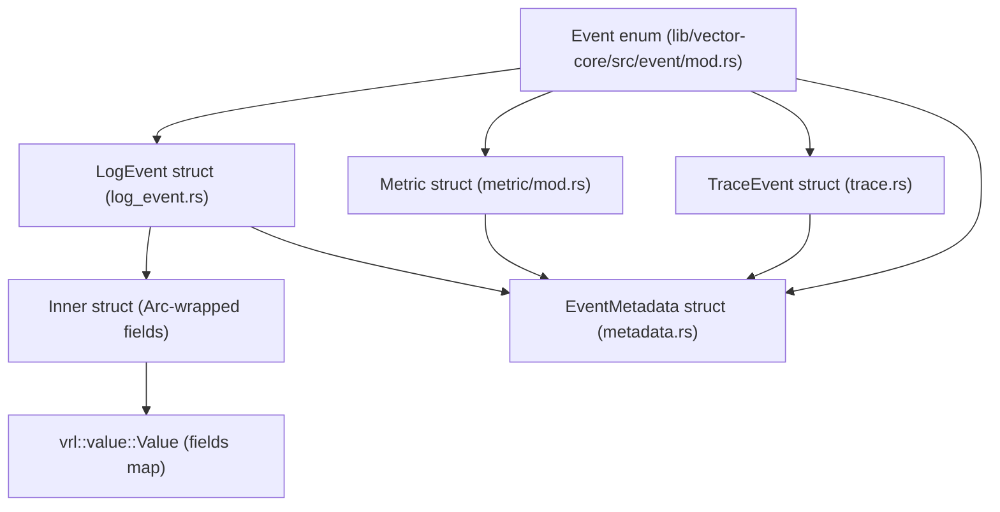
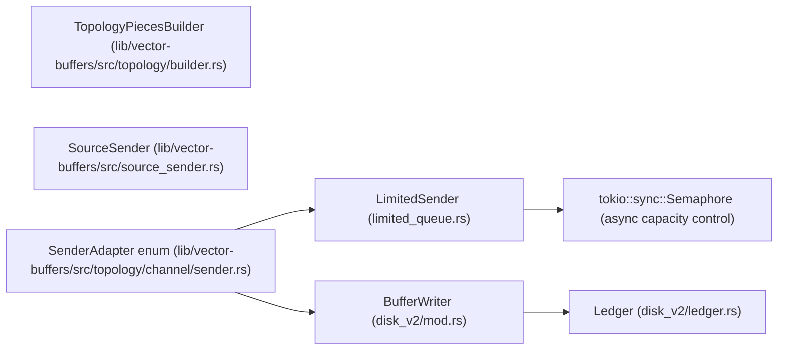
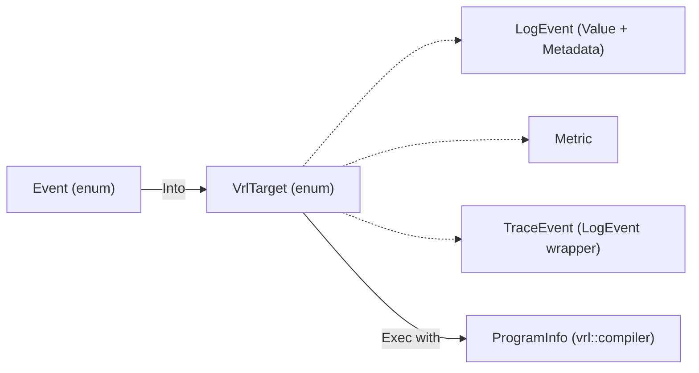
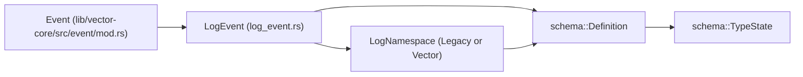

<!-- source: DeepWiki mcp.deepwiki.com · repo vectordotdev/vector · page 3 Event Processing · fetched 2026-10-29 -->

# Event Processing

<details>
<summary>Relevant source files</summary>

The following files were used as context for generating this wiki page:

- [lib/vector-buffers/benches/common.rs](lib/vector-buffers/benches/common.rs)
- [lib/vector-buffers/benches/sized_records.rs](lib/vector-buffers/benches/sized_records.rs)
- [lib/vector-buffers/examples/buffer_perf.rs](lib/vector-buffers/examples/buffer_perf.rs)
- [lib/vector-buffers/src/buffer_usage_data.rs](lib/vector-buffers/src/buffer_usage_data.rs)
- [lib/vector-buffers/src/config.rs](lib/vector-buffers/src/config.rs)
- [lib/vector-buffers/src/internal_events.rs](lib/vector-buffers/src/internal_events.rs)
- [lib/vector-buffers/src/lib.rs](lib/vector-buffers/src/lib.rs)
- [lib/vector-buffers/src/topology/builder.rs](lib/vector-buffers/src/topology/builder.rs)
- [lib/vector-buffers/src/topology/channel/receiver.rs](lib/vector-buffers/src/topology/channel/receiver.rs)
- [lib/vector-buffers/src/topology/channel/sender.rs](lib/vector-buffers/src/topology/channel/sender.rs)
- [lib/vector-buffers/src/topology/channel/tests.rs](lib/vector-buffers/src/topology/channel/tests.rs)
- [lib/vector-buffers/src/topology/test_util.rs](lib/vector-buffers/src/topology/test_util.rs)
- [lib/vector-buffers/src/variants/in_memory.rs](lib/vector-buffers/src/variants/in_memory.rs)
- [lib/vector-core/src/config/log_schema.rs](lib/vector-core/src/config/log_schema.rs)
- [lib/vector-core/src/event/array.rs](lib/vector-core/src/event/array.rs)
- [lib/vector-core/src/event/log_event.rs](lib/vector-core/src/event/log_event.rs)
- [lib/vector-core/src/event/metadata.rs](lib/vector-core/src/event/metadata.rs)
- [lib/vector-core/src/event/metric/mod.rs](lib/vector-core/src/event/metric/mod.rs)
- [lib/vector-core/src/event/metric/value.rs](lib/vector-core/src/event/metric/value.rs)
- [lib/vector-core/src/event/mod.rs](lib/vector-core/src/event/mod.rs)
- [lib/vector-core/src/event/proto.rs](lib/vector-core/src/event/proto.rs)
- [lib/vector-core/src/event/trace.rs](lib/vector-core/src/event/trace.rs)
- [lib/vector-core/src/event/vrl_target.rs](lib/vector-core/src/event/vrl_target.rs)
- [lib/vector-core/src/fanout.rs](lib/vector-core/src/fanout.rs)
- [lib/vector-core/src/latency.rs](lib/vector-core/src/latency.rs)
- [lib/vector-core/src/lib.rs](lib/vector-core/src/lib.rs)
- [lib/vector-core/src/metrics/ddsketch.rs](lib/vector-core/src/metrics/ddsketch.rs)
- [lib/vector-core/src/metrics/mod.rs](lib/vector-core/src/metrics/mod.rs)
- [lib/vector-core/src/metrics/recency.rs](lib/vector-core/src/metrics/recency.rs)
- [lib/vector-core/src/metrics/recorder.rs](lib/vector-core/src/metrics/recorder.rs)
- [lib/vector-core/src/metrics/storage.rs](lib/vector-core/src/metrics/storage.rs)
- [lib/vector-core/src/transform/outputs.rs](lib/vector-core/src/transform/outputs.rs)
- [lib/vector-lib/Cargo.toml](lib/vector-lib/Cargo.toml)
- [lib/vector-lib/src/lib.rs](lib/vector-lib/src/lib.rs)
- [lib/vector-vrl/metrics/Cargo.toml](lib/vector-vrl/metrics/Cargo.toml)
- [src/test_util/mock/sources/basic.rs](src/test_util/mock/sources/basic.rs)
- [src/test_util/mod.rs](src/test_util/mod.rs)

</details>


This document describes Vector's event processing system, covering the unified event data model, buffering and flow control mechanisms, VRL integration, schema tracking, metadata management, and how events flow through the pipeline. Vector consolidates logs, metrics, and traces into a coherent architecture, ensuring reliable, flexible handling of observability data.

This is a **parent page**. Each topic below is introduced at a high level with links to respective child pages for comprehensive technical details.

---

## Core Event Types and Data Model

Vector processes three principal event types unified under the `Event` enum:

- **LogEvent**: Structured logs represented as key-value maps with Copy-on-Write semantics backed by `Arc<Inner>`.
- **Metric**: Time-series metrics with explicit kinds such as counters, gauges, histograms, sets, distributions, and aggregated summaries.
- **TraceEvent**: Distributed tracing spans implemented as a newtype wrapper around `LogEvent`.

All events carry associated **EventMetadata**, which tracks lifecycle attributes like source identification, schema definitions, acknowledgments (finalizers), secrets, and dropped fields. This metadata supports end-to-end tracking and type-aware processing.

### Code Entities Overview



Key points:
- `Event` enum unifies logs, metrics, and traces.
- `LogEvent` uses an internal `Arc<Inner>` for efficient cloning and mutation.
- `EventMetadata` stores critical event context such as component IDs, secrets, schema definitions, and finalizers for acknowledgement.
- Metrics have rich type information and tags.
- Traces are effectively log events with tracing semantics.

For the full specification of the event enum variants, event lifecycle, and event metadata structure, see [Event Data Model](#3.1).

---

## Buffering and Flow Control

Vector’s pipeline uses advanced buffering layers to ensure smooth event flow and apply backpressure for resource management:

- **LimitedQueue**: Memory-bounded queue integrating a counting semaphore to control capacity.
- **BufferSender and BufferReceiver**: Channel abstractions wrapping underlying queues.
- **SenderAdapter**: Enum adapter unifying in-memory buffers (`LimitedSender`) and persistent disk buffers (`BufferWriter`) to transparently handle buffering.
- **WhenFull Policies**: Policies controlling buffer overflow behavior:
  - **Block** (default): waits until space is available, applying backpressure upstream.
  - **DropNewest**: drops incoming events if full.
  - **Overflow**: propagates events to the next buffer in topology if full (used internally).
- **Disk Buffer (disk_v2)**: Persistent queue using a ledger, reader, and writer design to guarantee durable buffering across restarts.

### Code Entities Overview



| Policy     | Description                                  | Default | Reference                     |
|------------|----------------------------------------------|---------|-------------------------------|
| Block      | Waits for free space, applying backpressure | Yes     | [lib/vector-buffers/src/lib.rs:46-85]() |
| DropNewest | Drops new events if buffer full              | No      | [lib/vector-buffers/src/lib.rs:59-75]() |
| Overflow   | Forwards events to next buffer stage         | No      | [lib/vector-buffers/src/lib.rs:76-90]() |

This architecture enables highly configurable and reliable flow control to adapt to varying load and topology changes.

For detailed architecture, buffer implementations, backpressure mechanisms, and metrics tracking, see [Buffering and Flow Control](#3.2).

---

## VRL Integration with Events

Vector Remap Language (VRL) is a dynamically typed language used to transform events at runtime:

- `VrlTarget` acts as the adapter between `Event` types and VRL, exposing fields for manipulation and expression evaluation.
- VRL supports complex runtime execution for logs, metrics, and traces, including array-based event expansion.
- Optimizations include **metric precomputation** of fields for fast access during VRL execution.
- Transform error handling modes include `drop_on_error` and `reroute_dropped` for resilient pipelines.
- The VRL web playground allows interactive testing of VRL scripts against example events.

### VRL to Event Adaptation Diagram



For detailed coverage of VRL integration, runtime execution, error handling, and related tooling, see [VRL Integration](#3.3).

---

## Schema System and Type Tracking

Vector tracks event schema information to provide strong typing and semantic clarity during processing:

- **schema::Definition**: Describes event field types and semantic meanings for logs especially.
- **TypeState**: Captures compile-time inference information propagated during VRL compilation.
- **LogNamespace**: Differentiates **Legacy** flat log model vs the new **Vector** structured model with dedicated metadata.
- Semantic meanings link logical field concepts (e.g., timestamp, service) to actual event paths.
- Schema information flows through transforms, aiding validation and optimization.

### Schema Associations Diagram



For comprehensive explanations on schema design, inference, and propagation through the pipeline, see [Schema System](#3.4).

---

## Acknowledgements and Event Finalization

Vector ensures **at-least-once** delivery semantics through a coordinated acknowledgement and event finalization system:

- Events carry `EventFinalizers` tracking dependencies for acknowledgment.
- There are **ordered** and **unordered** finalizers that manage acknowledgements at different granularities.
- `BatchNotifier` tracks event batches for efficient grouping and notification.
- Sources only advance offsets or checkpoints after corresponding events are confirmed by sinks.
- This guarantees proper tracking even under retries, failures, or partial pipeline reloads.

This mechanism underlies Vector's robust reliability guarantees.

For full details on acknowledgements, finalizers, batch coordination, and delivery semantics, see [Acknowledgements and Finalization](#3.5).

---

## Internal Events and Metrics

Vector emits internal observability data to monitor its own operation:

- The `emit!` macro signals internal events such as buffer usage, configuration changes, or errors.
- Metrics track buffer utilization, event counts, and errors at component boundaries.
- Internal metric and log sources (`internal_metrics` and `internal_logs`) expose this data externally.
- Rate-limited tracing avoids flooding logs during intensive internal events.
- The `tracing-limit` crate helps enforce such limits efficiently.

This feedback loop empowers diagnostics and operational insight.

See [Internal Events and Metrics](#3.6) for comprehensive coverage.

---

## Fanout and Event Distribution

Vector supports sending events to multiple downstream sinks via the **Fanout** mechanism:

- Maintains a map of sinks keyed by `ComponentKey`.
- Uses a `ControlChannel` (mpsc unbounded) to send `ControlMessage` commands like add, remove, pause, and replace sink endpoints dynamically.
- Handles backpressure from all sinks collectively, blocking if any sink is slow or paused.
- Supports dynamic pipeline reconfiguration and vector-to-vector chaining for scalable deployment.

### Fanout Control and Distribution Diagram

```mermaid
graph TB
    Fanout["Fanout struct (lib/vector-core/src/fanout.rs)"]
    ControlChannel["ControlChannel (mpsc::UnboundedSender<ControlMessage>)"]
    Sink1["Sink 1 (BufferSender<EventArray>)"]
    Sink2["Sink 2 (BufferSender<EventArray>)"]

    Fanout --> ControlChannel
    Fanout --> Sink1
    Fanout --> Sink2

    ControlChannel -.-> Fanout: ControlMessage(Add/Remove/Pause/Replace)
```

For a deep dive into fanout protocol, control messages, and dynamic management, see [Fanout and Event Distribution](#3.7).

---

# Summary

Vector’s event processing unifies logs, metrics, and traces into a consistent event data model with rich metadata and schema support. Events traverse multi-layered memory and disk buffers that regulate flow under configurable policies. VRL scripting enables powerful runtime transformations with strong type inference and error resilience. A robust acknowledgment system ensures reliable at-least-once delivery, while internal metrics and dynamic fanout provide scalability and observability.

Detailed child pages are available for deep exploration of each subsystem:
- [Event Data Model](#3.1)
- [Buffering and Flow Control](#3.2)
- [VRL Integration](#3.3)
- [Schema System](#3.4)
- [Acknowledgements and Finalization](#3.5)
- [Internal Events and Metrics](#3.6)
- [Fanout and Event Distribution](#3.7)

---

### Sources

- Event enum and variants: [lib/vector-core/src/event/mod.rs:50-57, 59-93]()  
- LogEvent structure with Arc wrapping: [lib/vector-core/src/event/log_event.rs:154-161, 183-213, 221-225]()  
- EventMetadata layout and semantics: [lib/vector-core/src/event/metadata.rs:28-90, 138-230]()  
- Buffering and flow control implementations: [lib/vector-buffers/src/topology/builder.rs:66-70](), [lib/vector-buffers/src/topology/channel/sender.rs:22-28](), [lib/vector-buffers/src/topology/channel/limited_queue.rs:30-150](), [lib/vector-buffers/src/lib.rs:46-85]()  
- Internal buffer metrics and event emission: [lib/vector-buffers/src/buffer_usage_data.rs:141-180](), [lib/vector-buffers/src/internal_events.rs:10-180]()  
- Fanout control and behavior: [lib/vector-core/src/fanout.rs:15-52, 54-153]()  
- VRL integration with events: [lib/vector-core/src/event/vrl_target.rs:60-130]()  
- Schema tracking and propagation: [lib/vector-core/src/schema/definition.rs:14-32](), [lib/vector-core/src/event/log_event.rs:206-213, 528-604]()  
- Event acknowledgements and finalization: [lib/vector-core/src/event/mod.rs:5-8, 85-93](), [lib/vector-core/src/event/log_event.rs:221-225]()

---

