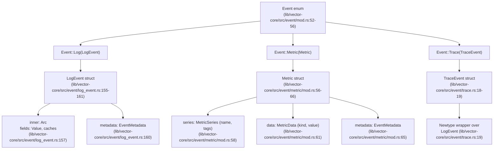
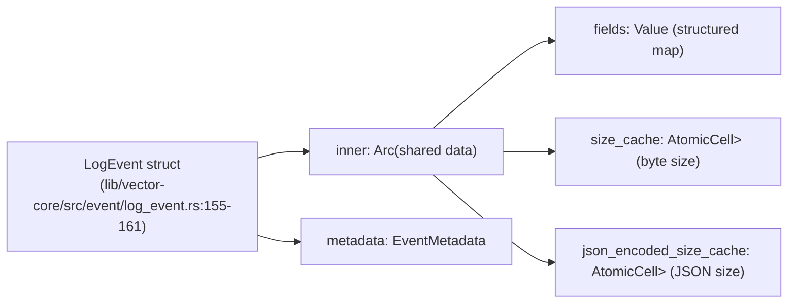
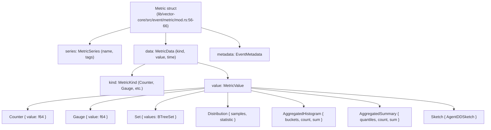
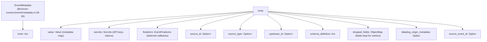
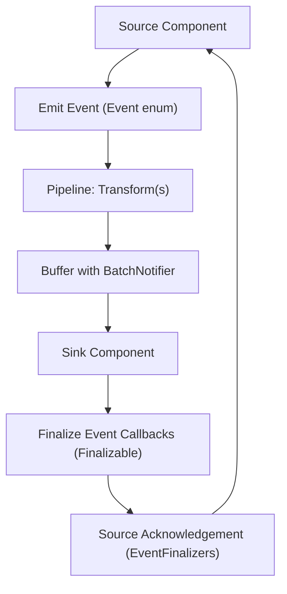

<!-- source: DeepWiki mcp.deepwiki.com · repo vectordotdev/vector · page 3.1 Event Data Model · fetched 2026-10-29 -->

# Event Data Model

<details>
<summary>Relevant source files</summary>

The following files were used as context for generating this wiki page:

- [changelog.d/otlp-metric-encoder.feature.md](changelog.d/otlp-metric-encoder.feature.md)
- [lib/codecs/src/encoding/format/otlp.rs](lib/codecs/src/encoding/format/otlp.rs)
- [lib/opentelemetry-proto/src/common.rs](lib/opentelemetry-proto/src/common.rs)
- [lib/opentelemetry-proto/src/lib.rs](lib/opentelemetry-proto/src/lib.rs)
- [lib/opentelemetry-proto/src/logs.rs](lib/opentelemetry-proto/src/logs.rs)
- [lib/opentelemetry-proto/src/metrics.rs](lib/opentelemetry-proto/src/metrics.rs)
- [lib/opentelemetry-proto/src/spans.rs](lib/opentelemetry-proto/src/spans.rs)
- [lib/vector-core/src/config/log_schema.rs](lib/vector-core/src/config/log_schema.rs)
- [lib/vector-core/src/event/array.rs](lib/vector-core/src/event/array.rs)
- [lib/vector-core/src/event/log_event.rs](lib/vector-core/src/event/log_event.rs)
- [lib/vector-core/src/event/metadata.rs](lib/vector-core/src/event/metadata.rs)
- [lib/vector-core/src/event/metric/mod.rs](lib/vector-core/src/event/metric/mod.rs)
- [lib/vector-core/src/event/metric/series.rs](lib/vector-core/src/event/metric/series.rs)
- [lib/vector-core/src/event/metric/tags.rs](lib/vector-core/src/event/metric/tags.rs)
- [lib/vector-core/src/event/metric/value.rs](lib/vector-core/src/event/metric/value.rs)
- [lib/vector-core/src/event/mod.rs](lib/vector-core/src/event/mod.rs)
- [lib/vector-core/src/event/proto.rs](lib/vector-core/src/event/proto.rs)
- [lib/vector-core/src/event/test/mod.rs](lib/vector-core/src/event/test/mod.rs)
- [lib/vector-core/src/event/test/serialization.rs](lib/vector-core/src/event/test/serialization.rs)
- [lib/vector-core/src/event/test/size_of.rs](lib/vector-core/src/event/test/size_of.rs)
- [lib/vector-core/src/event/trace.rs](lib/vector-core/src/event/trace.rs)
- [lib/vector-core/src/event/util/log/all_fields.rs](lib/vector-core/src/event/util/log/all_fields.rs)
- [lib/vector-core/src/event/util/log/mod.rs](lib/vector-core/src/event/util/log/mod.rs)
- [lib/vector-core/src/event/vrl_target.rs](lib/vector-core/src/event/vrl_target.rs)
- [lib/vector-core/src/lib.rs](lib/vector-core/src/lib.rs)
- [lib/vector-core/src/metrics/ddsketch.rs](lib/vector-core/src/metrics/ddsketch.rs)
- [lib/vector-core/src/metrics/mod.rs](lib/vector-core/src/metrics/mod.rs)
- [lib/vector-core/src/metrics/recency.rs](lib/vector-core/src/metrics/recency.rs)
- [lib/vector-core/src/metrics/recorder.rs](lib/vector-core/src/metrics/recorder.rs)
- [lib/vector-core/src/metrics/storage.rs](lib/vector-core/src/metrics/storage.rs)
- [lib/vector-lib/Cargo.toml](lib/vector-lib/Cargo.toml)
- [lib/vector-lib/src/lib.rs](lib/vector-lib/src/lib.rs)
- [lib/vector-vrl/metrics/Cargo.toml](lib/vector-vrl/metrics/Cargo.toml)
- [src/internal_events/reduce.rs](src/internal_events/reduce.rs)
- [src/test_util/mod.rs](src/test_util/mod.rs)
- [src/transforms/reduce/merge_strategy.rs](src/transforms/reduce/merge_strategy.rs)
- [src/transforms/reduce/transform.rs](src/transforms/reduce/transform.rs)

</details>


This document provides a detailed technical overview of Vector's core event data structures and their implementation: the `Event` enum, the `LogEvent` structure using `Arc<Inner>` for copy-on-write (CoW) semantics, the `EventMetadata` wrapper, the metric `Metric` type and its variants (Counter, Gauge, Histogram, Set, Distribution, AggregatedHistogram, AggregatedSummary), and the life cycle of events in the system.

---

## Event Type Hierarchy

Vector's event system models observability data through three primary event types unified under a single `Event` enum:

- **LogEvent** — for log data with structured fields.
- **Metric** — for numerical measurements with tags and types.
- **TraceEvent** — a wrapper over `LogEvent` specifically for tracing data.

### Event Enum and Its Variants

The `Event` enum is declared in `lib/vector-core/src/event/mod.rs` [lib/vector-core/src/event/mod.rs:52-56]() and has the following variants:

```rust
pub enum Event {
    Log(LogEvent),
    Metric(Metric),
    Trace(TraceEvent),
}
```

Each variant encapsulates its own data type:

- `LogEvent` holds structured log data [lib/vector-core/src/event/log_event.rs:155-161]().
- `Metric` captures numerical metrics with typed payloads [lib/vector-core/src/event/metric/mod.rs:56-66]().
- `TraceEvent` wraps a `LogEvent` for trace data [lib/vector-core/src/event/trace.rs:18-19]().

#### Type Coercion Methods

The enum provides safe and unsafe coercion methods to extract inner types, e.g., `as_log()` [lib/vector-core/src/event/mod.rs:120-125](), `try_into_log()` [lib/vector-core/src/event/mod.rs:154-159](), `into_log()` [lib/vector-core/src/event/mod.rs:144-149](). If the wrong variant is accessed unsafely, the code panics.

### Mermaid Diagram: Event Enum and Data Model Overview



**Sources:** [lib/vector-core/src/event/mod.rs:52-56](), [lib/vector-core/src/event/log_event.rs:155-161](), [lib/vector-core/src/event/trace.rs:18-19](), [lib/vector-core/src/event/metric/mod.rs:56-66]()

---

## LogEvent Structure

### Internal Representation with CoW via Arc<Inner>

`LogEvent` is implemented as a lightweight container holding an immutable reference-counted pointer (`Arc`) to an `Inner` struct along with associated `EventMetadata` [lib/vector-core/src/event/log_event.rs:155-161](). This allows efficient cloning with copy-on-write semantics: mutations trigger a clone of the inner data only when necessary via `Arc::make_mut` [lib/vector-core/src/event/log_event.rs:188-193]().

The core components are:

- `inner: Arc<Inner>` — shared fields data and caches.
- `metadata: EventMetadata` — additional state and routing info.

### Inner Struct Details

The `Inner` struct contains:

- `fields: Value` — the actual event data, usually a map of key-value pairs [lib/vector-core/src/event/log_event.rs:53]().
- `size_cache: AtomicCell<Option<NonZeroUsize>>` — cached byte size of this event to optimize memory accounting [lib/vector-core/src/event/log_event.rs:56]().
- `json_encoded_size_cache: AtomicCell<Option<NonZeroJsonSize>>` — cached size of estimated JSON encoding length [lib/vector-core/src/event/log_event.rs:59]().

These caches invalidate when the event is mutated [lib/vector-core/src/event/log_event.rs:63-66]().

### Mermaid Diagram: LogEvent Internals



**Sources:** [lib/vector-core/src/event/log_event.rs:155-161](), [lib/vector-core/src/event/log_event.rs:51-60]()

### API Highlights

- `value()` returns immutable reference to data [lib/vector-core/src/event/log_event.rs:183-185]().
- `value_mut()` triggers `Arc::make_mut` to clone if needed, invalidating caches [lib/vector-core/src/event/log_event.rs:187-193]().
- `namespace()` detects if event uses legacy or new Vector log namespaces by checking for metadata presence [lib/vector-core/src/event/log_event.rs:206-212]().
- `from_str_legacy()` and `from_bytes_legacy()` construct events in legacy mode [lib/vector-core/src/event/log_event.rs:166-181]().

### Log Namespace Modes

Vector supports two LogEvent namespaces [lib/vector-core/src/event/log_event.rs:206-212]():

| Namespace | Detection | Behavior |
|-----------|-----------|----------|
| **Legacy** | Absence of `metadata.vector` path | Uses global schema keys for message / timestamp / host |
| **Vector** | Presence of `metadata.vector` field (read-only) | Uses schema definitions and semantic meanings |

This allows backward compatibility with older log formats and newer, semantically enriched logs.

---

## Metric Structure

Metrics represent typed numerical and statistical data with associated tags and metadata [lib/vector-core/src/event/metric/mod.rs:56-66]().

### Metric Components

A `Metric` consists of:

- `series: MetricSeries` — identifies the metric name and optional tags [lib/vector-core/src/event/metric/mod.rs:58]().
- `data: MetricData` — holds times, kind (counter/gauge), and the value [lib/vector-core/src/event/metric/mod.rs:61]().
- `metadata: EventMetadata` — routing, finalization, and schema info [lib/vector-core/src/event/metric/mod.rs:65]().

### MetricValue Types

The `MetricValue` enum supports multiple kinds with distinct data shapes [lib/vector-core/src/event/proto.rs:147-200]():

| MetricValue Variant  | Description                     | Implementation Pointer |
|---------------------|---------------------------------|------------------------|
| `Counter`           | Cumulative incrementing count  | [lib/vector-core/src/event/proto.rs:150-152]() |
| `Gauge`             | Instantaneous measurement      | [lib/vector-core/src/event/proto.rs:153]() |
| `Set`               | Unique value aggregation       | [lib/vector-core/src/event/proto.rs:154-156]() |
| `Distribution`      | Statistical distribution       | [lib/vector-core/src/event/proto.rs:157-164]() |
| `AggregatedHistogram` | Pre-aggregated histogram buckets | [lib/vector-core/src/event/proto.rs:165-182]() |
| `AggregatedSummary`  | Quantile summaries             | [lib/vector-core/src/event/proto.rs:183-197]() |
| `Sketch`             | Compact quantile sketch (DDSketch) | [lib/vector-core/src/event/proto.rs:198-200]() |

### Mermaid Diagram: Metric Type Hierarchy



**Sources:** [lib/vector-core/src/event/metric/mod.rs:56-66](), [lib/vector-core/src/event/proto.rs:147-200]()

### Metric Tags

Metrics support multi-valued tags stored in a specialized `MetricTags` structure optimized for performance and compatibility with various upstream protocols [lib/vector-core/src/event/metric/mod.rs:35]().

How tags are exposed to VRL/Lua is governed by `MetricTagMode` [lib/vector-core/src/event/vrl_target.rs:39-58]():
- `Single`: Last value wins.
- `Full`: Always arrays.
- `Auto`: Strings for single, arrays for multi-value.

---

## TraceEvent Structure

`TraceEvent` is implemented as a newtype wrapper around `LogEvent`, reusing its structure and route tracking [lib/vector-core/src/event/trace.rs:17-19]().

```rust
pub struct TraceEvent(LogEvent);
```

This design preserves type safety while leveraging common log event infrastructure, including metadata and path-based field access. `TraceEvent` delegates operations to the inner `LogEvent` transparently [lib/vector-core/src/event/trace.rs:36-50]().

**Sources:** [lib/vector-core/src/event/trace.rs:17-19](), [lib/vector-core/src/event/trace.rs:128-132]()

---

## EventMetadata Structure

Event metadata encapsulates routing, schema, secrets, and finalization information attached to each event.

### Internal Representation

`EventMetadata` wraps an `Arc<Inner>` for efficient sharing and CoW behavior [lib/vector-core/src/event/metadata.rs:26-36]():

- `value: Value` — arbitrary metadata key-value map [lib/vector-core/src/event/metadata.rs:45]().
- `secrets: Secrets` — container for sensitive values like API keys [lib/vector-core/src/event/metadata.rs:49]().
- `finalizers: EventFinalizers` — a list of deferred callbacks for event acknowledgement [lib/vector-core/src/event/metadata.rs:52]().
- `source_id: Option<Arc<ComponentKey>>` — originating component ID [lib/vector-core/src/event/metadata.rs:55]().
- `source_type: Option<Cow<'static, str>>` — source type string [lib/vector-core/src/event/metadata.rs:58]().
- `upstream_id: Option<Arc<OutputId>>` — previous component output ID [lib/vector-core/src/event/metadata.rs:64]().
- `schema_definition: Arc<schema::Definition>` — attached schema info for structuring [lib/vector-core/src/event/metadata.rs:72]().
- `dropped_fields: ObjectMap` — fields dropped during encoding but preserved for later uses [lib/vector-core/src/event/metadata.rs:80]().
- `datadog_origin_metadata` — specific metadata used for Datadog integration [lib/vector-core/src/event/metadata.rs:85]().
- `source_event_id: Option<Uuid>` — internal unique event identifier [lib/vector-core/src/event/metadata.rs:89]().

### Mermaid Diagram: EventMetadata Internals



**Sources:** [lib/vector-core/src/event/metadata.rs:28-90]()

---

## Event Lifecycle and Finalization

### Finalizable Trait

All event types implement the `Finalizable` trait which enables event acknowledgements and callbacks to be attached to events [lib/vector-core/src/event/mod.rs:84-92]():

```rust
pub trait Finalizable {
    fn take_finalizers(&mut self) -> EventFinalizers;
}
```

This allows Vector to track when an event is fully processed and to trigger acknowledgements towards the source.

### Use in Event Acknowledgements

- Event sinks call `take_finalizers()` after successful processing [lib/vector-core/src/event/mod.rs:85-92]().
- Finalizers include closures that notify sources about completion (e.g., offset commits in Kafka, file checkpoint updates).
- `BatchNotifier` wraps acknowledgements for batches of events for efficiency [lib/vector-core/src/event/mod.rs:5-8]().

This mechanism ensures **at-least-once delivery semantics** throughout the pipeline, linking source position with successful sink processing.

---

# Summary Mermaid Diagram: Natural Language to Code Entity Mapping

```mermaid
graph TD
    subgraph NaturalLanguageSpace ["Natural Language Space"]
        NL_Vector["Vector"]
        NL_Event["Event (Logs/Metrics/Traces)"]
        NL_Metadata["Event Metadata"]
        NL_Metrics["Metrics (Counter, Gauge, etc.)"]
        NL_CoW["Copy-On-Write (CoW) Pattern"]
        NL_Lifecycle["Event Lifecycle with Finalizers"]
    end

    subgraph CodeEntitySpace ["Code Entity Space"]
        Code_Event["enum Event<br/>(lib/vector-core/src/event/mod.rs:52)"]
        Code_LogEvent["struct LogEvent<br/>(lib/vector-core/src/event/log_event.rs:155)"]
        Code_Inner["struct Inner<br/>(Arc data)<br/>(lib/vector-core/src/event/log_event.rs:51)"]
        Code_Metadata["struct EventMetadata<br/>(lib/vector-core/src/event/metadata.rs:28)"]
        Code_Metric["struct Metric<br/>(lib/vector-core/src/event/metric/mod.rs:56)"]
        Code_MetricValue["enum MetricValue variants<br/>(lib/vector-core/src/event/proto.rs:147)"]
        Code_TraceEvent["struct TraceEvent (wrapper)<br/>(lib/vector-core/src/event/trace.rs:19)"]
        Code_Finalizable["trait Finalizable<br/>(lib/vector-core/src/event/mod.rs:84)"]
        Code_BatchNotifier["struct BatchNotifier (finalizers)<br/>(lib/vector-core/src/event/mod.rs:5)"]
    end

    NL_Vector --> Code_Event
    NL_Event --> Code_Event
    NL_Event --> Code_LogEvent
    NL_Event --> Code_Metric
    NL_Event --> Code_TraceEvent
    NL_Metadata --> Code_Metadata
    NL_Metrics --> Code_MetricValue
    NL_CoW --> Code_Inner
    NL_Lifecycle --> Code_Finalizable
    NL_Lifecycle --> Code_BatchNotifier
```



---

# Detailed Event Lifecycle Flow Diagram



- Events are created by Sources encapsulated in the `Event` enum.
- They travel through the pipeline, optionally transformed and buffered.
- Sinks process events and call finalizers to mark them complete via `take_finalizers()` [lib/vector-core/src/event/mod.rs:84-92]().
- Finalizers trigger acknowledgements back to sources.

**Sources:** [lib/vector-core/src/event/mod.rs:5-8](), [lib/vector-core/src/event/log_event.rs:31](), [lib/vector-core/src/event/metadata.rs:52]()

---

# References

- `Event` enum and methods: [lib/vector-core/src/event/mod.rs:52-92]()
- `LogEvent` and `Arc<Inner>`: [lib/vector-core/src/event/log_event.rs:51-161]()
- `EventMetadata` with `Arc<Inner>`: [lib/vector-core/src/event/metadata.rs:26-90]()
- `Metric` and MetricValue variants: [lib/vector-core/src/event/metric/mod.rs:56-66]() and [lib/vector-core/src/event/proto.rs:147-200]()
- `TraceEvent` wrapper: [lib/vector-core/src/event/trace.rs:17-119]()
- Finalizable trait and event lifecycle: [lib/vector-core/src/event/mod.rs:84-92](), [lib/vector-core/src/event/log_event.rs:221-225]()

---

