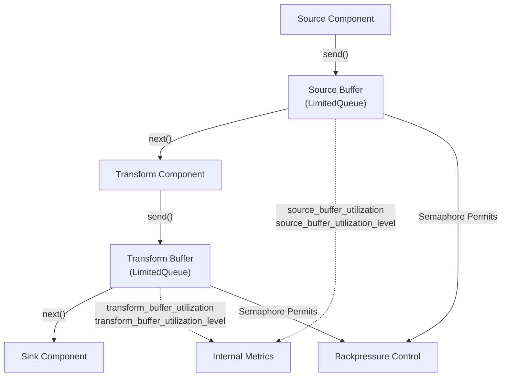
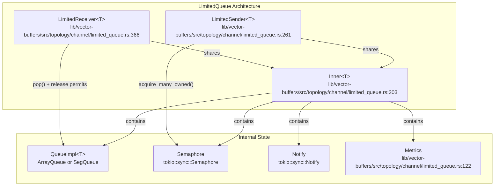
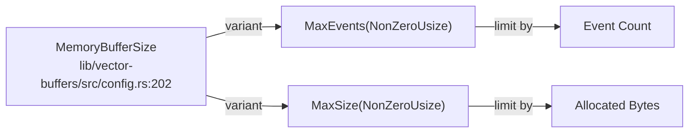
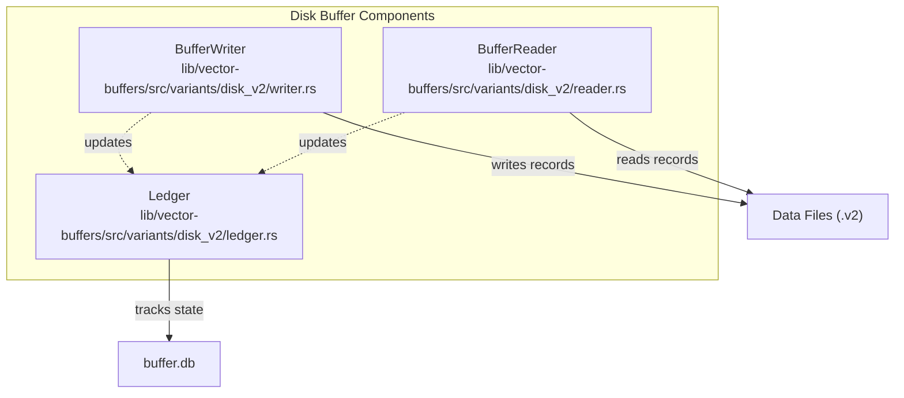
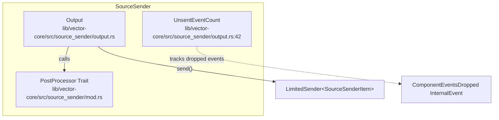
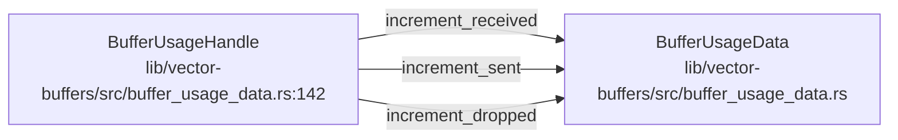

<!-- source: DeepWiki mcp.deepwiki.com · repo vectordotdev/vector · page 3.2 Buffering and Flow Control · fetched 2026-10-29 -->

# Buffering and Flow Control

Relevant source files

The following files were used as context for generating this wiki page:

- [changelog.d/disk_v2_buffer_size_recompute_on_restart.fix.md](changelog.d/disk_v2_buffer_size_recompute_on_restart.fix.md)
- [lib/vector-buffers/benches/common.rs](lib/vector-buffers/benches/common.rs)
- [lib/vector-buffers/benches/sized_records.rs](lib/vector-buffers/benches/sized_records.rs)
- [lib/vector-buffers/examples/buffer_perf.rs](lib/vector-buffers/examples/buffer_perf.rs)
- [lib/vector-buffers/src/buffer_usage_data.rs](lib/vector-buffers/src/buffer_usage_data.rs)
- [lib/vector-buffers/src/config.rs](lib/vector-buffers/src/config.rs)
- [lib/vector-buffers/src/internal_events.rs](lib/vector-buffers/src/internal_events.rs)
- [lib/vector-buffers/src/lib.rs](lib/vector-buffers/src/lib.rs)
- [lib/vector-buffers/src/topology/builder.rs](lib/vector-buffers/src/topology/builder.rs)
- [lib/vector-buffers/src/topology/channel/limited_queue.rs](lib/vector-buffers/src/topology/channel/limited_queue.rs)
- [lib/vector-buffers/src/topology/channel/mod.rs](lib/vector-buffers/src/topology/channel/mod.rs)
- [lib/vector-buffers/src/topology/channel/receiver.rs](lib/vector-buffers/src/topology/channel/receiver.rs)
- [lib/vector-buffers/src/topology/channel/sender.rs](lib/vector-buffers/src/topology/channel/sender.rs)
- [lib/vector-buffers/src/topology/channel/tests.rs](lib/vector-buffers/src/topology/channel/tests.rs)
- [lib/vector-buffers/src/topology/test_util.rs](lib/vector-buffers/src/topology/test_util.rs)
- [lib/vector-buffers/src/variants/disk_v2/checkpoint_recovery.rs](lib/vector-buffers/src/variants/disk_v2/checkpoint_recovery.rs)
- [lib/vector-buffers/src/variants/disk_v2/common.rs](lib/vector-buffers/src/variants/disk_v2/common.rs)
- [lib/vector-buffers/src/variants/disk_v2/io.rs](lib/vector-buffers/src/variants/disk_v2/io.rs)
- [lib/vector-buffers/src/variants/disk_v2/ledger.rs](lib/vector-buffers/src/variants/disk_v2/ledger.rs)
- [lib/vector-buffers/src/variants/disk_v2/mod.rs](lib/vector-buffers/src/variants/disk_v2/mod.rs)
- [lib/vector-buffers/src/variants/disk_v2/reader.rs](lib/vector-buffers/src/variants/disk_v2/reader.rs)
- [lib/vector-buffers/src/variants/disk_v2/tests/initialization.rs](lib/vector-buffers/src/variants/disk_v2/tests/initialization.rs)
- [lib/vector-buffers/src/variants/disk_v2/tests/invariants.rs](lib/vector-buffers/src/variants/disk_v2/tests/invariants.rs)
- [lib/vector-buffers/src/variants/disk_v2/tests/known_errors.rs](lib/vector-buffers/src/variants/disk_v2/tests/known_errors.rs)
- [lib/vector-buffers/src/variants/disk_v2/tests/mod.rs](lib/vector-buffers/src/variants/disk_v2/tests/mod.rs)
- [lib/vector-buffers/src/variants/disk_v2/tests/model/filesystem.rs](lib/vector-buffers/src/variants/disk_v2/tests/model/filesystem.rs)
- [lib/vector-buffers/src/variants/disk_v2/tests/model/mod.rs](lib/vector-buffers/src/variants/disk_v2/tests/model/mod.rs)
- [lib/vector-buffers/src/variants/disk_v2/tests/model/record.rs](lib/vector-buffers/src/variants/disk_v2/tests/model/record.rs)
- [lib/vector-buffers/src/variants/disk_v2/tests/record.rs](lib/vector-buffers/src/variants/disk_v2/tests/record.rs)
- [lib/vector-buffers/src/variants/disk_v2/tests/size_limits.rs](lib/vector-buffers/src/variants/disk_v2/tests/size_limits.rs)
- [lib/vector-buffers/src/variants/disk_v2/writer.rs](lib/vector-buffers/src/variants/disk_v2/writer.rs)
- [lib/vector-buffers/src/variants/in_memory.rs](lib/vector-buffers/src/variants/in_memory.rs)
- [lib/vector-common/src/stats/ewma_gauge.rs](lib/vector-common/src/stats/ewma_gauge.rs)
- [lib/vector-common/src/stats/mod.rs](lib/vector-common/src/stats/mod.rs)
- [lib/vector-core/src/fanout.rs](lib/vector-core/src/fanout.rs)
- [lib/vector-core/src/latency.rs](lib/vector-core/src/latency.rs)
- [lib/vector-core/src/source_sender/builder.rs](lib/vector-core/src/source_sender/builder.rs)
- [lib/vector-core/src/source_sender/errors.rs](lib/vector-core/src/source_sender/errors.rs)
- [lib/vector-core/src/source_sender/mod.rs](lib/vector-core/src/source_sender/mod.rs)
- [lib/vector-core/src/source_sender/output.rs](lib/vector-core/src/source_sender/output.rs)
- [lib/vector-core/src/source_sender/sender.rs](lib/vector-core/src/source_sender/sender.rs)
- [lib/vector-core/src/source_sender/tests.rs](lib/vector-core/src/source_sender/tests.rs)
- [lib/vector-core/src/transform/outputs.rs](lib/vector-core/src/transform/outputs.rs)
- [src/test_util/mock/mod.rs](src/test_util/mock/mod.rs)
- [src/test_util/mock/sources/basic.rs](src/test_util/mock/sources/basic.rs)

## Purpose and Scope

This document describes Vector's buffering and flow control mechanisms that manage event throughput between pipeline components. It covers the `LimitedQueue` architecture, `SourceSender` implementation, backpressure strategies, `WhenFull` policies, and the `disk_v2` persistent buffer implementation.

For information about how events flow through the complete topology, see [Topology Construction](#2.3). For event acknowledgement handling, see [Acknowledgements and Finalization](#3.5).

## Overview

Vector implements a sophisticated buffering system to handle backpressure and prevent memory exhaustion when downstream components cannot keep up with upstream data rates. The system uses bounded channels with configurable overflow behaviors and comprehensive metrics tracking.

*Diagram: High-Level Buffer Architecture*  
Sources: [lib/vector-buffers/src/topology/channel/limited_queue.rs:31-34](), [lib/vector-core/src/source_sender/output.rs:143-161]()

## Core Buffer Components

### LimitedQueue

The `LimitedQueue` is Vector's primary bounded channel implementation, providing flow control through semaphore-based permits. It supports both in-memory and disk-backed variants.

*Diagram: LimitedQueue Internal Structure*  
Sources: [lib/vector-buffers/src/topology/channel/limited_queue.rs:203-211](), [lib/vector-buffers/src/topology/channel/limited_queue.rs:261-264](), [lib/vector-buffers/src/topology/channel/limited_queue.rs:366-368]()

**Implementation Details:**
- The `Inner<T>` struct encapsulates the queue (`QueueImpl<T>`), a semaphore (`tokio::sync::Semaphore`) for managing capacity permits, a notifier (`tokio::sync::Notify`) for waking tasks when capacity is freed, and `Metrics` for buffering utilization reporting [lib/vector-buffers/src/topology/channel/limited_queue.rs:203-211]().
- Depending on capacity type, the actual queue implementation is either `ArrayQueue` (fixed capacity for event count limits) or `SegQueue` (lock-free unbounded for byte-size limits controlled by semaphore permits) [lib/vector-buffers/src/topology/channel/limited_queue.rs:225-240]().
- `LimitedSender` asynchronously acquires semaphore permits for the item it wants to send; after successful acquisition, the item plus permits is pushed to the queue [lib/vector-buffers/src/topology/channel/limited_queue.rs:291-313]().
- `LimitedReceiver` pops items from the queue, releasing the semaphore permits in the process to free capacity [lib/vector-buffers/src/topology/channel/limited_queue.rs:366-380]().
- Each queued item is stored as a tuple `(OwnedSemaphorePermit, T)`, ensuring permits are released correctly in all execution paths [lib/vector-buffers/src/topology/channel/limited_queue.rs:378-380]().

### Buffer Capacity Types

Buffer capacity can be expressed in terms of event counts or memory byte usage via the `MemoryBufferSize` enum:

*Diagram: MemoryBufferSize Variants*  
Sources: [lib/vector-buffers/src/config.rs:202-210]()

- `MaxEvents` limits the buffer by the number of events; each event requires 1 permit.
- `MaxSize` limits the buffer by the total byte size (using `ByteSizeOf` trait); permits requested correspond to the allocated byte size.
- If an item exceeds the permit limit (i.e. an oversized event), it is allowed through rather than blocked indefinitely — this avoids deadlocks on items larger than buffer capacity [lib/vector-buffers/src/topology/channel/limited_queue.rs:268-278]().

## Flow Control Policies

Vector supports strategies for handling full buffers via the `WhenFull` enum:

| Policy       | Behavior                                              | Use Case                                                        |
|--------------|-------------------------------------------------------|-----------------------------------------------------------------|
| `Block`      | Sender blocks until capacity is available             | Default, applies backpressure to prevent data loss.             |
| `DropNewest` | Incoming event is dropped instead of blocking          | Prefer dropping events over slowdown; prioritizes throughput.   |
| `Overflow`   | Sends the event to the next buffer stage (multi-stage) | For multi-tiered buffers like memory then disk overflow buffers. |

Sources: [lib/vector-buffers/src/lib.rs:50-79]()

### Blocking Behavior

The `LimitedSender::send` function waits asynchronously for semaphore permits before enqueuing data, effectively throttling upstream components if the buffer is full [lib/vector-buffers/src/topology/channel/limited_queue.rs:291-309]().

### Non-Blocking Try Send

`LimitedSender::try_send` attempts to immediately acquire permits without awaiting. If permits are not available, it returns an error indicating insufficient capacity (`TrySendError::InsufficientCapacity`). If the receiver is dropped, it returns `TrySendError::Disconnected` [lib/vector-buffers/src/topology/channel/limited_queue.rs:323-341]().

## Disk Buffer (`disk_v2`) Implementation

The `disk_v2` variant provides persistent buffering backed by the filesystem, focusing on minimal reader/writer coordination and reliable recovery [lib/vector-buffers/src/variants/disk_v2/mod.rs:3-6]().

*Diagram: Disk V2 Architecture*  
Sources: [lib/vector-buffers/src/variants/disk_v2/mod.rs:88](), [lib/vector-buffers/src/variants/disk_v2/ledger.rs](), [lib/vector-buffers/src/variants/disk_v2/writer.rs](), [lib/vector-buffers/src/variants/disk_v2/reader.rs]()

### Components Overview

- **Ledger**: Tracks persistent buffer state including `writer_next_record`, `writer_current_data_file`, `reader_current_data_file`, and `reader_last_record` [lib/vector-buffers/src/variants/disk_v2/ledger.rs:101-114](). It is managed via a memory-mapped file for atomic updates [lib/vector-buffers/src/variants/disk_v2/mod.rs:79-81]().
  
- **BufferWriter**: Encodes bufferable items into records and writes them sequentially to data files. It manages file rotation when the configured data file size limit is exceeded [lib/vector-buffers/src/variants/disk_v2/mod.rs:107-108]().

- **BufferReader**: Reads records from data files, performs CRC32C checksum validation, and deserializes records [lib/vector-buffers/src/variants/disk_v2/mod.rs:119-123](). It collects acknowledgements and triggers the deletion of fully processed data files [lib/vector-buffers/src/variants/disk_v2/mod.rs:125-132]().

### Data File Constraints
- Data files do not exceed 128MB [lib/vector-buffers/src/variants/disk_v2/mod.rs:13]().
- No more than 65,536 data files can exist (16-bit ID) [lib/vector-buffers/src/variants/disk_v2/mod.rs:14]().
- Records are written sequentially and do not span multiple files [lib/vector-buffers/src/variants/disk_v2/mod.rs:17]().

## Source and Transform Buffers

Vector distinguishes buffer metrics and flow control between sources and transforms, providing detailed operational insight.

### SourceSender Architecture

The `SourceSender` wraps a `LimitedSender` specialized for source event sending, adding batching, optional timeouts, and event post-processing.

*Diagram: SourceSender Components*  
Sources: [lib/vector-core/src/source_sender/output.rs:42-83](), [lib/vector-core/src/source_sender/output.rs:86-98](), [lib/vector-core/src/source_sender/output.rs:169-203]()

- **UnsentEventCount**: Tracks events that were not sent due to dropped futures or interruptions. On drop, it emits a `ComponentEventsDropped` internal event [lib/vector-core/src/source_sender/output.rs:73-83]().
- **PostProcessor**: Optional synchronous event transformation hook invoked before events are placed on the buffer channel [lib/vector-core/src/source_sender/output.rs:195-203]().

## Buffer Metrics and Utilization

### Instantaneous Utilization Monitoring

Within the `LimitedQueue` implementation, buffer utilization is tracked via:

- **Histogram**: Samples of instantaneous occupancy.
- **Gauge**: Current buffer fill level.
- **TimeEwmaGauge**: Exponentially Weighted Moving Average to smooth utilization level metrics [lib/vector-buffers/src/topology/channel/limited_queue.rs:122-135]().

### Buffer Usage Tracking

Separately, `BufferUsageHandle` provides aggregated metrics on event count and byte size over buffer lifetime:

*Diagram: Buffer Usage Tracking*  
Sources: [lib/vector-buffers/src/buffer_usage_data.rs:142-190]()

- Counters use `AtomicU64` with relaxed atomic ordering [lib/vector-buffers/src/buffer_usage_data.rs:20](), [lib/vector-buffers/src/buffer_usage_data.rs:48-51]().
- Usage data snapshots are taken for periodic internal event emission reporting buffer states such as `BufferEventsReceived`, `BufferEventsSent`, and `BufferEventsDropped` [lib/vector-buffers/src/internal_events.rs:56-210]().

---

Sources:
- [lib/vector-buffers/src/topology/channel/limited_queue.rs:1-378]()
- [lib/vector-core/src/source_sender/output.rs:1-203]()
- [lib/vector-buffers/src/config.rs:199-210]()
- [lib/vector-buffers/src/lib.rs:46-90]()
- [lib/vector-buffers/src/variants/disk_v2/ledger.rs:1-191]()
- [lib/vector-buffers/src/variants/disk_v2/writer.rs:1-134]()
- [lib/vector-buffers/src/variants/disk_v2/reader.rs:1-152]()
- [lib/vector-buffers/src/buffer_usage_data.rs:1-190]()
- [lib/vector-buffers/src/internal_events.rs:1-210]()
- [lib/vector-buffers/src/variants/disk_v2/mod.rs:1-135]()

---

