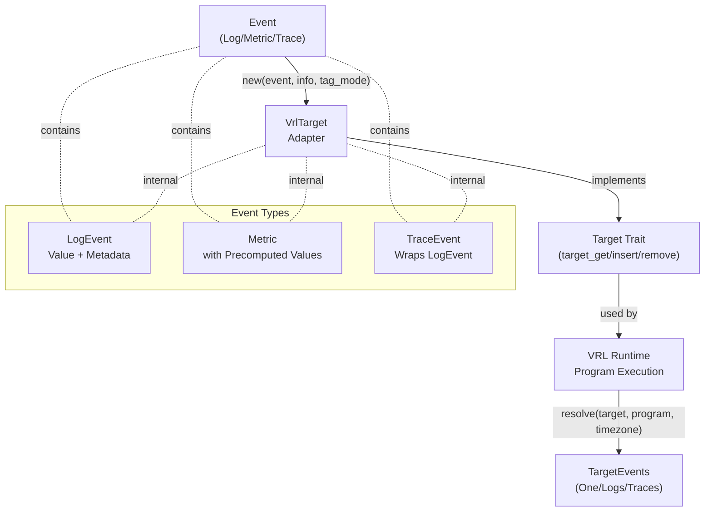
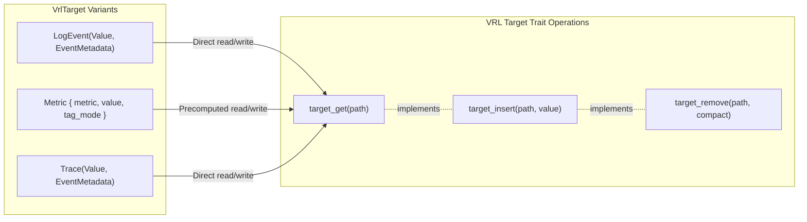
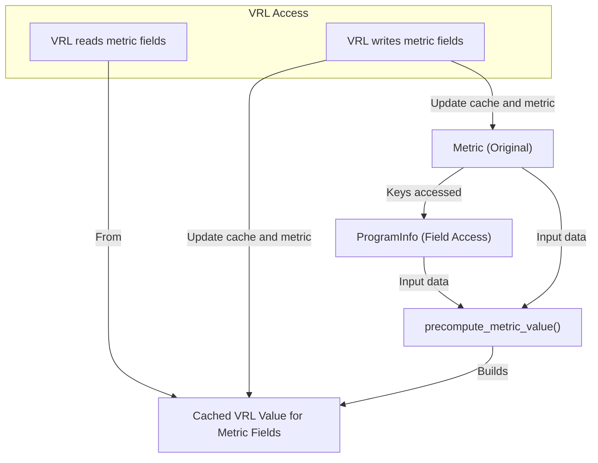
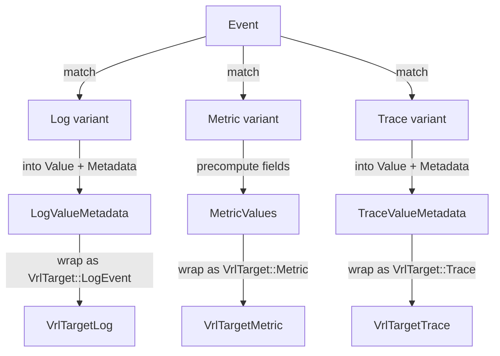
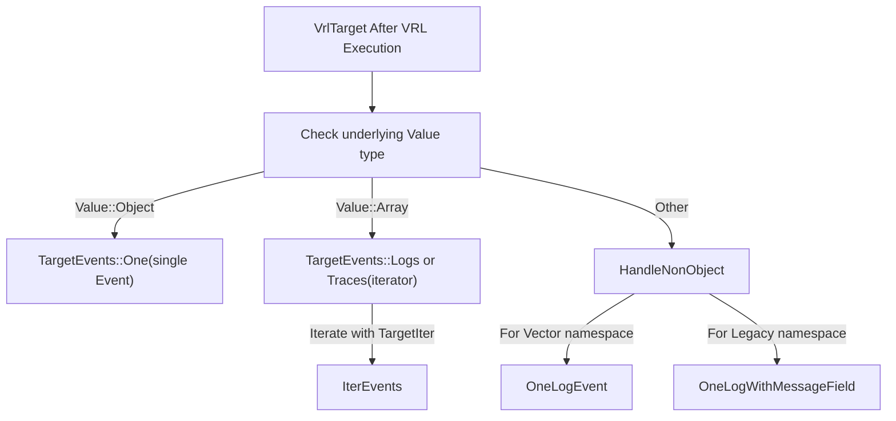
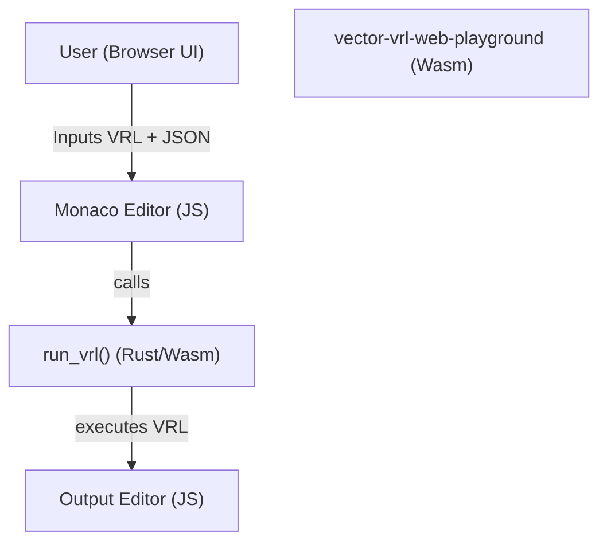

<!-- source: DeepWiki mcp.deepwiki.com · repo vectordotdev/vector · page 3.3 VRL Integration · fetched 2026-10-29 -->

# VRL Integration

<details>
<summary>Relevant source files</summary>

The following files were used as context for generating this wiki page:

- [lib/vector-core/src/config/log_schema.rs](lib/vector-core/src/config/log_schema.rs)
- [lib/vector-core/src/event/array.rs](lib/vector-core/src/event/array.rs)
- [lib/vector-core/src/event/log_event.rs](lib/vector-core/src/event/log_event.rs)
- [lib/vector-core/src/event/metadata.rs](lib/vector-core/src/event/metadata.rs)
- [lib/vector-core/src/event/metric/mod.rs](lib/vector-core/src/event/metric/mod.rs)
- [lib/vector-core/src/event/metric/value.rs](lib/vector-core/src/event/metric/value.rs)
- [lib/vector-core/src/event/mod.rs](lib/vector-core/src/event/mod.rs)
- [lib/vector-core/src/event/proto.rs](lib/vector-core/src/event/proto.rs)
- [lib/vector-core/src/event/trace.rs](lib/vector-core/src/event/trace.rs)
- [lib/vector-core/src/event/vrl_target.rs](lib/vector-core/src/event/vrl_target.rs)
- [lib/vector-core/src/lib.rs](lib/vector-core/src/lib.rs)
- [lib/vector-core/src/metrics/ddsketch.rs](lib/vector-core/src/metrics/ddsketch.rs)
- [lib/vector-core/src/metrics/mod.rs](lib/vector-core/src/metrics/mod.rs)
- [lib/vector-core/src/metrics/recency.rs](lib/vector-core/src/metrics/recency.rs)
- [lib/vector-core/src/metrics/recorder.rs](lib/vector-core/src/metrics/recorder.rs)
- [lib/vector-core/src/metrics/storage.rs](lib/vector-core/src/metrics/storage.rs)
- [lib/vector-lib/Cargo.toml](lib/vector-lib/Cargo.toml)
- [lib/vector-lib/src/lib.rs](lib/vector-lib/src/lib.rs)
- [lib/vector-vrl/cli/Cargo.toml](lib/vector-vrl/cli/Cargo.toml)
- [lib/vector-vrl/functions/Cargo.toml](lib/vector-vrl/functions/Cargo.toml)
- [lib/vector-vrl/metrics/Cargo.toml](lib/vector-vrl/metrics/Cargo.toml)
- [lib/vector-vrl/tests/Cargo.toml](lib/vector-vrl/tests/Cargo.toml)
- [lib/vector-vrl/web-playground/Cargo.toml](lib/vector-vrl/web-playground/Cargo.toml)
- [lib/vector-vrl/web-playground/build.rs](lib/vector-vrl/web-playground/build.rs)
- [lib/vector-vrl/web-playground/public/assets/dd_icon_rgb.svg](lib/vector-vrl/web-playground/public/assets/dd_icon_rgb.svg)
- [lib/vector-vrl/web-playground/public/index.css](lib/vector-vrl/web-playground/public/index.css)
- [lib/vector-vrl/web-playground/public/index.html](lib/vector-vrl/web-playground/public/index.html)
- [lib/vector-vrl/web-playground/public/index.js](lib/vector-vrl/web-playground/public/index.js)
- [lib/vector-vrl/web-playground/src/lib.rs](lib/vector-vrl/web-playground/src/lib.rs)
- [src/test_util/mod.rs](src/test_util/mod.rs)

</details>


This page documents how the Vector Remap Language (VRL) integrates with Vector's event processing system. VRL is Vector's domain-specific language for transforming observability data, and this integration layer enables VRL programs to safely and efficiently manipulate Vector events.

For details about the VRL language itself, see [VRL Language](#5.2). For the VRL standard library functions, see [VRL Standard Library](#5.3). For the remap transform that uses VRL by default, see [Remap Transform](#5.1).

---

## Purpose and Architecture

The VRL integration provides a bridge between Vector's event system and the VRL runtime. The core complexity arises because Vector events have rich and varied structures—logs, metrics, and traces—with associated metadata, while VRL operates on a unified, generic value model. The integration layer reconciles these differences using an adapter pattern centered on the `VrlTarget` enum.

### System Architecture Overview



*Diagram 1: VRL Integration Architecture*

The `VrlTarget` enum encapsulates these different event types, implementing the VRL `Target` trait. It accepts an `Event` instance, adapts it to a VRL-accessible structure, allows VRL programs to modify it, and then reconstructs one or more `Event` instances from the result.

**Sources:** [lib/vector-core/src/event/vrl_target.rs:60-73](), [lib/vector-core/src/event/vrl_target.rs:128-151](), [lib/vector-core/src/event/vrl_target.rs:279-468]()

---

## VrlTarget Adapter

The `VrlTarget` enum serves as the core interoperability point. It deals distinctly with each event kind:



*Diagram 2: VrlTarget Variants and VRL Trait Operations*

### Log and Trace Events

- Both wrap a `Value` (VRL data representation) and associated `EventMetadata`.
- Reads and writes operate directly on the VRL `Value`, mutating the event fields.
- Supports fairly straightforward `target_get`, `target_insert`, and `target_remove` semantics.

### Metric Events

Metrics are more complex. VRL programs only access a subset of metric fields but expect them to behave like an event object.

- **Precomputation:** When constructing a metric `VrlTarget`, the system uses VRL `ProgramInfo` to determine which metric fields (e.g., `.name`, `.namespace`, `.timestamp`, `.tags`) are accessed.
- It creates a stripped-down `Value` cache using `precompute_metric_value`.
- Reads return from this cached value.
- Writes are applied both to the cache and the underlying `Metric` structure, ensuring consistency.
- This includes special handling for fields like `.tags` via `MetricTagMode` (Single, Full, or Auto).



*Diagram 3: Metric Precomputation and Field Access Strategy*

This strategy avoids repeated conversions while providing fast field access and the ability to perform in-place mutations.

**Sources:** [lib/vector-core/src/event/vrl_target.rs:39-58](), [lib/vector-core/src/event/vrl_target.rs:134-145](), [lib/vector-core/src/event/vrl_target.rs:288-367]()

---

## Event Conversion Flow

### Converting Events into VrlTarget

The constructor `VrlTarget::new(event, info, tag_mode)` handles different `Event` variants differently:



*Diagram 4: Event to VrlTarget Conversion*

This separation stabilizes VRL program access and isolates event types.

**Sources:** [lib/vector-core/src/event/vrl_target.rs:128-151]()

### Converting VrlTarget Back to Events

After VRL execution, `into_events()` converts the target's VRL `Value` back into Vector `Event`(s). VRL allows a program to replace the entire event with an array of events by assigning an array to `.`.



*Diagram 5: VrlTarget to Event(s) Conversion*

Different log namespaces (`Legacy` vs `Vector`) alter the reconstruction. In `Legacy` mode, non-object values are moved into a message field using `create_log_event`.

In the case of arrays, `TargetIter` iterates over each `Value` and wraps them into `Event` instances.

**Sources:** [lib/vector-core/src/event/vrl_target.rs:88-92](), [lib/vector-core/src/event/vrl_target.rs:94-125](), [lib/vector-core/src/event/vrl_target.rs:170-216]()

---

## Runtime Execution

### Remap Transform Integration

The remap transform uses VRL integration as its core transformation mechanism. It compiles VRL programs and executes them on incoming events.

```mermaid
graph TB
    RemapConfig["RemapConfig"]
    CompileStep["compile_vrl_program()"]
    ProgramStored["Program + Warnings"]
    RemapTransform["Remap Transform Instance"]
    VrlRuntime["VRL Runtime"]
    Event["Incoming Event"]

    RemapConfig -->|builds| CompileStep
    CompileStep -->|stores| ProgramStored
    ProgramStored -->|stored in| RemapTransform
    VrlRuntime -->|stored in| RemapTransform
    Event -->|VrlTarget::new()| VRLEntryPoint

    subgraph "Per-Event Execution"
      VRLEntryPoint["VrlTarget constructed"]
      RunVRL["Runtime::resolve()"]
      VRLEntryPoint --> RunVRL
    end
```

*Diagram 6: Remap Transform VRL Execution Flow*

### VRL Conditions

VRL is also used for boolean conditions applied to events (e.g., for filtering or routing). The integration layer ensures that VRL expressions used in conditions are evaluated and their results interpreted as booleans.

---

## Error Handling

VRL executions can terminate in one of several ways:

- **Success:** Program completes normally.
- **Error:** Runtime error during fallible operation.
- **Abort:** Explicit program abort via `abort`.

The remap transform provides options like `drop_on_error` and `drop_on_abort` to control how these failures impact the event pipeline.

```mermaid
graph TD
    ExecuteVRL["Execute VRL Program"]
    Result["Execution Result"]

    ExecuteVRL --> Result
    Result -->|Ok(value)| SuccessPath["Process event normally"]
    Result -->|Err(Error)| ErrorHandling["Check drop_on_error"]
    Result -->|Err(Abort)| AbortHandling["Check drop_on_abort"]

    ErrorHandling -->|true| DropEvent["Drop event"]
    ErrorHandling -->|false| PassThrough["Pass original event downstream"]

    AbortHandling -->|true| DropEvent
    AbortHandling -->|false| PassThrough
```

*Diagram 7: VRL Execution Error Handling Logic*

---

## VRL Web Playground

The `vector-vrl-web-playground` crate provides an interactive, browser-based environment for experimenting with VRL programs.

### Architecture

- Compiled to WebAssembly (Wasm) using `wasm-bindgen`.
- Exports a `run_vrl` function that accepts VRL source code and input events.
- Uses the VRL runtime internally to compile and execute programs.
- The UI (implemented in `index.js`) uses the Monaco editor for code editing.
- Supports sharing state via URL parameters (base64 encoded JSON).



*Diagram 8: VRL Web Playground Architecture*

**Sources:** [lib/vector-vrl/web-playground/Cargo.toml:1-32](), [lib/vector-vrl/web-playground/public/index.js:58-82](), [lib/vector-vrl/web-playground/public/index.js:147-175]()

---

# Summary

The VRL integration layer is a critical piece in Vector's data transformation pipeline:

- It adapts rich Vector events into a uniform VRL `Target` interface via `VrlTarget`.
- Special logic enables efficient reading and mutating of metric events.
- The remap transform wraps VRL programs and exposes fine-grained error handling options.
- The VRL web playground offers an accessible interface for VRL experimentation.

This integration enables powerful, user-defined transformations on observability data with safe error boundaries and fast execution.

---

## Sources

- lib/vector-core/src/event/vrl_target.rs:39-58, 60-73, 88-92, 94-125, 128-151, 170-216, 288-367, 279-468
- lib/vector-vrl/web-playground/Cargo.toml:1-32
- lib/vector-vrl/web-playground/public/index.js:1-2, 58-82, 147-175
- lib/vector-core/src/event/log_event.rs:154-161, 183-193
- lib/vector-core/src/event/mod.rs:49-56, 114-150

---

