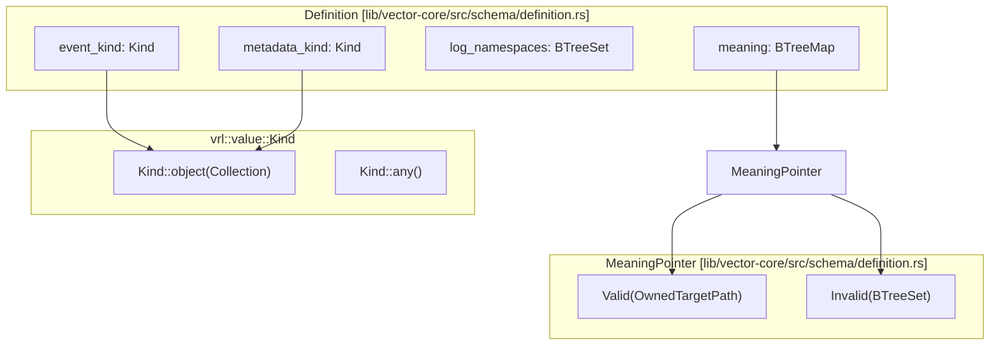
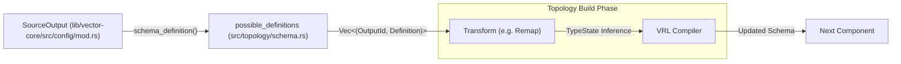
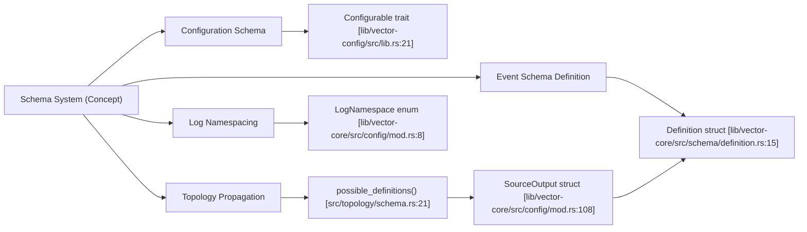
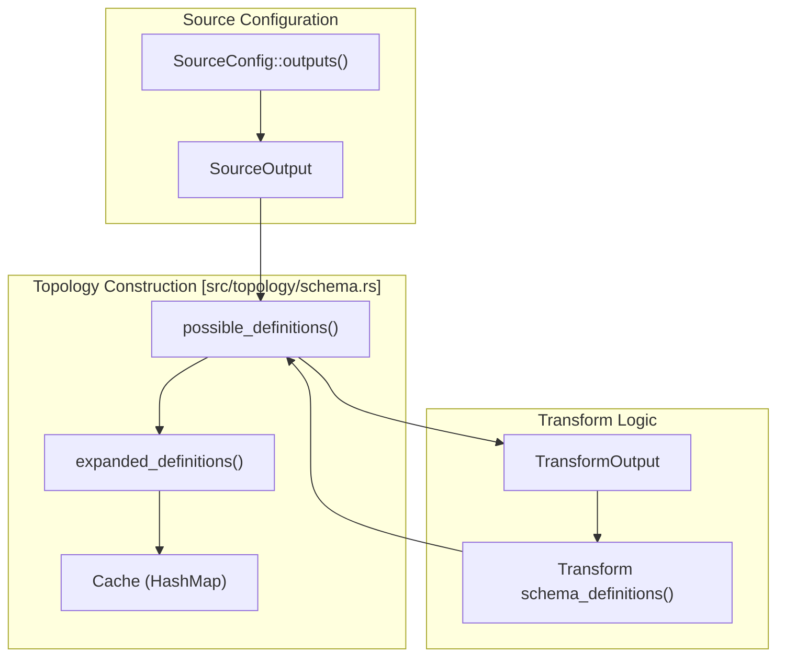

<!-- source: DeepWiki mcp.deepwiki.com · repo vectordotdev/vector · page 3.4 Schema System · fetched 2026-10-29 -->

# Schema System

Relevant source files

The following files were used as context for generating this wiki page:

- [lib/codecs/src/decoding/format/bytes.rs](lib/codecs/src/decoding/format/bytes.rs)
- [lib/codecs/src/decoding/format/gelf.rs](lib/codecs/src/decoding/format/gelf.rs)
- [lib/codecs/src/decoding/format/json.rs](lib/codecs/src/decoding/format/json.rs)
- [lib/codecs/src/decoding/format/native.rs](lib/codecs/src/decoding/format/native.rs)
- [lib/codecs/src/decoding/format/native_json.rs](lib/codecs/src/decoding/format/native_json.rs)
- [lib/codecs/src/decoding/format/syslog.rs](lib/codecs/src/decoding/format/syslog.rs)
- [lib/codecs/src/decoding/mod.rs](lib/codecs/src/decoding/mod.rs)
- [lib/vector-config-macros/src/configurable.rs](lib/vector-config-macros/src/configurable.rs)
- [lib/vector-config/src/configurable.rs](lib/vector-config/src/configurable.rs)
- [lib/vector-config/src/external/chrono.rs](lib/vector-config/src/external/chrono.rs)
- [lib/vector-config/src/external/encoding_rs.rs](lib/vector-config/src/external/encoding_rs.rs)
- [lib/vector-config/src/external/indexmap.rs](lib/vector-config/src/external/indexmap.rs)
- [lib/vector-config/src/external/no_proxy.rs](lib/vector-config/src/external/no_proxy.rs)
- [lib/vector-config/src/external/serde_with.rs](lib/vector-config/src/external/serde_with.rs)
- [lib/vector-config/src/external/tz.rs](lib/vector-config/src/external/tz.rs)
- [lib/vector-config/src/external/url.rs](lib/vector-config/src/external/url.rs)
- [lib/vector-config/src/external/vrl.rs](lib/vector-config/src/external/vrl.rs)
- [lib/vector-config/src/lib.rs](lib/vector-config/src/lib.rs)
- [lib/vector-config/src/metadata.rs](lib/vector-config/src/metadata.rs)
- [lib/vector-config/src/ser.rs](lib/vector-config/src/ser.rs)
- [lib/vector-config/src/stdlib.rs](lib/vector-config/src/stdlib.rs)
- [lib/vector-core/src/config/mod.rs](lib/vector-core/src/config/mod.rs)
- [lib/vector-core/src/schema/definition.rs](lib/vector-core/src/schema/definition.rs)
- [lib/vector-core/src/schema/requirement.rs](lib/vector-core/src/schema/requirement.rs)
- [src/config/graph.rs](src/config/graph.rs)
- [src/config/unit_test/tests.rs](src/config/unit_test/tests.rs)
- [src/config/unit_test/unit_test_components.rs](src/config/unit_test/unit_test_components.rs)
- [src/sinks/gcp_chronicle/compression.rs](src/sinks/gcp_chronicle/compression.rs)
- [src/sinks/util/buffer/compression.rs](src/sinks/util/buffer/compression.rs)
- [src/sinks/util/service/concurrency.rs](src/sinks/util/service/concurrency.rs)
- [src/topology/schema.rs](src/topology/schema.rs)

The schema system provides compile-time and runtime awareness of event structure and semantics as data flows through Vector. It tracks event types and metadata via `Definition`, bridges the legacy and Vector log namespaces, associates semantic meanings to fields, and ensures type-safe VRL program compilation and schema propagation through the pipeline topology.

---

## Purpose and Scope

The schema system enables precise static type tracking and semantic annotations for observability events. Its goals are to:

- **Type Tracking:** Maintain detailed type information for event payload and metadata as `Kind` instances in a `Definition` [lib/vector-core/src/schema/definition.rs:15-21]().
- **Semantic Meanings:** Map logical meanings (like `"message"`, `"timestamp"`, `"host"`) to concrete event field paths [lib/vector-core/src/schema/definition.rs:22-26]().
- **Compile-time VRL Type Inference:** Provide input type information when compiling VRL programs for validity and correctness checks.
- **Schema Propagation:** Propagate and merge schema definitions through sources, transforms, and sinks, reflecting how event shapes evolve [src/topology/schema.rs:21-95]().

Sources:
- [lib/vector-core/src/schema/definition.rs:10-32]()
- [lib/vector-core/src/config/mod.rs:115-116]()

---

## Schema Definition Structure

The core schema representation is the `Definition` struct. It tracks the event data kind (`event_kind`), metadata kind (`metadata_kind`), the set of active `log_namespaces`, and a map of semantic meanings.

- `event_kind`: The VRL `Kind` describing the payload structure (e.g., object, bytes) [lib/vector-core/src/schema/definition.rs:17]().
- `metadata_kind`: The VRL `Kind` for the metadata portion of the event [lib/vector-core/src/schema/definition.rs:20]().
- `log_namespaces`: Which log namespaces (Legacy, Vector) this definition supports [lib/vector-core/src/schema/definition.rs:31]().
- `meaning`: A map from semantic meaning keys to `MeaningPointer`s. A `MeaningPointer` can be `Valid` (single path) or `Invalid` (conflicting paths resulting from a merge) [lib/vector-core/src/schema/definition.rs:43-47]().

Sources:
- [lib/vector-core/src/schema/definition.rs:15-32]()
- [lib/vector-core/src/schema/definition.rs:43-47]()

---

## Schema Propagation Through Topology

Schema information flows and evolves through the topology starting from sources to transforms and finally sinks.

### Build Phase

- **Source Output Definitions:** Each source declares its output schema as a `SourceOutput` containing an optional `Definition` [lib/vector-core/src/config/mod.rs:108-116]().
- **Topology Traversal:** The `possible_definitions` function recursively traverses the pipeline graph [src/topology/schema.rs:21-95]() to collect all schema definitions feeding into a component's inputs. It uses a `Cache` to optimize lookups [src/topology/schema.rs:19-25]().
- **Transform Processing:** Transforms use these definitions to provide a contextual environment for VRL compilation. If `schema_enabled` is false, components return a simplified `Definition` containing only basic namespace defaults and meanings [lib/vector-core/src/config/mod.rs:169-183]().

### Runtime Phase

- While the schema system is primarily a build-time validation tool, it informs the `VrlTarget` adapter which mediates between `Event` instances and VRL-compatible values.
- Codecs like `SyslogDeserializerConfig` or `GelfDeserializerConfig` provide explicit schema definitions based on the selected `LogNamespace` [lib/codecs/src/decoding/format/syslog.rs:62-113]() [lib/codecs/src/decoding/format/gelf.rs:75-93]().

Sources:
- [src/topology/schema.rs:21-95]()
- [lib/vector-core/src/config/mod.rs:108-116]()
- [lib/vector-core/src/config/mod.rs:169-183]()
- [lib/codecs/src/decoding/format/syslog.rs:62-113]()

---

## Log Namespace: Legacy vs Vector

Vector supports two primary namespaces that dictate how events are structured and how metadata is handled.

| Namespace | Description | Field Mapping |
| :--- | :--- | :--- |
| **Legacy** | Traditional Vector structure. | Uses global `log_schema()` for standard keys like `message` and `timestamp` [lib/vector-core/src/config/mod.rs:15](). |
| **Vector** | New namespaced structure. | Encapsulates fields and metadata more strictly; metadata is often prefixed or nested [lib/vector-core/src/schema/definition.rs:147-160](). |

The `Definition::default_for_namespace` method generates suitable default schemas when no custom schema is supplied [lib/vector-core/src/schema/definition.rs:128-137]().

Sources:
- [lib/vector-core/src/schema/definition.rs:128-137]()
- [lib/vector-core/src/config/mod.rs:8-15]()
- [lib/vector-core/src/schema/definition.rs:147-160]()

---

## Configurable Schema Generation

The `Configurable` trait and its derive macro enable the generation of JSON schemas for Vector's own configuration types. This is distinct from the event schema but uses similar terminology.

- **`Configurable` Trait:** Defines how a Rust type generates its `SchemaObject` [lib/vector-config/src/lib.rs:21]().
- **Derive Macro:** The `configurable_component` and `Configurable` macros automate the implementation of `generate_schema`, handling structs, enums, and complex types like `Compression` or `Concurrency` [lib/vector-config-macros/src/configurable.rs:12-107]() [src/sinks/util/buffer/compression.rs:20-44]() [src/sinks/util/service/concurrency.rs:114-160]().

Sources:
- [lib/vector-config/src/lib.rs:21]()
- [lib/vector-config-macros/src/configurable.rs:12-107]()
- [src/sinks/util/buffer/compression.rs:20-44]()
- [src/sinks/util/service/concurrency.rs:114-160]()

---

## Natural Language to Code Entity Space Mapping

---

## Topology Schema Flow Detailed

This diagram illustrates how `possible_definitions` acts as the central orchestrator, querying sources and transforms to build a complete view of data types as they flow through the pipeline.

Sources:
- [src/topology/schema.rs:21-95]()
- [lib/vector-core/src/config/mod.rs:108-183]()
- [lib/vector-core/src/schema/definition.rs:72-137]()

---

