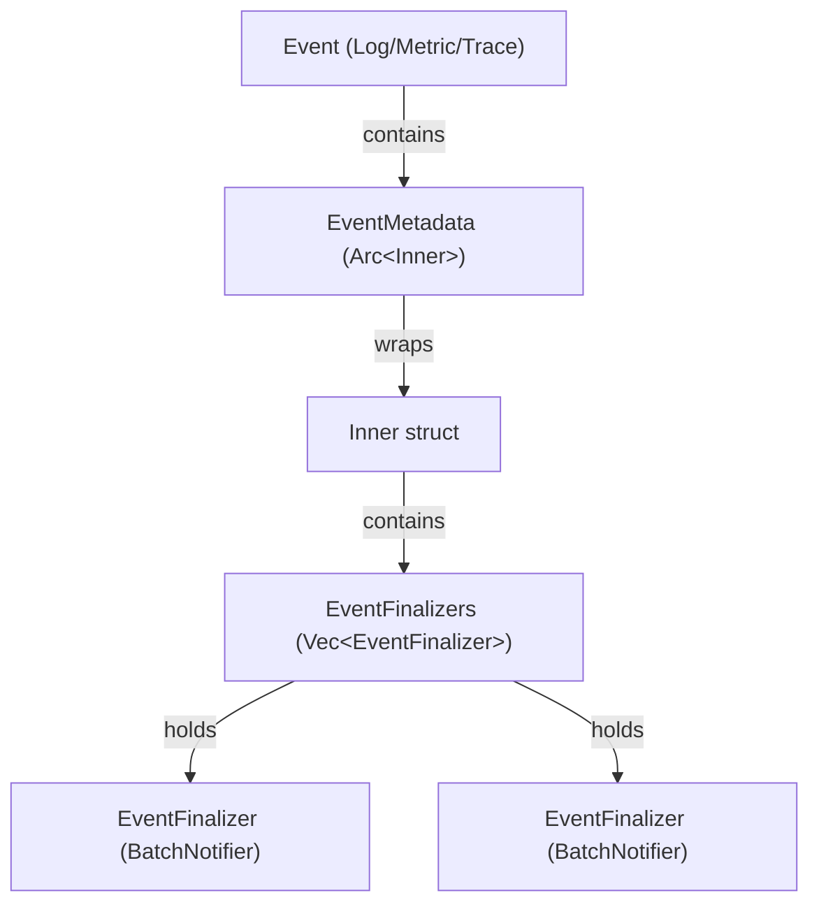
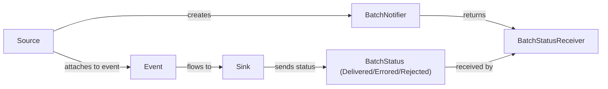

<!-- source: DeepWiki mcp.deepwiki.com · repo vectordotdev/vector · page 3.5 Acknowledgements and Finalization · fetched 2026-10-29 -->

# Acknowledgements and Finalization

Relevant source files

The following files were used as context for generating this wiki page:

- [lib/vector-buffers/benches/common.rs](lib/vector-buffers/benches/common.rs)
- [lib/vector-buffers/benches/sized_records.rs](lib/vector-buffers/benches/sized_records.rs)
- [lib/vector-buffers/examples/buffer_perf.rs](lib/vector-buffers/examples/buffer_perf.rs)
- [lib/vector-buffers/src/buffer_usage_data.rs](lib/vector-buffers/src/buffer_usage_data.rs)
- [lib/vector-buffers/src/config.rs](lib/vector-buffers/src/config.rs)
- [lib/vector-buffers/src/internal_events.rs](lib/vector-buffers/src/internal_events.rs)
- [lib/vector-buffers/src/lib.rs](lib/vector-buffers/src/lib.rs)
- [lib/vector-buffers/src/topology/builder.rs](lib/vector-buffers/src/topology/builder.rs)
- [lib/vector-buffers/src/topology/channel/receiver.rs](lib/vector-buffers/src/topology/channel/receiver.rs)
- [lib/vector-buffers/src/topology/channel/sender.rs](lib/vector-buffers/src/topology/channel/sender.rs)
- [lib/vector-buffers/src/topology/channel/tests.rs](lib/vector-buffers/src/topology/channel/tests.rs)
- [lib/vector-buffers/src/topology/test_util.rs](lib/vector-buffers/src/topology/test_util.rs)
- [lib/vector-buffers/src/variants/in_memory.rs](lib/vector-buffers/src/variants/in_memory.rs)
- [lib/vector-core/src/config/log_schema.rs](lib/vector-core/src/config/log_schema.rs)
- [lib/vector-core/src/event/array.rs](lib/vector-core/src/event/array.rs)
- [lib/vector-core/src/event/log_event.rs](lib/vector-core/src/event/log_event.rs)
- [lib/vector-core/src/event/metadata.rs](lib/vector-core/src/event/metadata.rs)
- [lib/vector-core/src/event/metric/mod.rs](lib/vector-core/src/event/metric/mod.rs)
- [lib/vector-core/src/event/metric/value.rs](lib/vector-core/src/event/metric/value.rs)
- [lib/vector-core/src/event/mod.rs](lib/vector-core/src/event/mod.rs)
- [lib/vector-core/src/event/proto.rs](lib/vector-core/src/event/proto.rs)
- [lib/vector-core/src/event/trace.rs](lib/vector-core/src/event/trace.rs)
- [lib/vector-core/src/event/vrl_target.rs](lib/vector-core/src/event/vrl_target.rs)
- [lib/vector-core/src/fanout.rs](lib/vector-core/src/fanout.rs)
- [lib/vector-core/src/latency.rs](lib/vector-core/src/latency.rs)
- [lib/vector-core/src/lib.rs](lib/vector-core/src/lib.rs)
- [lib/vector-core/src/metrics/ddsketch.rs](lib/vector-core/src/metrics/ddsketch.rs)
- [lib/vector-core/src/metrics/mod.rs](lib/vector-core/src/metrics/mod.rs)
- [lib/vector-core/src/metrics/recency.rs](lib/vector-core/src/metrics/recency.rs)
- [lib/vector-core/src/metrics/recorder.rs](lib/vector-core/src/metrics/recorder.rs)
- [lib/vector-core/src/metrics/storage.rs](lib/vector-core/src/metrics/storage.rs)
- [lib/vector-core/src/transform/outputs.rs](lib/vector-core/src/transform/outputs.rs)
- [lib/vector-lib/Cargo.toml](lib/vector-lib/Cargo.toml)
- [lib/vector-lib/src/lib.rs](lib/vector-lib/src/lib.rs)
- [lib/vector-vrl/metrics/Cargo.toml](lib/vector-vrl/metrics/Cargo.toml)
- [src/test_util/mock/sources/basic.rs](src/test_util/mock/sources/basic.rs)
- [src/test_util/mod.rs](src/test_util/mod.rs)

## Purpose and Scope

This document explains Vector's acknowledgement and finalization system, which provides at-least-once delivery guarantees by tracking event processing from source through sink. The system uses `BatchNotifier`, `EventFinalizers`, `OrderedFinalizer`, and `UnorderedFinalizer` to coordinate acknowledgements and update persistent checkpoints. This mechanism ensures that if Vector crashes or a downstream sink fails, the source can resume from the last successfully delivered event.

For event data structures, see [Event Data Model](3.1). For buffer flow control, see [Buffering and Flow Control](3.2).

---

## Core Components

The acknowledgement system consists of several interconnected types that work together to track event lifecycle and enable delivery guarantees.

### EventFinalizers and EventMetadata

Every event carries `EventFinalizers` within its `EventMetadata`. The `EventMetadata` structure uses an `Arc` wrapper around the actual metadata (`Inner`) to avoid cloning until a mutable copy is required [lib/vector-core/src/event/metadata.rs:24-30]().

**EventFinalizers Structure**

| Component | Type | Purpose |
|-----------|------|---------|
| `EventFinalizers` | `Vec<EventFinalizer>` | Container for all finalization callbacks [lib/vector-core/src/event/mod.rs:5-8](). |
| `EventFinalizer` | Wrapper around `BatchNotifier` | Individual finalization callback [lib/vector-core/src/event/mod.rs:5-8](). |
| `Finalizable` trait | Trait with `take_finalizers()` | Enables extraction of finalizers from events for processing [lib/vector-core/src/event/mod.rs:84-92](). |

Sources: [lib/vector-core/src/event/metadata.rs:24-53](), [lib/vector-core/src/event/mod.rs:5-92](), [lib/vector-core/src/event/log_event.rs:221-225]()

### BatchNotifier and BatchStatusReceiver

The `BatchNotifier` and `BatchStatusReceiver` pair enables asynchronous acknowledgement of event batches. Sources attach notifiers to events; sinks send status back through them.

**BatchStatus Values**

| Status | Meaning | Checkpoint Action |
|--------|---------|-------------------|
| `Delivered` | Successfully processed and delivered to the final destination. | Update checkpoint to new position. |
| `Errored` | Failed during processing or network delivery. | Do not update checkpoint (retry expected). |
| `Rejected` | Rejected by downstream system (e.g., 400 Bad Request). | Do not update checkpoint. |

Sources: [lib/vector-core/src/event/mod.rs:5-8](), [src/test_util/mod.rs:38-44]()

### Finalizer Traits

The event system implements specific traits to handle the movement and merging of finalizers as events are processed or transformed.

*   `Finalizable`: Provides `take_finalizers` to extract the list of finalizers from an event, usually leaving the event with an empty list [lib/vector-core/src/event/log_event.rs:221-225]().
*   `MergeFinalizable`: Provides `merge_finalizers` to add a list of finalizers to an existing event, used when merging multiple events or adding new notifications [lib/vector-core/src/event/log_event.rs:227-231]().

Sources: [lib/vector-core/src/event/log_event.rs:221-231](), [lib/vector-core/src/event/mod.rs:84-102](), [lib/vector-core/src/event/metric/mod.rs:133-150]()

---

## Acknowledgement Flow

The acknowledgement flow spans from source to sink and back, coordinating event delivery and checkpoint updates.

### Fanout and Propagation

When an event is distributed to multiple sinks via the `Fanout` mechanism, each sink receives its own reference to the event. The `Fanout` component manages these outputs using `ControlMessage` variants like `Add`, `Remove`, `Pause`, and `Replace` [lib/vector-core/src/fanout.rs:15-30]().

If a fanout has any paused sinks, subsequent sends cannot proceed until all paused sinks have been replaced, ensuring consistency across multiple outputs [lib/vector-core/src/fanout.rs:22-26]().

Sources: [lib/vector-core/src/fanout.rs:15-142]()

### VRL Integration and Finalization

When events pass through the `remap` transform or other VRL-based components, they are converted to a `VrlTarget`. The `VrlTarget` holds the `EventMetadata` (and thus the finalizers) separately from the event values [lib/vector-core/src/event/vrl_target.rs:63-73]().

When VRL finishes processing and `into_events` is called to turn the target back into events, the metadata (including finalizers) is cloned and re-attached to the resulting events [lib/vector-core/src/event/vrl_target.rs:101-104]().

Sources: [lib/vector-core/src/event/vrl_target.rs:63-125]()

---

## Delivery Guarantees

Vector's acknowledgement system provides **at-least-once delivery** guarantees through backpressure and finalization.

### Sink Implementation

Sinks are responsible for ensuring that `EventFinalizers` are triggered only after data is durably written. This is typically done by:
1.  Extracting finalizers from events using `take_finalizers()` before batching [lib/vector-core/src/event/mod.rs:85]().
2.  Storing these finalizers until the batch request completes.
3.  Calling the finalizers with the appropriate `BatchStatus` [lib/vector-core/src/event/mod.rs:6]().

### Scenario Matrix

| Scenario | Checkpoint Behavior | Result |
|----------|---------------------|--------|
| Successful Delivery | Finalizer triggers `BatchStatus::Delivered`; checkpoint advances. | No redelivery. |
| Sink Failure | Finalizer triggers `BatchStatus::Errored`; checkpoint stays. | Event redelivered on restart. |
| Vector Crash | Finalizers are not triggered; checkpoints are not updated. | Events redelivered from last persistent checkpoint. |
| Buffer Full (Block) | Source is paused via backpressure. | Delivery delayed, but guarantee maintained. |
| Buffer Full (Drop) | Event dropped; finalizer not triggered. | Data lost; guarantee broken for dropped events. |

Sources: [lib/vector-core/src/event/metadata.rs:51-53](), [lib/vector-core/src/event/mod.rs:5-8](), [lib/vector-core/src/event/log_event.rs:221-231]()

---

