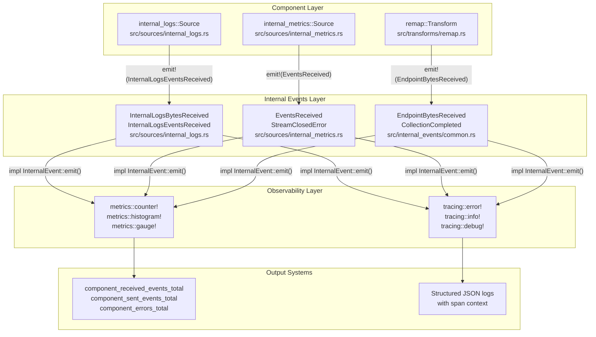
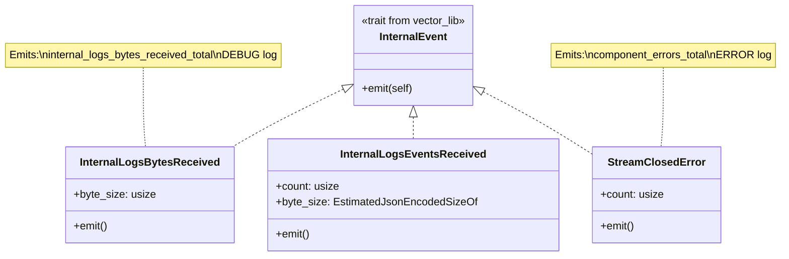
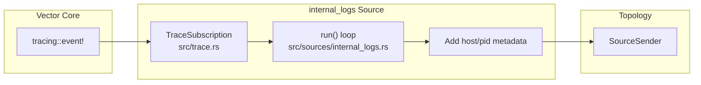
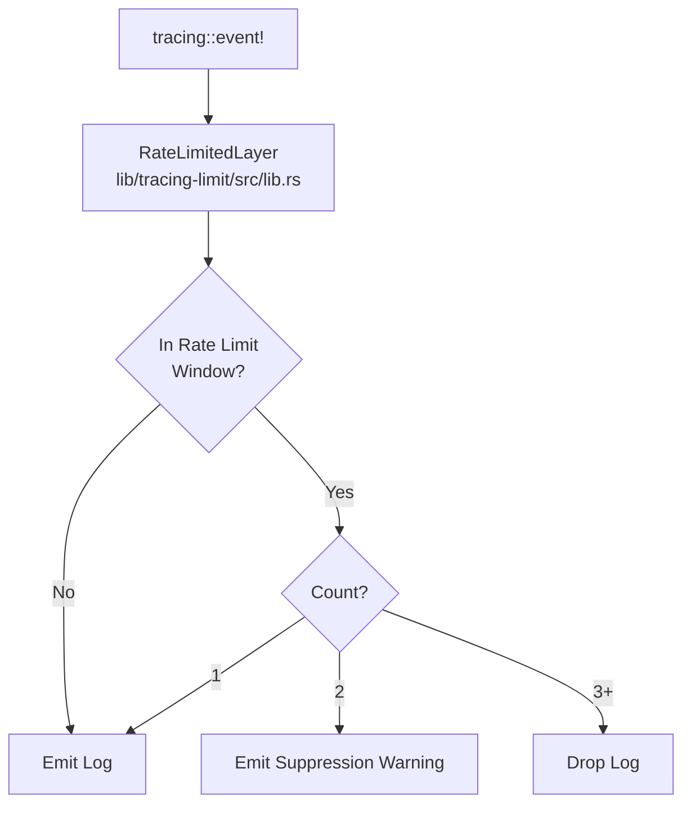

<!-- source: DeepWiki mcp.deepwiki.com · repo vectordotdev/vector · page 3.6 Internal Events and Metrics · fetched 2026-10-29 -->

# Internal Events and Metrics

Relevant source files

The following files were used as context for generating this wiki page:

- [lib/dnsmsg-parser/Cargo.toml](lib/dnsmsg-parser/Cargo.toml)
- [lib/dnsmsg-parser/benches/benches.rs](lib/dnsmsg-parser/benches/benches.rs)
- [lib/dnsmsg-parser/src/dns_message.rs](lib/dnsmsg-parser/src/dns_message.rs)
- [lib/dnsmsg-parser/src/dns_message_parser.rs](lib/dnsmsg-parser/src/dns_message_parser.rs)
- [lib/dnsmsg-parser/src/ede.rs](lib/dnsmsg-parser/src/ede.rs)
- [lib/dnsmsg-parser/src/lib.rs](lib/dnsmsg-parser/src/lib.rs)
- [lib/tracing-limit/Cargo.toml](lib/tracing-limit/Cargo.toml)
- [lib/tracing-limit/benches/limit.rs](lib/tracing-limit/benches/limit.rs)
- [lib/tracing-limit/examples/basic.rs](lib/tracing-limit/examples/basic.rs)
- [lib/tracing-limit/examples/by_span.rs](lib/tracing-limit/examples/by_span.rs)
- [lib/tracing-limit/src/lib.rs](lib/tracing-limit/src/lib.rs)
- [lib/vector-common/src/internal_event/prelude.rs](lib/vector-common/src/internal_event/prelude.rs)
- [src/internal_events/aws_kinesis_firehose.rs](src/internal_events/aws_kinesis_firehose.rs)
- [src/internal_events/batch.rs](src/internal_events/batch.rs)
- [src/internal_events/common.rs](src/internal_events/common.rs)
- [src/internal_events/conditions.rs](src/internal_events/conditions.rs)
- [src/internal_events/datadog_metrics.rs](src/internal_events/datadog_metrics.rs)
- [src/internal_events/datadog_traces.rs](src/internal_events/datadog_traces.rs)
- [src/internal_events/fluent.rs](src/internal_events/fluent.rs)
- [src/internal_events/http.rs](src/internal_events/http.rs)
- [src/internal_events/journald.rs](src/internal_events/journald.rs)
- [src/internal_events/logplex.rs](src/internal_events/logplex.rs)
- [src/internal_events/lua.rs](src/internal_events/lua.rs)
- [src/internal_events/remap.rs](src/internal_events/remap.rs)
- [src/internal_events/socket.rs](src/internal_events/socket.rs)
- [src/internal_events/splunk_hec.rs](src/internal_events/splunk_hec.rs)
- [src/internal_events/tcp.rs](src/internal_events/tcp.rs)
- [src/internal_events/template.rs](src/internal_events/template.rs)
- [src/internal_events/udp.rs](src/internal_events/udp.rs)
- [src/net.rs](src/net.rs)
- [src/sources/internal_logs.rs](src/sources/internal_logs.rs)
- [src/sources/internal_metrics.rs](src/sources/internal_metrics.rs)
- [src/test_util/components.rs](src/test_util/components.rs)
- [src/trace.rs](src/trace.rs)
- [website/cue/reference.cue](website/cue/reference.cue)
- [website/cue/reference/components.cue](website/cue/reference/components.cue)
- [website/cue/reference/components/sinks.cue](website/cue/reference/components/sinks.cue)
- [website/cue/reference/components/sources.cue](website/cue/reference/components/sources.cue)
- [website/cue/reference/components/sources/internal_metrics.cue](website/cue/reference/components/sources/internal_metrics.cue)
- [website/cue/reference/components/transforms.cue](website/cue/reference/components/transforms.cue)
- [website/cue/reference/components/transforms/remap.cue](website/cue/reference/components/transforms/remap.cue)
- [website/cue/reference/remap.cue](website/cue/reference/remap.cue)
- [website/cue/reference/remap/concepts/metrics.cue](website/cue/reference/remap/concepts/metrics.cue)
- [website/cue/reference/remap/expressions.cue](website/cue/reference/remap/expressions.cue)
- [website/cue/reference/remap/expressions/function_call.cue](website/cue/reference/remap/expressions/function_call.cue)
- [website/layouts/partials/badge.html](website/layouts/partials/badge.html)
- [website/layouts/partials/data.html](website/layouts/partials/data.html)

## Purpose and Scope

The Internal Events and Metrics system provides standardized instrumentation for all Vector components through the `emit!()` macro and `InternalEvent` trait. Every source, transform, and sink uses this system to automatically generate Prometheus-compatible metrics and structured logs for operations like events received/sent, errors, bytes transferred, and component-specific metrics. The system makes Vector fully observable without requiring manual metric registration or log statements in component code.

Unlike the primary event processing pipeline that handles external data (see page 3.1), this system tracks Vector's own operational metrics, providing insights into throughput, latency, error rates, and resource utilization. The `emit!()` macro serves as the primary API, wrapping calls to the `metrics` and `tracing` crates.

## Overview

Vector's internal events system implements a trait-based instrumentation framework using the `emit!()` macro as the primary API. Each component module defines event types that implement the `InternalEvent` trait. Components call `emit!(EventStruct { fields })` to automatically register metrics with the `metrics` crate and emit structured logs via the `tracing` crate.

**High-Level Event Flow**

Sources: [src/sources/internal_logs.rs:16-18](), [src/sources/internal_metrics.rs:18-19](), [src/internal_events/common.rs:11-158]()

## Architecture

The Internal Events System follows a trait-based architecture where components emit strongly-typed event structs that implement the `InternalEvent` trait. The trait's `emit()` method automatically registers metrics with the `metrics` crate and emits structured logs via the `tracing` crate.

**InternalEvent Trait Pattern**

**Event Implementation Pattern**

Each internal event struct implements the `InternalEvent` trait from `vector_lib::internal_event` and:

1.  **Registers Metrics**: Uses `counter!()`, `histogram!()`, or `gauge!()` to update metric values.
2.  **Emits Logs**: Uses `error!()`, `warn!()`, `info!()`, or `debug!()` for structured logging.
3.  **Includes Context**: Captures component name, operation type, error details, and other relevant metadata.

The `emit!()` macro expands to call the event's `emit()` method, making instrumentation concise and consistent across the codebase.

Sources: [src/internal_events/common.rs:120-144](), [src/sources/internal_logs.rs:162-172](), [lib/vector-common/src/internal_event/prelude.rs:1-10]()

### Core Components

| Component | Location | Purpose |
|-----------|----------|---------|
| **InternalEvent Trait** | `vector_lib::internal_event` | Core trait defining `emit()` method for all events. |
| **emit! Macro** | `vector_lib::internal_event` | Primary API for emitting events, expands to `.emit()` call. |
| **Common Events** | [src/internal_events/common.rs]() | Shared event types like `EndpointBytesReceived`, `StreamClosedError`. |
| **Component Modules** | `src/internal_events/*.rs` | Component-specific events (e.g., `remap.rs`, `tcp.rs`, `http.rs`). |
| **Metric Names** | `vector_lib::internal_event` | Enums like `CounterName` and `HistogramName` for standard names. |

Sources: [src/internal_events/common.rs:1-184](), [src/sources/internal_metrics.rs:11-13]()

## The internal_metrics and internal_logs Sources

Vector provides two specialized sources for self-observability: `internal_metrics` and `internal_logs`.

### internal_metrics Source
The `internal_metrics` source scrapes the internal metrics controller at a configurable interval (default 1s) and injects those metrics back into the Vector pipeline.

- **Implementation**: The `InternalMetrics` struct [src/sources/internal_metrics.rs:139-147]() uses a `Controller` [src/sources/internal_metrics.rs:143-143]() to capture current metric snapshots.
- **Scrape Interval**: Configured via `scrape_interval_secs` [src/sources/internal_metrics.rs:36-36]().
- **Metadata**: Automatically adds `host` and `pid` tags if configured [src/sources/internal_metrics.rs:174-182]().

### internal_logs Source
The `internal_logs` source exposes internal log messages emitted by the running Vector instance [src/sources/internal_logs.rs:22-25](). It works by creating a `TraceSubscription` which captures internal `tracing` events [src/sources/internal_logs.rs:112-112]().

**Internal Logs Data Flow**

The source adds standard metadata like `host` and `pid` to each log event before sending it into the pipeline [src/sources/internal_logs.rs:173-191]().

Sources: [src/sources/internal_logs.rs:22-148](), [src/sources/internal_metrics.rs:1-193]()

## Rate-Limited Tracing and the tracing-limit Crate

To prevent log flooding, Vector implements a rate-limiting layer for internal logs using the `tracing-limit` crate [lib/tracing-limit/Cargo.toml:2-2]().

### The tracing-limit Crate
This crate provides a `tracing::Subscriber` layer that limits the rate of events. It is implemented using a `DashMap` to track event counts and timestamps [lib/tracing-limit/Cargo.toml:15-15](). The core logic resides in `RateLimitedLayer` which intercepts events before they reach the formatter.

### Configuration
The rate limit is initialized in `src/trace.rs`.
- `internal_log_rate_limit`: Sets the global limit for the standard formatter [src/trace.rs:64-64]().
- `broadcast_rate_limit`: Optionally sets a limit specifically for the broadcast layer that feeds `internal_logs` [src/trace.rs:65-65]().

### Implementation in Tracing System
The `init` function in `src/trace.rs` sets up the subscriber registry with `RateLimitedLayer` wrapped around both the standard console formatter and the internal broadcast layer [src/trace.rs:82-141]().

**Tracing Limit Logic**

Sources: [lib/tracing-limit/src/lib.rs:1-26](), [src/trace.rs:60-142]()

## Tracing Subscriptions and Buffering

Vector uses a broadcast system to distribute internal logs to the `internal_logs` source.

1.  **Early Buffering**: Before the topology is fully initialized, internal logs are stored in a static `BUFFER` [src/trace.rs:41-41]().
2.  **TraceSubscription**: Components (like the `internal_logs` source) use `TraceSubscription::subscribe()` [src/trace.rs:112-112]() to receive both buffered events and a live stream of future events via a broadcast channel `SENDER` [src/trace.rs:54-54]().
3.  **Broadcast Rate Limiting**: The broadcast layer itself can be rate-limited independently of the console output [src/trace.rs:82-86]().

Sources: [src/trace.rs:35-218](), [src/sources/internal_logs.rs:112-112]()

## Metric Naming and Component Compliance

Vector enforces a strict metric naming convention to ensure consistency across the 100+ components.

### Metric Suffixes and Requirements
Common metric families include:
- `component_received_events_total`: Counter for incoming events.
- `component_sent_events_total`: Counter for outgoing events.
- `component_errors_total`: Counter for processing or connection errors.
- `source_buffer_utilization`: Gauge for buffer state [src/test_util/components.rs:69-77]().

### Component Compliance Testing
The `src/test_util/components.rs` file provides a framework for asserting that components emit the required internal events and metrics. For example, `SOURCE_TESTS` requires `BytesReceived`, `EventsReceived`, and `EventsSent` internal events [src/test_util/components.rs:112-122]().

| Test Suite | Required Events | Required Counters |
|------------|-----------------|-------------------|
| `SOURCE_TESTS` | `BytesReceived`, `EventsReceived`, `EventsSent` | `component_received_bytes_total`, `component_sent_events_total` |
| `SINK_TESTS` | `BytesSent`, `EventsSent` | `component_sent_bytes_total`, `component_sent_events_total` |
| `TRANSFORM_TESTS` | `EventsReceived`, `EventsSent` | `component_received_events_total`, `component_sent_events_total` |

Sources: [src/test_util/components.rs:112-170](), [website/cue/reference/components/sources/internal_metrics.cue:56-145]()

---

