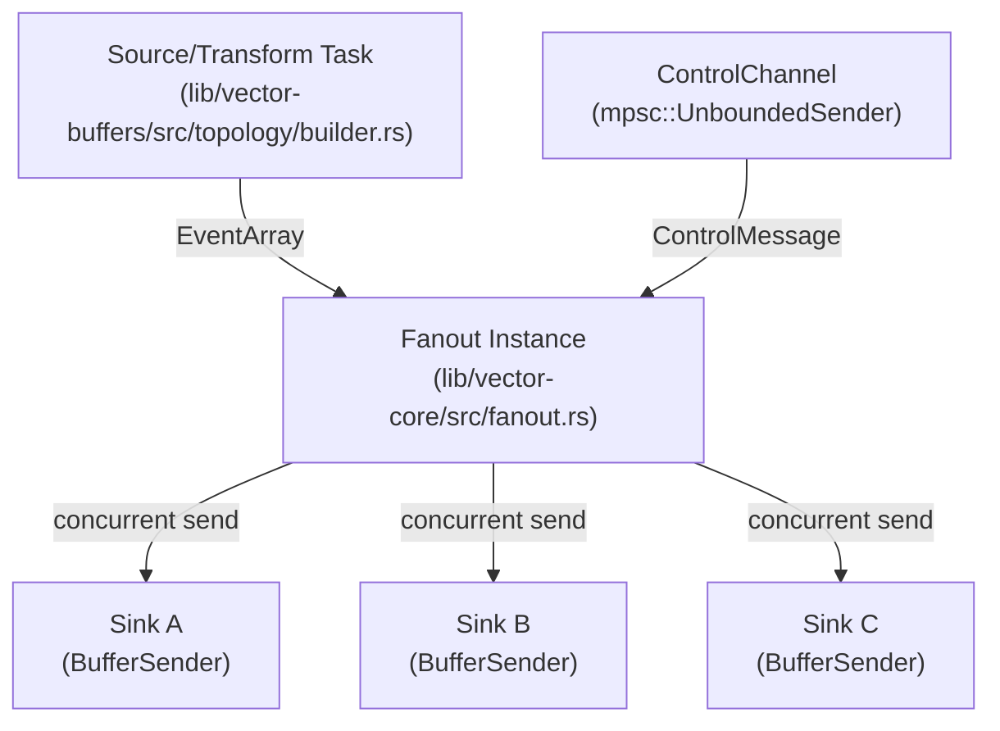
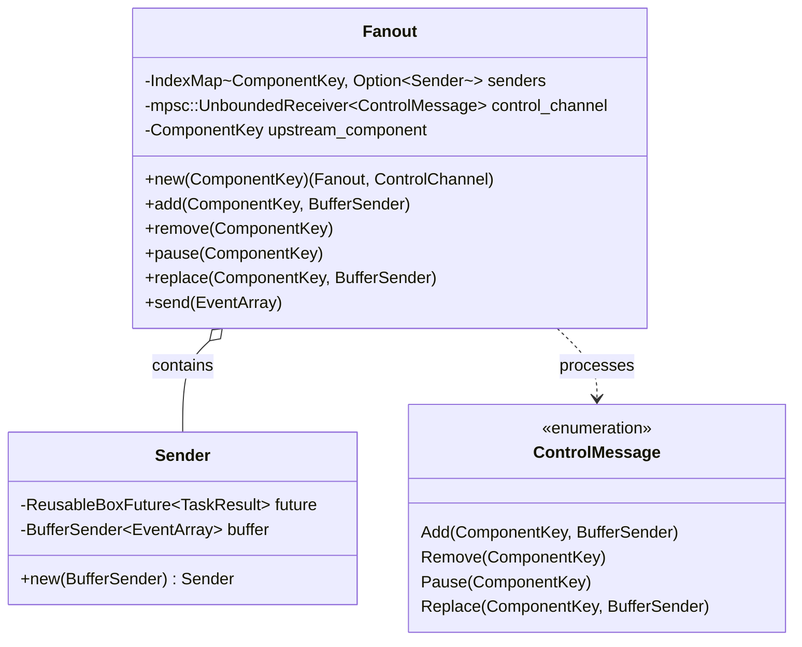
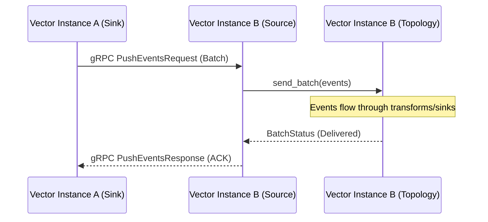

<!-- source: DeepWiki mcp.deepwiki.com · repo vectordotdev/vector · page 3.7 Fanout and Event Distribution · fetched 2026-10-29 -->

# Fanout and Event Distribution

Relevant source files

The following files were used as context for generating this wiki page:

- [lib/vector-buffers/benches/common.rs](lib/vector-buffers/benches/common.rs)
- [lib/vector-buffers/benches/sized_records.rs](lib/vector-buffers/benches/sized_records.rs)
- [lib/vector-buffers/examples/buffer_perf.rs](lib/vector-buffers/examples/buffer_perf.rs)
- [lib/vector-buffers/src/buffer_usage_data.rs](lib/vector-buffers/src/buffer_usage_data.rs)
- [lib/vector-buffers/src/config.rs](lib/vector-buffers/src/config.rs)
- [lib/vector-buffers/src/internal_events.rs](lib/vector-buffers/src/internal_events.rs)
- [lib/vector-buffers/src/lib.rs](lib/vector-buffers/src/lib.rs)
- [lib/vector-buffers/src/topology/builder.rs](lib/vector-buffers/src/topology/builder.rs)
- [lib/vector-buffers/src/topology/channel/receiver.rs](lib/vector-buffers/src/topology/channel/receiver.rs)
- [lib/vector-buffers/src/topology/channel/sender.rs](lib/vector-buffers/src/topology/channel/sender.rs)
- [lib/vector-buffers/src/topology/channel/tests.rs](lib/vector-buffers/src/topology/channel/tests.rs)
- [lib/vector-buffers/src/topology/test_util.rs](lib/vector-buffers/src/topology/test_util.rs)
- [lib/vector-buffers/src/variants/in_memory.rs](lib/vector-buffers/src/variants/in_memory.rs)
- [lib/vector-core/src/fanout.rs](lib/vector-core/src/fanout.rs)
- [lib/vector-core/src/latency.rs](lib/vector-core/src/latency.rs)
- [lib/vector-core/src/transform/outputs.rs](lib/vector-core/src/transform/outputs.rs)
- [src/sinks/util/metadata.rs](src/sinks/util/metadata.rs)
- [src/sinks/vector/config.rs](src/sinks/vector/config.rs)
- [src/sinks/vector/mod.rs](src/sinks/vector/mod.rs)
- [src/sinks/vector/service.rs](src/sinks/vector/service.rs)
- [src/sinks/vector/sink.rs](src/sinks/vector/sink.rs)
- [src/sources/vector/mod.rs](src/sources/vector/mod.rs)
- [src/test_util/mock/sources/basic.rs](src/test_util/mock/sources/basic.rs)
- [tests/antithesis/scenarios/vector_to_vector_e2e_disk/head.yaml](tests/antithesis/scenarios/vector_to_vector_e2e_disk/head.yaml)
- [website/cue/reference/components/sinks/generated/vector.cue](website/cue/reference/components/sinks/generated/vector.cue)

## Purpose and Scope

This document describes Vector's fanout mechanism, which enables event distribution from a single source or transform to multiple downstream components (sinks or transforms). Fanout handles dynamic topology changes, concurrent event delivery, and backpressure management to ensure reliable event routing throughout the pipeline.

For information about buffering between components, see [Buffering and Flow Control](3.2). For details on how the topology is constructed and managed, see [Topology Construction](2.3) and [Runtime Management and Hot Reloading](2.4).

## Overview

Fanout is Vector's event distribution mechanism that allows a single upstream component to send events to multiple downstream components concurrently. Each source and transform output has an associated `Fanout` instance that manages the set of connected sinks or transforms.

Key responsibilities:
- **Concurrent delivery**: Send events to all connected outputs simultaneously.
- **Dynamic reconfiguration**: Add, remove, pause, or replace outputs without disrupting event flow.
- **Backpressure handling**: Coordinate flow control across multiple downstream components.
- **Graceful degradation**: Handle individual sink failures without affecting others.

**Natural Language to Code Entity Space: Fanout Component Interaction**

Title: Fanout Component Data Flow

**Sources**: [lib/vector-core/src/fanout.rs:10-65](), [lib/vector-buffers/src/topology/builder.rs:1-30]()

## Fanout Architecture

### Core Types

The fanout system consists of three primary types:

| Type | Description | Location |
|------|-------------|----------|
| `Fanout` | Main struct managing event distribution | [lib/vector-core/src/fanout.rs:48-52]() |
| `ControlMessage` | Protocol for dynamic topology changes | [lib/vector-core/src/fanout.rs:15-30]() |
| `ControlChannel` | Alias for `mpsc::UnboundedSender<ControlMessage>` | [lib/vector-core/src/fanout.rs:46]() |

**Code Entity Space: Fanout Internal Structure**

Title: Fanout and Control Protocol

**Sources**: [lib/vector-core/src/fanout.rs:15-65](), [lib/vector-core/src/fanout.rs:454-460]()

### Fanout Struct Details

The `Fanout` struct maintains an `IndexMap` of sinks where each entry can be `Some(Sender)` or `None` [lib/vector-core/src/fanout.rs:49](). This design allows for graceful component replacement during configuration reloads without dropping events. When a sink is "Paused", its entry becomes `None` [lib/vector-core/src/fanout.rs:102-114](), and the fanout will block subsequent sends until it is "Replaced" with a new `BufferSender` via `wait_for_replacements` [lib/vector-core/src/fanout.rs:148-172]().

**Sources**: [lib/vector-core/src/fanout.rs:48-52](), [lib/vector-core/src/fanout.rs:148-172](), [lib/vector-core/src/fanout.rs:102-114]()

## Control Message Protocol

The `ControlMessage` enum defines operations for managing fanout topology dynamically [lib/vector-core/src/fanout.rs:15-30]().

### Control Operations

| Operation | Purpose | Typical Usage |
|-----------|---------|---------------|
| `Add` | Register new sink output | Initial topology build |
| `Remove` | Unregister sink completely | Component removed from config |
| `Pause` | Mark sink for replacement | Config reload starting |
| `Replace` | Swap in new `BufferSender` | Config reload completing |

**Sources**: [lib/vector-core/src/fanout.rs:15-30](), [lib/vector-core/src/fanout.rs:133-142]()

### Processing Logic

Control messages are processed via `apply_control_message` [lib/vector-core/src/fanout.rs:133](). If a `Fanout` is in the middle of a `send` operation, it uses a `SendGroup` to manage the concurrent distribution [lib/vector-core/src/fanout.rs:260-264](). The `SendGroup` captures the current state of senders and processes any control messages that arrive during the asynchronous send operation via `poll_control_channel` [lib/vector-core/src/fanout.rs:418-452]().

**Sources**: [lib/vector-core/src/fanout.rs:133-142](), [lib/vector-core/src/fanout.rs:260-264](), [lib/vector-core/src/fanout.rs:418-452]()

## Event Distribution and Backpressure

### Concurrent Send Mechanism

The `Fanout::send` method creates a `SendGroup` [lib/vector-core/src/fanout.rs:188](). The `SendGroup` iterates through all registered `Sender` instances and triggers their asynchronous send futures.

1. **Cloning**: For $N$ sinks, the `EventArray` is cloned $N-1$ times; the last sink receives the original array to minimize allocations [lib/vector-core/src/fanout.rs:275-285]().
2. **Concurrency**: All sends happen concurrently as the `SendGroup` polls multiple futures [lib/vector-core/src/fanout.rs:322-342]().
3. **Wait for Completion**: The `SendGroup` resolves only when all sinks have acknowledged receipt or the operation is cancelled [lib/vector-core/src/fanout.rs:336]().

**Sources**: [lib/vector-core/src/fanout.rs:188](), [lib/vector-core/src/fanout.rs:275-285](), [lib/vector-core/src/fanout.rs:322-342]()

### Backpressure and Slow Sinks

Backpressure is handled at the `BufferSender` level. If a sink's buffer is full (based on its `WhenFull` policy), the `Sender`'s future will not resolve until space is available [lib/vector-buffers/src/lib.rs:50-79](). Because `Fanout` waits for all sinks in the `SendGroup` to complete, a single slow sink will eventually apply backpressure to the upstream component.

`BufferSender` supports three modes for handling full buffers: `Block`, `DropNewest`, and `Overflow` [lib/vector-buffers/src/lib.rs:53-79](). The `BufferUsageHandle` tracks utilization and dropped events [lib/vector-buffers/src/buffer_usage_data.rs:142-190]().

**Sources**: [lib/vector-buffers/src/lib.rs:53-79](), [lib/vector-buffers/src/buffer_usage_data.rs:142-190](), [lib/vector-buffers/src/topology/channel/sender.rs:143-176]()

## Vector-to-Vector Source and Sink

Vector provides a specialized pair of components for pipeline chaining: the `vector` source and `vector` sink. These use a custom gRPC protocol for high-performance event transfer between Vector instances.

### `vector` Source

The `vector` source acts as a gRPC server listening for `PushEvents` requests [src/sources/vector/mod.rs:54-57]().

- **Implementation**: Defined in `src/sources/vector/mod.rs`.
- **Service**: The `Service` struct implements the `proto::Service` trait [src/sources/vector/mod.rs:53]().
- **Acknowledgements**: Supports end-to-end acknowledgements via `BatchNotifier` [src/sources/vector/mod.rs:81](). If enabled, the source will not respond to the gRPC request until the events have been successfully processed or buffered downstream via `handle_batch_status` [src/sources/vector/mod.rs:110-121]().

**Sources**: [src/sources/vector/mod.rs:46-50](), [src/sources/vector/mod.rs:53-95](), [src/sources/vector/mod.rs:110-121](), [src/sources/vector/mod.rs:185-213]()

### `vector` Sink

The `vector` sink acts as a gRPC client that connects to a remote `vector` source [src/sinks/vector/config.rs:49]().

- **Implementation**: Defined in `src/sinks/vector/mod.rs` and configured in `src/sinks/vector/config.rs`.
- **Compression**: Supports `none`, `gzip`, and `zstd` compression via `VectorCompression` [src/sinks/vector/config.rs:83-95]().
- **Healthcheck**: Load-balanced sinks healthcheck all configured endpoints on startup using the gRPC health protocol [src/sinks/vector/config.rs:160-186]().

**Sources**: [src/sinks/vector/config.rs:49-126](), [src/sinks/vector/config.rs:83-95](), [src/sinks/vector/config.rs:160-186]()

### Pipeline Chaining Diagram

Title: Vector-to-Vector Chaining

**Sources**: [src/sources/vector/mod.rs:54-95](), [src/sinks/vector/config.rs:49-126](), [src/sources/vector/mod.rs:110-121]()

---

