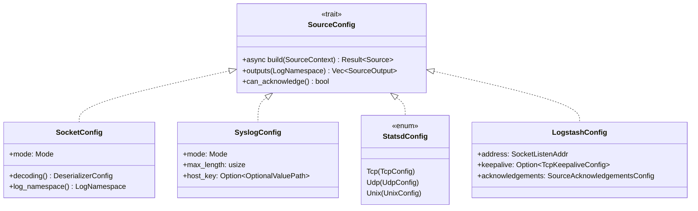
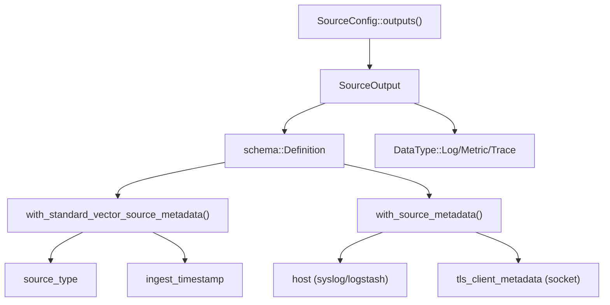
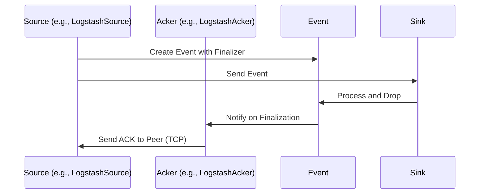

<!-- source: DeepWiki mcp.deepwiki.com · repo vectordotdev/vector · page 4 Sources · fetched 2026-10-29 -->

# Sources

Relevant source files

The following files were used as context for generating this wiki page:

- [lib/vector-core/src/config/global_options.rs](lib/vector-core/src/config/global_options.rs)
- [src/config/vars.rs](src/config/vars.rs)
- [src/internal_events/mod.rs](src/internal_events/mod.rs)
- [src/sinks/mod.rs](src/sinks/mod.rs)
- [src/sources/fluent/mod.rs](src/sources/fluent/mod.rs)
- [src/sources/logstash.rs](src/sources/logstash.rs)
- [src/sources/mod.rs](src/sources/mod.rs)
- [src/sources/prometheus/mod.rs](src/sources/prometheus/mod.rs)
- [src/sources/socket/mod.rs](src/sources/socket/mod.rs)
- [src/sources/socket/tcp.rs](src/sources/socket/tcp.rs)
- [src/sources/socket/udp.rs](src/sources/socket/udp.rs)
- [src/sources/socket/unix.rs](src/sources/socket/unix.rs)
- [src/sources/statsd/mod.rs](src/sources/statsd/mod.rs)
- [src/sources/statsd/unix.rs](src/sources/statsd/unix.rs)
- [src/sources/syslog.rs](src/sources/syslog.rs)
- [src/sources/util/net/tcp/mod.rs](src/sources/util/net/tcp/mod.rs)
- [src/sources/util/unix_datagram.rs](src/sources/util/unix_datagram.rs)
- [src/sources/util/unix_stream.rs](src/sources/util/unix_stream.rs)
- [src/transforms/mod.rs](src/transforms/mod.rs)
- [website/content/en/docs/reference/configuration/_index.md](website/content/en/docs/reference/configuration/_index.md)
- [website/content/en/docs/reference/configuration/sources/prometheus_pushgateway.md](website/content/en/docs/reference/configuration/sources/prometheus_pushgateway.md)
- [website/cue/reference/configuration.cue](website/cue/reference/configuration.cue)
- [website/cue/reference/urls.cue](website/cue/reference/urls.cue)
- [website/data/redirects.yaml](website/data/redirects.yaml)

## Purpose and Scope

Sources are Vector's data ingestion components that collect observability events from external systems and convert them into Vector's internal event model. This page covers the architecture of sources, common implementation patterns, and the major source categories available in Vector.

For information about how events flow through transforms after ingestion, see [Transforms](#5). For details on how events are sent to destinations, see [Sinks](#6).

Sources: [src/sources/mod.rs:1-113]()

---

## Source Architecture

### SourceConfig Trait

All sources implement the `SourceConfig` trait, which establishes the contract for building and configuring source components. This trait is foundational for the [Topology Construction](#2.3) process. The `build` method receives a `SourceContext` containing the `SourceSender` for downstream event propagation and a `ShutdownSignal` for lifecycle management.

**Trait Definition: SourceConfig**

Sources: [src/sources/mod.rs:102-102](), [src/sources/socket/mod.rs:112-200](), [src/sources/syslog.rs:174-210](), [src/sources/statsd/mod.rs:198-223](), [src/sources/logstash.rs:144-177]()

### Source Output and Schema

Sources define their output schema through the `outputs` method, specifying whether they produce logs, metrics, or traces, and what metadata fields are attached. This is often driven by a `Definition` object that incorporates `LogNamespace` settings.

Sources: [src/sources/logstash.rs:179-186](), [src/sources/socket/mod.rs:202-210](), [src/sources/fluent/mod.rs:10-17]()

---

## Source Categories

Vector provides sources organized into major categories. Detailed documentation for each is available in the child pages.

| Category | Description | Details |
|----------|-------------|---------|
| **File-Based** | Tailing files, globbing, and rotation handling. | [File-Based Sources](#4.2) |
| **System Logs** | Journald, Windows Event Logs, and subprocess execution. | [System Log Sources](#4.3) |
| **Message Queues** | Kafka, AMQP, NATS, and Pub/Sub systems. | [Message Queue Sources](#4.4) |
| **Network Protocols** | HTTP, Syslog, StatsD, and raw Socket ingestion. | [Network Protocol Sources](#4.5) |
| **Metrics & Monitoring** | Host metrics, DB metrics, and scrape targets. | [Metrics and Monitoring Sources](#4.6) |

Sources: [src/sources/mod.rs:1-113](), [website/data/redirects.yaml:48-71]()

### Network Protocol Sources

These sources handle incoming network traffic. Vector provides extensive utilities for `tcp`, `udp`, and `unix` socket management, often abstracted behind a `TcpSource` or `UdpFramed` implementation.

**Socket and Protocol Implementation:**

| Source | Modes Supported | Framing/Decoding |
|---------|-----------------|------------------|
| `socket` | TCP, UDP, UDS | Configurable via `DecodingConfig` |
| `syslog` | TCP, UDP, UDS | `SyslogDeserializerConfig` |
| `statsd` | TCP, UDP, UDS | `NewlineDelimitedDecoder` + `Parser` |
| `fluent` | TCP, UDS | MessagePack via `rmp_serde` |

Sources: [src/sources/socket/mod.rs:35-50](), [src/sources/syslog.rs:80-134](), [src/sources/statsd/mod.rs:55-65](), [src/sources/fluent/mod.rs:56-63]()

### Metrics and Monitoring Sources

Metrics sources like `host_metrics` or `apache_metrics` typically poll external endpoints or system APIs to produce `Metric` events. These sources often use specialized internal events for tracking scrape success.

Sources: [src/internal_events/mod.rs:9-20](), [src/sources/mod.rs:41-50]()

---

## Common Implementation Patterns

### Acknowledgements and Finalization

To achieve at-least-once delivery, Vector uses a finalization system where events are acknowledged by sinks back to the source. Sources like `logstash` and `fluent` implement `TcpSource` which integrates with `TcpSourceAcker`.

Sources: [src/sources/logstash.rs:204-212](), [src/sources/fluent/mod.rs:21-32](), [src/sources/socket/mod.rs:192-194]()

### Internal Events and Metrics

Sources emit internal events to track their performance. The `internal_events` module defines standard events like `SocketEventsReceived`, `BytesReceived`, and `StreamClosedError`.

**Standard Source Metrics:**
- `BytesReceived`: Track raw data volume.
- `EventsReceived`: Track event counts.
- `SocketBindError`: Track failures to open listening ports.

Sources: [src/internal_events/mod.rs:1-158](), [src/sources/syslog.rs:34-36](), [src/sources/statsd/mod.rs:30-33]()

### Shutdown Handling

Sources must implement graceful shutdown, ensuring in-flight events are flushed. This typically involves a `ShutdownSignal` and a `shutdown_timeout_secs` configuration to forcefully close connections if they persist beyond the grace period.

Sources: [src/sources/statsd/mod.rs:172-174](), [src/sources/logstash.rs:152-152](), [src/sources/syslog.rs:197-197]()

---

