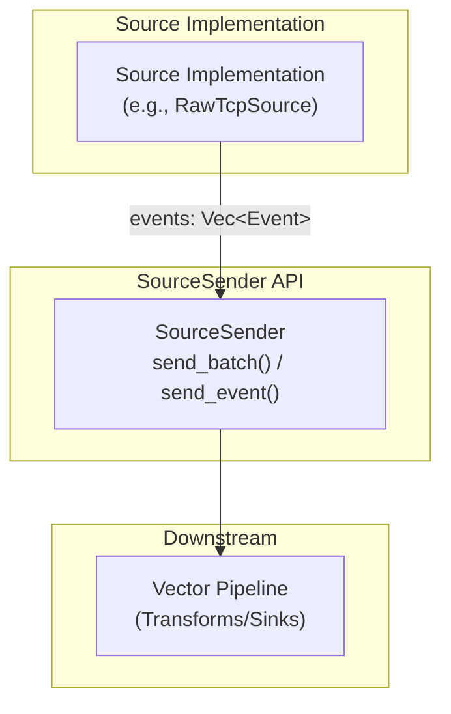
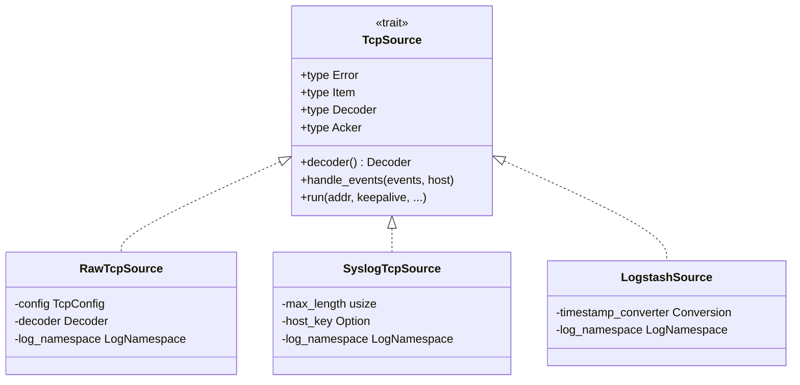
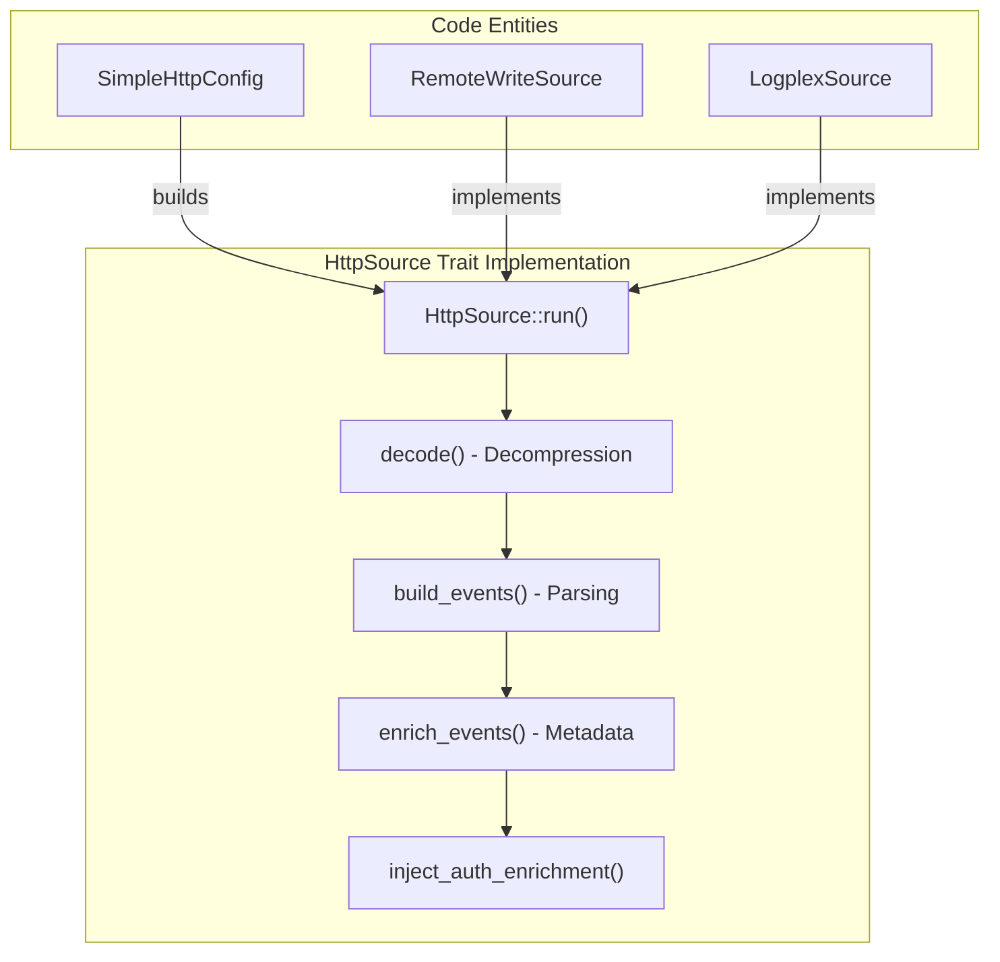

<!-- source: DeepWiki mcp.deepwiki.com · repo vectordotdev/vector · page 4.1 Source Architecture and Patterns · fetched 2026-10-29 -->

# Source Architecture and Patterns

<details>
<summary>Relevant source files</summary>

The following files were used as context for generating this wiki page:

- [changelog.d/tls_server_name_openssl_verify.fix.md](changelog.d/tls_server_name_openssl_verify.fix.md)
- [lib/vector-core/src/tls/incoming.rs](lib/vector-core/src/tls/incoming.rs)
- [lib/vector-core/src/tls/mod.rs](lib/vector-core/src/tls/mod.rs)
- [lib/vector-core/src/tls/reload.rs](lib/vector-core/src/tls/reload.rs)
- [lib/vector-core/src/tls/settings.rs](lib/vector-core/src/tls/settings.rs)
- [src/http.rs](src/http.rs)
- [src/sinks/prometheus/exporter.rs](src/sinks/prometheus/exporter.rs)
- [src/sources/apache_metrics/mod.rs](src/sources/apache_metrics/mod.rs)
- [src/sources/aws_ecs_metrics/mod.rs](src/sources/aws_ecs_metrics/mod.rs)
- [src/sources/fluent/mod.rs](src/sources/fluent/mod.rs)
- [src/sources/heroku_logs.rs](src/sources/heroku_logs.rs)
- [src/sources/http_server.rs](src/sources/http_server.rs)
- [src/sources/logstash.rs](src/sources/logstash.rs)
- [src/sources/prometheus/remote_write.rs](src/sources/prometheus/remote_write.rs)
- [src/sources/prometheus/scrape.rs](src/sources/prometheus/scrape.rs)
- [src/sources/socket/mod.rs](src/sources/socket/mod.rs)
- [src/sources/socket/tcp.rs](src/sources/socket/tcp.rs)
- [src/sources/socket/udp.rs](src/sources/socket/udp.rs)
- [src/sources/socket/unix.rs](src/sources/socket/unix.rs)
- [src/sources/statsd/mod.rs](src/sources/statsd/mod.rs)
- [src/sources/statsd/unix.rs](src/sources/statsd/unix.rs)
- [src/sources/syslog.rs](src/sources/syslog.rs)
- [src/sources/util/body_decoding.rs](src/sources/util/body_decoding.rs)
- [src/sources/util/decompression.rs](src/sources/util/decompression.rs)
- [src/sources/util/http/encoding.rs](src/sources/util/http/encoding.rs)
- [src/sources/util/http/mod.rs](src/sources/util/http/mod.rs)
- [src/sources/util/http/prelude.rs](src/sources/util/http/prelude.rs)
- [src/sources/util/http/query.rs](src/sources/util/http/query.rs)
- [src/sources/util/mod.rs](src/sources/util/mod.rs)
- [src/sources/util/net/tcp/mod.rs](src/sources/util/net/tcp/mod.rs)
- [src/sources/util/unix_datagram.rs](src/sources/util/unix_datagram.rs)
- [src/sources/util/unix_stream.rs](src/sources/util/unix_stream.rs)
- [website/cue/reference/components/sources/apache_metrics.cue](website/cue/reference/components/sources/apache_metrics.cue)
- [website/cue/reference/components/sources/aws_ecs_metrics.cue](website/cue/reference/components/sources/aws_ecs_metrics.cue)

</details>


This document describes the architecture and common patterns used by Vector sources. It covers the core abstractions (`SourceConfig`, `SourceContext`, `SourceSender`), the buffering mechanism between sources and transforms, batching strategies, and the internal events/metrics that sources must emit. It also details TLS configuration and the utility infrastructure for TCP, UDP, HTTP, and Unix sockets.

For specific source implementations, see [File-Based Sources](#4.2), [System Log Sources](#4.3), [Message Queue Sources](#4.4), and [Network Protocol Sources](#4.5).

## Source Configuration and Initialization

Sources in Vector are built using a two-phase initialization process: configuration validation and runtime instantiation.

### SourceConfig Trait

Every source implements the `SourceConfig` trait, which defines the contract for source configuration:

```rust
#[async_trait::async_trait]
pub trait SourceConfig: Send + Sync + 'static {
    /// Builds the source.
    async fn build(&self, cx: SourceContext) -> crate::Result<super::Source>;

    /// Returns the outputs that this source produces.
    fn outputs(&self, global_log_namespace: LogNamespace) -> Vec<SourceOutput>;

    /// Returns the resources that this source uses.
    fn resources(&self) -> Vec<Resource>;

    /// Returns whether this source can acknowledge events.
    fn can_acknowledge(&self) -> bool {
        false
    }
}
```
[src/sources/socket/mod.rs:112-113](), [src/sources/syslog.rs:174-175](), [src/sources/logstash.rs:142-143]()

The `build()` method receives a `SourceContext` and returns a `Source`, which is a boxed future (`Pin<Box<dyn Future<Output = Result<(), ()>> + Send>>`) that runs the source's event collection logic.

**Key Responsibilities:**
- **Configuration Validation**: Type checking and resource conflict detection occur during config parsing.
- **Output Definition**: The `outputs()` method declares what event types (logs, metrics, traces) and output names the source produces [src/sources/socket/mod.rs:201-205](), [src/sources/logstash.rs:176-183](), [src/sources/prometheus/remote_write.rs:147-149]().
- **Resource Declaration**: The `resources()` method declares resources like network addresses to enable Vector to detect conflicts [src/sources/logstash.rs:185-187](), [src/sources/http_server.rs:62-64]().

Sources: [src/sources/socket/mod.rs:112-205](), [src/sources/logstash.rs:142-192](), [src/sources/prometheus/remote_write.rs:126-154]()

### SourceContext

The `SourceContext` provides sources with access to runtime services. It is passed to the `build` method of a `SourceConfig`.

| Field | Purpose |
|-------|---------|
| `shutdown` | `ShutdownSignal` used to notify the source of graceful shutdown [src/sources/socket/mod.rs:164](). |
| `out` | `SourceSender` channel for sending events into the pipeline [src/sources/socket/mod.rs:165](). |
| `globals` | Global configuration options like `timezone` [src/sources/logstash.rs:146](). |
| `enrichment_tables` | Access to enrichment data for components like HTTP auth [src/sources/util/http/prelude.rs:131](). |

Sources: [src/sources/socket/mod.rs:113-165](), [src/sources/logstash.rs:143-146](), [src/sources/util/http/prelude.rs:124-132]()

## SourceSender Architecture

The `SourceSender` is the primary mechanism for sources to emit events into the Vector pipeline. It provides batching, timeout handling, and buffer management.

### Data Flow Pattern



Sources: [src/sources/socket/tcp.rs:210-230](), [src/sources/util/unix_stream.rs:130-132]()

### Batching and Transmission

Sources typically process data into a `SmallVec<[Event; 1]>` or `Vec<Event>` and then dispatch them via the `SourceSender`. For example, in the `unix_stream` utility, events are sent using `out.send_batch(events).await` [src/sources/util/unix_stream.rs:130]().

If the downstream buffer is full and a timeout is configured, the send operation may fail, leading to a `StreamClosedError` internal event [src/sources/util/unix_stream.rs:131-132]().

Sources: [src/sources/util/unix_stream.rs:116-133](), [src/sources/socket/tcp.rs:210-220]()

## Network Protocol Patterns

Vector provides a robust utility layer for building socket-based sources, primarily found in `src/sources/util/net/`.

### TCP Source Pattern

The `TcpSource` trait [src/sources/util/net/tcp/mod.rs:96]() simplifies building TCP-based sources. It defines the `decoder` to use and how to `handle_events`.



The `TcpSource::run` method handles the boilerplate of binding listeners, managing connection limits via `RequestLimiter`, and spawning tasks for each connection [src/sources/util/net/tcp/mod.rs:119-182]().

Sources: [src/sources/socket/tcp.rs:194-230](), [src/sources/syslog.rs:192-196](), [src/sources/logstash.rs:201-210](), [src/sources/util/net/tcp/mod.rs:96-182]()

### HTTP Source Pattern

The `HttpSource` trait [src/sources/util/http/prelude.rs:38]() provides a standardized way to host HTTP endpoints. It handles decompression, authentication, and event enrichment.



Sources: [src/sources/util/http/prelude.rs:38-127](), [src/sources/http_server.rs:188-190](), [src/sources/prometheus/remote_write.rs:188-212](), [src/sources/heroku_logs.rs:195-201]()

### UDP and Unix Socket Patterns

*   **UDP**: Uses `try_bind_udp_socket` [src/sources/socket/udp.rs:181]() and can join IPv4 multicast groups [src/sources/socket/udp.rs:190-200]().
*   **Unix Domain Sockets**: Supported in both datagram and stream modes via `build_unix_datagram_source` and `build_unix_stream_source` [src/sources/socket/unix.rs:138-168]().
*   **Permissions**: Unix socket file permissions are managed via `socket_file_mode` and the `change_socket_permissions` utility [src/sources/util/unix_stream.rs:62-63]().

Sources: [src/sources/socket/udp.rs:172-200](), [src/sources/socket/unix.rs:121-168](), [src/sources/util/unix_stream.rs:39-63]()

## TLS Configuration

TLS is a first-class citizen in Vector's network sources. The `TlsSourceConfig` struct [lib/vector-core/src/tls/settings.rs:76]() combines general TLS options with source-specific features like `client_metadata_key`.

### Identity and Verification
Sources use `MaybeTlsSettings::from_config()` [src/sources/socket/mod.rs:136]() to initialize the security layer. This configuration supports:
*   **Server Identity**: `crt_file` and `key_file` [lib/vector-core/src/tls/settings.rs:131-142]().
*   **Client Verification**: `verify_certificate` [lib/vector-core/src/tls/settings.rs:88-98]().
*   **Certificate Metadata**: Extracting client certificate info into events via `client_metadata_key` [lib/vector-core/src/tls/settings.rs:78]().

Sources: [lib/vector-core/src/tls/settings.rs:40-159](), [src/sources/socket/mod.rs:130-142]()

## Internal Events and Metrics

Sources must emit internal events for observability. These are often emitted through the `emit!` macro.

### Common Socket and HTTP Events

| Event | Meaning | File |
|-------|---------|------|
| `SocketBindError` | Failed to bind to a port/path | [src/sources/socket/udp.rs:184]() |
| `SocketEventsReceived` | Events successfully parsed from socket | [src/sources/util/unix_stream.rs:121]() |
| `HttpBadRequest` | Client sent malformed HTTP request | [src/sources/util/http/prelude.rs:32]() |
| `HttpInternalError` | Server-side error during HTTP processing | [src/sources/util/http/prelude.rs:32]() |
| `StreamClosedError` | Downstream channel closed (backpressure/shutdown) | [src/sources/util/unix_stream.rs:131]() |

### Metric Emission
Network utilities automatically handle some metrics. For instance, `unix_stream` uses `BytesReceived` to track raw data volume [src/sources/util/unix_stream.rs:65](). HTTP sources track `HttpBytesReceived` and `HttpEventsReceived` [src/sources/util/http/prelude.rs:32]().

Sources: [src/sources/util/unix_stream.rs:65-132](), [src/sources/socket/udp.rs:184-205](), [src/sources/util/http/prelude.rs:31-33]()

## Log Namespace and Schema

Vector supports multiple log namespaces (Legacy vs. Vector). Sources use the `LogNamespace` provided in the `SourceContext` to determine where to insert metadata [src/sources/socket/mod.rs:116]().

### Metadata Insertion
Standard metadata like `source_type` and `timestamp` are inserted using `insert_standard_vector_source_metadata` [src/sources/socket/tcp.rs:225-229](). Host information is inserted via `insert_source_metadata` [src/sources/socket/unix.rs:109-115](). HTTP sources inject auth enrichment into metadata (Vector namespace) or body (Legacy namespace) [src/sources/util/http/prelude.rs:71-108]().

Sources: [src/sources/socket/mod.rs:116-125](), [src/sources/socket/tcp.rs:225-235](), [src/sources/socket/unix.rs:100-117](), [src/sources/util/http/prelude.rs:71-109]()

---

