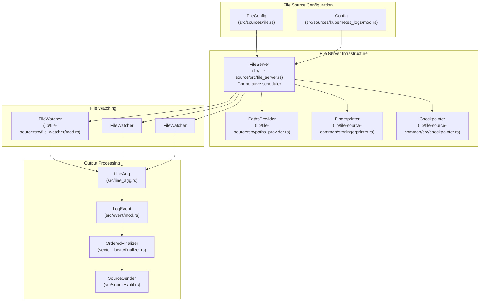
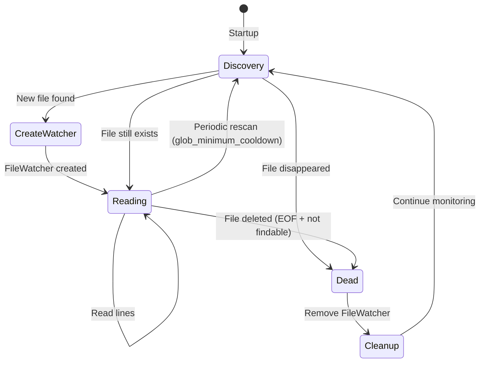
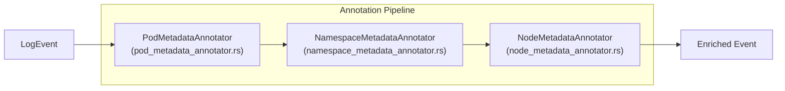
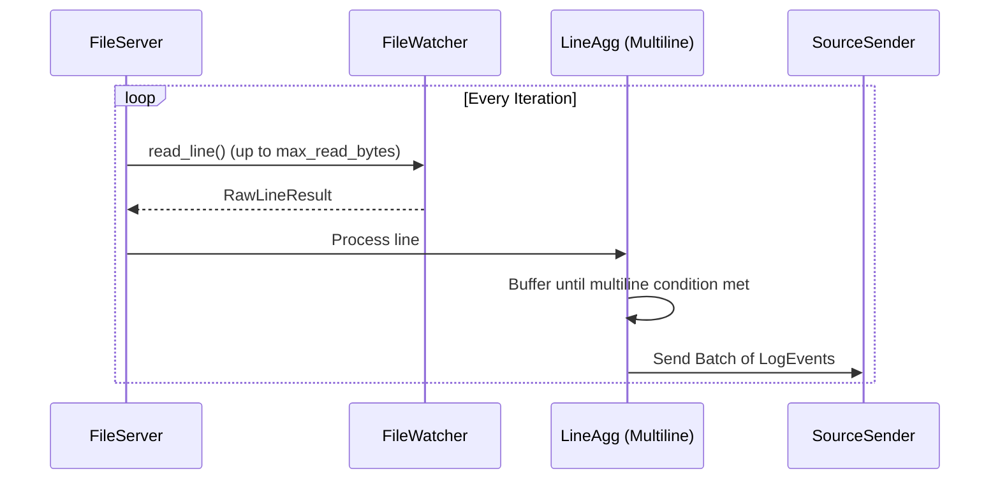

<!-- source: DeepWiki mcp.deepwiki.com · repo vectordotdev/vector · page 4.2 File-Based Sources · fetched 2026-10-29 -->

# File-Based Sources

Relevant source files

The following files were used as context for generating this wiki page:

- [distribution/kubernetes/vector-agent/kustomization.yaml](distribution/kubernetes/vector-agent/kustomization.yaml)
- [distribution/kubernetes/vector-aggregator/kustomization.yaml](distribution/kubernetes/vector-aggregator/kustomization.yaml)
- [lib/file-source/src/file_server.rs](lib/file-source/src/file_server.rs)
- [lib/file-source/src/file_watcher/mod.rs](lib/file-source/src/file_watcher/mod.rs)
- [lib/file-source/src/file_watcher/tests/experiment.rs](lib/file-source/src/file_watcher/tests/experiment.rs)
- [lib/file-source/src/file_watcher/tests/experiment_no_truncations.rs](lib/file-source/src/file_watcher/tests/experiment_no_truncations.rs)
- [lib/file-source/src/file_watcher/tests/mod.rs](lib/file-source/src/file_watcher/tests/mod.rs)
- [lib/file-source/src/lib.rs](lib/file-source/src/lib.rs)
- [src/gcp.rs](src/gcp.rs)
- [src/internal_events/gcp_pubsub.rs](src/internal_events/gcp_pubsub.rs)
- [src/sources/aws_sqs/source.rs](src/sources/aws_sqs/source.rs)
- [src/sources/file.rs](src/sources/file.rs)
- [src/sources/gcp_pubsub.rs](src/sources/gcp_pubsub.rs)
- [src/sources/journald.rs](src/sources/journald.rs)
- [src/sources/kafka.rs](src/sources/kafka.rs)
- [src/sources/kubernetes_logs/mod.rs](src/sources/kubernetes_logs/mod.rs)
- [src/sources/kubernetes_logs/namespace_metadata_annotator.rs](src/sources/kubernetes_logs/namespace_metadata_annotator.rs)
- [src/sources/kubernetes_logs/node_metadata_annotator.rs](src/sources/kubernetes_logs/node_metadata_annotator.rs)
- [src/sources/kubernetes_logs/pod_metadata_annotator.rs](src/sources/kubernetes_logs/pod_metadata_annotator.rs)
- [src/sources/splunk_hec/acknowledgements.rs](src/sources/splunk_hec/acknowledgements.rs)
- [website/.hugo_build.lock](website/.hugo_build.lock)
- [website/content/en/blog/kubernetes-integration.md](website/content/en/blog/kubernetes-integration.md)
- [website/content/en/docs/administration/management.md](website/content/en/docs/administration/management.md)
- [website/content/en/docs/administration/monitoring.md](website/content/en/docs/administration/monitoring.md)
- [website/content/en/docs/setup/deployment/roles.md](website/content/en/docs/setup/deployment/roles.md)
- [website/content/en/docs/setup/installation/package-managers/helm.md](website/content/en/docs/setup/installation/package-managers/helm.md)
- [website/content/en/docs/setup/installation/platforms/kubernetes.md](website/content/en/docs/setup/installation/platforms/kubernetes.md)
- [website/cue/reference/administration/interfaces/helm3.cue](website/cue/reference/administration/interfaces/helm3.cue)
- [website/cue/reference/administration/roles/aggregator.cue](website/cue/reference/administration/roles/aggregator.cue)
- [website/cue/reference/components/sources/file.cue](website/cue/reference/components/sources/file.cue)
- [website/cue/reference/components/sources/gcp_pubsub.cue](website/cue/reference/components/sources/gcp_pubsub.cue)
- [website/cue/reference/components/sources/journald.cue](website/cue/reference/components/sources/journald.cue)
- [website/cue/reference/components/sources/kubernetes_logs.cue](website/cue/reference/components/sources/kubernetes_logs.cue)
- [website/cue/reference/services/kubernetes.cue](website/cue/reference/services/kubernetes.cue)

## Purpose and Scope

File-based sources in Vector collect log data by reading files from the filesystem. This document covers the `file` source and the `kubernetes_logs` source, both of which use a common file-reading infrastructure. These sources monitor files matching glob patterns, handle file rotation, track read positions via checkpoints, and support features like multiline aggregation and end-to-end acknowledgements.

For network-based sources (syslog, HTTP, etc.), see [Network Protocol Sources](#4.5). For the `journald` source which uses a cursor-based approach via `journalctl`, see [System Log Sources](#4.3).

## Architecture Overview

File-based sources are built on a cooperative scheduling architecture where a `FileServer` coordinates multiple `FileWatcher` instances, each responsible for reading from a single file. The system uses fingerprinting to track files across rotation and checkpointing to enable resumption after restarts.

### Component Relationship Diagram
This diagram bridges the Natural Language Space of "File Sources" to the Code Entity Space.

Sources: [src/sources/file.rs:59-64](), [src/sources/kubernetes_logs/mod.rs:81-86](), [lib/file-source/src/file_server.rs:43-61](), [lib/file-source/src/file_watcher/mod.rs:30-40]()

## Core Components

### FileConfig

The `FileConfig` struct defines configuration for the `file` source. Key configuration options include:

| Field | Type | Purpose |
|-------|------|---------|
| `include` | `Vec<PathBuf>` | Array of file patterns to include [src/sources/file.rs:67-67]() |
| `exclude` | `Vec<PathBuf>` | Array of file patterns to exclude [src/sources/file.rs:76-76]() |
| `fingerprint` | `FingerprintConfig` | Strategy for identifying files (Checksum/DevInode) [src/sources/file.rs:167-167]() |
| `data_dir` | `Option<PathBuf>` | Directory for persisting checkpoint positions [src/sources/file.rs:140-140]() |
| `read_from` | `ReadFromConfig` | Where to start reading (Beginning/End) [src/sources/file.rs:103-103]() |
| `ignore_checkpoints` | `Option<bool>` | Whether to ignore existing checkpoints [src/sources/file.rs:99-99]() |
| `ignore_older_secs` | `Option<u64>` | Ignore files older than specified seconds [src/sources/file.rs:110-110]() |
| `max_line_bytes` | `usize` | Maximum size of a line before discard [src/sources/file.rs:117-117]() |
| `glob_minimum_cooldown_ms` | `Duration` | Delay between file discovery calls [src/sources/file.rs:163-163]() |

Sources: [src/sources/file.rs:64-246]()

### FileServer

The `FileServer` is the central coordinator that:

1. **Discovers files** by periodically globbing for paths matching configured patterns [lib/file-source/src/file_server.rs:188-210]().
2. **Schedules reads** fairly across all watched files using cooperative multitasking [lib/file-source/src/file_server.rs:282-310]().
3. **Manages FileWatcher instances** in an `IndexMap<FileFingerprint, FileWatcher>` [lib/file-source/src/file_server.rs:99-99]().
4. **Handles file lifecycle** including creation, rotation, and deletion [lib/file-source/src/file_server.rs:183-245]().
5. **Writes checkpoints** periodically via a background `checkpoint_writer` task [lib/file-source/src/file_server.rs:151-156]().

Sources: [lib/file-source/src/file_server.rs:86-173](), [lib/file-source/src/file_server.rs:282-431]()

### FileWatcher

Each `FileWatcher` manages a single file handle and maintains state for that specific stream.

- **File handle**: Async buffered reader with support for transparent Gzip decompression [lib/file-source/src/file_watcher/mod.rs:42-65]().
- **Position tracking**: Current byte offset (`file_position`) in the file.
- **Identity**: Device number and inode for rotation detection.
- **State flags**: `findable` (tracked during glob), `is_dead` (marked for removal), `reached_eof`.

Sources: [lib/file-source/src/file_watcher/mod.rs:42-120]()

### Fingerprinter

The `Fingerprinter` uniquely identifies files to track them across renames and rotations using one of two strategies:

#### Checksum Strategy
Computes a hash of the first N lines of the file.
- **Configuration**: `ignored_header_bytes` (skip common headers), `lines` (number of lines to hash).
- **Advantages**: Works across filesystems and container restarts where inodes might change.

#### Device and Inode Strategy (DevInode)
Uses filesystem metadata (device number + inode).
- **Advantages**: Extremely fast, no file I/O required.
- **Disadvantages**: Does not work across filesystem boundaries or in some containerized environments where device numbers are volatile.

Sources: [src/sources/file.rs:167-167](), [lib/file-source/src/file_server.rs:109-117]()

### Checkpointer

The `Checkpointer` persists file read positions to enable resumption after restarts.

- **Storage**: Checkpoints are stored in the `data_dir` [src/sources/file.rs:129-140]().
- **Integration**: Works with `OrderedFinalizer` to ensure checkpoints only advance after events are successfully acknowledged by the sink [src/sources/file.rs:11-23]().
- **Resumption**: On startup, `FileServer` calls `checkpointer.read_checkpoints()` to populate initial offsets [lib/file-source/src/file_server.rs:104-104]().

Sources: [lib/file-source/src/file_server.rs:151-156](), [src/sources/file.rs:11-23]()

## Kubernetes Logs Source

The `kubernetes_logs` source is a specialized implementation that uses the `FileServer` infrastructure but dynamically discovers log paths by watching the Kubernetes API.

### Path Discovery and Metadata
The `K8sPathsProvider` generates log paths following the standard Kubernetes convention: `/var/log/pods/<namespace>_<pod>_<uid>/<container>/*.log` [src/sources/kubernetes_logs/mod.rs:2-4]().

### Metadata Annotation Architecture
Events are enriched with Kubernetes context through a series of annotators:

**Annotation Fields**:
- **Pod**: `container_name`, `pod_labels`, `pod_annotations`, `pod_ip`, etc. [website/cue/reference/components/sources/kubernetes_logs.cue:73-198]().
- **Namespace**: `namespace_labels` [src/sources/kubernetes_logs/mod.rs:109-118]().
- **Node**: `node_labels` [src/sources/kubernetes_logs/mod.rs:166-168]().

Sources: [src/sources/kubernetes_logs/mod.rs:72-76](), [website/cue/reference/components/sources/kubernetes_logs.cue:63-224]()

## File Rotation and Handling

Vector handles file rotation through the combination of `PathsProvider` and `Fingerprinter`.

1. **Detection**: During the glob cycle, `FileServer` fingerprints discovered paths. If a path points to a known fingerprint, it updates the `FileWatcher`'s path [lib/file-source/src/file_server.rs:184-239]().
2. **Persistence**: If a file is rotated (renamed), Vector continues reading from the open file handle until EOF is reached.
3. **Copy-Truncate**: If `copytruncate` is used, Vector detects the truncation (file size smaller than last read position) and resets the reader to the beginning of the file [website/cue/reference/components/sources/file.cue:190-207]().

Sources: [lib/file-source/src/file_server.rs:184-239](), [website/cue/reference/components/sources/file.cue:190-207]()

## Data Flow and Line Processing

### Read Loop Logic
The `FileServer` read loop implements fair scheduling to prevent a single busy file from starving others.

### Multiline Aggregation
Multiline handling is performed by `LineAgg` [src/sources/file.rs:41-41](). It buffers lines until a `message_start_indicator` (regex) matches the start of a new message or a timeout is reached.

Sources: [lib/file-source/src/file_server.rs:282-430](), [src/sources/file.rs:41-41]()

---

