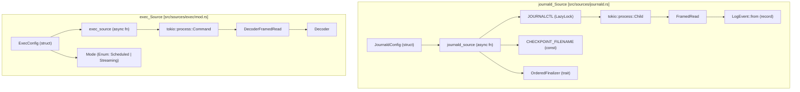
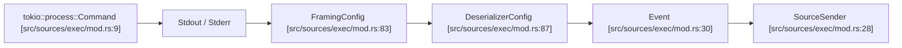

<!-- source: DeepWiki mcp.deepwiki.com · repo vectordotdev/vector · page 4.3 System Log Sources · fetched 2026-10-29 -->

# System Log Sources

Relevant source files

The following files were used as context for generating this wiki page:

- [lib/file-source/src/file_server.rs](lib/file-source/src/file_server.rs)
- [lib/file-source/src/file_watcher/mod.rs](lib/file-source/src/file_watcher/mod.rs)
- [lib/file-source/src/file_watcher/tests/experiment.rs](lib/file-source/src/file_watcher/tests/experiment.rs)
- [lib/file-source/src/file_watcher/tests/experiment_no_truncations.rs](lib/file-source/src/file_watcher/tests/experiment_no_truncations.rs)
- [lib/file-source/src/file_watcher/tests/mod.rs](lib/file-source/src/file_watcher/tests/mod.rs)
- [lib/file-source/src/lib.rs](lib/file-source/src/lib.rs)
- [src/gcp.rs](src/gcp.rs)
- [src/internal_events/apache_metrics.rs](src/internal_events/apache_metrics.rs)
- [src/internal_events/aws_ecs_metrics.rs](src/internal_events/aws_ecs_metrics.rs)
- [src/internal_events/dnstap.rs](src/internal_events/dnstap.rs)
- [src/internal_events/docker_logs.rs](src/internal_events/docker_logs.rs)
- [src/internal_events/eventstoredb_metrics.rs](src/internal_events/eventstoredb_metrics.rs)
- [src/internal_events/exec.rs](src/internal_events/exec.rs)
- [src/internal_events/file.rs](src/internal_events/file.rs)
- [src/internal_events/gcp_pubsub.rs](src/internal_events/gcp_pubsub.rs)
- [src/internal_events/kafka.rs](src/internal_events/kafka.rs)
- [src/internal_events/kubernetes_logs.rs](src/internal_events/kubernetes_logs.rs)
- [src/internal_events/mongodb_metrics.rs](src/internal_events/mongodb_metrics.rs)
- [src/internal_events/nginx_metrics.rs](src/internal_events/nginx_metrics.rs)
- [src/internal_events/postgresql_metrics.rs](src/internal_events/postgresql_metrics.rs)
- [src/internal_events/prometheus.rs](src/internal_events/prometheus.rs)
- [src/sources/aws_sqs/source.rs](src/sources/aws_sqs/source.rs)
- [src/sources/demo_logs.rs](src/sources/demo_logs.rs)
- [src/sources/eventstoredb_metrics/mod.rs](src/sources/eventstoredb_metrics/mod.rs)
- [src/sources/exec/mod.rs](src/sources/exec/mod.rs)
- [src/sources/file.rs](src/sources/file.rs)
- [src/sources/gcp_pubsub.rs](src/sources/gcp_pubsub.rs)
- [src/sources/journald.rs](src/sources/journald.rs)
- [src/sources/kafka.rs](src/sources/kafka.rs)
- [src/sources/kubernetes_logs/mod.rs](src/sources/kubernetes_logs/mod.rs)
- [src/sources/splunk_hec/acknowledgements.rs](src/sources/splunk_hec/acknowledgements.rs)
- [website/cue/reference/components/sources/eventstoredb_metrics.cue](website/cue/reference/components/sources/eventstoredb_metrics.cue)
- [website/cue/reference/components/sources/gcp_pubsub.cue](website/cue/reference/components/sources/gcp_pubsub.cue)
- [website/cue/reference/components/sources/journald.cue](website/cue/reference/components/sources/journald.cue)

## Purpose and Scope

This page documents Vector's system log sources that collect logs directly from operating system logging facilities. It covers the `journald` source, the `windows_event_log` source, and the `exec` source. 

- The `journald` source integrates with systemd's journal on Linux using a `journalctl` subprocess approach, leveraging cursor-based checkpoints for resumption [src/sources/journald.rs:63-74]().
- The `windows_event_log` source consumes Windows Event Log data with bookmark checkpointing and subscription handling.
- The `exec` source supports subprocess-based ingestion by running arbitrary commands and collecting their output [src/sources/exec/mod.rs:42-43]().

For file-based sources, including Kubernetes logs, see [File-Based Sources](4.2). For message queue sources like Kafka, see [Message Queue Sources](4.4).

---

## Overview

### journald Source

The `journald` source reads systemd journal entries by spawning a `journalctl` subprocess configured with filters and output in JSON format [src/sources/journald.rs:102-105](). It tracks reading position with journal cursors, persisting checkpoints to disk under Vector's data directory [src/sources/journald.rs:158-169](). It supports filtering by units and arbitrary fields, batching, and acknowledgements to ensure at-least-once event delivery [src/sources/journald.rs:102-183]().

### windows_event_log Source

The Windows Event Log source subscribes to Windows Event Log streams, storing progress via bookmarks and checkpoint files. It processes event batches asynchronously and manages subscriptions to provide reliable log ingestion with acknowledgment.

### exec Source

The `exec` source runs configured commands as subprocesses to ingest their output as log events [src/sources/exec/mod.rs:42-43](). It supports both `Scheduled` execution and `Streaming` modes [src/sources/exec/mod.rs:96-105](), handles environment variables, working directories, buffer sizes, decoding, and framing options [src/sources/exec/mod.rs:46-93](). It manages subprocess life cycle including respawning, timeouts, and shutdown [src/sources/exec/mod.rs:108-132]().

---

## Component Architecture

The following diagram bridges the natural language concepts to the specific Rust entities and modules used in the implementation.

### Code Entity Space: System Sources

**Sources:** [src/sources/journald.rs:63-189](), [src/sources/exec/mod.rs:42-105]()

---

## journald Source: Implementation Details

### 1. Subprocess Management with `journalctl`

The source spawns `journalctl` as a subprocess [src/sources/journald.rs:73-74](). It utilizes `tokio::process::Command` to manage the lifecycle of the `journalctl` binary [src/sources/journald.rs:23](). 

- **Arguments:** The command is typically invoked with `--follow` for streaming, `--output=json` for structured parsing, and `--show-cursor` to enable resumption [src/sources/journald.rs:64]().
- **Version Compatibility:** Vector checks `journalctl --version` to handle specific bugs in systemd versions 250 through 257 regarding `current_boot_only` [src/sources/journald.rs:92-96]().

### 2. Data Ingestion Flow

- **Decoding:** The stdout is wrapped in a `FramedRead` using `CharacterDelimitedDecoder` [src/sources/journald.rs:27-30]().
- **Parsing:** Each line is parsed from JSON into a record map. Key fields extracted include `__CURSOR` [src/sources/journald.rs:64](), `_HOSTNAME` [src/sources/journald.rs:65](), and `MESSAGE` [src/sources/journald.rs:66]().
- **Filtering:** Filtering is performed based on `include_matches` and `exclude_matches` configuration [src/sources/journald.rs:145-156]().

### 3. Checkpointing and Acknowledgements

- **Persistence:** Checkpoints are stored in `checkpoint.txt` within the data directory [src/sources/journald.rs:63]().
- **Finalization:** Vector uses `OrderedFinalizer` to ensure that the checkpoint is only updated once the corresponding events have been successfully acknowledged by the downstream sinks [src/sources/journald.rs:33-51]().

---

## exec Source: Subprocess-based Ingestion

### Architecture

The `exec` source runs arbitrary commands on the host and ingests their output.

- **Modes:** 
  - `Scheduled`: The command is run on a fixed interval (`exec_interval_secs`) [src/sources/exec/mod.rs:101-117]().
  - `Streaming`: The command runs continuously and can be configured to `respawn_on_exit` [src/sources/exec/mod.rs:103-132]().
- **Environment:** Supports clearing the environment or setting custom variables via the `environment` and `clear_environment` fields [src/sources/exec/mod.rs:60-69]().
- **Output:** Captures `stdout` and optionally `stderr` [src/sources/exec/mod.rs:75-76]().

### Execution Data Flow

**Sources:** [src/sources/exec/mod.rs:42-132]()

---

## Summary Table: System Log Sources

| Source              | Input Mechanism         | Checkpointing      | Filtering                 | Subprocess Required |
|---------------------|------------------------|--------------------|---------------------------|---------------------|
| `journald`          | `journalctl` subprocess | Cursor-based file  | Unit and field matching   | Yes                 |
| `windows_event_log` | Native Windows API     | XML Bookmarks      | Channel/Query filtering   | No                  |
| `exec`              | Arbitrary command      | N/A (stateless)    | N/A (uses decoders)       | Yes                 |

---

## References to Source Files

| Component | File and Line Range |
| :--- | :--- |
| `JournaldConfig` | [src/sources/journald.rs:102-190]() |
| `Journald` Internal Events | [src/sources/journald.rs:52-56]() |
| `ExecConfig` | [src/sources/exec/mod.rs:43-93]() |
| `Exec` Mode Enum | [src/sources/exec/mod.rs:96-105]() |

Sources:  
[src/sources/journald.rs:1-190](), [src/sources/exec/mod.rs:1-132]()

---

