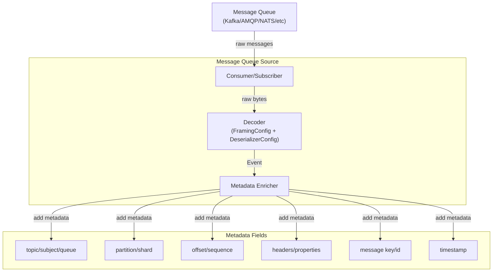
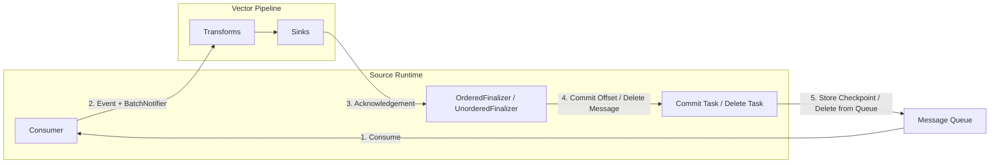
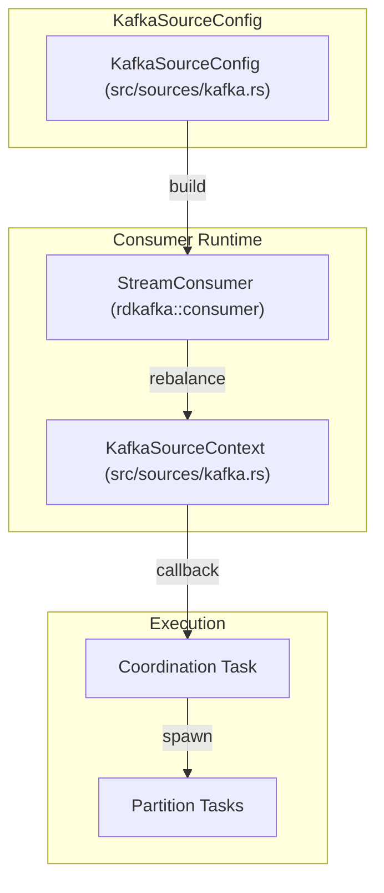
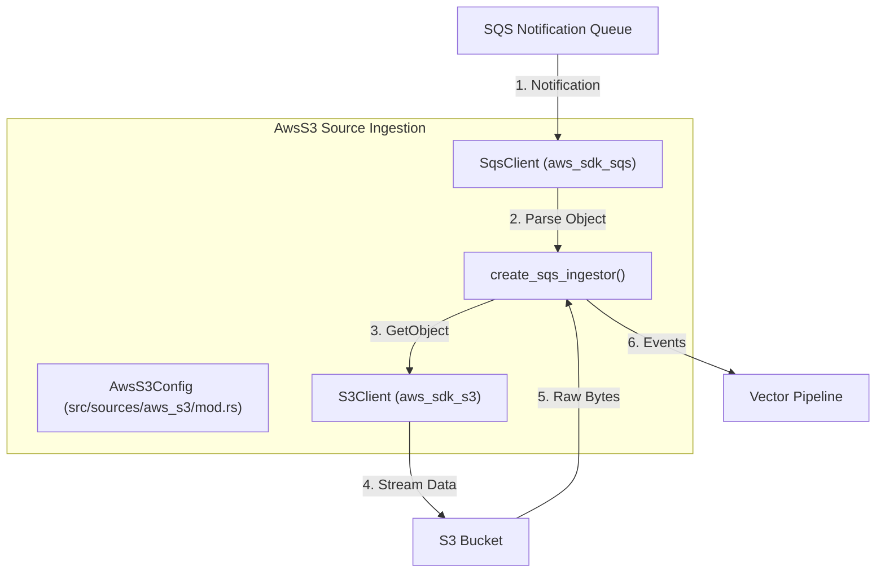

<!-- source: DeepWiki mcp.deepwiki.com · repo vectordotdev/vector · page 4.4 Message Queue Sources · fetched 2026-10-29 -->

# Message Queue Sources

Relevant source files

The following files were used as context for generating this wiki page:

- [lib/file-source/src/file_server.rs](lib/file-source/src/file_server.rs)
- [lib/file-source/src/file_watcher/mod.rs](lib/file-source/src/file_watcher/mod.rs)
- [lib/file-source/src/file_watcher/tests/experiment.rs](lib/file-source/src/file_watcher/tests/experiment.rs)
- [lib/file-source/src/file_watcher/tests/experiment_no_truncations.rs](lib/file-source/src/file_watcher/tests/experiment_no_truncations.rs)
- [lib/file-source/src/file_watcher/tests/mod.rs](lib/file-source/src/file_watcher/tests/mod.rs)
- [lib/file-source/src/lib.rs](lib/file-source/src/lib.rs)
- [src/gcp.rs](src/gcp.rs)
- [src/internal_events/gcp_pubsub.rs](src/internal_events/gcp_pubsub.rs)
- [src/sources/amqp.rs](src/sources/amqp.rs)
- [src/sources/aws_kinesis_firehose/errors.rs](src/sources/aws_kinesis_firehose/errors.rs)
- [src/sources/aws_kinesis_firehose/filters.rs](src/sources/aws_kinesis_firehose/filters.rs)
- [src/sources/aws_kinesis_firehose/handlers.rs](src/sources/aws_kinesis_firehose/handlers.rs)
- [src/sources/aws_kinesis_firehose/mod.rs](src/sources/aws_kinesis_firehose/mod.rs)
- [src/sources/aws_kinesis_firehose/models.rs](src/sources/aws_kinesis_firehose/models.rs)
- [src/sources/aws_s3/mod.rs](src/sources/aws_s3/mod.rs)
- [src/sources/aws_s3/sqs.rs](src/sources/aws_s3/sqs.rs)
- [src/sources/aws_sqs/config.rs](src/sources/aws_sqs/config.rs)
- [src/sources/aws_sqs/source.rs](src/sources/aws_sqs/source.rs)
- [src/sources/file.rs](src/sources/file.rs)
- [src/sources/gcp_pubsub.rs](src/sources/gcp_pubsub.rs)
- [src/sources/journald.rs](src/sources/journald.rs)
- [src/sources/kafka.rs](src/sources/kafka.rs)
- [src/sources/kubernetes_logs/mod.rs](src/sources/kubernetes_logs/mod.rs)
- [src/sources/splunk_hec/acknowledgements.rs](src/sources/splunk_hec/acknowledgements.rs)
- [website/cue/reference/components/sources/gcp_pubsub.cue](website/cue/reference/components/sources/gcp_pubsub.cue)
- [website/cue/reference/components/sources/journald.cue](website/cue/reference/components/sources/journald.cue)

## Purpose and Scope

This document covers Vector's message queue source implementations, which enable consumption of events from distributed messaging systems. Message queue sources provide reliable, ordered event ingestion from systems like Kafka, AMQP, NATS, AWS SQS, and GCP Pub/Sub.

For file-based event collection, see [File-Based Sources](#4.2). For system logs via journald, see [System Log Sources](#4.3). For general source architecture patterns, see [Source Architecture and Patterns](#4.1).

## Available Message Queue Sources

Vector supports the following message queue systems as sources:

| Source | Feature Flag | Primary Library | Key Capabilities |
|--------|-------------|-----------------|------------------|
| Kafka | `sources-kafka` | `rdkafka` (librdkafka) | Consumer groups, offset management, acknowledgements |
| AMQP | `sources-amqp` | `lapin` | Exchange/queue binding, message acknowledgement |
| NATS | `sources-nats` | `nats.rs` | Subject subscription, queue groups |
| AWS SQS | `sources-aws-sqs` | `aws-sdk-sqs` | Message receipt, deletion, concurrency |
| GCP Pub/Sub | `sources-gcp-pubsub` | `tonic` (gRPC) | Subscription, automatic concurrency, acknowledgement |
| AWS S3 (SQS Strategy) | `sources-aws-s3` | `aws-sdk-s3` | Consumes S3 events via SQS notification queue |
| AWS Kinesis Firehose | `sources-aws-kinesis-firehose` | `hyper` / `warp` | HTTP-based push ingestion, record decompression |

Sources: [src/sources/kafka.rs:92-180](), [src/sources/gcp_pubsub.rs:123-182](), [src/sources/aws_sqs/source.rs:33-43](), [src/sources/aws_s3/mod.rs:60-70](), [src/sources/aws_kinesis_firehose/mod.rs:35-123]()

## Common Architecture Patterns

### Message Metadata Enrichment

All message queue sources enrich events with protocol-specific metadata fields that provide context about message origin and routing. The `LogNamespace` configuration determines where this metadata is inserted (Legacy vs. Vector namespace).

Sources: [src/sources/kafka.rs:173-210](), [src/sources/gcp_pubsub.rs:26-36](), [src/sources/aws_sqs/source.rs:145-156](), [src/sources/amqp.rs:158-192](), [src/sources/aws_kinesis_firehose/handlers.rs:103-162]()

### Acknowledgement Support

Message queue sources implement end-to-end acknowledgements to ensure at-least-once delivery semantics. Vector uses `OrderedFinalizer` or `UnorderedFinalizer` to track event status.

Sources: [src/sources/kafka.rs:47-49](), [src/sources/gcp_pubsub.rs:31-31](), [src/sources/aws_sqs/source.rs:48-60](), [src/sources/amqp.rs:21-24](), [src/sources/aws_kinesis_firehose/handlers.rs:89-96]()

## Kafka Source Architecture

The Kafka source leverages `librdkafka` via the `rdkafka` crate for high-performance consumption.

### Component Overview

The `KafkaSourceConfig` [src/sources/kafka.rs:96-180]() defines configuration such as `bootstrap_servers`, `topics`, and `group_id`.

Sources: [src/sources/kafka.rs:92-180](), [src/sources/kafka.rs:17-26]()

### Consumer Context and Callbacks

The Kafka source uses `rdkafka`'s callback system to handle consumer group rebalancing. `KafkaSourceContext` implements `ClientContext` and `ConsumerContext` traits [src/sources/kafka.rs:17-26]().

### Offset Management

- **Auto Offset Reset:** `auto_offset_reset` [src/sources/kafka.rs:125]() controls behavior when no offset exists.
- **Commit Strategy:** Periodic commits via `commit_interval_ms` [src/sources/kafka.rs:171]() (default 5000ms).
- **Drain Timeout:** `drain_timeout_ms` [src/sources/kafka.rs:148]() limits wait time for pending acknowledgements during rebalance or shutdown. Must be less than `session_timeout_ms` [src/sources/kafka.rs:133]().

Sources: [src/sources/kafka.rs:123-171](), [src/sources/kafka.rs:70-75]()

## AWS SQS and S3-SQS Ingestion

Vector interacts with SQS as a direct source and as a trigger for S3 object ingestion.

### AWS SQS Source
`SqsSource` [src/sources/aws_sqs/source.rs:33-43]() handles polling. The `run` method [src/sources/aws_sqs/source.rs:46-91]() spawns concurrent tasks calling `run_once` [src/sources/aws_sqs/source.rs:93-182]() to fetch messages using `MAX_BATCH_SIZE` (10) [src/sources/aws_sqs/source.rs:28]().

### AWS S3 SQS Strategy
The `aws_s3` source uses an SQS queue to receive bucket notifications [src/sources/aws_s3/mod.rs:60-70](). 

Sources: [src/sources/aws_s3/mod.rs:168-174](), [src/sources/aws_s3/sqs.rs:96-163](), [src/sources/aws_sqs/source.rs:46-182]()

## GCP Pub/Sub Source

The GCP Pub/Sub source uses gRPC `StreamingPull` [src/sources/gcp_pubsub.rs:123-128]().

**Concurrency Management:**
The source monitors "busyness". If responses exceed `full_response_size` [src/sources/gcp_pubsub.rs:163](), Vector opens new streams up to `max_concurrency` [src/sources/gcp_pubsub.rs:154](). Acknowledgements use `UnorderedFinalizer` [src/sources/gcp_pubsub.rs:69-70]().

Sources: [src/sources/gcp_pubsub.rs:132-193](), [src/sources/gcp_pubsub.rs:69-70]()

## AWS Kinesis Firehose Source

The `aws_kinesis_firehose` source functions as an HTTP server that accepts push-based ingestion from AWS [src/sources/aws_kinesis_firehose/mod.rs:35-41]().

### Record Processing
Incoming requests contain multiple records [src/sources/aws_kinesis_firehose/models.rs:30](). Each record is base64 decoded and optionally decompressed based on the `record_compression` setting [src/sources/aws_kinesis_firehose/handlers.rs:73-77](). Vector supports `gzip` and `auto` detection [src/sources/aws_kinesis_firehose/mod.rs:134-153]().

Sources: [src/sources/aws_kinesis_firehose/handlers.rs:60-170](), [src/sources/aws_kinesis_firehose/mod.rs:69-81]()

## Performance Considerations

### Parallelism
- **Kafka**: One task per partition.
- **AWS SQS**: Configurable `concurrency` [src/sources/aws_sqs/source.rs:40]().
- **GCP Pub/Sub**: `max_concurrency` [src/sources/gcp_pubsub.rs:154]() adjusts gRPC connections.
- **AMQP**: Supports `prefetch_count` [src/sources/amqp.rs:115]() for flow control.

### Latency Tuning
- **Kafka**: `fetch_wait_max_ms` [src/sources/kafka.rs:164]() and `commit_interval_ms` [src/sources/kafka.rs:171]().
- **AWS SQS**: `poll_secs` [src/sources/aws_sqs/source.rs:37]() and `visibility_timeout_secs` [src/sources/aws_sqs/source.rs:38]().
- **GCP Pub/Sub**: `poll_time_seconds` [src/sources/gcp_pubsub.rs:170]() and `ack_deadline_secs` [src/sources/gcp_pubsub.rs:178]().

Sources: [src/sources/kafka.rs:164-171](), [src/sources/aws_sqs/source.rs:37-38](), [src/sources/gcp_pubsub.rs:170-178](), [src/sources/amqp.rs:115]()

---

