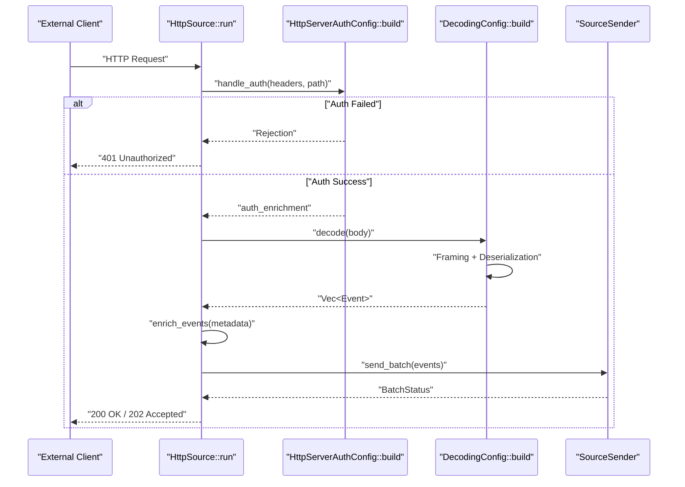

<!-- source: DeepWiki mcp.deepwiki.com · repo vectordotdev/vector · page 4.5 Network Protocol Sources · fetched 2026-10-29 -->

# Network Protocol Sources

Relevant source files

The following files were used as context for generating this wiki page:

- [lib/opentelemetry-proto/build.rs](lib/opentelemetry-proto/build.rs)
- [lib/opentelemetry-proto/src/proto.rs](lib/opentelemetry-proto/src/proto.rs)
- [src/components/validation/runner/io.rs](src/components/validation/runner/io.rs)
- [src/sinks/humio/logs.rs](src/sinks/humio/logs.rs)
- [src/sinks/humio/metrics.rs](src/sinks/humio/metrics.rs)
- [src/sinks/splunk_hec/common/acknowledgements.rs](src/sinks/splunk_hec/common/acknowledgements.rs)
- [src/sinks/splunk_hec/common/mod.rs](src/sinks/splunk_hec/common/mod.rs)
- [src/sinks/splunk_hec/common/request.rs](src/sinks/splunk_hec/common/request.rs)
- [src/sinks/splunk_hec/common/service.rs](src/sinks/splunk_hec/common/service.rs)
- [src/sinks/splunk_hec/common/util.rs](src/sinks/splunk_hec/common/util.rs)
- [src/sinks/splunk_hec/logs/config.rs](src/sinks/splunk_hec/logs/config.rs)
- [src/sinks/splunk_hec/logs/encoder.rs](src/sinks/splunk_hec/logs/encoder.rs)
- [src/sinks/splunk_hec/logs/integration_tests.rs](src/sinks/splunk_hec/logs/integration_tests.rs)
- [src/sinks/splunk_hec/logs/request_builder.rs](src/sinks/splunk_hec/logs/request_builder.rs)
- [src/sinks/splunk_hec/logs/sink.rs](src/sinks/splunk_hec/logs/sink.rs)
- [src/sinks/splunk_hec/logs/tests.rs](src/sinks/splunk_hec/logs/tests.rs)
- [src/sinks/splunk_hec/metrics/config.rs](src/sinks/splunk_hec/metrics/config.rs)
- [src/sinks/splunk_hec/metrics/encoder.rs](src/sinks/splunk_hec/metrics/encoder.rs)
- [src/sinks/splunk_hec/metrics/integration_tests.rs](src/sinks/splunk_hec/metrics/integration_tests.rs)
- [src/sinks/splunk_hec/metrics/request_builder.rs](src/sinks/splunk_hec/metrics/request_builder.rs)
- [src/sinks/splunk_hec/metrics/sink.rs](src/sinks/splunk_hec/metrics/sink.rs)
- [src/sinks/splunk_hec/metrics/tests.rs](src/sinks/splunk_hec/metrics/tests.rs)
- [src/sources/datadog_agent/logs.rs](src/sources/datadog_agent/logs.rs)
- [src/sources/datadog_agent/metrics.rs](src/sources/datadog_agent/metrics.rs)
- [src/sources/datadog_agent/mod.rs](src/sources/datadog_agent/mod.rs)
- [src/sources/datadog_agent/tests.rs](src/sources/datadog_agent/tests.rs)
- [src/sources/datadog_agent/traces.rs](src/sources/datadog_agent/traces.rs)
- [src/sources/fluent/mod.rs](src/sources/fluent/mod.rs)
- [src/sources/logstash.rs](src/sources/logstash.rs)
- [src/sources/opentelemetry/config.rs](src/sources/opentelemetry/config.rs)
- [src/sources/opentelemetry/grpc.rs](src/sources/opentelemetry/grpc.rs)
- [src/sources/opentelemetry/http.rs](src/sources/opentelemetry/http.rs)
- [src/sources/opentelemetry/integration_tests.rs](src/sources/opentelemetry/integration_tests.rs)
- [src/sources/opentelemetry/mod.rs](src/sources/opentelemetry/mod.rs)
- [src/sources/opentelemetry/tests.rs](src/sources/opentelemetry/tests.rs)
- [src/sources/socket/mod.rs](src/sources/socket/mod.rs)
- [src/sources/socket/tcp.rs](src/sources/socket/tcp.rs)
- [src/sources/socket/udp.rs](src/sources/socket/udp.rs)
- [src/sources/socket/unix.rs](src/sources/socket/unix.rs)
- [src/sources/splunk_hec/mod.rs](src/sources/splunk_hec/mod.rs)
- [src/sources/statsd/mod.rs](src/sources/statsd/mod.rs)
- [src/sources/statsd/unix.rs](src/sources/statsd/unix.rs)
- [src/sources/syslog.rs](src/sources/syslog.rs)
- [src/sources/util/grpc/mod.rs](src/sources/util/grpc/mod.rs)
- [src/sources/util/net/tcp/mod.rs](src/sources/util/net/tcp/mod.rs)
- [src/sources/util/unix_datagram.rs](src/sources/util/unix_datagram.rs)
- [src/sources/util/unix_stream.rs](src/sources/util/unix_stream.rs)
- [website/content/en/docs/reference/configuration/sources/opentelemetry.md](website/content/en/docs/reference/configuration/sources/opentelemetry.md)
- [website/cue/reference/components/sources/amqp.cue](website/cue/reference/components/sources/amqp.cue)
- [website/cue/reference/components/sources/aws_kinesis_firehose.cue](website/cue/reference/components/sources/aws_kinesis_firehose.cue)
- [website/cue/reference/components/sources/aws_s3.cue](website/cue/reference/components/sources/aws_s3.cue)
- [website/cue/reference/components/sources/aws_sqs.cue](website/cue/reference/components/sources/aws_sqs.cue)
- [website/cue/reference/components/sources/exec.cue](website/cue/reference/components/sources/exec.cue)
- [website/cue/reference/components/sources/file_descriptor.cue](website/cue/reference/components/sources/file_descriptor.cue)
- [website/cue/reference/components/sources/fluent.cue](website/cue/reference/components/sources/fluent.cue)
- [website/cue/reference/components/sources/generated/opentelemetry.cue](website/cue/reference/components/sources/generated/opentelemetry.cue)
- [website/cue/reference/components/sources/generated/vector.cue](website/cue/reference/components/sources/generated/vector.cue)
- [website/cue/reference/components/sources/kafka.cue](website/cue/reference/components/sources/kafka.cue)
- [website/cue/reference/components/sources/logstash.cue](website/cue/reference/components/sources/logstash.cue)
- [website/cue/reference/components/sources/mqtt.cue](website/cue/reference/components/sources/mqtt.cue)
- [website/cue/reference/components/sources/nats.cue](website/cue/reference/components/sources/nats.cue)
- [website/cue/reference/components/sources/opentelemetry.cue](website/cue/reference/components/sources/opentelemetry.cue)
- [website/cue/reference/components/sources/redis.cue](website/cue/reference/components/sources/redis.cue)
- [website/cue/reference/components/sources/socket.cue](website/cue/reference/components/sources/socket.cue)
- [website/cue/reference/components/sources/statsd.cue](website/cue/reference/components/sources/statsd.cue)
- [website/cue/reference/components/sources/stdin.cue](website/cue/reference/components/sources/stdin.cue)
- [website/cue/reference/components/sources/syslog.cue](website/cue/reference/components/sources/syslog.cue)

Network protocol sources accept incoming observability data over standard network protocols. Unlike pull-based sources that actively request data, these sources listen on network endpoints and process incoming connections from external systems. They implement protocol-specific parsing and decoding to convert wire formats into Vector's event model.

For file-based data collection, see [4.2 File-Based Sources](). For message queue sources, see [4.4 Message Queue Sources](). For system logs, see [4.3 System Log Sources]().

## Architecture Overview

Vector's network protocol sources are push-based servers that listen on network endpoints and accept incoming connections from external systems. Each source implements protocol-specific parsing and decoding logic while sharing common infrastructure for connection management, authentication, and TLS.

### Network Protocol Source Types

**Protocol Source Categories**

```mermaid
graph TB
    subgraph NetworkProtocolSources["Network Protocol Sources"]
        subgraph HTTPProtocols["HTTP-Based Protocols"]
            HttpServer["http_server<br/>SimpleHttpConfig"]
            SplunkHEC["splunk_hec<br/>SplunkConfig"]
            DatadogAgent["datadog_agent<br/>DatadogAgentConfig"]
            HerokuLogs["heroku_logs<br/>LogplexConfig"]
            PrometheusRW["prometheus_remote_write<br/>PrometheusRemoteWriteConfig"]
            OTLP["opentelemetry<br/>OpentelemetryConfig"]
        end
        
        subgraph SocketProtocols["Socket-Based Protocols"]
            Syslog["syslog<br/>SyslogConfig"]
            Fluent["fluent<br/>FluentConfig"]
            Logstash["logstash<br/>LogstashConfig"]
            SocketTCP["socket (TCP)<br/>TcpConfig"]
            SocketUnixStream["socket (Unix Stream)<br/>UnixConfig"]
        end
        
        subgraph UDPProtocols["UDP Protocols"]
            StatsD["statsd<br/>StatsdConfig"]
            SyslogUDP["syslog (UDP mode)"]
            SocketUDP["socket (UDP)<br/>UdpConfig"]
            SocketUnixDatagram["socket (Unix Datagram)<br/>UnixConfig"]
        end
    end
    
    subgraph SharedInfra["Shared Infrastructure"]
        HttpSourceTrait["HttpSource trait<br/>src/sources/util/http/prelude.rs"]
        SocketUtil["Socket utilities<br/>src/sources/socket/mod.rs"]
        TlsConfig["MaybeTlsSettings<br/>src/tls/mod.rs"]
        AuthStrategies["HttpServerAuthConfig<br/>src/common/http/server_auth.rs"]
        Decoders["DecodingConfig<br/>src/codecs/mod.rs"]
    end
    
    HttpServer -.uses.-> HttpSourceTrait
    SplunkHEC -.uses.-> HttpSourceTrait
    DatadogAgent -.uses.-> HttpSourceTrait
    HerokuLogs -.uses.-> HttpSourceTrait
    PrometheusRW -.uses.-> HttpSourceTrait
    
    Syslog -.uses.-> SocketUtil
    Fluent -.uses.-> SocketUtil
    Logstash -.uses.-> SocketUtil
    SocketTCP -.uses.-> SocketUtil
    SocketUDP -.uses.-> SocketUtil
    
    HttpServer -.uses.-> TlsConfig
    Syslog -.uses.-> TlsConfig
    Logstash -.uses.-> TlsConfig
    SocketTCP -.uses.-> TlsConfig
    
    HttpServer -.uses.-> AuthStrategies
    SplunkHEC -.uses.-> AuthStrategies
    DatadogAgent -.uses.-> AuthStrategies
    HerokuLogs -.uses.-> AuthStrategies
    PrometheusRW -.uses.-> AuthStrategies
```

Sources: [src/sources/socket/mod.rs:21-50](), [src/sources/syslog.rs:44-134](), [src/sources/logstash.rs:40-76](), [src/sources/splunk_hec/mod.rs:90-166](), [src/sources/opentelemetry/config.rs:16-103](), [src/sources/statsd/mod.rs:49-65]()

### Common Request Processing Flow

Sources: [src/sources/socket/mod.rs:113-199](), [src/sources/splunk_hec/mod.rs:172-195]()

## Common Infrastructure

### HTTP Source Infrastructure

HTTP-based protocol sources typically implement the `HttpSource` trait. This trait provides a standardized `run` method that sets up a `hyper::Server` using `warp` filters for path handling, body size limits, and decompression.

**HTTP Source Components**

| Component | Purpose | Location |
|-----------|---------|----------|
| `HttpSource` trait | Interface for building events from HTTP bodies and headers | [src/sources/util/http/prelude.rs:38-75]() |
| `SimpleHttpConfig` | Shared configuration for the `http_server` source | [src/sources/http_server.rs:75-189]() |
| `HttpServerAuthConfig` | Configuration for Basic, Bearer, or Custom VRL auth | [src/common/http/server_auth.rs:27-27]() |
| `capped_body` | Utility to handle body size limits | [src/sources/util/http/mod.rs:10-25]() |

Sources: [src/sources/util/http/prelude.rs:38-98](), [src/sources/http_server.rs:75-189](), [src/sources/splunk_hec/mod.rs:76-76]()

### Socket Source Infrastructure

Socket-based sources leverage the `TcpSource` trait and `udp` utilities. TCP sources support TLS and connection management, while UDP sources handle datagram-based ingestion.

**Socket Source Components**

| Component | Purpose | Location |
|-----------|---------|----------|
| `TcpSource` trait | Shared logic for TCP servers (keepalive, TLS, connection limits) | [src/sources/util/net/mod.rs:33-33]() |
| `RawTcpSource` | Implementation for generic TCP sockets | [src/sources/socket/mod.rs:129-129]() |
| `udp` function | Implementation for UDP datagram sockets | [src/sources/socket/udp.rs:172-178]() |
| `unix_stream` / `unix_datagram` | Unix domain socket implementations | [src/sources/socket/mod.rs:170-197]() |

Sources: [src/sources/socket/mod.rs:113-199](), [src/sources/socket/udp.rs:172-188]()

## HTTP Server Source

The `http_server` source (formerly `http`) hosts an endpoint to receive logs. It is highly configurable via `SimpleHttpConfig`.

*   **Path Handling**: Supports `strict_path` matching or prefix matching [src/sources/http_server.rs:131-140]().
*   **Metadata Enrichment**: Can include HTTP headers and query parameters in the resulting events [src/sources/http_server.rs:92-118]().
*   **Custom Auth**: Integrates with `HttpServerAuthConfig` to allow VRL-based authentication logic [src/sources/http_server.rs:121-129]().

Sources: [src/sources/http_server.rs:75-189]()

## Splunk HEC Source

The `splunk_hec` source implements the Splunk HTTP Event Collector protocol.

*   **Endpoints**: Supports `/services/collector/event` (JSON envelope) and `/services/collector/raw` [src/sources/splunk_hec/mod.rs:141-166]().
*   **Acknowledgements**: Implements indexer acknowledgements via `HecAcknowledgementsConfig` to notify the client when data is durably stored [src/sources/splunk_hec/mod.rs:128-131]().
*   **Metadata**: Automatically extracts `splunk_channel`, `splunk_index`, `splunk_source`, and `splunk_sourcetype` [src/sources/splunk_hec/mod.rs:82-86]().

Sources: [src/sources/splunk_hec/mod.rs:90-166]()

## Datadog Agent Source

The `datadog_agent` source accepts logs, metrics, and traces as if it were a Datadog API endpoint.

*   **Multi-Output**: Can be configured to split data into `.logs`, `.metrics`, and `.traces` outputs via the `multiple_outputs` flag [src/sources/datadog_agent/mod.rs:114-122]().
*   **Trace Processing**: Decodes Datadog traces using `ddtrace_proto` generated from Protobuf [src/sources/datadog_agent/mod.rs:16-18]().
*   **Metric Processing**: Handles Datadog series (v1/v2) and sketches via `DatadogSeriesRequest` [src/sources/datadog_agent/tests.rs:52-53]().

Sources: [src/sources/datadog_agent/mod.rs:85-173](), [src/sources/datadog_agent/tests.rs:61-68]()

## Syslog Source

The `syslog` source supports RFC 3164 and RFC 5424 formats over TCP, UDP, or UDS.

*   **Framing**: Uses `OctetCountingDecoder` for RFC 5424 or `BytesDecoder` with length limits [src/sources/syslog.rs:11-16]().
*   **Modes**: Supports `Tcp`, `Udp`, and `Unix` (stream) modes [src/sources/syslog.rs:80-134]().
*   **Metadata**: Adds peer host information to events using the configured `host_key` [src/sources/syslog.rs:177-181]().

Sources: [src/sources/syslog.rs:44-134](), [src/sources/syslog.rs:172-210]()

## StatsD Source

The `statsd` source implements the StatsD protocol over TCP, UDP, or Unix sockets.

*   **Parsing**: Uses a dedicated `Parser` to handle StatsD and DogStatsD formats [src/sources/statsd/mod.rs:40-44]().
*   **Sanitization**: Optionally sanitizes incoming metric keys by replacing whitespace and special characters [src/sources/statsd/mod.rs:142-148]().
*   **Conversion**: Can convert timing values from milliseconds to seconds via `ConversionUnit` [src/sources/statsd/mod.rs:71-78]().

Sources: [src/sources/statsd/mod.rs:49-65](), [src/sources/statsd/mod.rs:113-153]()

## Logstash Source

The `logstash` source implements the Lumberjack protocol (v2).

*   **Reliability**: Supports the Lumberjack ACK protocol to ensure at-least-once delivery using `TcpSourceAck` and `LogstashAcker` [src/sources/logstash.rs:27-27](), [src/sources/logstash.rs:208-208]().
*   **Compression**: Handles Zlib-compressed frames via `CappedDecoder` [src/sources/logstash.rs:24-26]().
*   **Metadata**: Extracts `host` and `timestamp` from the Lumberjack frames into the event metadata using `schema_definition` [src/sources/logstash.rs:79-118]().

Sources: [src/sources/logstash.rs:40-76](), [src/sources/logstash.rs:143-177]()

## Fluent Source

The `fluent` source collects logs from Fluentd or Fluent Bit agents using the Forward protocol.

*   **Modes**: Supports `Tcp` and `Unix` stream sockets [src/sources/fluent/mod.rs:56-63]().
*   **Encoding**: Decodes MessagePack payloads using `rmp_serde` [src/sources/fluent/mod.rs:6-9]().
*   **Framing**: Handles `FluentMessage` variants including `Message`, `Entry`, and `Forward` types [src/sources/fluent/mod.rs:34-35]().

Sources: [src/sources/fluent/mod.rs:38-48](), [src/sources/fluent/mod.rs:162-193]()

## OpenTelemetry Source

The `opentelemetry` source provides full OTLP support for logs, metrics, and traces.

*   **Transports**: Supports gRPC via `tonic` and HTTP/1.1 or HTTP/2 using `warp` [src/sources/opentelemetry/grpc.rs:1-10](), [src/sources/opentelemetry/http.rs:54-88]().
*   **Protocols**: Implements `ExportLogsService`, `ExportMetricsService`, and `ExportTraceService` [src/sources/opentelemetry/http.rs:20-24]().
*   **Decoding**: Uses `OtlpDeserializer` to convert Protobuf payloads into Vector `Event` objects [src/sources/opentelemetry/http.rs:160-179]().

Sources: [src/sources/opentelemetry/config.rs:16-103](), [src/sources/opentelemetry/http.rs:91-134]()

## Socket Source

The `socket` source is a generic entry point for TCP, UDP, and Unix domain sockets.

*   **Dynamic Configuration**: Uses the `Mode` enum to dispatch to specific implementations for `Tcp`, `Udp`, `UnixDatagram`, and `UnixStream` [src/sources/socket/mod.rs:35-50]().
*   **Framing/Decoding**: Allows users to specify arbitrary `decoding` and `framing` configurations, which are built into a `Decoder` at runtime [src/sources/socket/mod.rs:118-127]().
*   **Multicast**: The UDP mode supports joining IPv4 multicast groups via `multicast_groups` [src/sources/socket/udp.rs:57-59]().

Sources: [src/sources/socket/mod.rs:21-50](), [src/sources/socket/mod.rs:113-200](), [src/sources/socket/udp.rs:42-120]()

---

