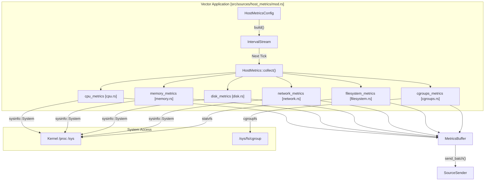
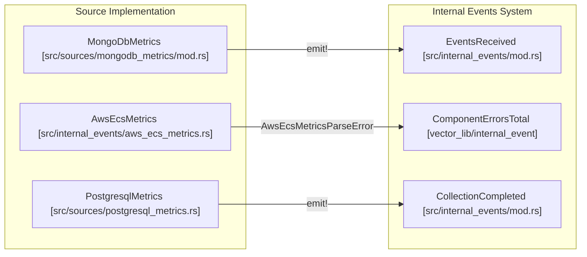

<!-- source: DeepWiki mcp.deepwiki.com · repo vectordotdev/vector · page 4.6 Metrics and Monitoring Sources · fetched 2026-10-29 -->

# Metrics and Monitoring Sources

Relevant source files

The following files were used as context for generating this wiki page:

- [changelog.d/22615_redis_channel_reconnect.fix.md](changelog.d/22615_redis_channel_reconnect.fix.md)
- [src/internal_events/apache_metrics.rs](src/internal_events/apache_metrics.rs)
- [src/internal_events/aws_ecs_metrics.rs](src/internal_events/aws_ecs_metrics.rs)
- [src/internal_events/dnstap.rs](src/internal_events/dnstap.rs)
- [src/internal_events/docker_logs.rs](src/internal_events/docker_logs.rs)
- [src/internal_events/eventstoredb_metrics.rs](src/internal_events/eventstoredb_metrics.rs)
- [src/internal_events/exec.rs](src/internal_events/exec.rs)
- [src/internal_events/file.rs](src/internal_events/file.rs)
- [src/internal_events/kafka.rs](src/internal_events/kafka.rs)
- [src/internal_events/kubernetes_logs.rs](src/internal_events/kubernetes_logs.rs)
- [src/internal_events/mongodb_metrics.rs](src/internal_events/mongodb_metrics.rs)
- [src/internal_events/nginx_metrics.rs](src/internal_events/nginx_metrics.rs)
- [src/internal_events/postgresql_metrics.rs](src/internal_events/postgresql_metrics.rs)
- [src/internal_events/prometheus.rs](src/internal_events/prometheus.rs)
- [src/internal_events/redis.rs](src/internal_events/redis.rs)
- [src/sources/demo_logs.rs](src/sources/demo_logs.rs)
- [src/sources/eventstoredb_metrics/mod.rs](src/sources/eventstoredb_metrics/mod.rs)
- [src/sources/exec/mod.rs](src/sources/exec/mod.rs)
- [src/sources/host_metrics/cgroups.rs](src/sources/host_metrics/cgroups.rs)
- [src/sources/host_metrics/cpu.rs](src/sources/host_metrics/cpu.rs)
- [src/sources/host_metrics/disk.rs](src/sources/host_metrics/disk.rs)
- [src/sources/host_metrics/filesystem.rs](src/sources/host_metrics/filesystem.rs)
- [src/sources/host_metrics/memory.rs](src/sources/host_metrics/memory.rs)
- [src/sources/host_metrics/mod.rs](src/sources/host_metrics/mod.rs)
- [src/sources/host_metrics/network.rs](src/sources/host_metrics/network.rs)
- [src/sources/host_metrics/process.rs](src/sources/host_metrics/process.rs)
- [src/sources/host_metrics/temperature.rs](src/sources/host_metrics/temperature.rs)
- [src/sources/mongodb_metrics/mod.rs](src/sources/mongodb_metrics/mod.rs)
- [src/sources/nginx_metrics/mod.rs](src/sources/nginx_metrics/mod.rs)
- [src/sources/postgresql_metrics.rs](src/sources/postgresql_metrics.rs)
- [src/sources/redis/channel.rs](src/sources/redis/channel.rs)
- [src/sources/redis/list.rs](src/sources/redis/list.rs)
- [src/sources/redis/mod.rs](src/sources/redis/mod.rs)
- [website/cue/reference/components/sources/eventstoredb_metrics.cue](website/cue/reference/components/sources/eventstoredb_metrics.cue)
- [website/cue/reference/components/sources/generated/host_metrics.cue](website/cue/reference/components/sources/generated/host_metrics.cue)
- [website/cue/reference/components/sources/host_metrics.cue](website/cue/reference/components/sources/host_metrics.cue)
- [website/cue/reference/components/sources/postgresql_metrics.cue](website/cue/reference/components/sources/postgresql_metrics.cue)

This page details the various sources available in Vector for collecting metrics and monitoring data. It covers host-level metrics (CPU, memory, disk, network, filesystem, cgroups), database-specific metrics (PostgreSQL, MongoDB), web server metrics (Apache, Nginx), EventStoreDB metrics, AWS ECS metrics, and other pull-based metric sources. Additionally, it documents the `demo_logs` source for generating synthetic log data, the `exec` source for subprocess-based ingestion, and the `redis` source.

## Host Metrics (`host_metrics`)

The `host_metrics` source examines system data sources on the local system and generates metrics describing utilization of various system resources, such as CPU, memory, disk, and network utilization [website/cue/reference/components/sources/host_metrics.cue:6-10](). It is highly configurable, allowing users to specify which types of collectors to enable and to apply filtering rules for specific devices, filesystems, or cgroups.

The `HostMetricsConfig` struct [src/sources/host_metrics/mod.rs:102-148]() defines the configuration for this source, including the `scrape_interval_secs` [src/sources/host_metrics/mod.rs:113]() and a list of `collectors` to enable [src/sources/host_metrics/mod.rs:121]().

### Collectors

The `Collector` enum [src/sources/host_metrics/mod.rs:45-85]() specifies the types of metrics that can be gathered:

*   `CGroups`: Linux control group metrics (Linux only) [src/sources/host_metrics/mod.rs:54]().
*   `Cpu`: CPU utilization metrics [src/sources/host_metrics/mod.rs:57]().
*   `Process`: Process utilization metrics [src/sources/host_metrics/mod.rs:60]().
*   `Disk`: Disk I/O utilization metrics [src/sources/host_metrics/mod.rs:63]().
*   `Filesystem`: Filesystem space utilization metrics [src/sources/host_metrics/mod.rs:66]().
*   `Load`: System load average metrics [src/sources/host_metrics/mod.rs:69]().
*   `Host`: General host metrics (e.g., uptime, boot time) [src/sources/host_metrics/mod.rs:72]().
*   `Memory`: Memory utilization metrics [src/sources/host_metrics/mod.rs:75]().
*   `Network`: Network utilization metrics [src/sources/host_metrics/mod.rs:78]().
*   `TCP`: TCP connection metrics (Linux only) [src/sources/host_metrics/mod.rs:81]().
*   `Temperature`: Component temperature metrics [src/sources/host_metrics/mod.rs:84]().

By default, all collectors are enabled, with `CGroups` and `TCP` being conditionally enabled for Linux systems [src/sources/host_metrics/mod.rs:208-232]().

### Configuration and Filtering

Each collector type can have specific configuration options. For example:

*   **CGroups (`CGroupsConfig`)**: Configures the number of hierarchy levels to report metrics for (`levels`), the base cgroup name (`base`), and `FilterList` for including/excluding cgroup name patterns (`groups`) [src/sources/host_metrics/mod.rs:153-183]().
*   **Disk (`disk::DiskConfig`)**: Allows filtering disk devices using `includes` and `excludes` patterns [src/sources/host_metrics/mod.rs:135]().
*   **Filesystem (`filesystem::FilesystemConfig`)**: Provides filtering for devices, filesystems, and mount points [src/sources/host_metrics/mod.rs:139]().
*   **Network (`network::NetworkConfig`)**: Filters network interfaces [src/sources/host_metrics/mod.rs:143]().
*   **Process (`process::ProcessConfig`)**: Filters processes by name [src/sources/host_metrics/mod.rs:147]().

The `FilterList` struct [src/sources/host_metrics/mod.rs:88-100]() is a generic mechanism for including or excluding items based on glob patterns.

### Implementation Details

The `host_metrics` source operates by periodically scraping system information. The `build` method of `HostMetricsConfig` [src/sources/host_metrics/mod.rs:260-270]() creates an asynchronous task that uses `tokio::time::interval` [src/sources/host_metrics/mod.rs:14-15]() to trigger scrapes.

During each scrape, the collection logic iterates through enabled collectors. For example, the `cgroups` collector [src/sources/host_metrics/cgroups.rs]() reads data from the cgroup filesystem (e.g., `cpu.stat`, `memory.current`) and emits metrics like `cgroup_cpu_usage_seconds_total` [website/cue/reference/components/sources/host_metrics.cue:117]() and `cgroup_memory_current_bytes` [website/cue/reference/components/sources/host_metrics.cue:120]().

### Diagram: Host Metrics Data Flow

Sources:
- [src/sources/host_metrics/mod.rs:45-148]()
- [src/sources/host_metrics/mod.rs:208-232]()
- [website/cue/reference/components/sources/host_metrics.cue:6-152]()

## PostgreSQL Metrics (`postgresql_metrics`)

The `postgresql_metrics` source connects to PostgreSQL instances and queries system views.

The `PostgresqlMetricsConfig` struct [src/sources/postgresql_metrics.rs:118-172]() defines:
*   `endpoints`: Connection URIs [src/sources/postgresql_metrics.rs:133]().
*   `include_databases` / `exclude_databases`: POSIX Regex filters [src/sources/postgresql_metrics.rs:148-158]().
*   `scrape_interval_secs`: Interval between scrapes [src/sources/postgresql_metrics.rs:164]().

### Implementation Details

The `build` method [src/sources/postgresql_metrics.rs:197-214]() initializes a `PostgresqlMetrics` instance for each endpoint. The `collect` method executes SQL queries against views such as `pg_stat_database` and `pg_stat_bgwriter` [src/sources/postgresql_metrics.rs:242-290]().

Sources:
- [src/sources/postgresql_metrics.rs:118-172]()
- [src/sources/postgresql_metrics.rs:197-214]()
- [src/sources/postgresql_metrics.rs:242-290]()

## MongoDB Metrics (`mongodb_metrics`)

The `mongodb_metrics` source uses the MongoDB driver to execute commands like `serverStatus`.

The `MongoDbMetricsConfig` struct [src/sources/mongodb_metrics/mod.rs:79-103]() defines:
*   `endpoints`: Connection string URIs [src/sources/mongodb_metrics/mod.rs:88]().
*   `scrape_interval_secs`: Scrape frequency [src/sources/mongodb_metrics/mod.rs:94]().

### Implementation Details

`MongoDbMetrics::new` [src/sources/mongodb_metrics/mod.rs:170-191]() parses endpoints and sets `direct_connection` to true. It uses `get_node_type` via the `isMaster` command [src/sources/mongodb_metrics/mod.rs:193-213]() to determine if the instance is a `Replset`, `Mongos`, or `Mongod`.

Sources:
- [src/sources/mongodb_metrics/mod.rs:79-103]()
- [src/sources/mongodb_metrics/mod.rs:170-191]()
- [src/sources/mongodb_metrics/mod.rs:193-213]()

## Apache and Nginx Metrics

These sources scrape web server status pages.

### Apache Metrics
`ApacheMetricsConfig` scrapes `mod_status` endpoints. It uses `parser::parse` to convert the text response into metrics. It also emits an `up` metric.

### Nginx Metrics
`NginxMetricsConfig` [src/sources/nginx_metrics/mod.rs:64-93]() scrapes the `stub_status` module. It uses a dedicated `parser` [src/sources/nginx_metrics/mod.rs:29]() to handle the specific Nginx status format.

Sources:
- [src/sources/nginx_metrics/mod.rs:64-93]()

## Exec Source (`exec`)

The `exec` source runs a subprocess and collects its output as logs.

`ExecConfig` [src/sources/exec/mod.rs:43-93]() defines the `command`, `mode` (Scheduled or Streaming), and `environment` [src/sources/exec/mod.rs:57-65]().
*   **Scheduled**: Runs the command at fixed intervals [src/sources/exec/mod.rs:111-117]().
*   **Streaming**: Runs the command continuously, optionally respawning on exit [src/sources/exec/mod.rs:123-132]().

It uses `DecoderFramedRead` [src/sources/exec/mod.rs:17]() to parse the subprocess's `stdout` and `stderr` [src/sources/exec/mod.rs:75]().

Sources:
- [src/sources/exec/mod.rs:43-93]()
- [src/sources/exec/mod.rs:111-132]()

## Demo Logs (`demo_logs`)

The `demo_logs` source generates synthetic logs for testing.

`DemoLogsConfig` [src/sources/demo_logs.rs:34-79]() supports multiple `OutputFormat` variants [src/sources/demo_logs.rs:97-140]():
*   `Shuffle`: Randomly picks from a list of `lines` [src/sources/demo_logs.rs:104-111]().
*   `ApacheCommon`, `ApacheError`, `Syslog`, `BsdSyslog`, `Json`.

It uses `demo_logs_source` [src/sources/demo_logs.rs:208-230]() which leverages `tokio::time::interval` [src/sources/demo_logs.rs:218]() and a `Decoder` to produce events.

Sources:
- [src/sources/demo_logs.rs:34-79]()
- [src/sources/demo_logs.rs:97-140]()
- [src/sources/demo_logs.rs:208-230]()

## Redis Source (`redis`)

The `redis` source collects observability data from Redis using either `list` or `channel` (Pub/Sub) data types [src/sources/redis/mod.rs:91-134]().

### Configuration and Modes
*   **List Mode**: Uses `LPOP` or `RPOP` to pull messages from a Redis list [src/sources/redis/mod.rs:61-71]().
*   **Channel Mode**: Subscribes to a Redis channel for real-time message streaming [src/sources/redis/mod.rs:45-48]().

The `RedisSourceConfig` [src/sources/redis/mod.rs:91-134]() handles connection details via a Redis URL [src/sources/redis/mod.rs:105]() and manages decoding via the standard `DecodingConfig` [src/sources/redis/mod.rs:166]().

Sources:
- [src/sources/redis/mod.rs:37-134]()
- [src/sources/redis/mod.rs:165-191]()

## AWS ECS Metrics (`aws_ecs_metrics`)

The `aws_ecs_metrics` source collects task-level metrics from the Amazon ECS Task Metadata Endpoint.

### Implementation Details
During processing, Vector tracks `AwsEcsMetricsEventsReceived` [src/internal_events/aws_ecs_metrics.rs:10-14]() to monitor the count and byte size of received events. If the JSON response from the metadata endpoint is malformed, an `AwsEcsMetricsParseError` is emitted [src/internal_events/aws_ecs_metrics.rs:39-43](), which increments the `CounterName::ParseErrorsTotal` and `CounterName::ComponentErrorsTotal` [src/internal_events/aws_ecs_metrics.rs:59-66]().

Sources:
- [src/internal_events/aws_ecs_metrics.rs:9-68]()

## Internal Metric Emission and Errors

Vector components use the `internal_event` system to report their own health and performance. For pull-based metrics sources:

1.  **Collection Completion**: Sources emit `CollectionCompleted` [src/sources/postgresql_metrics.rs:41]() [src/sources/mongodb_metrics/mod.rs:26]() to track scrape duration.
2.  **Network Ingress**: `EndpointBytesReceived` [src/sources/postgresql_metrics.rs:41]() tracks the raw payload size from HTTP/database endpoints.
3.  **Parsing Failures**:
    *   `PrometheusParseError` [src/internal_events/prometheus.rs:17-21]() tracks failures in the Prometheus scrape parser.
    *   `PostgresqlMetricsCollectError` [src/internal_events/postgresql_metrics.rs:41]() handles SQL execution or result set parsing errors.
    *   `MongoDbMetricsBsonParseError` [src/internal_events/mongodb_metrics/mod.rs:26]() tracks failures in decoding BSON responses.

### Diagram: Component to Internal Events Mapping

Sources:
- [src/internal_events/prometheus.rs:1-91]()
- [src/sources/postgresql_metrics.rs:37-44]()
- [src/sources/mongodb_metrics/mod.rs:22-29]()
- [src/internal_events/aws_ecs_metrics.rs:39-68]()

---

