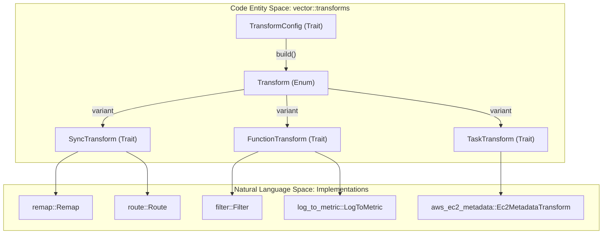
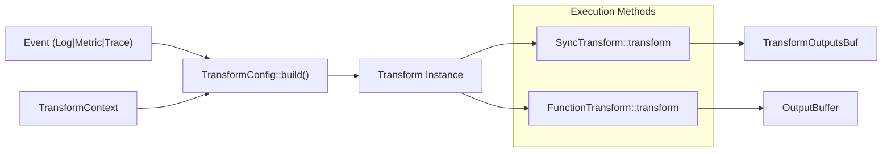
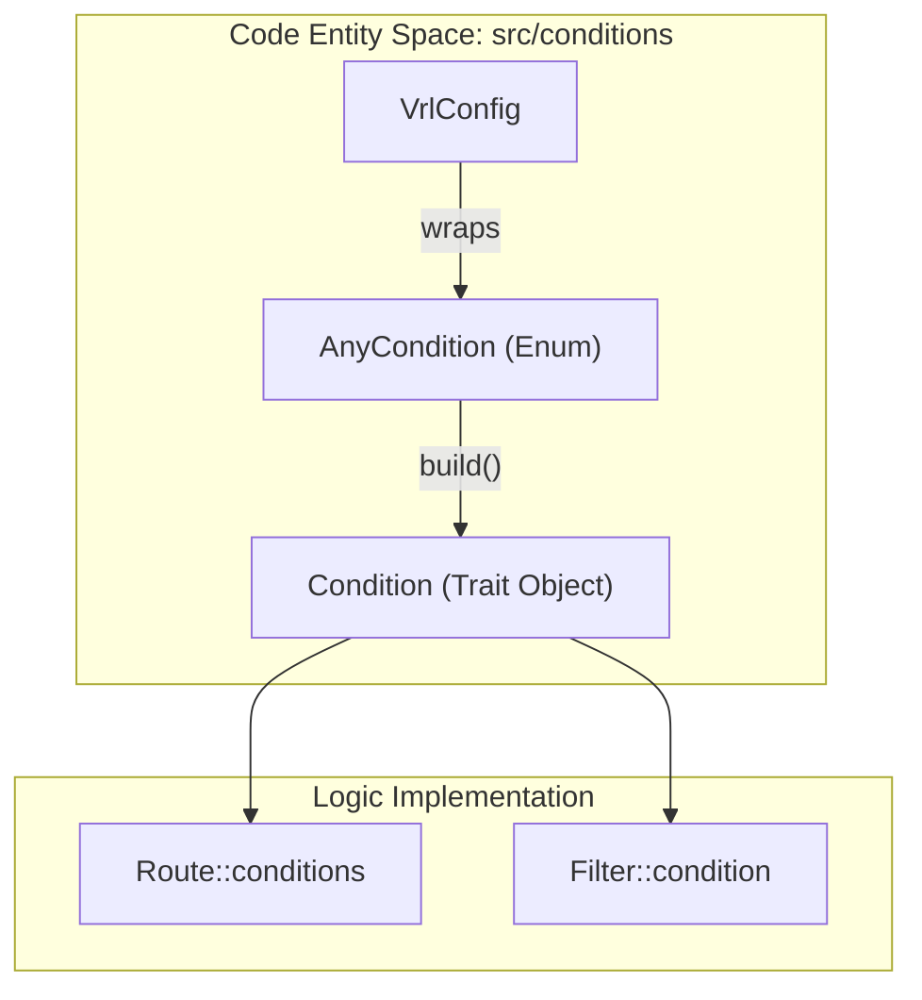

<!-- source: DeepWiki mcp.deepwiki.com · repo vectordotdev/vector · page 5 Transforms · fetched 2026-10-29 -->

# Transforms

Relevant source files

The following files were used as context for generating this wiki page:

- [lib/vector-core/src/event/lua/event.rs](lib/vector-core/src/event/lua/event.rs)
- [lib/vector-core/src/event/lua/log.rs](lib/vector-core/src/event/lua/log.rs)
- [lib/vector-core/src/event/lua/metric.rs](lib/vector-core/src/event/lua/metric.rs)
- [lib/vector-core/src/event/lua/util.rs](lib/vector-core/src/event/lua/util.rs)
- [src/config/transform.rs](src/config/transform.rs)
- [src/config/validation.rs](src/config/validation.rs)
- [src/internal_events/encoding_transcode.rs](src/internal_events/encoding_transcode.rs)
- [src/internal_events/filter.rs](src/internal_events/filter.rs)
- [src/internal_events/log_to_metric.rs](src/internal_events/log_to_metric.rs)
- [src/test_util/mock/transforms/noop.rs](src/test_util/mock/transforms/noop.rs)
- [src/topology/test/cpu_metrics.rs](src/topology/test/cpu_metrics.rs)
- [src/transforms/aws_ec2_metadata.rs](src/transforms/aws_ec2_metadata.rs)
- [src/transforms/delay.rs](src/transforms/delay.rs)
- [src/transforms/exclusive_route/config.rs](src/transforms/exclusive_route/config.rs)
- [src/transforms/filter.rs](src/transforms/filter.rs)
- [src/transforms/log_to_metric.rs](src/transforms/log_to_metric.rs)
- [src/transforms/lua/mod.rs](src/transforms/lua/mod.rs)
- [src/transforms/lua/v1/mod.rs](src/transforms/lua/v1/mod.rs)
- [src/transforms/lua/v2/mod.rs](src/transforms/lua/v2/mod.rs)
- [src/transforms/metric_to_log.rs](src/transforms/metric_to_log.rs)
- [src/transforms/reduce/config.rs](src/transforms/reduce/config.rs)
- [src/transforms/reduce/mod.rs](src/transforms/reduce/mod.rs)
- [src/transforms/remap.rs](src/transforms/remap.rs)
- [src/transforms/route.rs](src/transforms/route.rs)
- [src/transforms/sample/config.rs](src/transforms/sample/config.rs)
- [src/transforms/throttle/config.rs](src/transforms/throttle/config.rs)
- [src/transforms/window/config.rs](src/transforms/window/config.rs)
- [website/cue/reference/components/transforms/aws_ec2_metadata.cue](website/cue/reference/components/transforms/aws_ec2_metadata.cue)

Transforms are the core data processing components in Vector that modify, filter, route, or convert events as they flow through the observability pipeline. This document covers the transform system architecture, the Vector Remap Language (VRL) used for data manipulation, and the various built-in transform types.

For information about sources that generate events, see [Sources](#4). For information about sinks that export processed events, see [Sinks](#6).

## Transform System Architecture

Vector's transform system processes events through a standardized interface while supporting different execution models and capabilities. Transforms are defined by their configuration and built into operational units that handle event flow.

### Transform Types and Traits

The transform system is built around several core traits that define different execution patterns:

| Trait | Description | Implementation Example |
| :--- | :--- | :--- |
| `SyncTransform` | Synchronous transformation logic. | `Route` [src/transforms/route.rs:40-40]() |
| `FunctionTransform` | A simpler function-based interface for event-in, event-out. | `Filter` [src/transforms/filter.rs:94-94]() |
| `TaskTransform` | Asynchronous stream-based transformation. | `Lua` (v1) [src/transforms/lua/v1/mod.rs:195-195]() |
| `TransformConfig` | The configuration trait used to build the transform instance. | `RemapConfig` [src/transforms/remap.rs:62-62]() |

Sources: [src/config/transform.rs:28-28](), [src/transforms/remap.rs:47-48](), [src/transforms/route.rs:40-40](), [src/transforms/filter.rs:94-94](), [src/transforms/aws_ec2_metadata.rs:38-38]()

### Event Processing Pipeline

Transforms operate on `Event` objects that can contain logs, metrics, or traces. The transformation process involves taking an input event and pushing one or more resulting events into a `TransformOutputsBuf` [src/transforms/route.rs:41-41]() or `OutputBuffer` [src/transforms/filter.rs:95-95]().

Sources: [src/config/transform.rs:128-165](), [src/transforms/route.rs:41-41](), [src/transforms/filter.rs:95-95]()

## Built-in Transform Types

### Remap Transform
The `remap` transform is the primary data transformation component, using Vector Remap Language (VRL) for event processing. It allows for complex logic, field manipulation, and type conversion. It supports features like `drop_on_error`, `drop_on_abort`, and `reroute_dropped` [src/transforms/remap.rs:117-156](). For details, see [Remap Transform](#5.1).

Sources: [src/transforms/remap.rs:54-62](), [src/transforms/remap.rs:158-160]()

### VRL Language
The Vector Remap Language (VRL) is a domain-specific language designed for processing observability data. It provides a high-performance, expression-based syntax for manipulating events. VRL integrates with Vector via the `VrlTarget` adapter [src/transforms/remap.rs:43-43](). For details, see [VRL Language](#5.2).

Sources: [src/transforms/remap.rs:25-35](), [src/transforms/remap.rs:63-73]()

### VRL Standard Library
The VRL standard library offers over 200 functions for tasks including parsing (JSON, Syslog, Grok), encoding, hashing, and semantic meaning assignment via `set_semantic_meaning` [src/transforms/remap.rs:23-23](). For details, see [VRL Standard Library](#5.3).

Sources: [src/transforms/remap.rs:68-71]()

### Other Transforms
Vector includes a variety of specialized transforms for specific use cases. For details, see [Other Transforms](#5.4).

| Transform | Purpose | Configuration Struct |
| :--- | :--- | :--- |
| `filter` | Drops events that do not match a condition. | `FilterConfig` [src/transforms/filter.rs:23-23]() |
| `route` | Splits a stream into multiple named outputs based on conditions. | `RouteConfig` [src/transforms/route.rs:64-64]() |
| `log_to_metric` | Derives metrics from log fields. | `LogToMetricConfig` [src/transforms/log_to_metric.rs:45-45]() |
| `metric_to_log` | Converts metric events to log events. | `MetricToLogConfig` [src/transforms/metric_to_log.rs:33-33]() |
| `aws_ec2_metadata` | Enriches events with AWS instance metadata. | `Ec2Metadata` [src/transforms/aws_ec2_metadata.rs:98-98]() |
| `sample` | Reduces event volume by sampling traffic. | `SampleConfig` [src/transforms/sample/config.rs:58-58]() |
| `lua` (v2) | Custom processing using Lua scripts. | `LuaConfig` [src/transforms/lua/v2/mod.rs:76-76]() |

## Conditions System

Vector uses a unified `Condition` system to evaluate events. These conditions are used extensively in `filter` and `route` transforms. Conditions can be based on VRL expressions, field existence, or type checks.

Sources: [src/transforms/route.rs:21-21](), [src/transforms/filter.rs:81-81](), [src/transforms/route.rs:91-91]()

## Internal Event Monitoring

Transforms emit internal events to monitor performance and operational health. For example, the `remap` transform emits `RemapMappingError` and `RemapMappingAbort` when processing fails [src/transforms/remap.rs:45-45](), while the `filter` transform tracks `FilterEventsDropped` [src/transforms/filter.rs:82-82]().

Sources: [src/transforms/filter.rs:14-14](), [src/transforms/aws_ec2_metadata.rs:36-36](), [src/transforms/metric_to_log.rs:23-23]()

---

