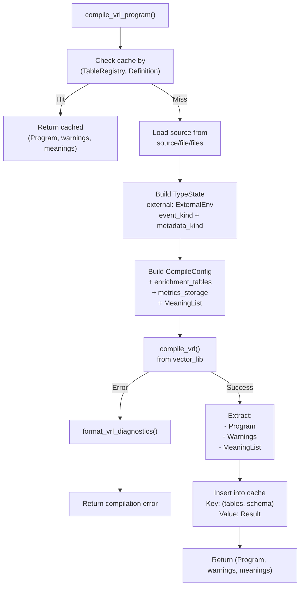
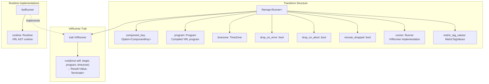
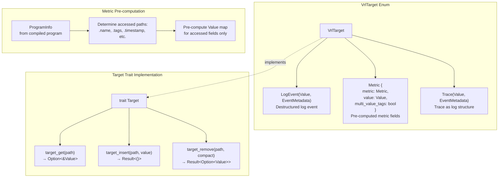
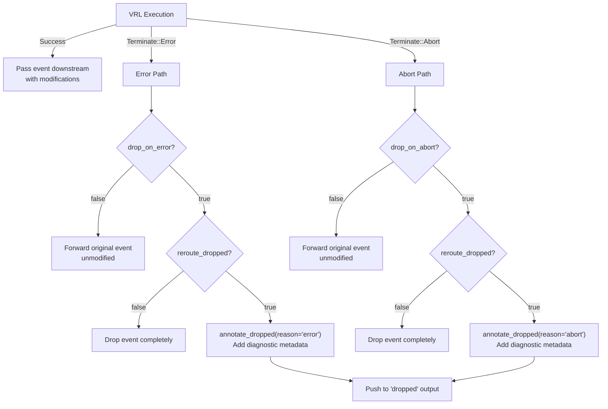
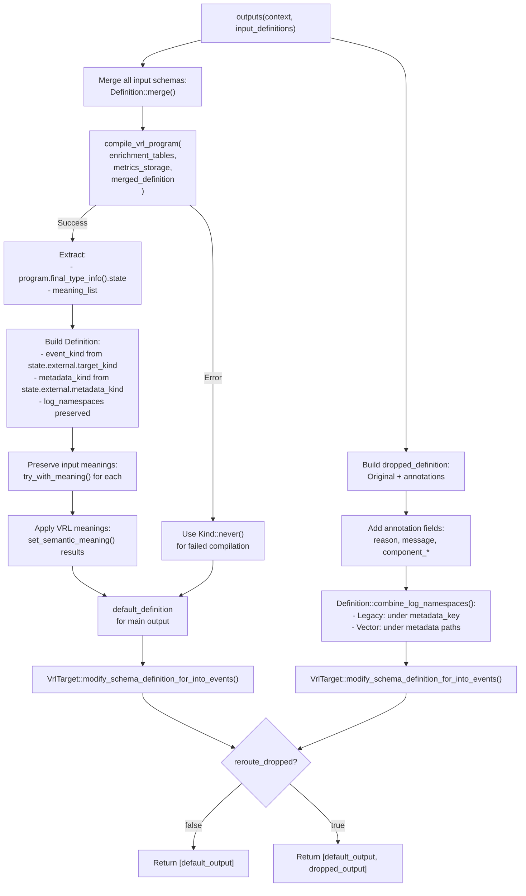
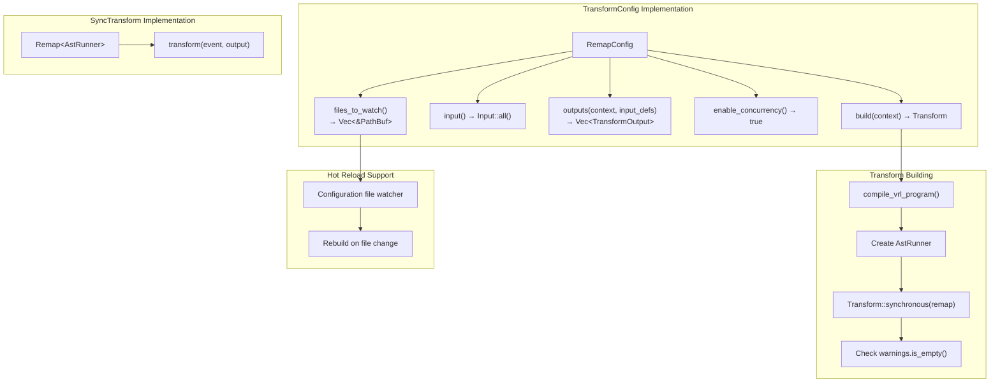

<!-- source: DeepWiki mcp.deepwiki.com · repo vectordotdev/vector · page 5.1 Remap Transform · fetched 2026-10-29 -->

# Remap Transform

<details>
<summary>Relevant source files</summary>

The following files were used as context for generating this wiki page:

- [src/config/transform.rs](src/config/transform.rs)
- [src/config/validation.rs](src/config/validation.rs)
- [src/transforms/delay.rs](src/transforms/delay.rs)
- [src/transforms/exclusive_route/config.rs](src/transforms/exclusive_route/config.rs)
- [src/transforms/reduce/config.rs](src/transforms/reduce/config.rs)
- [src/transforms/remap.rs](src/transforms/remap.rs)
- [src/transforms/route.rs](src/transforms/route.rs)
- [src/transforms/sample/config.rs](src/transforms/sample/config.rs)
- [src/transforms/throttle/config.rs](src/transforms/throttle/config.rs)
- [src/transforms/window/config.rs](src/transforms/window/config.rs)

</details>


## Purpose and Scope

The Remap transform is Vector's primary data transformation component that executes [Vector Remap Language](website/cue/reference/remap.cue)() (VRL) programs against observability events. It provides compile-time type checking, schema inference, and flexible error handling for modifying logs, metrics, and traces as they flow through the topology.

For information about the VRL language itself, see [VRL Language](#5.2). For other transform types, see [Other Transforms](#5.4). For VRL standard library functions, see [VRL Standard Library](#5.3).

## Configuration Structure

The `RemapConfig` structure defines all configuration options for the remap transform.

```mermaid
graph TB
    RemapConfig["RemapConfig"]
    RemapConfig --> source["source: Option&lt;String&gt;<br/>Inline VRL program"]
    RemapConfig --> file["file: Option&lt;PathBuf&gt;<br/>Single VRL file path"]
    RemapConfig --> files["files: Option&lt;Vec&lt;PathBuf&gt;&gt;<br/>Multiple VRL file paths"]
    RemapConfig --> metric_tag_values["metric_tag_values: MetricTagValues<br/>Single or Full tag exposure"]
    RemapConfig --> timezone["timezone: Option&lt;TimeZone&gt;<br/>Override global timezone"]
    RemapConfig --> drop_on_error["drop_on_error: bool<br/>Drop events on VRL errors"]
    RemapConfig --> drop_on_abort["drop_on_abort: bool<br/>Drop events on VRL abort"]
    RemapConfig --> reroute_dropped["reroute_dropped: bool<br/>Route dropped to named output"]
    RemapConfig --> runtime["runtime: VrlRuntime<br/>AST runtime type"]
    RemapConfig --> cache["cache: Mutex&lt;Vec&gt;<br/>Program compilation cache"]
```



**Configuration Validation**: Exactly one of `source`, `file`, or `files` must be provided [src/transforms/remap.rs:72-92](). Multiple files are concatenated with newlines during compilation [src/transforms/remap.rs:207-210]().

Sources: [src/transforms/remap.rs:51-164]()

### Configuration Fields

| Field | Type | Default | Description |
|-------|------|---------|-------------|
| `source` | `Option<String>` | None | Inline VRL program text [src/transforms/remap.rs:72]() |
| `file` | `Option<PathBuf>` | None | Path to single VRL file [src/transforms/remap.rs:82]() |
| `files` | `Option<Vec<PathBuf>>` | None | Paths to multiple VRL files [src/transforms/remap.rs:92]() |
| `metric_tag_values` | `MetricTagValues` | Single | Tag value exposure mode [src/transforms/remap.rs:101]() |
| `timezone` | `Option<TimeZone>` | Global | Timezone for conversions [src/transforms/remap.rs:113]() |
| `drop_on_error` | `bool` | false | Drop events on error [src/transforms/remap.rs:127]() |
| `drop_on_abort` | `bool` | true | Drop events on abort [src/transforms/remap.rs:141]() |
| `reroute_dropped` | `bool` | false | Reroute to "dropped" output [src/transforms/remap.rs:154]() |
| `runtime` | `VrlRuntime` | Ast | Runtime implementation [src/transforms/remap.rs:158]() |
| `cache` | `Mutex<Vec>` | Empty | Compilation cache [src/transforms/remap.rs:166]() |

Sources: [src/transforms/remap.rs:59-164]()

## VRL Program Compilation and Caching

The compilation process converts VRL source code into an executable `Program` with type information and semantic meanings.



**Compilation Steps** at [src/transforms/remap.rs:184-244]():

1. **Cache Lookup**: Check if program was already compiled for this combination of enrichment tables and input schema [src/transforms/remap.rs:191-198]().
2. **Source Loading**: Load from `source`, `file`, or concatenate `files` [src/transforms/remap.rs:200-213]().
3. **Type State Creation**: Build `TypeState` with input event and metadata kinds from schema definition [src/transforms/remap.rs:215-223]().
4. **Config Setup**: Configure compiler with custom settings [src/transforms/remap.rs:225-231]():
   - Enrichment tables for lookups
   - Metrics storage for VRL metrics
   - `MeaningList` to track semantic meanings set by VRL
5. **Compilation**: Call `compile_vrl()` with vector-specific functions [src/transforms/remap.rs:232]().
6. **Result Handling**: Extract program, warnings, and meanings; cache the result [src/transforms/remap.rs:234-243]().
7. **Error Formatting**: Format diagnostics into human-readable errors [src/transforms/remap.rs:245-250]().

**Cache Key**: The cache uses `(TableRegistry, schema::Definition)` as the key to ensure programs are recompiled when input schemas or enrichment tables change [src/transforms/remap.rs:51]().

Sources: [src/transforms/remap.rs:184-244](), [src/transforms/remap.rs:48-49]()

## Runtime Execution Architecture

The remap transform uses a trait-based architecture to abstract VRL program execution.



**VrlRunner Trait** at [src/transforms/remap.rs:415-422]():
- Abstracts VRL program execution.
- Single method: `run(&mut self, target: &mut VrlTarget, program: &Program, timezone: &TimeZone)`.
- Returns `Result<Value, Terminate>` where `Terminate` enum covers errors and aborts.

**AstRunner Implementation** at [src/transforms/remap.rs:424-448]():
- Uses VRL's `Runtime::resolve()` for AST interpretation [src/transforms/remap.rs:439]().
- Clears runtime state after each execution to prevent state leakage between events [src/transforms/remap.rs:441]().
- Implements `Clone` by creating fresh `Runtime` instances [src/transforms/remap.rs:426-430]().

Sources: [src/transforms/remap.rs:400-448]()

## Event Processing Flow

The `SyncTransform` implementation orchestrates event transformation with error handling and schema preservation.

```mermaid
graph TB
    Start["transform(event, output)"]
    Start --> CheckNeeds["Check if cloning needed:<br/>fallible && forward_on_error<br/>|| abortable && forward_on_abort"]
    CheckNeeds -->|Yes| CloneEvent["Clone original event<br/>for potential restoration"]
    CheckNeeds -->|No| NoClone["Skip cloning<br/>original_event = None"]
    CloneEvent --> GetNamespace["Get log_namespace<br/>from event"]
    NoClone --> GetNamespace
    GetNamespace --> CreateTarget["VrlTarget::new(event, program.info(),<br/>multi_value_metric_tags)"]
    CreateTarget --> RunVRL["run_vrl(&mut target)"]
    
    RunVRL -->|Ok(value)| ConvertBack["target.into_events(log_namespace)"]
    ConvertBack --> CheckType{"Event type?"}
    CheckType -->|One| PushOne["push_default(event, output)"]
    CheckType -->|Logs| PushLogs["Iterate and push logs"]
    CheckType -->|Traces| PushTraces["Iterate and push traces"]
    
    RunVRL -->|Err(Terminate)| CheckTerminate{"Terminate type?"}
    CheckTerminate -->|Abort| HandleAbort["drop = drop_on_abort<br/>emit RemapMappingAbort"]
    HandleAbort --> CheckDrop{"Drop event?"}
    CheckTerminate -->|Error| HandleError["drop = drop_on_error<br/>emit RemapMappingError"]
    HandleError --> CheckDrop
    CheckDrop -->|No| RestoreOriginal["Use original_event<br/>push_default()"]
    CheckDrop -->|Yes, reroute| AnnotateDropped["annotate_dropped()<br/>push_dropped()"]
    CheckDrop -->|Yes, no reroute| DiscardEvent["Discard event"]
```

**Key Decision Points**:

1. **Clone Optimization** at [src/transforms/remap.rs:579-587](): Only clone original event if program can fail/abort AND the event would be forwarded on failure.
2. **VrlTarget Creation** at [src/transforms/remap.rs:594-601](): Converts `Event` to `VrlTarget` with program metadata.
3. **Result Handling** at [src/transforms/remap.rs:604-644](): Routes based on success/error/abort.

**Event Array Handling**: When VRL assigns an array to `.`, the transform emits multiple events. The `into_events()` method handles this conversion [lib/vector-core/src/event/vrl_target.rs:145-183]().

Sources: [src/transforms/remap.rs:564-646](), [lib/vector-core/src/event/vrl_target.rs:145-183]()

### VrlTarget Event Adapter

The `VrlTarget` bridges Vector's event model with VRL's execution model.



**Pre-computation Strategy** at [lib/vector-core/src/event/vrl_target.rs:110-119]():
- For metrics, the `precompute_metric_value()` function creates a `Value` representation.
- Uses `ProgramInfo` to determine which fields the VRL program accesses.
- Only computes accessed fields to minimize overhead.
- Supports both single-value and multi-value tag modes.

**Path Validation** at [lib/vector-core/src/event/vrl_target.rs:280-467]():
- Metrics only support specific paths: `.name`, `.namespace`, `.timestamp`, `.kind`, `.tags`, `.type` [lib/vector-core/src/event/vrl_target.rs:23-27]().
- Invalid paths return errors at runtime.
- Uses `MAX_METRIC_PATH_DEPTH` constant (3) to limit path traversal [lib/vector-core/src/event/vrl_target.rs:33]().

Sources: [lib/vector-core/src/event/vrl_target.rs:102-198](), [lib/vector-core/src/event/vrl_target.rs:279-467]()

## Error Handling and Dropped Events

The remap transform provides granular control over event fate when VRL execution fails.



**Error Annotation** at [src/transforms/remap.rs:513-557]():

The `annotate_dropped()` method adds diagnostic metadata to dropped events based on log namespace:

**Legacy Namespace**: Inserts under `metadata.dropped` (if metadata key is configured) [src/transforms/remap.rs:536-545]().

**Vector Namespace**: Inserts under `vector.dropped` metadata path [src/transforms/remap.rs:519-528]().

**Metrics**: Adds as tags under `metadata.dropped.*` prefix [src/transforms/remap.rs:548-554]().

Sources: [src/transforms/remap.rs:497-557](), [src/transforms/remap.rs:612-643]()

### Configuration Combinations

| drop_on_error | drop_on_abort | reroute_dropped | Behavior on Error | Behavior on Abort |
|---------------|---------------|-----------------|-------------------|-------------------|
| false | false | false | Forward original | Forward original |
| false | false | true | Forward original | Forward original |
| true | false | false | Drop | Forward original |
| true | false | true | Route to "dropped" | Forward original |
| false | true | false | Forward original | Drop |
| false | true | true | Forward original | Route to "dropped" |
| true | true | false | Drop | Drop |
| true | true | true | Route to "dropped" | Route to "dropped" |

**Default Configuration**: `drop_on_error = false`, `drop_on_abort = true`, `reroute_dropped = false` [src/transforms/remap.rs:125-154]().

Sources: [src/transforms/remap.rs:122-151]()

## Schema Inference and Output Definition

The remap transform performs compile-time schema inference to determine output event schemas.



**Schema Inference Process** at [src/transforms/remap.rs:284-386]():

1. **Input Merging**: Combines schemas from all upstream components [src/transforms/remap.rs:287-291]().
2. **VRL Compilation**: Compiles program against merged input to determine output types [src/transforms/remap.rs:293-298]().
3. **Type Extraction**: Gets `TypeState` from `program.final_type_info()` [src/transforms/remap.rs:302-303]().
4. **Meaning Preservation**: Attempts to preserve semantic meanings from input [src/transforms/remap.rs:314-326]().
5. **Meaning Application**: Applies new meanings set via `set_semantic_meaning()` in VRL [src/transforms/remap.rs:328-331]().
6. **Array Handling**: Applies `modify_schema_definition_for_into_events()` transformation [src/transforms/remap.rs:376-379]().

**Array Schema Modification** at [lib/vector-core/src/event/vrl_target.rs:129-247]():
- When VRL assigns array to `.`, elements become separate events.
- `merge_array_definitions()`: Merges array element types with non-array types.
- `move_field_definitions_into_message()`: For Legacy namespace, moves non-object values to `message` field.

**Dropped Event Schema** at [src/transforms/remap.rs:343-373]():
- Starts with input schema.
- Adds annotation fields under appropriate namespace.
- Creates separate schema definition for "dropped" output port.

Sources: [src/transforms/remap.rs:284-386](), [lib/vector-core/src/event/vrl_target.rs:129-247]()

### Semantic Meanings

VRL programs can set semantic meanings using the `set_semantic_meaning()` function. The `MeaningList` custom config object tracks these assignments during compilation [src/transforms/remap.rs:23]():
- Stored in `CompileConfig` as custom data [src/transforms/remap.rs:226]().
- Extracted after compilation at [src/transforms/remap.rs:234]().
- Applied to output schema definition at [src/transforms/remap.rs:328-331]().

Sources: [src/transforms/remap.rs:226](), [src/transforms/remap.rs:234]()

## Integration with Transform System

The remap transform implements Vector's `TransformConfig` and `SyncTransform` traits.



**Key Implementations**:

| Trait Method | Return Value | Purpose |
|--------------|--------------|---------|
| `build()` | `Transform` | Compiles VRL, creates runtime, wraps in `Transform::synchronous()` [src/transforms/remap.rs:258-282]() |
| `input()` | `Input::all()` | Accepts all event types (logs, metrics, traces) [src/transforms/remap.rs:255]() |
| `outputs()` | `Vec<TransformOutput>` | Returns 1-2 outputs (default + optional "dropped") [src/transforms/remap.rs:284-386]() |
| `enable_concurrency()` | `true` | Allows parallel execution of transform instances [src/transforms/remap.rs:388-390]() |
| `files_to_watch()` | `Vec<&PathBuf>` | Returns file paths for hot reload monitoring [src/transforms/remap.rs:392-397]() |
| `transform()` | `void` | Processes single event, pushes to output buffer [src/transforms/remap.rs:564-646]() |

**Concurrency**: The transform enables concurrency at [src/transforms/remap.rs:388-390]() because VRL programs are pure and each `Remap` instance has its own `Runtime`.

**Hot Reload**: The `files_to_watch()` method at [src/transforms/remap.rs:392-397]() returns all configured file paths, enabling automatic topology reload when VRL files change.

Sources: [src/transforms/remap.rs:258-398](), [src/transforms/remap.rs:564-646]()

## Program Caching Strategy

The compilation cache optimizes repeated builds with identical inputs.

**Cache Structure** at [src/transforms/remap.rs:48-49]():
```rust
type CacheKey = (TableRegistry, schema::Definition);
type CacheValue = (Program, String, MeaningList);
```

**Cache Behavior**:
- Uses `Mutex<Vec>` rather than `HashMap` to avoid deep comparison of `TableRegistry` [src/transforms/remap.rs:163-166]().
- Key includes both enrichment tables and input schema [src/transforms/remap.rs:51]().
- Value stores successful compilation or error string [src/transforms/remap.rs:52]().
- Linear search through cache entries [src/transforms/remap.rs:191-198]().

**Cache Invalidation**: Cache entries become stale when enrichment table contents or input schemas change. The `Clone` implementation creates a fresh empty cache [src/transforms/remap.rs:170-181]().

Sources: [src/transforms/remap.rs:48-52](), [src/transforms/remap.rs:163-181](), [src/transforms/remap.rs:190-198]()

---

