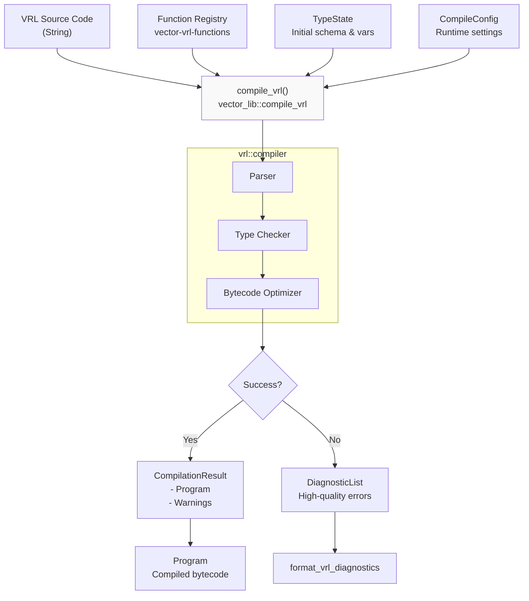
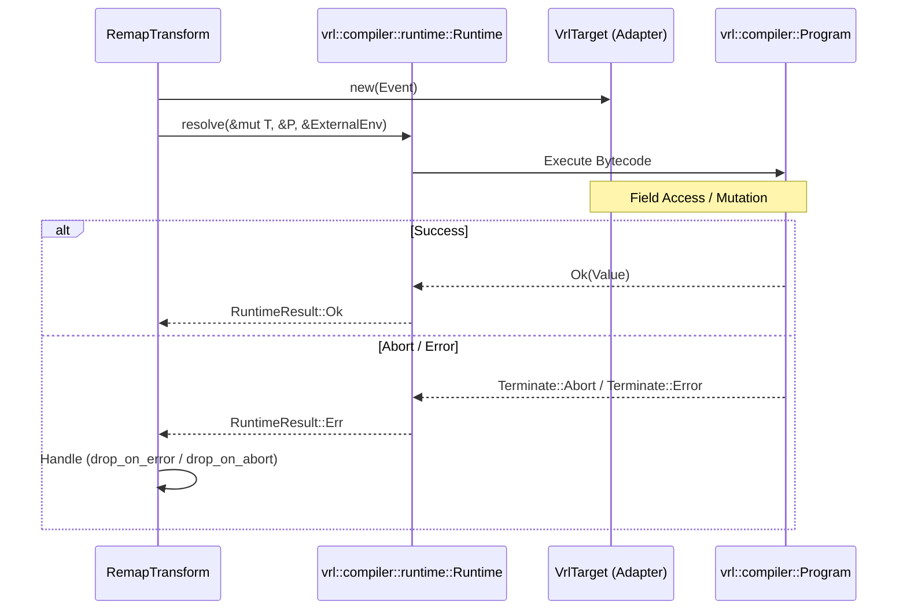

<!-- source: DeepWiki mcp.deepwiki.com · repo vectordotdev/vector · page 5.2 VRL Language · fetched 2026-10-29 -->

# VRL Language

Relevant source files

The following files were used as context for generating this wiki page:

- [lib/vector-vrl/cli/Cargo.toml](lib/vector-vrl/cli/Cargo.toml)
- [lib/vector-vrl/functions/Cargo.toml](lib/vector-vrl/functions/Cargo.toml)
- [lib/vector-vrl/tests/Cargo.toml](lib/vector-vrl/tests/Cargo.toml)
- [lib/vector-vrl/web-playground/Cargo.toml](lib/vector-vrl/web-playground/Cargo.toml)
- [lib/vector-vrl/web-playground/build.rs](lib/vector-vrl/web-playground/build.rs)
- [lib/vector-vrl/web-playground/public/assets/dd_icon_rgb.svg](lib/vector-vrl/web-playground/public/assets/dd_icon_rgb.svg)
- [lib/vector-vrl/web-playground/public/index.css](lib/vector-vrl/web-playground/public/index.css)
- [lib/vector-vrl/web-playground/public/index.html](lib/vector-vrl/web-playground/public/index.html)
- [lib/vector-vrl/web-playground/public/index.js](lib/vector-vrl/web-playground/public/index.js)
- [lib/vector-vrl/web-playground/src/lib.rs](lib/vector-vrl/web-playground/src/lib.rs)
- [src/config/transform.rs](src/config/transform.rs)
- [src/config/validation.rs](src/config/validation.rs)
- [src/transforms/delay.rs](src/transforms/delay.rs)
- [src/transforms/exclusive_route/config.rs](src/transforms/exclusive_route/config.rs)
- [src/transforms/reduce/config.rs](src/transforms/reduce/config.rs)
- [src/transforms/remap.rs](src/transforms/remap.rs)
- [src/transforms/route.rs](src/transforms/route.rs)
- [src/transforms/sample/config.rs](src/transforms/sample/config.rs)
- [src/transforms/throttle/config.rs](src/transforms/throttle/config.rs)
- [src/transforms/window/config.rs](src/transforms/window/config.rs)

## Purpose and Scope

This page documents **Vector's integration of the VRL (Vector Remap Language) compilation and runtime system**. VRL is a domain-specific language designed specifically for observability data transformation, prioritizing safety and performance. This page covers Vector's integration layer:

- The `compile_vrl` wrapper and the compilation pipeline.
- `VrlTarget` adapter for mapping Vector `Event` types to VRL `Value` types.
- Runtime execution patterns in transforms (`remap`) and conditions (`vrl`).
- Integration with external environments like Enrichment Tables and Metrics.
- Developer tools including the VRL CLI and Web Playground.

**Scope Boundaries:**
- **VRL standard library functions**: See [VRL Standard Library](#5.3) for documentation on the 200+ built-in functions.
- **Remap transform configuration**: See [Remap Transform](#5.1) for specific component settings.

Sources: [src/transforms/remap.rs:13-35](), [src/transforms/remap.rs:62-115]()

---

## VRL Compilation Pipeline

### Compilation Flow

**Compilation Flow Diagram**: VRL source code is transformed into executable bytecode through a pipeline that enforces type handling before execution begins. Vector uses `format_vrl_diagnostics` to present compiler errors in a human-readable format.

Sources: [src/transforms/remap.rs:16-27](), [src/transforms/remap.rs:44-44](), [src/transforms/remap.rs:165-175]()

### The `compile_vrl` Integration
Vector wraps the `vrl` crate's compilation API. Components like `RemapConfig` use this to prepare scripts during the topology build phase.

- **TypeState**: Tracks the schema of the event (`.`) and metadata (`%`) at compile time [src/transforms/remap.rs:27-27]().
- **CompileConfig**: Injected with external state like the `TableRegistry` and `MetricsStorage` into the compiler environment [src/transforms/remap.rs:26-30]().
- **Program Caching**: The `remap` transform implements a caching mechanism (`CacheKey` and `CacheValue`) to avoid re-compiling scripts when schema definitions or enrichment tables haven't changed [src/transforms/remap.rs:51-53]().

Sources: [src/transforms/remap.rs:25-35](), [src/transforms/remap.rs:165-175]()

---

## Event Data Mapping: `VrlTarget`

VRL operates on `vrl::value::Value` types, while Vector uses `Event` (Log, Metric, Trace). The `VrlTarget` enum acts as the bridge.

| Vector Type | VRL Representation | Implementation Details |
| :--- | :--- | :--- |
| **LogEvent** | `Value::Object` | Direct mapping of fields to the VRL root `.` [src/transforms/remap.rs:43-43](). |
| **Metric** | Precomputed `Value` | Metric fields are precomputed into a `Value` structure for performance, respecting `MetricTagValues` settings [src/transforms/remap.rs:91-103](). |
| **TraceEvent** | `Value::Object` | Fields are wrapped in a `Value::Object` for VRL manipulation [src/transforms/remap.rs:43-43](). |

### Runtime Environment Configuration
The `RemapConfig` struct allows fine-tuning how VRL interacts with events, such as setting the default `timezone` for timestamp conversions [src/transforms/remap.rs:105-115]() and defining how metric tags are exposed (`single`, `full`, or `auto`) [src/transforms/remap.rs:91-103]().

Sources: [src/transforms/remap.rs:43-43](), [src/transforms/remap.rs:91-115]()

---

## Runtime Execution

### Execution Sequence

**Execution Flow**: The `Runtime` executes the compiled `Program` against a `VrlTarget`. In the `remap` transform, if an error or abort occurs, the component checks `drop_on_error` [src/transforms/remap.rs:117-129]() or `drop_on_abort` [src/transforms/remap.rs:131-143]() to determine if the event should be discarded or rerouted.

Sources: [src/transforms/remap.rs:25-35](), [src/transforms/remap.rs:117-156]()

---

## External Integrations

### Enrichment Tables
VRL programs access Vector's `TableRegistry` during both compilation (for type checking) and runtime (for data retrieval).
- **Registry**: `vector_lib::enrichment::TableRegistry` [src/transforms/remap.rs:19-19]().
- **Integration**: Passed into the `TransformContext` and used as part of the `CacheKey` for compiled programs [src/transforms/remap.rs:51-51](), [src/config/transform.rs:136-136]().

Sources: [src/transforms/remap.rs:19-19](), [src/transforms/remap.rs:51-51](), [src/config/transform.rs:136-136]()

### Metrics Integration
VRL can interact with Vector's internal metrics via `MetricsStorage`.
- **Storage**: `vector_vrl_metrics::MetricsStorage` [src/transforms/remap.rs:24-24]().
- **Integration**: The `TransformContext` carries `metrics_storage` to components like `remap`, `route`, and `reduce`, allowing VRL conditions and programs to access metrics state [src/config/transform.rs:138-138](), [src/transforms/route.rs:30-30](), [src/transforms/reduce/config.rs:122-122]().

Sources: [src/transforms/remap.rs:24-24](), [src/config/transform.rs:138-138](), [src/transforms/route.rs:30-30](), [src/transforms/reduce/config.rs:122-122]()

---

## Developer Tools

### VRL CLI
The `vector-vrl-cli` is a standalone tool for testing VRL expressions.
- **Crate**: `lib/vector-vrl/cli`
- **Purpose**: Provides a CLI for executing VRL scripts.
- **Stdlib**: Includes the full VRL standard library by default [lib/vector-vrl/cli/Cargo.toml:13-14]().

Sources: [lib/vector-vrl/cli/Cargo.toml:1-20]()

### VRL Web Playground
A WebAssembly-powered browser application for experimenting with VRL.
- **Implementation**: Uses `wasm-bindgen` to expose `run_vrl` and version info to JavaScript [lib/vector-vrl/web-playground/Cargo.toml:22-22](), [lib/vector-vrl/web-playground/public/index.js:77-81]().
- **Editors**: Integrated with Monaco Editor for syntax highlighting and linting [lib/vector-vrl/web-playground/public/index.js:83-112]().
- **Features**: Supports JSON input events, real-time compilation, and history tracking via `HISTORY_STORAGE_KEY` [lib/vector-vrl/web-playground/public/index.js:21-30](), [lib/vector-vrl/web-playground/public/index.js:131-145]().

Sources: [lib/vector-vrl/web-playground/Cargo.toml:1-36](), [lib/vector-vrl/web-playground/public/index.js:1-112]()

### Testing Infrastructure
VRL logic is heavily tested via the `vector-vrl-tests` crate, which integrates `vrl`, `vector-core`, and the full suite of VRL functions [lib/vector-vrl/tests/Cargo.toml:1-24]().

Sources: [lib/vector-vrl/tests/Cargo.toml:1-24]()

---

