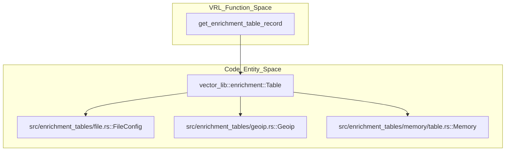
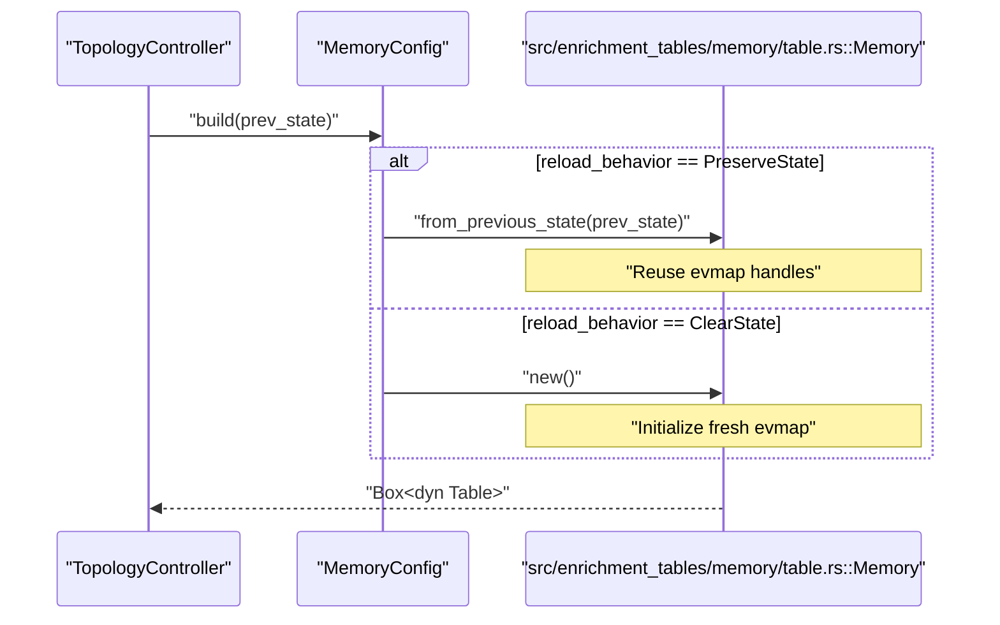
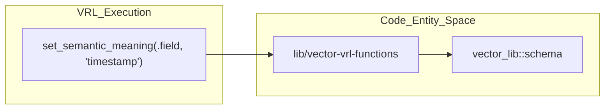

<!-- source: DeepWiki mcp.deepwiki.com · repo vectordotdev/vector · page 5.3 VRL Standard Library · fetched 2026-10-29 -->

# VRL Standard Library

Relevant source files

The following files were used as context for generating this wiki page:

- [changelog.d/25143_enrichment_table_memory_cuckoo_filter.feature.md](changelog.d/25143_enrichment_table_memory_cuckoo_filter.feature.md)
- [changelog.d/25154_enrichment_table_memory_bloom_filter.feature.md](changelog.d/25154_enrichment_table_memory_bloom_filter.feature.md)
- [lib/vector-common/src/internal_event/metric_name.rs](lib/vector-common/src/internal_event/metric_name.rs)
- [lib/vector-vrl/cli/Cargo.toml](lib/vector-vrl/cli/Cargo.toml)
- [lib/vector-vrl/functions/Cargo.toml](lib/vector-vrl/functions/Cargo.toml)
- [lib/vector-vrl/tests/Cargo.toml](lib/vector-vrl/tests/Cargo.toml)
- [lib/vector-vrl/web-playground/Cargo.toml](lib/vector-vrl/web-playground/Cargo.toml)
- [lib/vector-vrl/web-playground/build.rs](lib/vector-vrl/web-playground/build.rs)
- [lib/vector-vrl/web-playground/public/assets/dd_icon_rgb.svg](lib/vector-vrl/web-playground/public/assets/dd_icon_rgb.svg)
- [lib/vector-vrl/web-playground/public/index.css](lib/vector-vrl/web-playground/public/index.css)
- [lib/vector-vrl/web-playground/public/index.html](lib/vector-vrl/web-playground/public/index.html)
- [lib/vector-vrl/web-playground/public/index.js](lib/vector-vrl/web-playground/public/index.js)
- [lib/vector-vrl/web-playground/src/lib.rs](lib/vector-vrl/web-playground/src/lib.rs)
- [src/enrichment_tables/file.rs](src/enrichment_tables/file.rs)
- [src/enrichment_tables/geoip.rs](src/enrichment_tables/geoip.rs)
- [src/enrichment_tables/memory/bloom_table.rs](src/enrichment_tables/memory/bloom_table.rs)
- [src/enrichment_tables/memory/config.rs](src/enrichment_tables/memory/config.rs)
- [src/enrichment_tables/memory/cuckoo_table.rs](src/enrichment_tables/memory/cuckoo_table.rs)
- [src/enrichment_tables/memory/internal_events.rs](src/enrichment_tables/memory/internal_events.rs)
- [src/enrichment_tables/memory/mod.rs](src/enrichment_tables/memory/mod.rs)
- [src/enrichment_tables/memory/table.rs](src/enrichment_tables/memory/table.rs)
- [src/enrichment_tables/mmdb.rs](src/enrichment_tables/mmdb.rs)
- [src/enrichment_tables/mod.rs](src/enrichment_tables/mod.rs)
- [website/cue/reference/generated/configuration.cue](website/cue/reference/generated/configuration.cue)
- [website/cue/reference/remap/functions.cue](website/cue/reference/remap/functions.cue)

## Purpose and Scope

The Vector Remap Language (VRL) Standard Library provides over 200 built-in functions for data transformation within Vector's `remap` transform. The library is organized into categories including Type, String, Parse, Encode, Convert, IP, Array, Cryptography, and Enrichment [website/cue/reference/remap/functions.cue:31-54]().

Functions are aggregated from three primary sources during VRL program compilation:

1.  **VRL Core Standard Library**: Provided by the `vrl` crate - includes core language functions.
2.  **Vector Enrichment Functions**: Provided by `vector_lib::enrichment` - handles operations on enrichment tables (e.g., lookups in CSV or GeoIP databases) [lib/vector-vrl/functions/Cargo.toml:15]().
3.  **Vector-Specific Functions**: Provided by `vector-vrl-functions` - includes specialized functionality like `set_semantic_meaning`, metrics integration, and secret management [lib/vector-vrl/functions/Cargo.toml:1-25]().

Sources: [lib/vector-vrl/functions/Cargo.toml:1-25](), [website/cue/reference/remap/functions.cue:31-54]()

## Function Loading and Registration

The VRL stdlib is feature-gated. The `stdlib` feature in the `vrl` crate enables the full suite of functions [lib/vector-vrl/cli/Cargo.toml:12-14](). In the web playground and CLI, this feature is enabled by default to provide the complete environment [lib/vector-vrl/web-playground/Cargo.toml:17-19]().

### VRL Function Categories

Functions are grouped logically to assist discovery and documentation.

| Category | Purpose | Examples |
| :--- | :--- | :--- |
| **Type** | Type checking and validation | `is_string`, `is_boolean`, `is_array`, `is_object` |
| **Parse** | Decoding structured formats | `parse_json`, `parse_syslog`, `parse_grok`, `parse_csv` |
| **Enrichment**| External data lookups | `get_enrichment_table_record`, `find_enrichment_table_records` |
| **Secret** | Accessing sensitive data | `get_secret`, `set_secret`, `remove_secret` |
| **IP** | Network address operations | `ip_cidr_contains`, `ip_subnet`, `is_ipv4` |
| **Metrics** | Internal telemetry | `counter`, `gauge`, `increment_counter` |

Sources: [website/cue/reference/remap/functions.cue:31-54](), [lib/vector-vrl/functions/Cargo.toml:21-24]()

## Enrichment Table Integration

Enrichment functions bridge VRL with Vector's internal `Table` registry. This allows VRL scripts to perform lookups against various backend types.

### Enrichment Backend Implementations

*   **File (CSV)**: Handles enrichment data for `type = file`. Supports configurable delimiters and schema coercion to types like `bool`, `float`, `integer`, and `timestamp` [src/enrichment_tables/file.rs:1-122]().
*   **GeoIP**: Loads data from MaxMind GeoIP2 or GeoLite2 binary databases (`.mmdb`). Supports localized field lookups (e.g., `locale: "en"`) and specific database types like `City`, `ISP`, and `Asn` [src/enrichment_tables/geoip.rs:1-117]().
*   **MMDB**: A generic handler for any database in MaxMind format [src/enrichment_tables/mmdb.rs:1-51]().
*   **Memory**: A high-performance in-memory table using `evmap` for concurrent read/write access. It supports TTL (Time-To-Live) and can optionally export expired items as a source [src/enrichment_tables/memory/table.rs:114-143]().

**Enrichment Data Architecture**

Sources: [src/enrichment_tables/file.rs:67-69](), [src/enrichment_tables/geoip.rs:112-117](), [src/enrichment_tables/memory/table.rs:114-122](), [src/enrichment_tables/mod.rs:48-69]()

## Memory Table Lifecycle and State

The `memory` enrichment table can preserve its state across configuration reloads by utilizing the `from_previous_state` constructor, which attempts to downcast the previous state into a `Memory` instance to reuse existing `evmap` handles [src/enrichment_tables/memory/table.rs:151-167]().

**Memory Table Reload Flow**

Sources: [src/enrichment_tables/memory/table.rs:151-167](), [src/enrichment_tables/memory/table.rs:131-148]()

## Secret Management Functions

Vector provides specialized functions for managing secrets during event processing. These functions interact with Vector's internal secret management infrastructure to ensure sensitive data is handled securely throughout the pipeline.

*   `get_secret`: Retrieves a secret value by key.
*   `set_secret`: Stores a secret in the event metadata.
*   `remove_secret`: Removes a secret from the event metadata.

These functions are part of the `vector-vrl-functions` crate [lib/vector-vrl/functions/Cargo.toml:1-7]().

Sources: [lib/vector-vrl/functions/Cargo.toml:1-7](), [website/cue/reference/remap/functions.cue:41-41]()

## Semantic Meaning and Schema Tracking

The `set_semantic_meaning` function allows VRL scripts to annotate fields with semantic types (e.g., `timestamp`, `host`, `message`). This information is used by downstream sinks to map fields to their respective destination schemas.

**Semantic Meaning Registration**

Sources: [lib/vector-vrl/functions/Cargo.toml:17-18](), [website/cue/reference/remap/functions.cue:52-52]()

## VRL Web Playground

Vector includes a WASM-based web playground for testing VRL programs against sample events. The playground is implemented in the `vector-vrl-web-playground` crate [lib/vector-vrl/web-playground/Cargo.toml:1-7]().

It provides:
*   **Real-time execution**: Uses `run_vrl` exported from Rust to WASM [lib/vector-vrl/web-playground/public/index.js:77]().
*   **Full Standard Library**: Enabled via the `vrl/stdlib` feature [lib/vector-vrl/web-playground/Cargo.toml:18-19]().
*   **Monaco Editor Integration**: Features syntax highlighting and JSON linting [lib/vector-vrl/web-playground/public/index.js:84-112]().

Sources: [lib/vector-vrl/web-playground/Cargo.toml:1-33](), [lib/vector-vrl/web-playground/public/index.js:58-130]()

---

