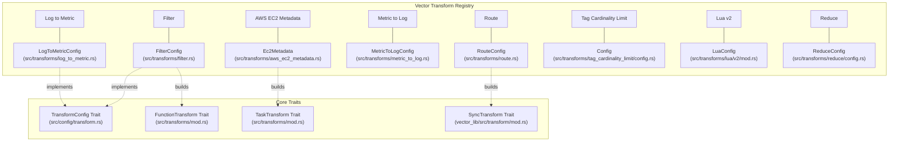
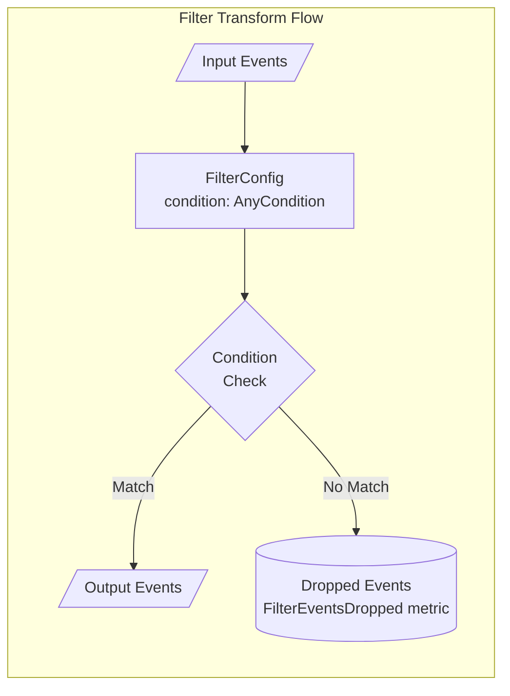
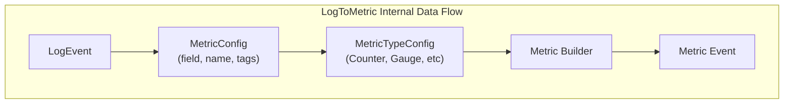
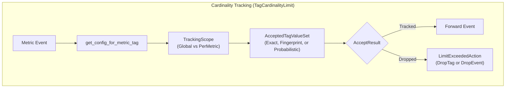

<!-- source: DeepWiki mcp.deepwiki.com · repo vectordotdev/vector · page 5.4 Other Transforms · fetched 2026-10-29 -->

# Other Transforms

Relevant source files

The following files were used as context for generating this wiki page:

- [clippy.toml](clippy.toml)
- [lib/vector-common/src/lib.rs](lib/vector-common/src/lib.rs)
- [lib/vector-common/src/sampling.rs](lib/vector-common/src/sampling.rs)
- [lib/vector-core/src/event/lua/event.rs](lib/vector-core/src/event/lua/event.rs)
- [lib/vector-core/src/event/lua/log.rs](lib/vector-core/src/event/lua/log.rs)
- [lib/vector-core/src/event/lua/metric.rs](lib/vector-core/src/event/lua/metric.rs)
- [lib/vector-core/src/event/lua/util.rs](lib/vector-core/src/event/lua/util.rs)
- [regression/cases/syslog_log2metric_tag_cardinality_limit_blackhole/data/.gitkeep](regression/cases/syslog_log2metric_tag_cardinality_limit_blackhole/data/.gitkeep)
- [regression/cases/syslog_log2metric_tag_cardinality_limit_blackhole/experiment.yaml](regression/cases/syslog_log2metric_tag_cardinality_limit_blackhole/experiment.yaml)
- [regression/cases/syslog_log2metric_tag_cardinality_limit_blackhole/vector/vector.yaml](regression/cases/syslog_log2metric_tag_cardinality_limit_blackhole/vector/vector.yaml)
- [src/config/transform.rs](src/config/transform.rs)
- [src/config/validation.rs](src/config/validation.rs)
- [src/internal_events/encoding_transcode.rs](src/internal_events/encoding_transcode.rs)
- [src/internal_events/filter.rs](src/internal_events/filter.rs)
- [src/internal_events/log_to_metric.rs](src/internal_events/log_to_metric.rs)
- [src/internal_events/tag_cardinality_limit.rs](src/internal_events/tag_cardinality_limit.rs)
- [src/test_util/mock/transforms/noop.rs](src/test_util/mock/transforms/noop.rs)
- [src/topology/test/cpu_metrics.rs](src/topology/test/cpu_metrics.rs)
- [src/transforms/aggregate.rs](src/transforms/aggregate.rs)
- [src/transforms/aws_ec2_metadata.rs](src/transforms/aws_ec2_metadata.rs)
- [src/transforms/delay.rs](src/transforms/delay.rs)
- [src/transforms/exclusive_route/config.rs](src/transforms/exclusive_route/config.rs)
- [src/transforms/filter.rs](src/transforms/filter.rs)
- [src/transforms/log_to_metric.rs](src/transforms/log_to_metric.rs)
- [src/transforms/lua/mod.rs](src/transforms/lua/mod.rs)
- [src/transforms/lua/v1/mod.rs](src/transforms/lua/v1/mod.rs)
- [src/transforms/lua/v2/mod.rs](src/transforms/lua/v2/mod.rs)
- [src/transforms/metric_to_log.rs](src/transforms/metric_to_log.rs)
- [src/transforms/reduce/config.rs](src/transforms/reduce/config.rs)
- [src/transforms/reduce/mod.rs](src/transforms/reduce/mod.rs)
- [src/transforms/remap.rs](src/transforms/remap.rs)
- [src/transforms/route.rs](src/transforms/route.rs)
- [src/transforms/sample/config.rs](src/transforms/sample/config.rs)
- [src/transforms/sample/mod.rs](src/transforms/sample/mod.rs)
- [src/transforms/sample/tests.rs](src/transforms/sample/tests.rs)
- [src/transforms/sample/transform.rs](src/transforms/sample/transform.rs)
- [src/transforms/tag_cardinality_limit/config.rs](src/transforms/tag_cardinality_limit/config.rs)
- [src/transforms/tag_cardinality_limit/mod.rs](src/transforms/tag_cardinality_limit/mod.rs)
- [src/transforms/tag_cardinality_limit/tag_value_set.rs](src/transforms/tag_cardinality_limit/tag_value_set.rs)
- [src/transforms/tag_cardinality_limit/tests.rs](src/transforms/tag_cardinality_limit/tests.rs)
- [src/transforms/throttle/config.rs](src/transforms/throttle/config.rs)
- [src/transforms/window/config.rs](src/transforms/window/config.rs)
- [website/cue/reference/components/transforms/aws_ec2_metadata.cue](website/cue/reference/components/transforms/aws_ec2_metadata.cue)
- [website/cue/reference/components/transforms/generated/tag_cardinality_limit.cue](website/cue/reference/components/transforms/generated/tag_cardinality_limit.cue)
- [website/cue/reference/components/transforms/tag_cardinality_limit.cue](website/cue/reference/components/transforms/tag_cardinality_limit.cue)

This page documents Vector's built-in transforms that process and modify events as they flow through the pipeline. These transforms provide essential data manipulation capabilities without requiring custom code. For information about the Remap transform and VRL (Vector Remap Language), see [Remap Transform](#5.1) and [VRL Language](#5.2).

## Overview

Vector's built-in transforms provide a set of common data manipulation operations that can be applied to events in a pipeline. These transforms allow you to:

- Filter events based on conditions
- Route events to different outputs
- Convert between event types (logs to metrics and vice versa)
- Enrich events with metadata
- Aggregate metrics
- Execute custom Lua code
- Deduplicate events
- Sample events
- Throttle events
- Limit tag cardinality
- Convert incremental metrics to absolute
- Convert traces to logs
- Window events

### Code Entity Mapping: Transform Architecture

The following diagram maps the logical transform names to their primary implementation structs and configuration traits.

Sources: [src/transforms/filter.rs:19-29](), [src/transforms/route.rs:57-92](), [src/transforms/log_to_metric.rs:41-77](), [src/transforms/aws_ec2_metadata.rs:90-144](), [src/transforms/tag_cardinality_limit/config.rs:17-66](), [src/transforms/lua/v2/mod.rs:72-112](), [src/transforms/reduce/mod.rs:1-9]()

## Filter Transform

The Filter transform allows you to conditionally pass or drop events based on a specified condition. Events that match the condition are forwarded, while events that don't match are dropped.

### Implementation Details
The Filter transform is implemented as a `FunctionTransform` [src/transforms/filter.rs:94-103](). It uses the `Condition` system to evaluate whether an event should be passed through or dropped. When an event is dropped, the transform emits an internal metric `FilterEventsDropped` to track the number of filtered events [src/transforms/filter.rs:99-101]().

Sources: [src/transforms/filter.rs:19-103](), [src/internal_events/filter.rs:1-14]()

## Route Transform

The Route transform splits an event stream into multiple sub-streams based on user-defined conditions. Each condition is associated with a named output.

### Implementation Details
The Route transform evaluates each event against all defined conditions [src/transforms/route.rs:40-55](). It is implemented as a `SyncTransform` [src/transforms/route.rs:40](). If an event doesn't match any condition and `reroute_unmatched` is true (the default), it's sent to a special `_unmatched` output [src/transforms/route.rs:51-53](). The transform supports concurrency if enabled in config [src/transforms/route.rs:192-194]().

Sources: [src/transforms/route.rs:19-55](), [src/transforms/route.rs:57-92](), [src/transforms/route.rs:125-130]()

## Log to Metric Transform

The LogToMetric transform converts log events to metric events based on user-defined specifications.

### Metric Types
The transform supports creating different types of metrics:
- **Counter**: Incremental or absolute count [src/transforms/log_to_metric.rs:82-90]().
- **Gauge**: Point-in-time value [src/transforms/log_to_metric.rs:151]().
- **Histogram**: Distribution of values in buckets [src/transforms/log_to_metric.rs:148]().
- **Set**: Unique count of values [src/transforms/log_to_metric.rs:154]().
- **Summary**: Statistical summary [src/transforms/log_to_metric.rs:157]().

Sources: [src/transforms/log_to_metric.rs:41-158](), [src/transforms/log_to_metric.rs:199-207]()

## Metric to Log Transform

The MetricToLog transform converts metric events to log events. This is useful for debugging or storing metrics in log-based systems.

### Implementation Details
The transform converts each metric event to a log event by serializing the metric components (name, namespace, tags, kind, and values) into a structured log event [src/transforms/metric_to_log.rs:254-344](). The `metric_tag_values` option controls whether tags are exposed as single strings or full arrays [src/transforms/metric_to_log.rs:65-67]().

Sources: [src/transforms/metric_to_log.rs:29-68](), [src/transforms/metric_to_log.rs:126-252]()

## AWS EC2 Metadata Transform

The AwsEc2Metadata transform enriches events with metadata from the AWS EC2 instance metadata service (IMDS).

### Implementation Details
The transform periodically fetches metadata using the `HttpClient` [src/transforms/aws_ec2_metadata.rs:35](). It supports IMDSv2 by fetching a session token from `/latest/api/token` [src/transforms/aws_ec2_metadata.rs:86-87](). Metadata is stored in an `ArcSwap` for thread-safe, low-latency access during event processing [src/transforms/aws_ec2_metadata.rs:175]().

Sources: [src/transforms/aws_ec2_metadata.rs:56-89](), [src/transforms/aws_ec2_metadata.rs:174-200]()

## Tag Cardinality Limit Transform

The `tag_cardinality_limit` transform protects downstream systems from cardinality explosions by limiting the number of unique values for metric tags.

### Implementation Details
- **Tracking Scope**: Can be `Global` (all metrics share a single tracking bucket) or `PerMetric` (isolated buckets per metric) [src/transforms/tag_cardinality_limit/config.rs:68-82]().
- **Modes**:
    - `Exact`: Tracks cardinality exactly with higher memory requirements [src/transforms/tag_cardinality_limit/config.rs:112-116]().
    - `ExactFingerprint`: Stores 64-bit hashes to save memory [src/transforms/tag_cardinality_limit/config.rs:118-123]().
    - `Probabilistic`: Uses Bloom filters for very low memory usage [src/transforms/tag_cardinality_limit/config.rs:125-132]().
- **Key Limit**: `max_tracked_keys` limits the total number of (metric, tag-key) pairs tracked across the transform [src/transforms/tag_cardinality_limit/config.rs:42-44]().

Sources: [src/transforms/tag_cardinality_limit/config.rs:17-132]()

## Lua Transform (v2)

The Lua transform allows you to execute custom Lua code to process events. Version 2 provides lifecycle hooks and timers.

### Implementation Details
The transform utilizes `RuntimeTransform` [src/transforms/lua/v2/mod.rs:8-9](). It supports three primary hooks:
- `hooks.init`: Initialization before processing [src/transforms/lua/v2/mod.rs:138-149]().
- `hooks.process`: The main per-event processing logic [src/transforms/lua/v2/mod.rs:151-163]().
- `hooks.shutdown`: Cleanup when the transform is stopped [src/transforms/lua/v2/mod.rs:165-175]().

It also supports `timers` for periodic tasks, such as emitting aggregate metrics every N seconds [src/transforms/lua/v2/mod.rs:182-189]().

Sources: [src/transforms/lua/v2/mod.rs:72-189]()

## Aggregate Transform

The Aggregate transform combines metrics with the same series data over a time interval.

### Aggregation Modes
- **Auto**: Sums incremental metrics, uses latest for absolute [src/transforms/aggregate.rs:49-50]().
- **Sum**: Sums incremental metrics; absolute metrics pass through unchanged [src/transforms/aggregate.rs:53]().
- **Mean/Stdev**: Calculates statistical averages/deviations for absolute metrics [src/transforms/aggregate.rs:70-75]().

### Implementation Details
The transform uses a `HashMap<MetricSeries, MetricEntry>` to store state [src/transforms/aggregate.rs:171](). It is implemented as a `TaskTransform` that flushes the map based on `interval_ms` [src/transforms/aggregate.rs:30-35]().

Sources: [src/transforms/aggregate.rs:26-75](), [src/transforms/aggregate.rs:169-203]()

## Sample Transform

The Sample transform allows sampling events based on a rate or ratio.

### Configuration Options
- **Rate**: Expressed as `1/N` [src/transforms/sample/config.rs:65]().
- **Ratio**: Expressed as a percentage (0.0 to 1.0) [src/transforms/sample/config.rs:72]().
- **Dynamic Sampling**: Can use `ratio_field` or `rate_field` to determine sampling per-event [src/transforms/sample/config.rs:82-90]().
- **Key-based Sampling**: `key_field` ensures all events with the same hashed value are sampled together [src/transforms/sample/config.rs:106]().

Sources: [src/transforms/sample/config.rs:52-128]()

## Reduce Transform

The Reduce transform collapses multiple events into a single event based on a set of keys and a merge strategy.

### Implementation Details
Reduce is implemented across several modules: `config` [src/transforms/reduce/mod.rs:2](), `merge_strategy` [src/transforms/reduce/mod.rs:5](), and `transform` [src/transforms/reduce/mod.rs:8](). It allows for merging events over time or until a specific condition is met.

Sources: [src/transforms/reduce/mod.rs:1-9]()

---

