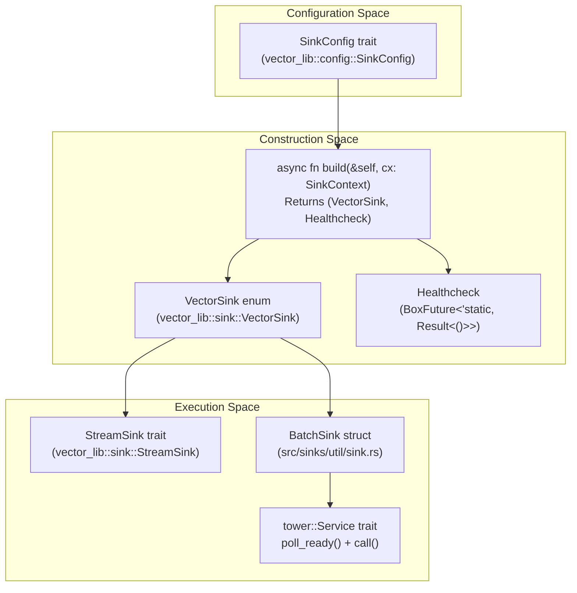
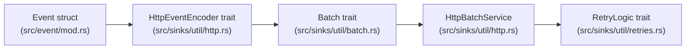

<!-- source: DeepWiki mcp.deepwiki.com · repo vectordotdev/vector · page 6 Sinks · fetched 2026-10-29 -->

# Sinks

Relevant source files

The following files were used as context for generating this wiki page:

- [src/dns.rs](src/dns.rs)
- [src/internal_events/adaptive_concurrency.rs](src/internal_events/adaptive_concurrency.rs)
- [src/internal_events/open.rs](src/internal_events/open.rs)
- [src/sinks/util/adaptive_concurrency/controller.rs](src/sinks/util/adaptive_concurrency/controller.rs)
- [src/sinks/util/adaptive_concurrency/future.rs](src/sinks/util/adaptive_concurrency/future.rs)
- [src/sinks/util/adaptive_concurrency/mod.rs](src/sinks/util/adaptive_concurrency/mod.rs)
- [src/sinks/util/adaptive_concurrency/service.rs](src/sinks/util/adaptive_concurrency/service.rs)
- [src/sinks/util/batch.rs](src/sinks/util/batch.rs)
- [src/sinks/util/buffer/json.rs](src/sinks/util/buffer/json.rs)
- [src/sinks/util/buffer/mod.rs](src/sinks/util/buffer/mod.rs)
- [src/sinks/util/buffer/partition.rs](src/sinks/util/buffer/partition.rs)
- [src/sinks/util/buffer/vec.rs](src/sinks/util/buffer/vec.rs)
- [src/sinks/util/http.rs](src/sinks/util/http.rs)
- [src/sinks/util/retries.rs](src/sinks/util/retries.rs)
- [src/sinks/util/service.rs](src/sinks/util/service.rs)
- [src/sinks/util/sink.rs](src/sinks/util/sink.rs)
- [src/utilization.rs](src/utilization.rs)

Sinks are Vector's data output components that deliver processed events to external systems. They form the final stage of Vector's data pipeline, sending logs, metrics, and traces to 60+ destination types including cloud storage services, observability platforms, message queues, and databases. Each sink implements batching, compression, healthchecks, and acknowledgement tracking to ensure reliable delivery.

For information about data ingestion, see [Sources](#4). For data transformation before output, see [Transforms](#5). For the overall sink architecture patterns and Tower service abstraction, see [Sink Architecture](#6.1).

## Overview

Sinks are defined as modules under `src/sinks/` [src/sinks/mod.rs:8-122](). Each sink implements the `SinkConfig` trait, which provides the interface for building sink instances and performing healthchecks. The sink system is organized around several key abstractions:

- **SinkConfig**: Configuration trait that builds `VectorSink` and `Healthcheck` instances [src/sinks/mod.rs:124-126]().
- **VectorSink**: Enum wrapper that can contain either event-based or stream-based sinks [src/sinks/mod.rs:124]().
- **StreamSink**: Async trait for sinks that process event streams [src/sinks/util/sink.rs:55]().
- **Service**: Tower service abstraction for request/call handling [src/sinks/util/http.rs:60]().

Sources: [src/sinks/mod.rs:1-143](), [src/sinks/util/sink.rs:1-63](), [src/sinks/util/http.rs:60-60]()

### Sink Categories

Vector's sinks are organized into functional categories based on destination type:

| Category | Sinks | Purpose |
|----------|-------|---------|
| **Cloud Storage** | `aws_s3`, `azure_blob`, `gcp` (Cloud Storage), `webhdfs` | Object storage and distributed file systems [src/sinks/mod.rs:21-28](). |
| **Observability Platforms** | `datadog`, `splunk_hec`, `elasticsearch`, `prometheus`, `loki`, `honeycomb`, `new_relic`, `appsignal`, `humio`, `sematext` | Commercial and open-source observability solutions [src/sinks/mod.rs:10-112](). |
| **Message Queues** | `kafka`, `nats`, `mqtt`, `pulsar`, `redis`, `aws_sqs`, `amqp` | Stream processing and message broker systems [src/sinks/mod.rs:9-104](). |
| **Databases** | `clickhouse`, `databend`, `postgres`, `greptimedb`, `influxdb`, `doris`, `databricks_zerobus` | Time-series and analytical databases [src/sinks/mod.rs:38-76](). |
| **Cloud Logs/Metrics** | `aws_cloudwatch_logs`, `aws_cloudwatch_metrics`, `azure_monitor_logs`, `azure_logs_ingestion`, `gcp_chronicle` | Cloud-native logging and metrics services [src/sinks/mod.rs:12-60](). |
| **Utility** | `blackhole`, `console`, `file`, `socket`, `http`, `websocket`, `websocket_server` | Testing, debugging, and generic output [src/sinks/mod.rs:35-122](). |

Sources: [src/sinks/mod.rs:8-123]()

## Sink Lifecycle and Core Traits

**Diagram: Sink Construction and Execution Flow**

The sink lifecycle follows this pattern:

1. **Configuration Phase**: `SinkConfig` trait implementations parse configuration [src/sinks/mod.rs:124]().
2. **Build Phase**: `build()` method constructs runtime instances [src/sinks/mod.rs:130]().
3. **Healthcheck Phase**: Async healthcheck validates connectivity before topology starts [src/sinks/mod.rs:126]().
4. **Execution Phase**: The sink processes the event stream until shutdown.

Sources: [src/sinks/mod.rs:124-143](), [src/sinks/util/sink.rs:34-55]()

### Healthcheck Pattern

Healthchecks validate connectivity before the topology starts. They are boxed futures that return `Result<()>` [src/sinks/mod.rs:126](). Common healthcheck errors include `UnexpectedStatus` when a destination returns an unexpected HTTP status code [src/sinks/mod.rs:145-148]().

Sources: [src/sinks/mod.rs:126-148]()

## Common Sink Patterns

### Batched HTTP Sink Pattern

Vector provides a `BatchedHttpSink` utility to simplify the creation of HTTP-based sinks. It handles batching, retries, and request building using Tower services.

**Diagram: BatchedHttpSink Code Entity Flow**

The `BatchedHttpSink` [src/sinks/util/http.rs:116-137]() uses:
- **HttpEventEncoder**: Encodes individual events into the intermediate input format [src/sinks/util/http.rs:83-86]().
- **HttpSink**: Trait defining how to build requests from batched events [src/sinks/util/http.rs:88-98]().
- **HttpBatchService**: A Tower `Service` that handles the actual HTTP calls [src/sinks/util/http.rs:188]().

Sources: [src/sinks/util/http.rs:81-199](), [src/sinks/util/sink.rs:65-96]()

### Tower Service and Middleware

Sinks use the Tower `Service` trait for request execution, enabling middleware composition. The common stack is defined as `Svc<S, L>` [src/sinks/util/service.rs:40-41]().

Tower middleware adds:
- **Retry logic**: `FibonacciRetryPolicy` for backoff [src/sinks/util/service.rs:41](), [src/sinks/util/retries.rs:78-86]().
- **Adaptive Concurrency**: `AdaptiveConcurrencyLimit` (ARC) which expands and contracts limits based on RTT [src/sinks/util/service.rs:41](), [src/sinks/util/adaptive_concurrency/service.rs:19-23]().
- **Timeouts**: `Timeout` layer to abort slow requests [src/sinks/util/service.rs:41]().
- **Rate limiting**: `RateLimit` to respect destination quotas [src/sinks/util/service.rs:41]().

Sources: [src/sinks/util/service.rs:40-43](), [src/sinks/util/retries.rs:28-56](), [src/sinks/util/adaptive_concurrency/service.rs:16-23]()

## Configuration Patterns

### Standard Sink Configuration

Most sinks follow a common configuration structure, often using `TowerRequestConfig` and `BatchConfig` for behavior settings:

| Field | Type | Purpose |
|-------|------|---------|
| `batch` | `BatchConfig` | Batching behavior (max_events, max_bytes, timeout) [src/sinks/util/batch.rs:97-124](). |
| `request` | `TowerRequestConfig` | Retry, timeout, and concurrency settings [src/sinks/util/service.rs:114-170](). |
| `retry_jitter_mode` | `JitterMode` | Backoff jitter behavior (None, Full) [src/sinks/util/retries.rs:59-75](). |

Sources: [src/sinks/util/batch.rs:97-124](), [src/sinks/util/service.rs:114-170](), [src/sinks/util/retries.rs:59-75]()

## Internal Events and Observability

Sinks emit internal events for observability, specifically for monitoring throughput and failure modes:

- **EndpointBytesSent**: Bytes transmitted to an endpoint [src/sinks/util/http.rs:79]().
- **SinkRequestBuildError**: Failed to construct a request [src/sinks/util/http.rs:79]().
- **LargeEventDroppedError**: Dropped event that exceeds batch limits [src/sinks/util/batch.rs:11]().
- **Adaptive Concurrency Metrics**: Metrics like `AdaptiveConcurrencyLimit` and `AdaptiveConcurrencyObservedRtt` track ARC performance [src/internal_events/adaptive_concurrency.rs:16-66]().
- **Utilization Tracking**: The `Utilization` wrapper approximates component load from poll timing [src/utilization.rs:33-56]().

Sources: [src/sinks/util/http.rs:79](), [src/sinks/util/batch.rs:11](), [src/internal_events/adaptive_concurrency.rs:1-66](), [src/utilization.rs:27-56]()

## Error Handling

Common errors during sink construction and request execution:

- **BuildError**: Enum covering DNS failures, URI parsing, and HTTP builder errors [src/sinks/mod.rs:129-141]().
- **BatchError**: Errors for invalid batch configurations (e.g., `InvalidMaxBytes`) [src/sinks/util/batch.rs:16-30]().
- **RetryAction**: Logic determining if a response or error should trigger a retry [src/sinks/util/retries.rs:17-26]().

Sources: [src/sinks/mod.rs:129-141](), [src/sinks/util/batch.rs:16-30](), [src/sinks/util/retries.rs:17-56]()

## Related Documentation

- For details on the Tower service-based pattern and ARC, see [Sink Architecture](#6.1).
- For platform-specific sinks (Datadog, Splunk, etc.), see [Observability Platform Sinks](#6.2).
- For storage backends (S3, ClickHouse, etc.), see [Storage Sinks](#6.3).
- For messaging systems (Kafka, Pulsar, etc.), see [Streaming and Messaging Sinks](#6.4).

---

