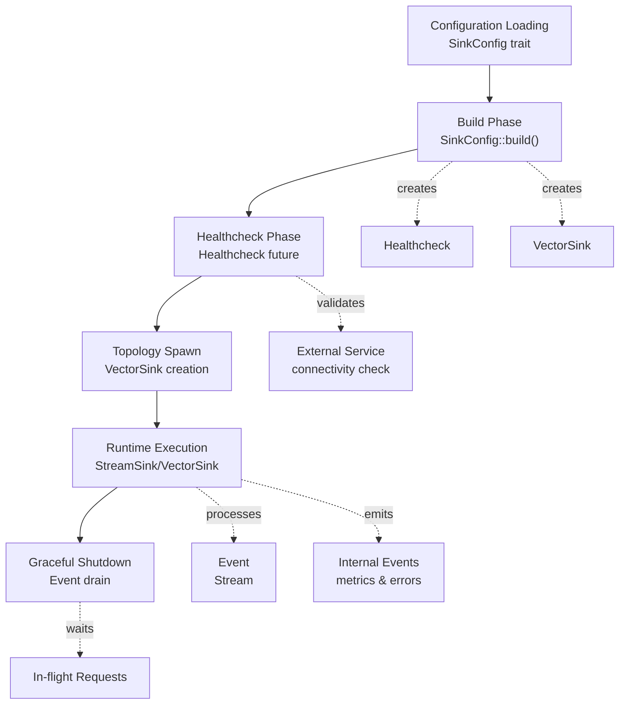
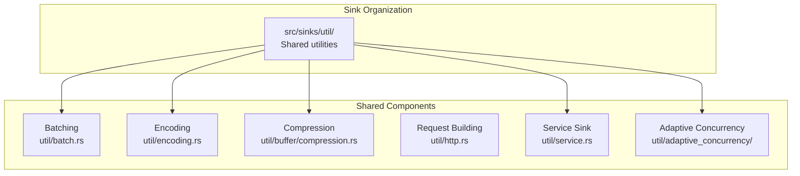
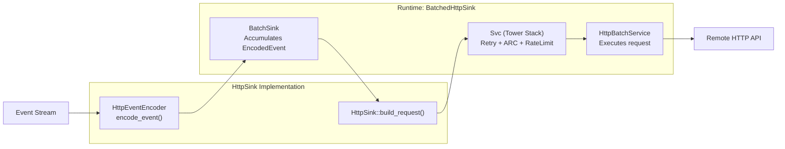

<!-- source: DeepWiki mcp.deepwiki.com · repo vectordotdev/vector · page 6.1 Sink Architecture · fetched 2026-10-29 -->

# Sink Architecture

Relevant source files

The following files were used as context for generating this wiki page:

- [lib/codecs/src/encoding/encoder.rs](lib/codecs/src/encoding/encoder.rs)
- [lib/codecs/src/encoding/format/arrow.rs](lib/codecs/src/encoding/format/arrow.rs)
- [lib/codecs/src/encoding/format/avro.rs](lib/codecs/src/encoding/format/avro.rs)
- [lib/codecs/src/encoding/format/gelf.rs](lib/codecs/src/encoding/format/gelf.rs)
- [lib/codecs/src/encoding/format/json.rs](lib/codecs/src/encoding/format/json.rs)
- [lib/codecs/src/encoding/format/logfmt.rs](lib/codecs/src/encoding/format/logfmt.rs)
- [lib/codecs/src/encoding/format/mod.rs](lib/codecs/src/encoding/format/mod.rs)
- [lib/codecs/src/encoding/format/native_json.rs](lib/codecs/src/encoding/format/native_json.rs)
- [lib/codecs/src/encoding/format/parquet.rs](lib/codecs/src/encoding/format/parquet.rs)
- [lib/codecs/src/encoding/format/text.rs](lib/codecs/src/encoding/format/text.rs)
- [lib/codecs/src/encoding/mod.rs](lib/codecs/src/encoding/mod.rs)
- [lib/codecs/src/encoding/serializer.rs](lib/codecs/src/encoding/serializer.rs)
- [lib/codecs/src/internal_events.rs](lib/codecs/src/internal_events.rs)
- [lib/codecs/src/lib.rs](lib/codecs/src/lib.rs)
- [lib/vector-config-common/src/human_friendly.rs](lib/vector-config-common/src/human_friendly.rs)
- [lib/vector-config-macros/src/configurable.rs](lib/vector-config-macros/src/configurable.rs)
- [lib/vector-config/src/configurable.rs](lib/vector-config/src/configurable.rs)
- [lib/vector-config/src/external/chrono.rs](lib/vector-config/src/external/chrono.rs)
- [lib/vector-config/src/external/encoding_rs.rs](lib/vector-config/src/external/encoding_rs.rs)
- [lib/vector-config/src/external/indexmap.rs](lib/vector-config/src/external/indexmap.rs)
- [lib/vector-config/src/external/no_proxy.rs](lib/vector-config/src/external/no_proxy.rs)
- [lib/vector-config/src/external/serde_with.rs](lib/vector-config/src/external/serde_with.rs)
- [lib/vector-config/src/external/tz.rs](lib/vector-config/src/external/tz.rs)
- [lib/vector-config/src/external/url.rs](lib/vector-config/src/external/url.rs)
- [lib/vector-config/src/lib.rs](lib/vector-config/src/lib.rs)
- [lib/vector-config/src/metadata.rs](lib/vector-config/src/metadata.rs)
- [lib/vector-config/src/ser.rs](lib/vector-config/src/ser.rs)
- [lib/vector-config/src/stdlib.rs](lib/vector-config/src/stdlib.rs)
- [src/dns.rs](src/dns.rs)
- [src/internal_events/adaptive_concurrency.rs](src/internal_events/adaptive_concurrency.rs)
- [src/internal_events/open.rs](src/internal_events/open.rs)
- [src/sinks/gcp_chronicle/compression.rs](src/sinks/gcp_chronicle/compression.rs)
- [src/sinks/util/adaptive_concurrency/controller.rs](src/sinks/util/adaptive_concurrency/controller.rs)
- [src/sinks/util/adaptive_concurrency/future.rs](src/sinks/util/adaptive_concurrency/future.rs)
- [src/sinks/util/adaptive_concurrency/mod.rs](src/sinks/util/adaptive_concurrency/mod.rs)
- [src/sinks/util/adaptive_concurrency/service.rs](src/sinks/util/adaptive_concurrency/service.rs)
- [src/sinks/util/batch.rs](src/sinks/util/batch.rs)
- [src/sinks/util/buffer/compression.rs](src/sinks/util/buffer/compression.rs)
- [src/sinks/util/buffer/json.rs](src/sinks/util/buffer/json.rs)
- [src/sinks/util/buffer/mod.rs](src/sinks/util/buffer/mod.rs)
- [src/sinks/util/buffer/partition.rs](src/sinks/util/buffer/partition.rs)
- [src/sinks/util/buffer/vec.rs](src/sinks/util/buffer/vec.rs)
- [src/sinks/util/encoding.rs](src/sinks/util/encoding.rs)
- [src/sinks/util/http.rs](src/sinks/util/http.rs)
- [src/sinks/util/retries.rs](src/sinks/util/retries.rs)
- [src/sinks/util/service.rs](src/sinks/util/service.rs)
- [src/sinks/util/service/concurrency.rs](src/sinks/util/service/concurrency.rs)
- [src/sinks/util/sink.rs](src/sinks/util/sink.rs)
- [src/utilization.rs](src/utilization.rs)

## Purpose and Scope

This document covers the architecture and implementation patterns for sinks in Vector - the output components that deliver processed events to external systems. Sinks are responsible for batching events, encoding them into appropriate formats, compressing payloads, building requests, managing concurrency, performing healthchecks, and handling retries.

Sources: [src/sinks/util/sink.rs:1-32]()

---

## Sink Component Lifecycle

**Sink Component Lifecycle Diagram**

The lifecycle of a sink component progresses through distinct phases:

1. **Configuration Loading**: Each sink implements the `SinkConfig` trait which defines its configuration structure and validation rules. Configuration is deserialized into strongly-typed structs.
2. **Build Phase**: The `SinkConfig::build()` method constructs the runtime sink instance and returns both a `VectorSink` implementation and a healthcheck future.
3. **Healthcheck Phase**: Before the topology starts, Vector executes the healthcheck future to validate connectivity.
4. **Runtime Execution**: The sink processes incoming events through its batching, encoding, and request sending pipeline. It emits internal metrics like `EventsSent` [src/sinks/util/sink.rs:52-53]().
5. **Graceful Shutdown**: On shutdown signals, the sink stops accepting new events and drains in-flight batches [src/sinks/util/sink.rs:196-197]().

Sources: [src/sinks/util/sink.rs:1-53](), [src/sinks/util/sink.rs:196-197]()

---

## Core Traits and Types

### SinkConfig Trait
The `SinkConfig` trait is implemented by all sink configurations. It defines the `build` method, the `input` type (Logs, Metrics, or Traces), and acknowledgement settings.

### VectorSink Type
The `VectorSink` represents the runtime sink implementation. Sinks typically use one of the following utility wrappers:
- `StreamSink`: For sinks that process events as a stream [src/sinks/util/sink.rs:55-55]().
- `BatchSink`: Wraps a `tower::Service` and a `Batch` to handle buffering and dispatching [src/sinks/util/sink.rs:85-96]().
- `PartitionBatchSink`: Similar to `BatchSink` but supports partitioning events by a key [src/sinks/util/sink.rs:184-197]().
- `BatchedHttpSink`: A specialized wrapper for HTTP-based sinks [src/sinks/util/http.rs:113-135]().

### Healthcheck Type
`Healthcheck` is a boxed future: `pub type Healthcheck = BoxFuture<'static, crate::Result<()>>`. It validates connectivity via `HealthService` and `HealthLogic` [src/sinks/util/service.rs:17-21]().

Sources: [src/sinks/util/sink.rs:55-197](), [src/sinks/util/http.rs:113-135](), [src/sinks/util/service.rs:17-21]()

---

## Sink Module Organization

**Sink Module Organization Diagram**

Vector shared logic for batching, encoding, and HTTP request management is centralized in `src/sinks/util/`.

Sources: [src/sinks/util/http.rs:1-100](), [src/sinks/util/service.rs:1-44](), [src/sinks/util/buffer/compression.rs:1-44]()

---

## Data Flow Architecture

Events flow through a multi-stage pipeline within sinks:

### 1. Batching Stage
The batcher accumulates events based on settings like `max_events`, `max_bytes`, and `timeout`. The `Batch` trait defines how events are added and when a batch is ready [src/sinks/util/batch.rs:1-20](). Configuration is handled via `BatchConfig` which validates parameters such as `max_bytes` and `timeout_secs` [src/sinks/util/batch.rs:94-160]().

### 2. Encoding Stage
Encoders serialize events into the wire format. The `HttpEventEncoder` trait defines the `encode_event` method [src/sinks/util/http.rs:81-84](). Vector supports a wide variety of formats:
- **JSON**: `JsonSerializer` [lib/codecs/src/encoding/mod.rs:24-24]().
- **Arrow/Parquet**: `ArrowStreamSerializer` and `ParquetSerializer` [lib/codecs/src/encoding/mod.rs:17-35]().
- **Protobuf/Native**: `ProtobufSerializer` and `NativeSerializer` [lib/codecs/src/encoding/mod.rs:26-29]().
- **Framing**: `Framer` handles event boundaries (e.g., `NewlineDelimited`, `CharacterDelimited`) [lib/codecs/src/encoding/mod.rs:38-44]().
- **GELF/Syslog**: `GelfSerializer` and `SyslogSerializer` [lib/codecs/src/encoding/mod.rs:23-37]().

The `Encoder` trait in `src/sinks/util/encoding.rs` provides the `encode_input` method used to write events to an `io::Write` target [src/sinks/util/encoding.rs:15-26](). It integrates with `Transformer` to apply field transformations before serialization [src/sinks/util/encoding.rs:44-50]().

### 3. Compression Stage
The `Compression` enum handles algorithms like `Gzip`, `Zlib`, `Zstd`, and `Snappy` [src/sinks/util/buffer/compression.rs:20-44](). It provides the `content-encoding` header value for HTTP requests [src/sinks/util/buffer/compression.rs:71-79](). Compression levels are configurable for supported algorithms [src/sinks/util/buffer/compression.rs:111-117]().

### 4. Request Stage
The `HttpSink` trait defines `build_request`, which takes encoded events and produces an `http::Request<Bytes>` [src/sinks/util/http.rs:92-96](). Request building involves setting headers like `OrderedHeaderName` [src/sinks/util/http.rs:15-26]().

### 5. Service Stage (Tower)
Vector uses `tower::Service` to manage request execution. The stack includes:
- **Retry Logic**: `FibonacciRetryPolicy` [src/sinks/util/service.rs:29-41](). This policy uses `RetryLogic` to determine if errors or specific response bodies (via `RetryAction`) warrant a retry [src/sinks/util/retries.rs:17-56]().
- **Adaptive Concurrency (ARC)**: `AdaptiveConcurrencyLimit` dynamically adjusts the number of in-flight requests based on performance [src/sinks/util/service.rs:41-55]().
- **Rate Limiting**: `RateLimit` layer [src/sinks/util/service.rs:41-51]().
- **Timeouts**: `Timeout` layer [src/sinks/util/service.rs:41-55]().

Sources: [src/sinks/util/http.rs:81-96](), [src/sinks/util/buffer/compression.rs:20-79](), [src/sinks/util/service.rs:1-55](), [lib/codecs/src/encoding/mod.rs:13-44](), [src/sinks/util/encoding.rs:15-26](), [src/sinks/util/retries.rs:17-142](), [src/sinks/util/batch.rs:94-160]()

---

## Adaptive Concurrency (ARC)

Adaptive concurrency dynamically optimizes sink throughput by adjusting the concurrency limit based on observed request latencies. It is configured via `AdaptiveConcurrencySettings` [src/sinks/util/service.rs:166-166]().

| Setting | Description |
|---------|-------------|
| `concurrency` | Can be set to `none`, `adaptive`, or `fixed(usize)` [src/sinks/util/service/concurrency.rs:22-36](). |
| `AdaptiveConcurrencyLimit` | The Tower layer that implements the adjustment logic [src/sinks/util/service.rs:41-55](). |

The `Concurrency` enum handles serialization and schema generation for these options [src/sinks/util/service/concurrency.rs:38-160](). Fixed concurrency limits require a positive integer [src/sinks/util/service/concurrency.rs:86-100]().

Sources: [src/sinks/util/service.rs:114-170](), [src/sinks/util/service/concurrency.rs:22-160]()

---

## Internal Events and Metrics

Sinks emit metrics to track their health and performance. Standard metrics include:
- `EventsSent`: Number of events successfully delivered [src/sinks/util/sink.rs:52-53]().
- `EndpointBytesSent`: Total bytes sent to the destination [src/sinks/util/http.rs:76-76]().
- `SinkRequestBuildError`: Incremented when a request fails to build [src/sinks/util/http.rs:76-76]().
- `EncoderWriteError`: Emitted when writing encoded data to the underlying transport fails [src/sinks/util/encoding.rs:180-186]().
- `Utilization`: Approximates component utilization from poll timing using `UtilizationComponentSender` [src/utilization.rs:27-38](), [src/utilization.rs:186-209](). Utilization is calculated using an Exponentially Weighted Moving Average (EWMA) [src/utilization.rs:145-167]().

Sources: [src/sinks/util/sink.rs:52-53](), [src/sinks/util/http.rs:76-76](), [src/utilization.rs:27-209](), [src/sinks/util/encoding.rs:180-186]()

---

## Implementation Example: HTTP Sink Pattern

The `BatchedHttpSink` demonstrates the standard pattern for a batched HTTP sink using Tower services.

**HTTP Sink Implementation Diagram**

1. **Encoder**: The sink provides an `HttpEventEncoder` that converts `Event` into the desired `Input` type [src/sinks/util/http.rs:81-84]().
2. **Batching**: `BatchedHttpSink` uses an internal `TowerBatchedSink` to manage event accumulation into `B::Output` [src/sinks/util/http.rs:125-129]().
3. **Request**: `HttpSink::build_request` constructs the `http::Request<Bytes>` from the batched output [src/sinks/util/http.rs:92-96]().
4. **Execution**: The `HttpBatchService` uses an `HttpClient` to dispatch the request [src/sinks/util/http.rs:186-187]().

Sources: [src/sinks/util/http.rs:81-197](), [src/sinks/util/service.rs:40-43]()

---

