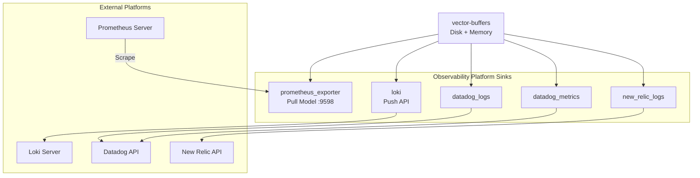
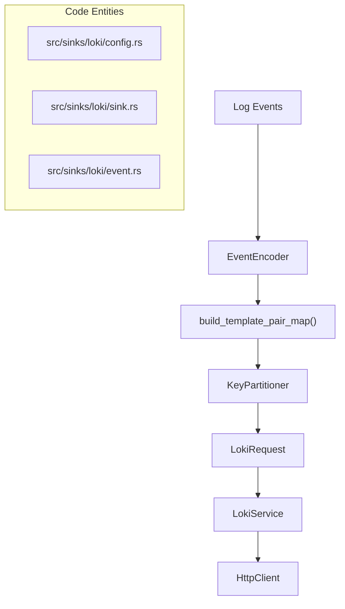
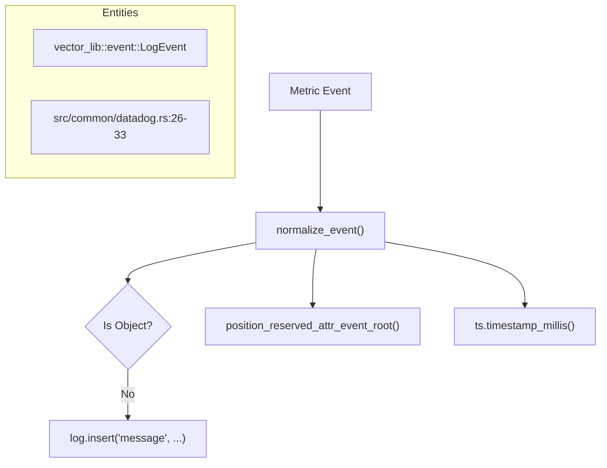

<!-- source: DeepWiki mcp.deepwiki.com · repo vectordotdev/vector · page 6.2 Observability Platform Sinks · fetched 2026-10-29 -->

# Observability Platform Sinks

Relevant source files

The following files were used as context for generating this wiki page:

- [lib/loki-logproto/build.rs](lib/loki-logproto/build.rs)
- [lib/loki-logproto/proto/README](lib/loki-logproto/proto/README)
- [lib/loki-logproto/proto/logproto.proto](lib/loki-logproto/proto/logproto.proto)
- [lib/loki-logproto/proto/push.proto](lib/loki-logproto/proto/push.proto)
- [lib/loki-logproto/proto/stats.proto](lib/loki-logproto/proto/stats.proto)
- [lib/loki-logproto/src/lib.rs](lib/loki-logproto/src/lib.rs)
- [src/common/datadog.rs](src/common/datadog.rs)
- [src/sinks/appsignal/tests.rs](src/sinks/appsignal/tests.rs)
- [src/sinks/datadog/events/config.rs](src/sinks/datadog/events/config.rs)
- [src/sinks/datadog/events/service.rs](src/sinks/datadog/events/service.rs)
- [src/sinks/datadog/logs/config.rs](src/sinks/datadog/logs/config.rs)
- [src/sinks/datadog/logs/integration_tests.rs](src/sinks/datadog/logs/integration_tests.rs)
- [src/sinks/datadog/logs/mod.rs](src/sinks/datadog/logs/mod.rs)
- [src/sinks/datadog/logs/service.rs](src/sinks/datadog/logs/service.rs)
- [src/sinks/datadog/logs/sink.rs](src/sinks/datadog/logs/sink.rs)
- [src/sinks/datadog/logs/tests.rs](src/sinks/datadog/logs/tests.rs)
- [src/sinks/datadog/metrics/config.rs](src/sinks/datadog/metrics/config.rs)
- [src/sinks/datadog/metrics/encoder.rs](src/sinks/datadog/metrics/encoder.rs)
- [src/sinks/datadog/metrics/integration_tests.rs](src/sinks/datadog/metrics/integration_tests.rs)
- [src/sinks/datadog/metrics/mod.rs](src/sinks/datadog/metrics/mod.rs)
- [src/sinks/datadog/metrics/request_builder.rs](src/sinks/datadog/metrics/request_builder.rs)
- [src/sinks/datadog/metrics/service.rs](src/sinks/datadog/metrics/service.rs)
- [src/sinks/datadog/metrics/sink.rs](src/sinks/datadog/metrics/sink.rs)
- [src/sinks/datadog/metrics/tests.rs](src/sinks/datadog/metrics/tests.rs)
- [src/sinks/datadog/mod.rs](src/sinks/datadog/mod.rs)
- [src/sinks/datadog/test_utils.rs](src/sinks/datadog/test_utils.rs)
- [src/sinks/datadog/traces/config.rs](src/sinks/datadog/traces/config.rs)
- [src/sinks/datadog/traces/service.rs](src/sinks/datadog/traces/service.rs)
- [src/sinks/gcp/stackdriver/metrics/tests.rs](src/sinks/gcp/stackdriver/metrics/tests.rs)
- [src/sinks/honeycomb/tests.rs](src/sinks/honeycomb/tests.rs)
- [src/sinks/loki/config.rs](src/sinks/loki/config.rs)
- [src/sinks/loki/event.rs](src/sinks/loki/event.rs)
- [src/sinks/loki/service.rs](src/sinks/loki/service.rs)
- [src/sinks/loki/sink.rs](src/sinks/loki/sink.rs)
- [src/sinks/new_relic/config.rs](src/sinks/new_relic/config.rs)
- [src/sinks/new_relic/encoding.rs](src/sinks/new_relic/encoding.rs)
- [src/sinks/new_relic/healthcheck.rs](src/sinks/new_relic/healthcheck.rs)
- [src/sinks/new_relic/mod.rs](src/sinks/new_relic/mod.rs)
- [src/sinks/new_relic/model.rs](src/sinks/new_relic/model.rs)
- [src/sinks/new_relic/service.rs](src/sinks/new_relic/service.rs)
- [src/sinks/new_relic/sink.rs](src/sinks/new_relic/sink.rs)
- [src/sinks/new_relic/tests.rs](src/sinks/new_relic/tests.rs)
- [src/sinks/prometheus/remote_write/config.rs](src/sinks/prometheus/remote_write/config.rs)
- [website/content/en/docs/reference/configuration/sinks/new_relic.md](website/content/en/docs/reference/configuration/sinks/new_relic.md)
- [website/cue/reference/components/nats.cue](website/cue/reference/components/nats.cue)
- [website/cue/reference/components/sinks/loki.cue](website/cue/reference/components/sinks/loki.cue)
- [website/cue/reference/components/sinks/nats.cue](website/cue/reference/components/sinks/nats.cue)
- [website/cue/reference/components/sinks/new_relic.cue](website/cue/reference/components/sinks/new_relic.cue)
- [website/cue/reference/components/sinks/prometheus_exporter.cue](website/cue/reference/components/sinks/prometheus_exporter.cue)
- [website/cue/reference/components/sinks/prometheus_remote_write.cue](website/cue/reference/components/sinks/prometheus_remote_write.cue)
- [website/cue/reference/components/sinks/redis.cue](website/cue/reference/components/sinks/redis.cue)
- [website/cue/reference/components/sources/demo_logs.cue](website/cue/reference/components/sources/demo_logs.cue)
- [website/cue/reference/components/sources/docker_logs.cue](website/cue/reference/components/sources/docker_logs.cue)
- [website/cue/reference/components/sources/heroku_logs.cue](website/cue/reference/components/sources/heroku_logs.cue)
- [website/cue/reference/components/sources/http_server.cue](website/cue/reference/components/sources/http_server.cue)
- [website/cue/reference/components/sources/prometheus_remote_write.cue](website/cue/reference/components/sources/prometheus_remote_write.cue)
- [website/cue/reference/components/sources/prometheus_scrape.cue](website/cue/reference/components/sources/prometheus_scrape.cue)
- [website/cue/reference/components/sources/splunk_hec.cue](website/cue/reference/components/sources/splunk_hec.cue)
- [website/cue/reference/services/splunk_client.cue](website/cue/reference/services/splunk_client.cue)

This document describes Vector's sinks for observability platforms—specialized systems designed for ingesting, storing, and analyzing telemetry data (logs, metrics, and traces). These sinks enable Vector to send data to platforms like Prometheus, Loki, Datadog, Splunk, and others.

Vector provides numerous sink implementations, with observability platforms representing a major category focused on comprehensive monitoring and analytics solutions.

## Overview

Observability platform sinks send telemetry data from Vector to external monitoring and analytics systems. These platforms typically provide storage, querying, visualization, and alerting capabilities for operational data.

### Major Observability Platforms

Vector integrates with numerous observability platforms, each with specialized capabilities:

| Platform | Primary Data Types | Sink Components |
|----------|-------------------|-----------------|
| Prometheus | Metrics | `prometheus_exporter`, `prometheus_remote_write` |
| Loki | Logs | `loki` |
| Datadog | Logs, Metrics, Traces | `datadog_logs`, `datadog_metrics`, `datadog_traces`, `datadog_events` |
| Splunk | Logs, Metrics | `splunk_hec` |
| New Relic | Logs, Metrics | `new_relic`, `new_relic_logs` |
| Honeycomb | Logs, Traces | `honeycomb` |

### Data Flow Architecture

Sources: `[src/sinks/datadog/logs/config.rs:46-51]()`, `[src/sinks/loki/config.rs:21-25]()`, `[website/cue/reference/components/sinks/prometheus_exporter.cue:3-14]()`

## Prometheus Sinks

Vector provides implementations for both pull-based (`prometheus_exporter`) and push-based (`prometheus_remote_write`) Prometheus delivery.

### prometheus_exporter Sink

The `prometheus_exporter` sink exposes metrics on an HTTP endpoint for Prometheus servers to scrape. It supports various metric types including counters, gauges, histograms, and summaries `[website/cue/reference/components/sinks/prometheus_exporter.cue:61-72]()`.

#### Configuration
The default listening port is `9598` `[website/cue/reference/components/sinks/prometheus_exporter.cue:4]()`. It uses a "best-effort" delivery class as it is an "expose" method sink rather than a push-based batch sink `[website/cue/reference/components/sinks/prometheus_exporter.cue:8-14]()`.

### prometheus_remote_write Sink
The `prometheus_remote_write` sink pushes metrics to a remote Prometheus-compatible endpoint. It supports Snappy compression as a default `[website/cue/reference/components/sinks/prometheus_remote_write.cue:28-31]()`.

## Loki Sink

The `loki` sink sends log events to Grafana Loki using the Push API.

### Architecture

Sources: `[src/sinks/loki/sink.rs:43-77]()`, `[src/sinks/loki/sink.rs:103-165]()`, `[src/sinks/loki/sink.rs:192-218]()`

### Multi-Tenancy and Partitioning
The sink supports multi-tenancy via `tenant_id` templates using `KeyPartitioner` `[src/sinks/loki/sink.rs:43-77]()`. Events are partitioned by these IDs to ensure they are sent in the correct HTTP requests with appropriate headers. The sink sorts events by timestamp before sending to avoid out-of-order rejection in older Loki versions `[website/cue/reference/components/sinks/loki.cue:93-102]()`.

## Datadog Sinks

Vector provides specialized sinks for logs, metrics, traces, and events.

### datadog_logs Sink
The `datadog_logs` sink normalizes events to the Datadog Agent standard `[src/sinks/datadog/logs/sink.rs:108-152]()`. It handles reserved attributes like `hostname`, `service`, and `ddsource` by moving them to the root of the event object using `position_reserved_attr_event_root` `[src/sinks/datadog/logs/sink.rs:184-192]()`.

The sink has a hard limit of 5MB for uncompressed payloads `[src/sinks/datadog/logs/config.rs:25-32]()`.

### datadog_metrics Sink
The `datadog_metrics` sink supports both Series V1 (JSON) and Series V2 (Protobuf) APIs `[src/sinks/datadog/metrics/config.rs:35-55]()`.

#### Metric Normalization

Sources: `[src/sinks/datadog/logs/sink.rs:108-152]()`, `[src/common/datadog.rs:26-33]()`

### datadog_metrics Encoder
The `DatadogMetricsEncoder` `[src/sinks/datadog/metrics/encoder.rs:152-162]()` handles the complex task of serializing metrics into either JSON (for V1) or Protobuf (for V2 and Sketches). It manages payload limits based on the endpoint:
- **V1/Sketches**: 60 MiB uncompressed, 3.2 MB compressed `[src/sinks/datadog/metrics/config.rs:92-98]()`.
- **V2**: 5 MiB uncompressed, 512 KB compressed `[src/sinks/datadog/metrics/config.rs:99-102]()`.

## New Relic Sinks

Vector supports New Relic through the `new_relic` sink (for metrics) and `new_relic_logs` sink.

### Architecture
The New Relic implementation uses a `NewRelicSink` `[src/sinks/new_relic/sink.rs:19-23]()` which wraps a `NewRelicService`. It leverages `RequestConfig` for adaptive concurrency and retry logic.

## Common Sink Utilities

Most observability sinks leverage shared infrastructure in Vector:

1.  **Healthchecks**: Datadog sinks use a common healthcheck that validates the API key against the `/api/v1/validate` endpoint `[src/sinks/datadog/mod.rs:140-149]()`.
2.  **Compression**: Sinks support multiple algorithms. Datadog logs default to `zstd` `[src/sinks/datadog/logs/config.rs:80-82]()`, while Loki defaults to `snappy` `[src/sinks/loki/config.rs:13-15]()`.
3.  **API Key Management**: Many observability sinks allow setting the API key per-event in metadata, which overrides the default configuration `[src/sinks/datadog/logs/sink.rs:25-32]()`.
4.  **Batching**: Sinks use `BatchConfig` to group events. For example, Datadog metrics default to 100,000 events per batch `[src/sinks/datadog/metrics/config.rs:27-28]()`.

Sources: `[src/sinks/datadog/mod.rs:140-180]()`, `[src/sinks/datadog/logs/config.rs:80-82]()`, `[src/sinks/loki/config.rs:13-15]()`, `[src/sinks/datadog/metrics/config.rs:24-33]()`

---

