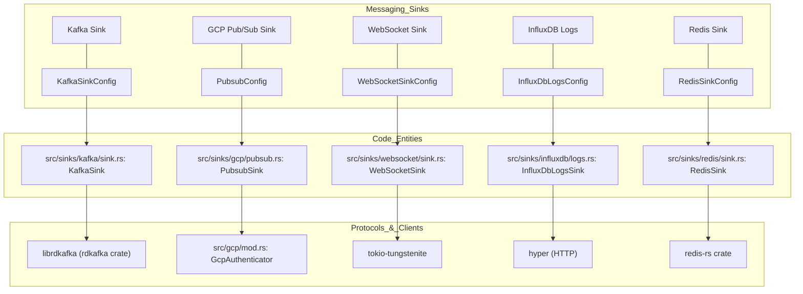
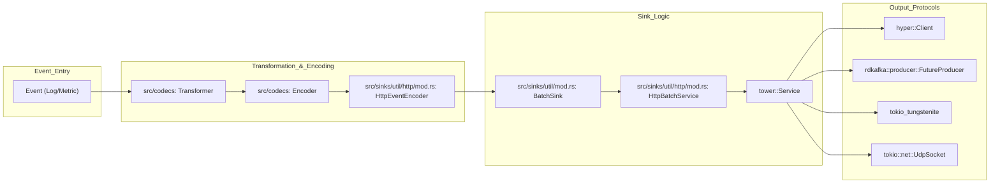

<!-- source: DeepWiki mcp.deepwiki.com · repo vectordotdev/vector · page 6.4 Streaming and Messaging Sinks · fetched 2026-10-29 -->

# Streaming and Messaging Sinks

Relevant source files

The following files were used as context for generating this wiki page:

- [src/internal_events/unix.rs](src/internal_events/unix.rs)
- [src/kafka.rs](src/kafka.rs)
- [src/sinks/amqp/config.rs](src/sinks/amqp/config.rs)
- [src/sinks/console/config.rs](src/sinks/console/config.rs)
- [src/sinks/console/sink.rs](src/sinks/console/sink.rs)
- [src/sinks/gcp/pubsub.rs](src/sinks/gcp/pubsub.rs)
- [src/sinks/influxdb/logs.rs](src/sinks/influxdb/logs.rs)
- [src/sinks/influxdb/metrics.rs](src/sinks/influxdb/metrics.rs)
- [src/sinks/influxdb/mod.rs](src/sinks/influxdb/mod.rs)
- [src/sinks/kafka/config.rs](src/sinks/kafka/config.rs)
- [src/sinks/kafka/request_builder.rs](src/sinks/kafka/request_builder.rs)
- [src/sinks/kafka/service.rs](src/sinks/kafka/service.rs)
- [src/sinks/kafka/sink.rs](src/sinks/kafka/sink.rs)
- [src/sinks/kafka/tests.rs](src/sinks/kafka/tests.rs)
- [src/sinks/nats/config.rs](src/sinks/nats/config.rs)
- [src/sinks/nats/integration_tests.rs](src/sinks/nats/integration_tests.rs)
- [src/sinks/nats/mod.rs](src/sinks/nats/mod.rs)
- [src/sinks/nats/request_builder.rs](src/sinks/nats/request_builder.rs)
- [src/sinks/nats/service.rs](src/sinks/nats/service.rs)
- [src/sinks/nats/sink.rs](src/sinks/nats/sink.rs)
- [src/sinks/pulsar/config.rs](src/sinks/pulsar/config.rs)
- [src/sinks/redis/config.rs](src/sinks/redis/config.rs)
- [src/sinks/redis/integration_tests.rs](src/sinks/redis/integration_tests.rs)
- [src/sinks/redis/mod.rs](src/sinks/redis/mod.rs)
- [src/sinks/redis/request_builder.rs](src/sinks/redis/request_builder.rs)
- [src/sinks/redis/service.rs](src/sinks/redis/service.rs)
- [src/sinks/redis/sink.rs](src/sinks/redis/sink.rs)
- [src/sinks/redis/tests.rs](src/sinks/redis/tests.rs)
- [src/sinks/sematext/metrics.rs](src/sinks/sematext/metrics.rs)
- [src/sinks/socket.rs](src/sinks/socket.rs)
- [src/sinks/util/adaptive_concurrency/tests.rs](src/sinks/util/adaptive_concurrency/tests.rs)
- [src/sinks/util/datagram.rs](src/sinks/util/datagram.rs)
- [src/sinks/util/mod.rs](src/sinks/util/mod.rs)
- [src/sinks/util/service/net/mod.rs](src/sinks/util/service/net/mod.rs)
- [src/sinks/util/service/net/unix.rs](src/sinks/util/service/net/unix.rs)
- [src/sinks/util/socket_bytes_sink.rs](src/sinks/util/socket_bytes_sink.rs)
- [src/sinks/util/tcp.rs](src/sinks/util/tcp.rs)
- [src/sinks/util/test.rs](src/sinks/util/test.rs)
- [src/sinks/util/udp.rs](src/sinks/util/udp.rs)
- [src/sinks/util/unix.rs](src/sinks/util/unix.rs)
- [src/sinks/websocket/config.rs](src/sinks/websocket/config.rs)
- [src/sinks/websocket/mod.rs](src/sinks/websocket/mod.rs)
- [src/sinks/websocket/sink.rs](src/sinks/websocket/sink.rs)
- [src/topology/test/source_finished.rs](src/topology/test/source_finished.rs)
- [website/cue/reference/components/sinks/influxdb_logs.cue](website/cue/reference/components/sinks/influxdb_logs.cue)
- [website/cue/reference/components/sinks/influxdb_metrics.cue](website/cue/reference/components/sinks/influxdb_metrics.cue)
- [website/cue/reference/components/sinks/websocket.cue](website/cue/reference/components/sinks/websocket.cue)
- [website/cue/reference/services/websocket.cue](website/cue/reference/services/websocket.cue)

## Purpose and Scope

Streaming and messaging sinks deliver events to message queues, streaming platforms, and network protocols, enabling real-time data distribution and pub/sub architectures. These sinks integrate Vector with systems like Kafka, AMQP (RabbitMQ), NATS, MQTT, and Redis, as well as providing low-level network output via TCP, UDP, Unix sockets, and WebSockets.

This page covers the architecture and implementation details for these sinks. It also includes specialized observability destinations that follow streaming patterns, such as InfluxDB and Sematext. For general sink architecture concepts like batching and Tower services, see [Sink Architecture](6.1).

**Sources:** [src/sinks/kafka/sink.rs:14-21](), [src/sinks/websocket/sink.rs:7-15]()

## Streaming Sink Architecture

Streaming sinks in Vector typically follow one of two implementation patterns:
1.  **Tower Service-based**: Most high-level messaging sinks (Kafka, AMQP, InfluxDB, NATS, Redis) wrap a `tower::Service` to handle request-response cycles, retries, and concurrency. This often utilizes `BatchSink` or `PartitionBatchSink`.
2.  **StreamSink-based**: Low-level network sinks (Socket, WebSocket) often implement the `StreamSink` trait directly for long-lived connection management and continuous streaming [src/sinks/websocket/sink.rs:181-204]().

### Entity Mapping: Natural Language to Code

The following diagram maps high-level messaging concepts to their specific implementation structs and configuration types within the Vector codebase.

Title: Messaging Concept to Code Entity Mapping

**Sources:** [src/sinks/kafka/config.rs:23-30](), [src/sinks/websocket/sink.rs:28-34](), [src/sinks/gcp/pubsub.rs:48-53](), [src/sinks/influxdb/logs.rs:48-105](), [src/sinks/redis/config.rs:26-31]()

---

## Kafka Sink

The Kafka sink publishes events to Apache Kafka topics using the `librdkafka` library via the `rdkafka` crate. It is highly configurable, supporting complex partitioning and authentication.

### Implementation Details
- **Producer**: Uses a `FutureProducer` with a `KafkaStatisticsContext` to expose internal `librdkafka` metrics [src/sinks/kafka/sink.rs:39-49]().
- **Topic Rendering**: Supports dynamic topic names using Vector's template system [src/sinks/kafka/sink.rs:81-97]().
- **Partitioning**: Can use a specific field (via `key_field`) to determine the Kafka partition [src/sinks/kafka/config.rs:54-65]().
- **Rate Limiting**: Includes built-in rate limiting via Tower middleware `tower::limit::RateLimit` [src/sinks/kafka/sink.rs:63-68]().
- **Healthchecks**: Performed by fetching metadata for the configured topic or a dedicated `healthcheck_topic` [src/sinks/kafka/sink.rs:115-147]().

### Data Flow
1.  Events enter the `KafkaSink::run` loop [src/sinks/kafka/sink.rs:151-155]().
2.  The `KafkaRequestBuilder` transforms events into Kafka messages, including headers if `headers_key` is provided [src/sinks/kafka/sink.rs:75-79]().
3.  The `KafkaService` manages the interaction with the `rdkafka` producer, handling the asynchronous delivery of messages [src/sinks/kafka/service.rs:15-20]().

**Sources:** [src/sinks/kafka/sink.rs:52-72](), [src/sinks/kafka/config.rs:172-190](), [src/sinks/kafka/sink.rs:115-148](), [src/sinks/kafka/request_builder.rs:1-20]()

---

## WebSocket and Network Sinks

Vector provides low-level streaming sinks for raw network protocols.

### WebSocket Sink
The WebSocket sink maintains a persistent connection to a remote endpoint.
- **Connection Logic**: Uses a `WebSocketConnector` with backoff logic via `tokio-tungstenite` [src/sinks/websocket/sink.rs:54-62]().
- **Keep-alive**: Implements manual PING/PONG frames using `PingInterval` to keep connections alive [src/sinks/websocket/sink.rs:105-123]().
- **Encoding**: Can send messages as `Message::Text` or `Message::Binary` depending on whether the serializer is binary-based [src/sinks/websocket/sink.rs:143-154]().

### Socket Sink (TCP/UDP/Unix)
The `socket` sink is a multi-mode sink supporting TCP, UDP, and Unix Domain Sockets [src/sinks/socket.rs:17-31]().
- **TCP**: Supports TLS and framing settings via `TcpSinkConfig` [src/sinks/socket.rs:58-64]().
- **UDP**: Implements a datagram-based sink. It utilizes a `chunker` to ensure events fit within MTU limits [src/sinks/socket.rs:148-154]().
- **Unix Domain Sockets**: Provides local inter-process communication in both `Stream` and `Datagram` modes [src/sinks/socket.rs:155-184]().
- **Implementation**: Uses `send_datagrams` utility for UDP and Unix Datagram modes to handle framing and backpressure [src/sinks/util/datagram.rs:1-30](), [src/sinks/util/udp.rs:206-216]().

**Sources:** [src/sinks/websocket/sink.rs:181-204](), [src/sinks/socket.rs:136-190](), [src/sinks/socket.rs:38-53](), [src/sinks/util/udp.rs:46-62]()

---

## InfluxDB and Sematext Sinks

Vector provides specialized sinks for InfluxDB and Sematext, which utilize the InfluxDB Line Protocol.

### InfluxDB Logs and Metrics
- **Protocol**: Encodes data into InfluxDB Line Protocol [src/sinks/influxdb/mod.rs:20-33]().
- **Settings**: Supports both InfluxDB v1 (database/retention policy) and v2 (org/bucket/token) via `InfluxDb1Settings` and `InfluxDb2Settings` [src/sinks/influxdb/mod.rs:57-124]().
- **Normalization**: Metrics are normalized using `MetricNormalizer<InfluxMetricNormalize>` to ensure they conform to InfluxDB's requirements [src/sinks/influxdb/metrics.rs:166-185]().
- **Quantiles**: For distribution metrics, Vector calculates specific quantiles (defaulting to 0.5, 0.75, 0.9, 0.95, 0.99) [src/sinks/influxdb/metrics.rs:107-109]().

### Sematext Metrics
- **Service**: Implemented as `SematextMetricsService`, which wraps an `HttpBatchService` [src/sinks/sematext/metrics.rs:37-40]().
- **Endpoint**: Supports US and EU regions by default, but can be overridden with a custom `endpoint` [src/sinks/sematext/metrics.rs:122-136]().
- **Healthcheck**: Validates the endpoint by calling a `/health` URI [src/sinks/sematext/metrics.rs:105-119]().

**Sources:** [src/sinks/influxdb/logs.rs:48-105](), [src/sinks/influxdb/metrics.rs:54-105](), [src/sinks/sematext/metrics.rs:52-93]()

---

## GCP Pub/Sub Sink

The `gcp_pubsub` sink publishes events to Google Cloud Platform's messaging system.

### Implementation Details
- **Authentication**: Uses `GcpAuthenticator` to handle OAuth2 scopes for PubSub [src/sinks/gcp/pubsub.rs:163-166]().
- **Batching**: Enforces a strict 10MB maximum message size per GCP quotas [src/sinks/gcp/pubsub.rs:35-37]().
- **Encoding**: Uses `PubSubSinkEventEncoder` to base64 encode each event and wrap it in a JSON object [src/sinks/gcp/pubsub.rs:192-207]().
- **Infrastructure**: Built on top of `BatchedHttpSink` [src/sinks/gcp/pubsub.rs:133-140]().

**Sources:** [src/sinks/gcp/pubsub.rs:48-99](), [src/sinks/gcp/pubsub.rs:155-182]()

---

## NATS, Redis, and Pulsar

Vector supports several other messaging systems using a similar Tower-based architecture.

- **NATS**: Supports both core NATS and JetStream via the `async-nats` crate. It uses `NatsService` and `NatsRequestBuilder` to manage connections and subject-based routing [src/sinks/nats/sink.rs:1-30](), [src/sinks/nats/request_builder.rs:1-20]().
- **Redis**: Implements several modes including `RPUSH` (list), `PUBLISH` (pub/sub), and `XADD` (streams). It uses `RedisService` to interact with the `redis-rs` client [src/sinks/redis/service.rs:15-30](), [src/sinks/redis/config.rs:38-55]().
- **Pulsar**: Provides a sink for Apache Pulsar, supporting topic templating and compression [src/sinks/pulsar/config.rs:20-50]().

**Sources:** [src/sinks/nats/config.rs:20-40](), [src/sinks/redis/config.rs:26-60](), [src/sinks/pulsar/config.rs:1-50]()

---

## Implementation Diagram: Data Encoding to Network

This diagram illustrates how a generic `Event` is transformed and routed through the streaming infrastructure using Vector's internal utilities.

Title: Data Encoding and Routing Flow

**Sources:** [src/sinks/kafka/sink.rs:52-72](), [src/sinks/websocket/sink.rs:104-164](), [src/sinks/influxdb/metrics.rs:168-185](), [src/sinks/gcp/pubsub.rs:192-207](), [src/sinks/util/udp.rs:196-220]()

---

## Internal Metrics and Events

All streaming sinks emit telemetry to track their health and performance:
- **Events Sent**: Tracked via `EventsSent` internal event [src/sinks/websocket/sink.rs:101-102]().
- **Byte Size**: Tracked via `BytesSent` or `ByteSize` [src/sinks/websocket/sink.rs:100-101]().
- **Connection States**: Monitored using `OpenGauge` and `ConnectionOpen` events for long-lived sinks like WebSockets [src/sinks/websocket/sink.rs:191-192]().
- **Errors**: Sinks emit specific error events such as `WebSocketConnectionError`, `KafkaCreateFailed`, `InfluxdbEncodingError`, or `UdpSocketOutgoingConnectionError` [src/sinks/websocket/sink.rs:94-96](), [src/sinks/kafka/sink.rs:25-28](), [src/sinks/influxdb/logs.rs:24](), [src/sinks/util/udp.rs:26]().

**Sources:** [src/sinks/websocket/sink.rs:10-13](), [src/sinks/kafka/sink.rs:23-28](), [src/sinks/influxdb/metrics.rs:19-25](), [src/sinks/util/udp.rs:26-27]()

---

