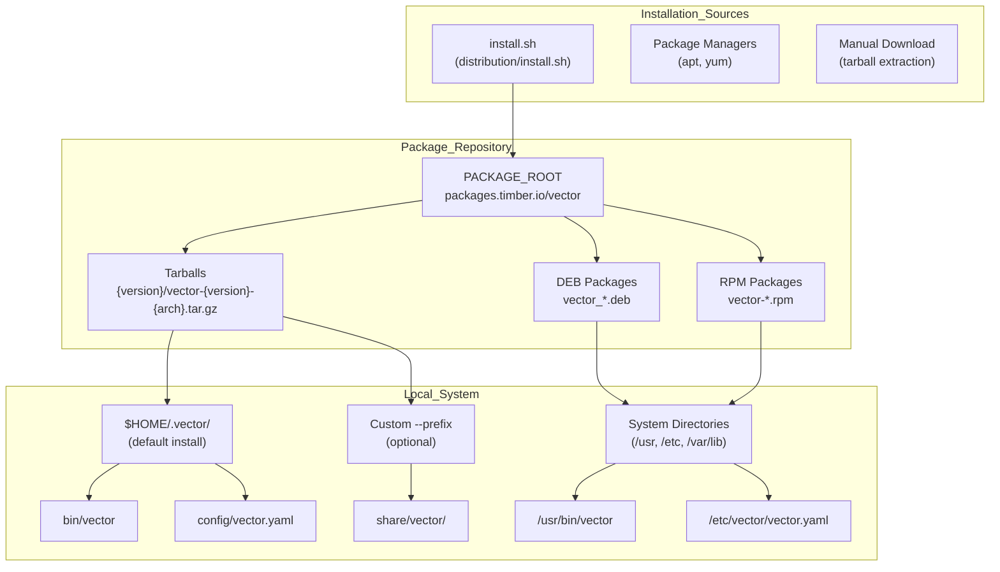
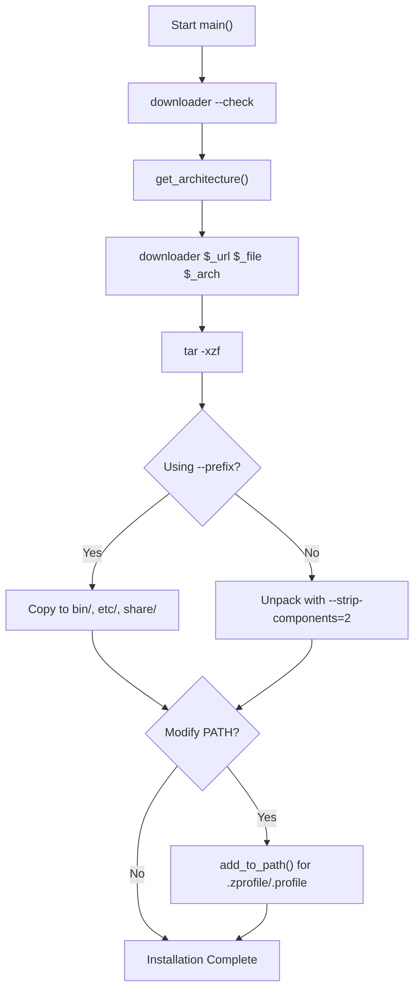
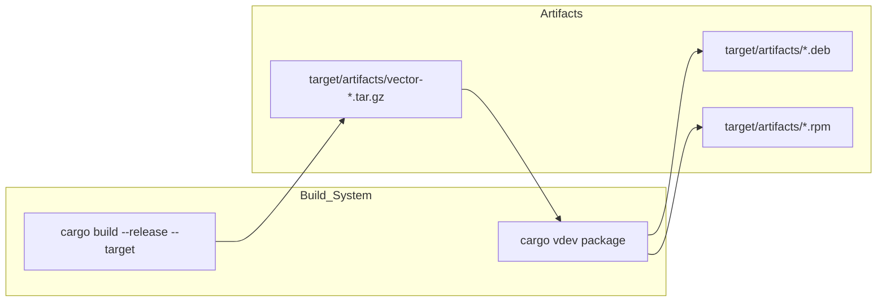

<!-- source: DeepWiki mcp.deepwiki.com · repo vectordotdev/vector · page 7.1 Binary Installation · fetched 2026-10-29 -->

# Binary Installation

<details>
<summary>Relevant source files</summary>

The following files were used as context for generating this wiki page:

- [.github/workflows/vdev_publish.yml](.github/workflows/vdev_publish.yml)
- [Makefile.packaging](Makefile.packaging)
- [config/README.md](config/README.md)
- [distribution/debian/scripts/postinst](distribution/debian/scripts/postinst)
- [distribution/debian/scripts/preinst](distribution/debian/scripts/preinst)
- [distribution/install.sh](distribution/install.sh)
- [distribution/rpm/vector.spec](distribution/rpm/vector.spec)
- [scripts/package-deb.sh](scripts/package-deb.sh)
- [scripts/verify-install.sh](scripts/verify-install.sh)
- [website/content/en/releases/0.22.3.md](website/content/en/releases/0.22.3.md)
- [website/cue/reference/administration/interfaces/kubectl.cue](website/cue/reference/administration/interfaces/kubectl.cue)
- [website/cue/reference/releases/0.22.0.cue](website/cue/reference/releases/0.22.0.cue)
- [website/cue/reference/releases/0.22.3.cue](website/cue/reference/releases/0.22.3.cue)
- [website/cue/reference/versions.cue](website/cue/reference/versions.cue)

</details>


This document details the methods available for installing Vector across various platforms and environments. It focuses on the universal installation script (`install.sh`), platform detection, architecture mapping, package manager configurations (DEB/RPM), and manual installation procedures. For container-based deployments, see [Container Images](7.2). For Kubernetes-specific deployment, see [Kubernetes Deployment](7.3).

## Installation Methods Overview

Vector provides multiple installation methods to accommodate different platforms and deployment scenarios:

| Method | Best For | Platforms | Key Features |
|--------|----------|-----------|--------------|
| Shell Script (`install.sh`) | Quick setup on Unix-like systems | Linux, macOS | Auto-detection, automatic PATH configuration |
| Package Managers | System-wide installation | Debian/Ubuntu (apt), RHEL/CentOS (yum) | Native package management, systemd integration |
| Manual (tarballs) | Custom installations | All platforms | Full control over installation location |
| From Source | Custom builds / development | Linux, macOS, Windows | Custom feature flags, static linking |

### Installation Methods Architecture


Sources: [distribution/install.sh:13-16](), [distribution/install.sh:170]()

## Shell Script Installation

The primary way to install Vector on Unix-like systems is via the installation script. This script automatically detects your system's architecture, downloads the appropriate Vector binary archive, and installs it.

### Basic Usage

```bash
curl --proto '=https' --tlsv1.2 -sSf https://sh.vector.dev | bash
```

This installs Vector to `$HOME/.vector` by default and adds it to your PATH [distribution/install.sh:64]().

### Installation Process Flow


Sources: [distribution/install.sh:58-121](), [distribution/install.sh:123-233](), [distribution/install.sh:186-209]()

### Custom Installation Options

The installation script supports several options:

- `--prefix <dir>`: The directory where the files should be placed (default: `$HOME/.vector`). This option automatically assumes the `--no-modify-path` flag [distribution/install.sh:51-52]().
- `--no-modify-path`: Don't configure the PATH environment variable [distribution/install.sh:53]().
- `-y`: Disable confirmation prompt [distribution/install.sh:50]().

### Architecture Mapping

The script maps the detected system architecture to specific archive names:

| Detected Architecture (`_arch`) | Archive Name (`_archive_arch`) |
|---------------------------------|--------------------------------|
| `aarch64-apple-darwin`          | `arm64-apple-darwin`           |
| `x86_64-*linux*-gnu`            | `x86_64-unknown-linux-gnu`     |
| `x86_64-*linux*-musl`           | `x86_64-unknown-linux-musl`    |
| `aarch64-*linux*`               | `aarch64-unknown-linux-musl`   |
| `armv7-*linux*-gnueabihf`       | `armv7-unknown-linux-gnueabihf`|
| `armv7-*linux*-musleabihf`      | `armv7-unknown-linux-musleabihf`|

Sources: [distribution/install.sh:146-168]()

## Package Manager Installation

Vector is available through native package managers on various platforms, handled via the `vdev` tool and specialized scripts.

### Debian/Ubuntu (DEB)
Vector provides `.deb` packages built using `cargo-deb` [scripts/package-deb.sh:75](). The packaging process:
1. Extracts a pre-built archive and moves the binary to `target/$TARGET/$PROFILE` [scripts/package-deb.sh:39-44]().
2. Generates a Debian-compliant description from the `README.md` using `cmark-gfm` [scripts/package-deb.sh:56-60]().
3. Sets up system permissions via `postinst`, adding the `vector` user to `adm`, `systemd-journal`, and `systemd-journal-remote` groups [distribution/debian/scripts/postinst:5-19]().
4. Creates the `vector` user and data directory `/var/lib/vector` via `preinst` [distribution/debian/scripts/preinst:5-13]().

### RHEL/CentOS (RPM)
RPM packages are defined by `distribution/rpm/vector.spec`. The installation process:
1. Creates the `vector` user and group if they do not exist [distribution/rpm/vector.spec:69-71]().
2. Sets up the data directory at `/var/lib/vector` [distribution/rpm/vector.spec:72]().
3. Adds the `vector` user to `systemd-journal` and `systemd-journal-remote` groups for log access [distribution/rpm/vector.spec:73-74]().
4. Installs the binary to `/usr/bin/vector` and service configuration to `/etc/default/vector` [distribution/rpm/vector.spec:58-63]().

### Verification
The `scripts/verify-install.sh` script ensures packages are built correctly. It verifies:
- Existence of the `vector` user and group [scripts/verify-install.sh:25-26]().
- Binary execution (`vector --version`) [scripts/verify-install.sh:27]().
- Configuration file preservation on reinstall [scripts/verify-install.sh:42]().

## Manual Installation from Source

For development or custom builds, Vector can be compiled from source using the Rust toolchain. The `Makefile.packaging` file provides targets for various triples.

### Packaging Workflow


Sources: [Makefile.packaging:32-38](), [Makefile.packaging:98-134]()

### Cross-Compilation Targets
Available targets in `Makefile.packaging` include:
- `x86_64-unknown-linux-gnu` [Makefile.packaging:65]()
- `x86_64-unknown-linux-musl` [Makefile.packaging:69]()
- `aarch64-unknown-linux-musl` [Makefile.packaging:73]()
- `armv7-unknown-linux-gnueabihf` [Makefile.packaging:81]()

## Installation Directory Structure

The directory structure depends on the installation method.

### Structured Installation (Custom Prefix)
When `--prefix` is specified in `install.sh`, Vector uses a structured layout:
- **Binary**: `$prefix/bin/vector` [distribution/install.sh:197]()
- **Config**: `$prefix/etc/` [distribution/install.sh:199]()
- **Shared Data**: `$prefix/share/vector/config` [distribution/install.sh:202]()
- **Docs**: `$prefix/share/vector/README.md` [distribution/install.sh:203]()

### RPM System Structure
- **Binaries**: `/usr/bin/vector` [distribution/rpm/vector.spec:81]()
- **Service Files**: `/usr/lib/systemd/system/vector.service` [distribution/rpm/vector.spec:82]()
- **Configuration**: `/etc/vector/` [distribution/rpm/vector.spec:88]()
- **Data Directory**: `/var/lib/vector` [distribution/rpm/vector.spec:89]()

## Version Management

The Vector version is centralized and maintained across several files:
- `VECTOR_VERSION`: Defaults to `0.57.0` in the install script [distribution/install.sh:16]().
- `versions.cue`: A manual list of all released versions used by the website metadata [website/cue/reference/versions.cue:4-108]().
- `Makefile.packaging`: Exports the version for packaging targets, defaulting to the output of `cargo vdev version` [Makefile.packaging:17-18]().

## Implementation Details

### PATH Configuration
The `add_to_path` function in `install.sh` appends the Vector binary path to `${HOME}/.zprofile` and `${HOME}/.profile` [distribution/install.sh:212-215]().

### Automated Verification
The `scripts/verify-install.sh` script automates the validation of installed packages, checking for required files like `/etc/default/vector` and ensuring that example configurations are placed in `/usr/share/vector/examples/vector.yaml` [scripts/verify-install.sh:28-30]().

Sources: [distribution/install.sh:1-233](), [distribution/rpm/vector.spec:1-96](), [scripts/package-deb.sh:1-92](), [Makefile.packaging:1-137](), [scripts/verify-install.sh:1-45]()

---

