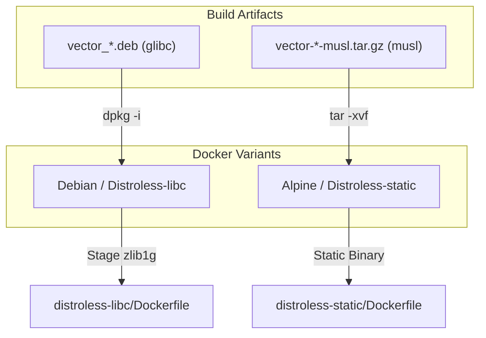
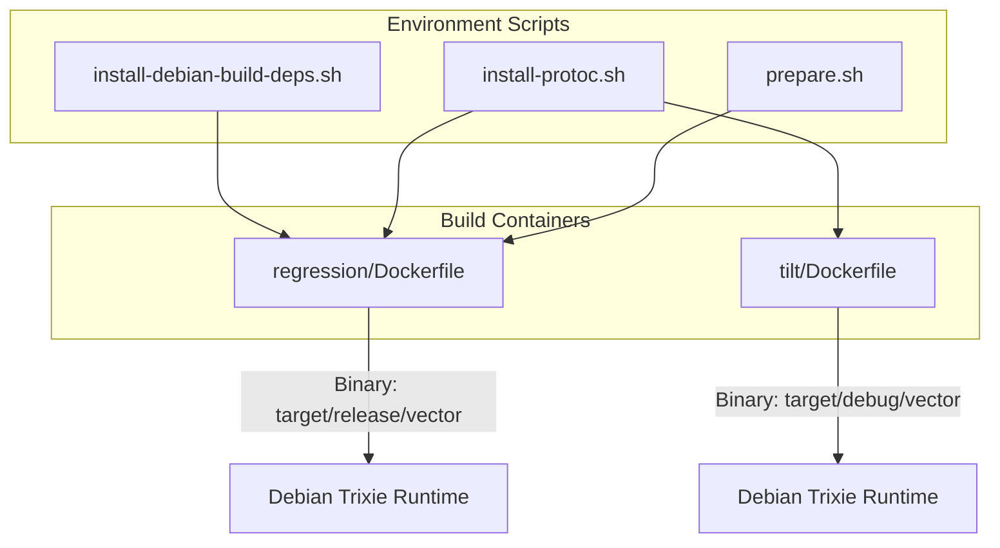

<!-- source: DeepWiki mcp.deepwiki.com · repo vectordotdev/vector · page 7.2 Container Images · fetched 2026-10-29 -->

# Container Images

Relevant source files

The following files were used as context for generating this wiki page:

- [.github/ISSUE_TEMPLATE/minor-release.md](.github/ISSUE_TEMPLATE/minor-release.md)
- [.github/ISSUE_TEMPLATE/patch-release.md](.github/ISSUE_TEMPLATE/patch-release.md)
- [.gitignore](.gitignore)
- [README.md](README.md)
- [Tiltfile](Tiltfile)
- [agents/skills/vector-components-maturity-eval/SKILL.md](agents/skills/vector-components-maturity-eval/SKILL.md)
- [distribution/docker/alpine/Dockerfile](distribution/docker/alpine/Dockerfile)
- [distribution/docker/debian/Dockerfile](distribution/docker/debian/Dockerfile)
- [distribution/docker/distroless-libc/Dockerfile](distribution/docker/distroless-libc/Dockerfile)
- [distribution/docker/distroless-static/Dockerfile](distribution/docker/distroless-static/Dockerfile)
- [lib/vector-buffers/src/variants/disk_v2/tests/model/action.rs](lib/vector-buffers/src/variants/disk_v2/tests/model/action.rs)
- [lib/vector-buffers/src/variants/disk_v2/tests/model/sequencer.rs](lib/vector-buffers/src/variants/disk_v2/tests/model/sequencer.rs)
- [regression/Dockerfile](regression/Dockerfile)
- [rust-toolchain.toml](rust-toolchain.toml)
- [scripts/environment/install-debian-build-deps.sh](scripts/environment/install-debian-build-deps.sh)
- [src/kubernetes/meta_cache.rs](src/kubernetes/meta_cache.rs)
- [src/kubernetes/mod.rs](src/kubernetes/mod.rs)
- [src/kubernetes/pod_manager_logic.rs](src/kubernetes/pod_manager_logic.rs)
- [src/kubernetes/reflector.rs](src/kubernetes/reflector.rs)
- [src/sources/kubernetes_logs/k8s_paths_provider.rs](src/sources/kubernetes_logs/k8s_paths_provider.rs)
- [tilt/Dockerfile](tilt/Dockerfile)
- [website/content/en/docs/setup/installation/platforms/docker.md](website/content/en/docs/setup/installation/platforms/docker.md)

This page describes Vector's Docker container images, including the available variants (Alpine, Debian, Distroless), multi-architecture support, the automated image building process, and specialized images used for development and regression testing.

## Image Variants

Vector provides four primary image variants to balance compatibility, security, and image size. Each variant is optimized for specific deployment requirements.

| Variant | Base Image | C Library | Characteristics |
| :--- | :--- | :--- | :--- |
| **Alpine** | `alpine:3.24` | `musl` | Minimal size, uses `apk` package manager. Includes `ca-certificates` and `tzdata`. [distribution/docker/alpine/Dockerfile:15-24]() |
| **Debian** | `debian:trixie-slim` | `glibc` | Broadest compatibility. Includes `apt`, `ca-certificates`, `tzdata`, `systemd`, and `libsasl2-2`. [distribution/docker/debian/Dockerfile:10-19]() |
| **Distroless-libc** | `gcr.io/distroless/cc-debian12` | `glibc` | Security-focused, contains only Vector and dynamic dependencies like `zlib`. No shell. [distribution/docker/distroless-libc/Dockerfile:10-18]() |
| **Distroless-static** | `gcr.io/distroless/static` | `musl` | Most minimal, contains only the statically linked Vector binary. [distribution/docker/distroless-static/Dockerfile:12]() |

### Implementation Details

The Dockerfiles utilize multi-stage builds. They first use a `builder` stage to extract the Vector binary from pre-compiled archives (tarballs or `.deb` packages) before copying them into the final production image.

*   **Alpine/Distroless-static**: These variants pull the `musl` build of Vector. For Alpine, a special case handles `arm/v6` builds where the `TARGETPLATFORM` argument is used to determine if the architecture should be forced to `arm` instead of the default reported by `apk`. [distribution/docker/alpine/Dockerfile:5-11]()
*   **Debian/Distroless-libc**: These variants install the `.deb` package in the builder stage using `dpkg -i` to ensure all standard directory structures (`/usr/bin`, `/etc/vector`, `/var/lib/vector`) are correctly populated. [distribution/docker/debian/Dockerfile:5-8](), [distribution/docker/distroless-libc/Dockerfile:5-6]()
*   **Dynamic Dependencies**: In `distroless-libc`, `zlib1g` is explicitly staged from the Debian builder because `distroless/cc` does not include it, and Vector (via `rdkafka`) links against it dynamically. The build script finds the library path using `dpkg -L zlib1g`. [distribution/docker/distroless-libc/Dockerfile:10-14]()

Sources: [distribution/docker/alpine/Dockerfile:1-34](), [distribution/docker/debian/Dockerfile:1-31](), [distribution/docker/distroless-libc/Dockerfile:1-35](), [distribution/docker/distroless-static/Dockerfile:1-27]()

## Multi-Architecture Support

Vector supports multiple CPU architectures through multi-arch manifests. The building process maps target platforms to specific Vector build artifacts.

### Build-Time Mapping
The following diagram illustrates how build artifacts are mapped to specific Docker variants during the multi-stage build process.

Sources: [distribution/docker/alpine/Dockerfile:7-11](), [distribution/docker/debian/Dockerfile:5-6](), [distribution/docker/distroless-libc/Dockerfile:10-14]()

## Specialized Development and Testing Images

Vector maintains specialized Dockerfiles for development, CI, and regression testing to ensure performance stability and feature correctness.

### Regression Testing Image
The `regression/Dockerfile` is used to build Vector for performance and stability regression testing.
*   **Build Environment**: Uses `rust:${RUST_VERSION}-slim-trixie` as a base and installs dependencies via `install-debian-build-deps.sh`. [regression/Dockerfile:4-11]()
*   **Optimization**: Compiles Vector with the `release` profile and uses the `mold` linker for faster build times. [regression/Dockerfile:23-24]()
*   **Dependencies**: Includes `zlib1g`, `ca-certificates`, and `libsasl2-2` in the final runtime stage based on `debian:trixie-slim`. [regression/Dockerfile:29-30]()

### Tilt/Development Image
For local Kubernetes development, `tilt/Dockerfile` provides a fast-feedback loop:
*   **Mold Linker**: Compiles and installs `mold` (v2.40.4) from source to significantly speed up Rust linking during development. [tilt/Dockerfile:11-18]()
*   **Build Caching**: Utilizes Docker's `--mount=type=cache` for the `/vector/target` directory and Cargo registries to optimize incremental builds. [tilt/Dockerfile:24-26]()
*   **Feature Selection**: Accepts a `FEATURES` argument to compile only necessary components, defaulting to a set required for Agent and Aggregator Helm configurations. [tilt/Dockerfile:4-28]()

### Release Process
During minor and patch releases, the release engineer checks if newer versions of Alpine or Debian are available to update the base images in `distribution/docker/`. [ .github/ISSUE_TEMPLATE/minor-release.md:46-47](). The version number in `distribution/install.sh` is also updated to match the new release. [ .github/ISSUE_TEMPLATE/patch-release.md:32]()

### System Logic Flow: Build to Test
The following diagram shows the relationship between the various Dockerfiles and the build environment scripts.

Sources: [regression/Dockerfile:1-38](), [tilt/Dockerfile:1-44](), [ .github/ISSUE_TEMPLATE/minor-release.md:46-47](), [ .github/ISSUE_TEMPLATE/patch-release.md:32]()

---

