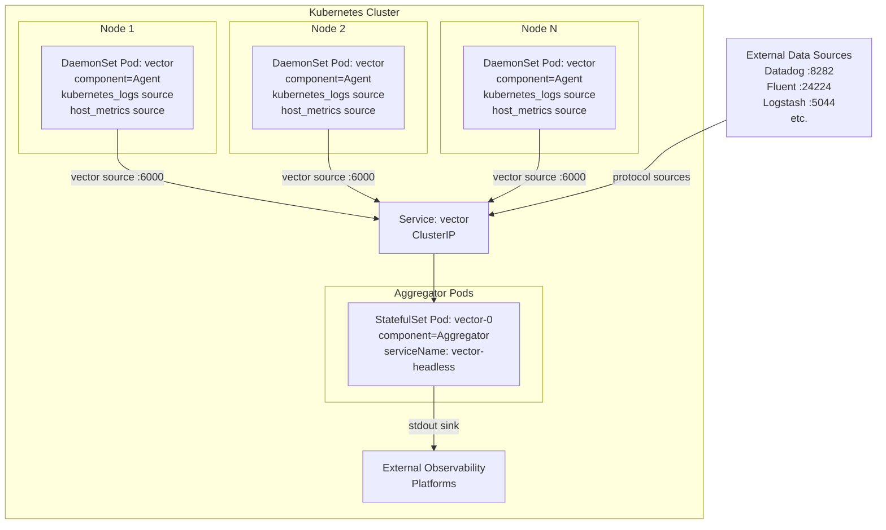
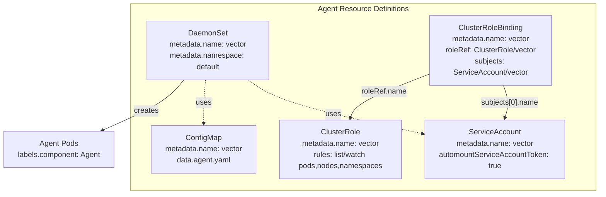
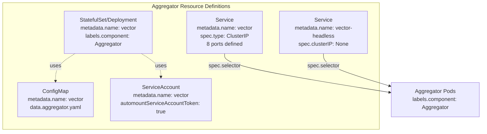

<!-- source: DeepWiki mcp.deepwiki.com · repo vectordotdev/vector · page 7.3 Kubernetes Deployment · fetched 2026-10-29 -->

# Kubernetes Deployment

<details>
<summary>Relevant source files</summary>

The following files were used as context for generating this wiki page:

- [distribution/kubernetes/vector-agent/README.md](distribution/kubernetes/vector-agent/README.md)
- [distribution/kubernetes/vector-agent/configmap.yaml](distribution/kubernetes/vector-agent/configmap.yaml)
- [distribution/kubernetes/vector-agent/daemonset.yaml](distribution/kubernetes/vector-agent/daemonset.yaml)
- [distribution/kubernetes/vector-agent/kustomization.yaml](distribution/kubernetes/vector-agent/kustomization.yaml)
- [distribution/kubernetes/vector-agent/rbac.yaml](distribution/kubernetes/vector-agent/rbac.yaml)
- [distribution/kubernetes/vector-agent/service-headless.yaml](distribution/kubernetes/vector-agent/service-headless.yaml)
- [distribution/kubernetes/vector-agent/serviceaccount.yaml](distribution/kubernetes/vector-agent/serviceaccount.yaml)
- [distribution/kubernetes/vector-aggregator/README.md](distribution/kubernetes/vector-aggregator/README.md)
- [distribution/kubernetes/vector-aggregator/configmap.yaml](distribution/kubernetes/vector-aggregator/configmap.yaml)
- [distribution/kubernetes/vector-aggregator/kustomization.yaml](distribution/kubernetes/vector-aggregator/kustomization.yaml)
- [distribution/kubernetes/vector-aggregator/service-headless.yaml](distribution/kubernetes/vector-aggregator/service-headless.yaml)
- [distribution/kubernetes/vector-aggregator/service.yaml](distribution/kubernetes/vector-aggregator/service.yaml)
- [distribution/kubernetes/vector-aggregator/serviceaccount.yaml](distribution/kubernetes/vector-aggregator/serviceaccount.yaml)
- [distribution/kubernetes/vector-aggregator/statefulset.yaml](distribution/kubernetes/vector-aggregator/statefulset.yaml)
- [distribution/kubernetes/vector-stateless-aggregator/README.md](distribution/kubernetes/vector-stateless-aggregator/README.md)
- [distribution/kubernetes/vector-stateless-aggregator/configmap.yaml](distribution/kubernetes/vector-stateless-aggregator/configmap.yaml)
- [distribution/kubernetes/vector-stateless-aggregator/deployment.yaml](distribution/kubernetes/vector-stateless-aggregator/deployment.yaml)
- [distribution/kubernetes/vector-stateless-aggregator/service-headless.yaml](distribution/kubernetes/vector-stateless-aggregator/service-headless.yaml)
- [distribution/kubernetes/vector-stateless-aggregator/service.yaml](distribution/kubernetes/vector-stateless-aggregator/service.yaml)
- [src/sources/kubernetes_logs/namespace_metadata_annotator.rs](src/sources/kubernetes_logs/namespace_metadata_annotator.rs)
- [src/sources/kubernetes_logs/node_metadata_annotator.rs](src/sources/kubernetes_logs/node_metadata_annotator.rs)
- [src/sources/kubernetes_logs/pod_metadata_annotator.rs](src/sources/kubernetes_logs/pod_metadata_annotator.rs)
- [website/.hugo_build.lock](website/.hugo_build.lock)
- [website/content/en/blog/kubernetes-integration.md](website/content/en/blog/kubernetes-integration.md)
- [website/content/en/docs/administration/management.md](website/content/en/docs/administration/management.md)
- [website/content/en/docs/administration/monitoring.md](website/content/en/docs/administration/monitoring.md)
- [website/content/en/docs/setup/deployment/roles.md](website/content/en/docs/setup/deployment/roles.md)
- [website/content/en/docs/setup/installation/package-managers/helm.md](website/content/en/docs/setup/installation/package-managers/helm.md)
- [website/content/en/docs/setup/installation/platforms/kubernetes.md](website/content/en/docs/setup/installation/platforms/kubernetes.md)
- [website/cue/reference/administration/interfaces/helm3.cue](website/cue/reference/administration/interfaces/helm3.cue)
- [website/cue/reference/administration/roles/aggregator.cue](website/cue/reference/administration/roles/aggregator.cue)
- [website/cue/reference/components/sources/file.cue](website/cue/reference/components/sources/file.cue)
- [website/cue/reference/components/sources/kubernetes_logs.cue](website/cue/reference/components/sources/kubernetes_logs.cue)
- [website/cue/reference/services/kubernetes.cue](website/cue/reference/services/kubernetes.cue)

</details>


This document details Vector's Kubernetes deployment architecture, covering three deployment patterns (Agent, Aggregator, Stateless-Aggregator), their Kubernetes resource definitions, RBAC configuration, networking setup, and data flow patterns. All manifests are located in [distribution/kubernetes/]() and are auto-generated from the upstream `vector/vector` Helm chart.

Sources:
[distribution/kubernetes/vector-agent/README.md:1-10]()
[distribution/kubernetes/vector-aggregator/README.md:1-8]()
[distribution/kubernetes/vector-stateless-aggregator/README.md:1-8]()

## Deployment Patterns

Vector provides three Kubernetes deployment patterns, each implemented with specific Kubernetes workload types:

| Pattern | Kubernetes Resource | Component Label | Purpose |
|---------|---------------------|-----------------|---------|
| **Agent** | `DaemonSet` | `app.kubernetes.io/component: Agent` | Node-level log and metric collection via `kubernetes_logs` and `host_metrics` sources |
| **Aggregator** | `StatefulSet` | `app.kubernetes.io/component: Aggregator` | Centralized data aggregation with stable network identity and disk persistence |
| **Stateless-Aggregator** | `Deployment` | `app.kubernetes.io/component: Stateless-Aggregator` | Load-balanced aggregation without state management requirements |

All deployments use the `0.57.0-distroless-libc` container image variant [distribution/kubernetes/vector-agent/daemonset.yaml:33-33]().

Sources:
[distribution/kubernetes/vector-agent/rbac.yaml:12-13]()
[distribution/kubernetes/vector-aggregator/service.yaml:11-12]()
[distribution/kubernetes/vector-stateless-aggregator/service.yaml:11-12]()
[distribution/kubernetes/vector-agent/daemonset.yaml:4-12]()

### Deployment Architecture



Sources:
[distribution/kubernetes/vector-aggregator/service.yaml:1-45]()
[distribution/kubernetes/vector-aggregator/configmap.yaml:19-45]()
[distribution/kubernetes/vector-agent/daemonset.yaml:20-27]()

## Kubernetes Resource Structure

Each Vector deployment pattern uses specific Kubernetes resources to manage the application lifecycle and configuration.

### Vector Agent Resources

The Agent role is designed to run on every node in the cluster. It requires elevated RBAC permissions to interact with the Kubernetes API for metadata enrichment. The Agent also mounts several host volumes to collect system logs and metrics.



**Host Volume Mounts:**
The Agent role mounts the following host paths to enable log collection and host metrics:
* `/var/log/` to `/var/log/` (read-only) [distribution/kubernetes/vector-agent/daemonset.yaml:71-73]()
* `/var/lib/` to `/var/lib/` (read-only) [distribution/kubernetes/vector-agent/daemonset.yaml:74-76]()
* `/proc` to `/host/proc` (read-only) [distribution/kubernetes/vector-agent/daemonset.yaml:77-79]()
* `/sys` to `/host/sys` (read-only) [distribution/kubernetes/vector-agent/daemonset.yaml:80-82]()
* Host path `/var/lib/vector` for persistent data storage [distribution/kubernetes/vector-agent/daemonset.yaml:91-92]()

Sources:
[distribution/kubernetes/vector-agent/rbac.yaml:5-43]()
[distribution/kubernetes/vector-agent/serviceaccount.yaml:3-14]()
[distribution/kubernetes/vector-agent/daemonset.yaml:65-105]()

### Vector Aggregator Resources

The Aggregator role uses a `StatefulSet` (or `Deployment` for the stateless variant) to provide data processing services.



Sources:
[distribution/kubernetes/vector-aggregator/configmap.yaml:3-56]()
[distribution/kubernetes/vector-aggregator/service.yaml:3-45]()
[distribution/kubernetes/vector-aggregator/service-headless.yaml:3-46]()
[distribution/kubernetes/vector-stateless-aggregator/service.yaml:3-45]()

## Configuration Details

### ConfigMap-based Configuration
Vector components are configured via `ConfigMap` resources mounted to `/etc/vector/` [distribution/kubernetes/vector-agent/daemonset.yaml:68-70]().

**Agent Configuration (`agent.yaml`):**
* `kubernetes_logs`: Collects logs from Kubernetes pods [distribution/kubernetes/vector-agent/configmap.yaml:20-21]().
* `host_metrics`: Collects node-level metrics including filesystem usage [distribution/kubernetes/vector-agent/configmap.yaml:22-30]().
* `internal_metrics`: Tracks Vector's own performance [distribution/kubernetes/vector-agent/configmap.yaml:31-32]().

**Aggregator Configuration (`aggregator.yaml`):**
The Aggregator acts as a central ingestion point for various protocols:

| Source ID | Type | Address | Purpose |
|-----------|------|---------|---------|
| `datadog_agent` | `datadog_agent` | `0.0.0.0:8282` | Receives Datadog Agent data [distribution/kubernetes/vector-aggregator/configmap.yaml:20-22]() |
| `fluent` | `fluent` | `0.0.0.0:24224` | Receives Fluentd/Fluent Bit data [distribution/kubernetes/vector-aggregator/configmap.yaml:23-25]() |
| `logstash` | `logstash` | `0.0.0.0:5044` | Receives Logstash beats protocol data [distribution/kubernetes/vector-aggregator/configmap.yaml:28-30]() |
| `splunk_hec` | `splunk_hec` | `0.0.0.0:8080` | Receives Splunk HEC data [distribution/kubernetes/vector-aggregator/configmap.yaml:31-33]() |
| `statsd` | `statsd` | `0.0.0.0:8125` | Receives StatsD metrics (TCP) [distribution/kubernetes/vector-aggregator/configmap.yaml:34-37]() |
| `syslog` | `syslog` | `0.0.0.0:9000` | Receives syslog data (TCP) [distribution/kubernetes/vector-aggregator/configmap.yaml:38-41]() |
| `vector` | `vector` | `0.0.0.0:6000` | Receives Vector protocol v2 data [distribution/kubernetes/vector-aggregator/configmap.yaml:42-45]() |

Sources:
[distribution/kubernetes/vector-agent/configmap.yaml:14-43]()
[distribution/kubernetes/vector-aggregator/configmap.yaml:14-56]()

## Networking Configuration

Vector deploys two types of Kubernetes Services for the Aggregator and Stateless-Aggregator deployments:

### Service Resources

**1. ClusterIP Service (`vector`)**
The standard ClusterIP Service provides a stable virtual IP for load-balanced access [distribution/kubernetes/vector-aggregator/service.yaml:44-44](). It distributes traffic across all pods matching the selector labels.

**2. Headless Service (`vector-headless`)**
The headless Service (`clusterIP: None`) creates DNS records for direct pod addressing [distribution/kubernetes/vector-aggregator/service-headless.yaml:15-15](). This is used for peer-to-peer communication or when specific pod addressing is required.

### Service Port Mappings

| Port Name | Port Number | Protocol | Purpose |
|-----------|-------------|----------|---------|
| `datadog-agent` | 8282 | TCP | Datadog Agent ingestion |
| `fluent` | 24224 | TCP | Fluentd/Fluent Bit ingestion |
| `logstash` | 5044 | TCP | Logstash beats protocol |
| `splunk-hec` | 8080 | TCP | Splunk HTTP Event Collector |
| `statsd` | 8125 | TCP | StatsD metrics ingestion |
| `syslog` | 9000 | TCP | Syslog ingestion |
| `vector` | 6000 | TCP | Vector-to-Vector protocol |
| `prom-exporter` | 9090 | TCP | Prometheus metrics exposition |

Sources:
[distribution/kubernetes/vector-aggregator/service.yaml:15-39]()
[distribution/kubernetes/vector-stateless-aggregator/service.yaml:15-39]()

## RBAC Permissions

Vector requires specific RBAC permissions to access the Kubernetes API, primarily for the Agent role to enrich logs with metadata.

### ClusterRole Definition
The `ClusterRole` resource grants read-only access to core Kubernetes resources:

```yaml
apiVersion: rbac.authorization.k8s.io/v1
kind: ClusterRole
metadata:
  name: vector
rules:
  - apiGroups: [""]
    resources: [namespaces, nodes, pods]
    verbs: [list, watch]
```

These permissions are utilized by the `kubernetes_logs` source to discover pods and enrich log events with metadata (pod name, labels, annotations).

Sources:
[distribution/kubernetes/vector-agent/rbac.yaml:5-23]()

## Helm Chart Usage

The Kubernetes manifests provided in the Vector repository are auto-generated from the official `vector/vector` Helm chart.

### Role-based Configuration
The role of the deployment is controlled by the `role` value in the Helm chart:

* **Agent**: `role: Agent` with `service.enabled: false` [distribution/kubernetes/vector-agent/README.md:6-8]().
* **Stateless-Aggregator**: `role: Stateless-Aggregator` [distribution/kubernetes/vector-stateless-aggregator/README.md:6-6]().
* **Aggregator**: Default role (manifests in [distribution/kubernetes/vector-aggregator/]()).

### Environmental Metadata
The `DaemonSet` injects pod and node metadata via environment variables using the Kubernetes Downward API:
* `VECTOR_SELF_NODE_NAME`: `spec.nodeName` [distribution/kubernetes/vector-agent/daemonset.yaml:41-44]()
* `VECTOR_SELF_POD_NAME`: `metadata.name` [distribution/kubernetes/vector-agent/daemonset.yaml:45-48]()
* `VECTOR_SELF_POD_NAMESPACE`: `metadata.namespace` [distribution/kubernetes/vector-agent/daemonset.yaml:49-52]()

Sources:
[distribution/kubernetes/vector-agent/README.md:1-10]()
[distribution/kubernetes/vector-stateless-aggregator/README.md:1-8]()
[distribution/kubernetes/vector-agent/daemonset.yaml:38-52]()

---

