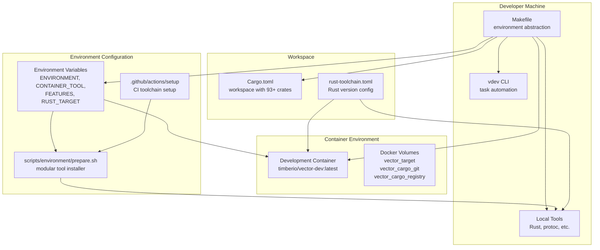
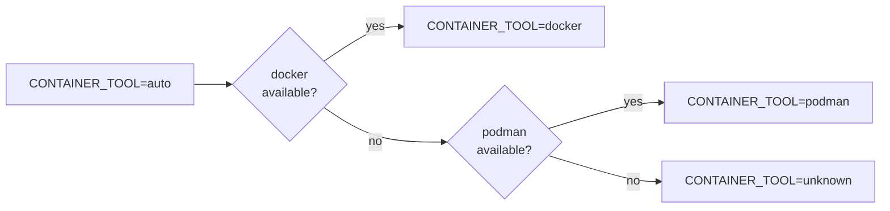
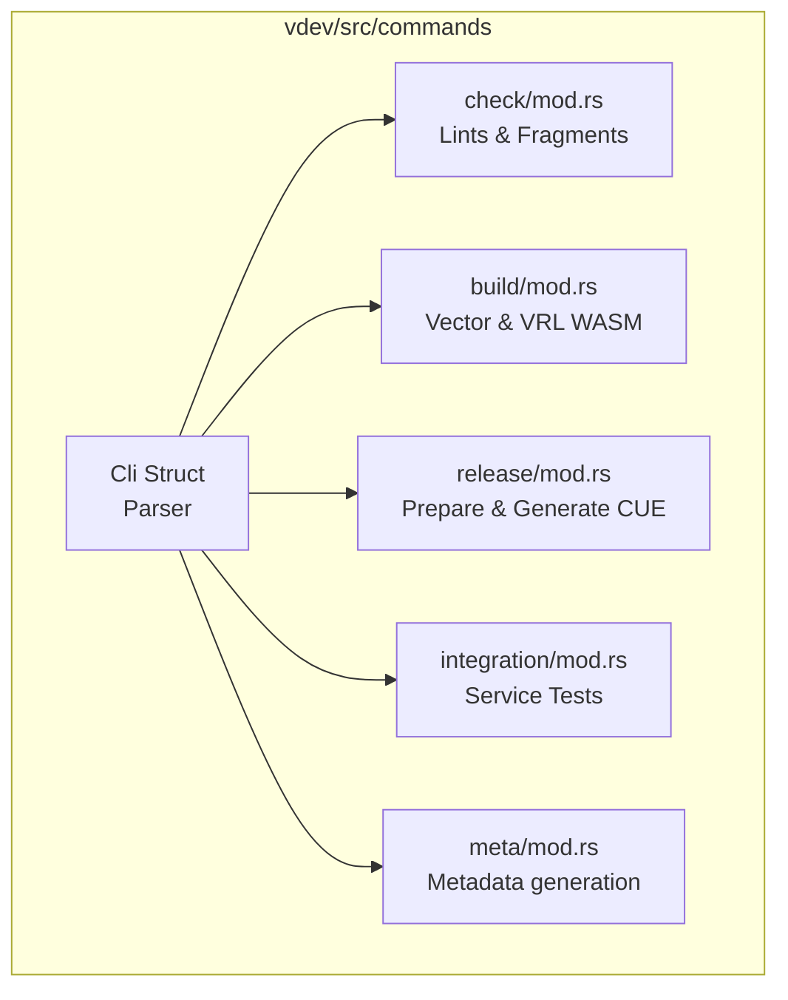

<!-- source: DeepWiki mcp.deepwiki.com · repo vectordotdev/vector · page 8.1 Environment Setup · fetched 2026-10-29 -->

# Environment Setup

<details>
<summary>Relevant source files</summary>

The following files were used as context for generating this wiki page:

- [.cargo/config.toml](.cargo/config.toml)
- [.dockerignore](.dockerignore)
- [.github/PULL_REQUEST_TEMPLATE.md](.github/PULL_REQUEST_TEMPLATE.md)
- [.github/actions/setup/action.yml](.github/actions/setup/action.yml)
- [.github/workflows/changelog.yaml](.github/workflows/changelog.yaml)
- [.github/workflows/ci-review-trigger.yml](.github/workflows/ci-review-trigger.yml)
- [.github/workflows/coverage.yml](.github/workflows/coverage.yml)
- [.github/workflows/master_merge_queue.yml](.github/workflows/master_merge_queue.yml)
- [.github/workflows/test-make-command.yml](.github/workflows/test-make-command.yml)
- [.github/workflows/unit-tests.yml](.github/workflows/unit-tests.yml)
- [.github/workflows/vdev_autotag.yml](.github/workflows/vdev_autotag.yml)
- [AGENTS.md](AGENTS.md)
- [CONTRIBUTING.md](CONTRIBUTING.md)
- [changelog.d/README.md](changelog.d/README.md)
- [rfcs/2020-08-04-3325-remap-v2.md](rfcs/2020-08-04-3325-remap-v2.md)
- [scripts/environment/prepare.sh](scripts/environment/prepare.sh)
- [src/test_util/http.rs](src/test_util/http.rs)
- [tests/e2e/opentelemetry-logs/README.md](tests/e2e/opentelemetry-logs/README.md)
- [vdev/README.md](vdev/README.md)
- [vdev/src/app.rs](vdev/src/app.rs)
- [vdev/src/commands/build/mod.rs](vdev/src/commands/build/mod.rs)
- [vdev/src/commands/build/vector.rs](vdev/src/commands/build/vector.rs)
- [vdev/src/commands/build/vrl_wasm.rs](vdev/src/commands/build/vrl_wasm.rs)
- [vdev/src/commands/changelog/mod.rs](vdev/src/commands/changelog/mod.rs)
- [vdev/src/commands/changelog/new.rs](vdev/src/commands/changelog/new.rs)
- [vdev/src/commands/check/changelog_fragments.rs](vdev/src/commands/check/changelog_fragments.rs)
- [vdev/src/commands/check/examples.rs](vdev/src/commands/check/examples.rs)
- [vdev/src/commands/check/mod.rs](vdev/src/commands/check/mod.rs)
- [vdev/src/commands/check/rust.rs](vdev/src/commands/check/rust.rs)
- [vdev/src/commands/complete.rs](vdev/src/commands/complete.rs)
- [vdev/src/commands/compose_tests/mod.rs](vdev/src/commands/compose_tests/mod.rs)
- [vdev/src/commands/compose_tests/run.rs](vdev/src/commands/compose_tests/run.rs)
- [vdev/src/commands/crate_versions.rs](vdev/src/commands/crate_versions.rs)
- [vdev/src/commands/e2e/mod.rs](vdev/src/commands/e2e/mod.rs)
- [vdev/src/commands/integration/mod.rs](vdev/src/commands/integration/mod.rs)
- [vdev/src/commands/meta/mod.rs](vdev/src/commands/meta/mod.rs)
- [vdev/src/commands/mod.rs](vdev/src/commands/mod.rs)
- [vdev/src/commands/release/generate_cue.rs](vdev/src/commands/release/generate_cue.rs)
- [vdev/src/commands/release/mod.rs](vdev/src/commands/release/mod.rs)
- [vdev/src/commands/release/prepare.rs](vdev/src/commands/release/prepare.rs)

</details>


This document covers setting up the development environment for building, testing, and working with Vector. It explains the Makefile-based environment abstraction, the `vdev` CLI tool, Docker-based development containers, and local build setup.

For information about the CI/CD pipeline that uses these environments, see [8.3](). For cross-compilation and release builds, see [8.4]().

---

## Overview

Vector provides two primary approaches for development environment setup:

1. **Local Development**: Direct installation of dependencies and tools on the host machine using platform-specific bootstrap scripts and `prepare.sh` [scripts/environment/prepare.sh:1-60]().
2. **Containerized Development**: Using Docker/Podman with pre-configured development containers to ensure environment parity across different machines [AGENTS.md:218-220]().

The environment setup is orchestrated through:
- **Makefile**: Central environment abstraction and task execution [CONTRIBUTING.md:138-154]().
- **vdev CLI**: Development task automation tool implemented in Rust [vdev/src/app.rs:88-101]().
- **Bootstrap Scripts**: Platform-specific dependency installation (Ubuntu, macOS, Windows).
- **Development Container**: Pre-built environment with all dependencies required for Vector's crates [AGENTS.md:218-220]().

---

## Environment Architecture



**Environment Selection Decision Flow**

Sources: [scripts/environment/prepare.sh:1-60](), [.github/actions/setup/action.yml:9-96](), [AGENTS.md:158-171]()

---

## Makefile Environment Abstraction

The Makefile provides a unified interface for development tasks with automatic detection of the host environment. It acts as the primary entry point for developers [CONTRIBUTING.md:138-154]().

### Container Tool Detection

The environment abstraction logic determines whether to use Docker or Podman based on availability and environment variables.



### Key Environment Variables

| Variable | Purpose | Default | Usage |
|----------|---------|---------|-------|
| `ENVIRONMENT` | Enable containerized development | `false` | Set to `true` to run commands in container |
| `CONTAINER_TOOL` | Container runtime to use | `docker` | `docker` or `podman` [.github/workflows/master_merge_queue.yml:32]() |
| `RUST_BACKTRACE` | Error reporting detail | `full` | [.github/workflows/ci-review-trigger.yml:49]() |
| `INSTALL_MODULES` | Selective tool installation | `all` | Used by `prepare.sh` to filter tools [scripts/environment/prepare.sh:67-69]() |

Sources: [.github/workflows/master_merge_queue.yml:31-39](), [scripts/environment/prepare.sh:67-69](), [.github/workflows/ci-review-trigger.yml:47-54]()

---

## vdev CLI Tool

The `vdev` CLI tool is Vector's unified development utility. It is defined as a cargo alias in the workspace [vdev/README.md]().

### vdev Architecture

The `vdev` tool uses `clap` for command parsing and provides various subcommands for the development lifecycle.



**Key Commands:**
- `check`: Runs lints, formatters, and validity checks for Rust [vdev/src/commands/check/rust.rs]() and changelog fragments [vdev/src/commands/check/changelog_fragments.rs:1-15]().
- `build`: Wraps `cargo build` for Vector binaries [vdev/src/commands/build/vector.rs]() and VRL WASM targets [vdev/src/commands/build/vrl_wasm.rs]().
- `release`: Automates release tasks like generating CUE metadata [vdev/src/commands/release/generate_cue.rs:33-45]() and pinning VRL versions [vdev/src/commands/release/prepare.rs:152-165]().
- `integration`: Manages integration tests against external services [vdev/src/commands/integration/mod.rs]().

Sources: [vdev/src/commands/mod.rs](), [vdev/src/commands/release/prepare.rs:22-44](), [AGENTS.md:158-171]()

---

## Docker-Based Development Environment

Vector utilizes a standardized Docker environment to ensure consistent builds across different operating systems and CI runners.

### Development Container Structure

The container environment is primarily used for integration testing. The `CONTAINER_TOOL` is set to `docker` by default in CI workflows [.github/workflows/master_merge_queue.yml:32]().

### Integration Test Runner
Integration tests verify Vector works with real external services [AGENTS.md:217-219](). The system uses `cargo vdev int` to manage these environments, allowing developers to start services and run tests against them [AGENTS.md:222-229]().

Sources: [AGENTS.md:217-232](), [vdev/src/commands/integration/mod.rs]()

---

## Local Development Setup

### Modular Preparation Script (`prepare.sh`)

The `scripts/environment/prepare.sh` script is the core of the local setup. It installs specific "modules" (tools) required for development [scripts/environment/prepare.sh:43-59]().

**Installation Modules:**
- **Rust/Cargo Tools**: `rustup`, `cargo-deb`, `cross`, `cargo-nextest`, `cargo-deny`, `cargo-msrv`, `cargo-hack`, `cargo-llvm-cov` [scripts/environment/prepare.sh:44-52]().
- **NPM Tools**: `markdownlint-cli2`, `prettier`, `datadog-ci` [scripts/environment/prepare.sh:55-57]().
- **Other**: `wasm-pack`, `vdev`, `protoc` [scripts/environment/prepare.sh:45-58]().

**Tool Version Management:**
Versions are pinned directly in the script to ensure environment stability.
- `CARGO_NEXTEST_VERSION`: "0.9.95" [scripts/environment/prepare.sh:33]()
- `CARGO_DENY_VERSION`: "0.19.0" [scripts/environment/prepare.sh:34]()
- `CARGO_DEB_VERSION`: "2.9.3" [scripts/environment/prepare.sh:31]()

### Platform-Specific Bootstrap

Platform scripts invoke `prepare.sh` with appropriate modules. The CI setup is handled by the `.github/actions/setup` composite action which automates tool installation, including `mold` for faster linking [.github/actions/setup/action.yml:142-187]() and `cue` [.github/actions/setup/action.yml:189-202]().

The `vdev` tool itself is installed via `cargo binstall` or built from the working tree if `binstall` fails [scripts/environment/prepare.sh:153-167]().

Sources: [scripts/environment/prepare.sh:30-58](), [.github/actions/setup/action.yml:1-96](), [CONTRIBUTING.md:121-131]()

---

## Common Development Workflows

### 1. Initial Setup (Local)
```bash
# Prepare the environment with all modules
bash scripts/environment/prepare.sh
```
[scripts/environment/prepare.sh:81-105]()

### 2. Building and Testing
```bash
# Build the binary via vdev
cargo vdev build vector
# Run unit tests via vdev
cargo vdev test
```
[AGENTS.md:160-170]()

### 3. Checking Code Quality
```bash
# Run Clippy and formatting checks via Makefile
make check-clippy
make check-fmt
```
[CONTRIBUTING.md:144-145]()

### 4. Release Preparation
```bash
# Prepare release branches and pin versions
cargo vdev release prepare --version 0.40.0 --vrl-version 0.20.0
# Generate release CUE metadata
cargo vdev release generate-cue --version 0.40.0
```
[vdev/src/commands/release/prepare.rs:58-80](), [vdev/src/commands/release/generate_cue.rs:33-45]()

Sources: [CONTRIBUTING.md:138-154](), [AGENTS.md:158-171](), [vdev/src/commands/release/prepare.rs:83-110]()

---

