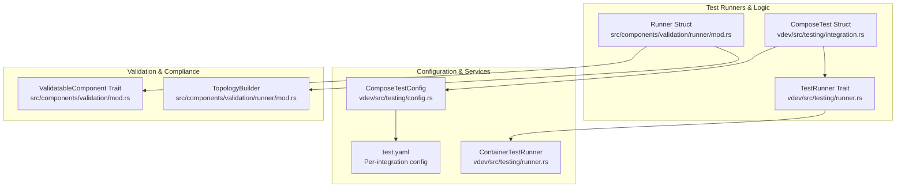
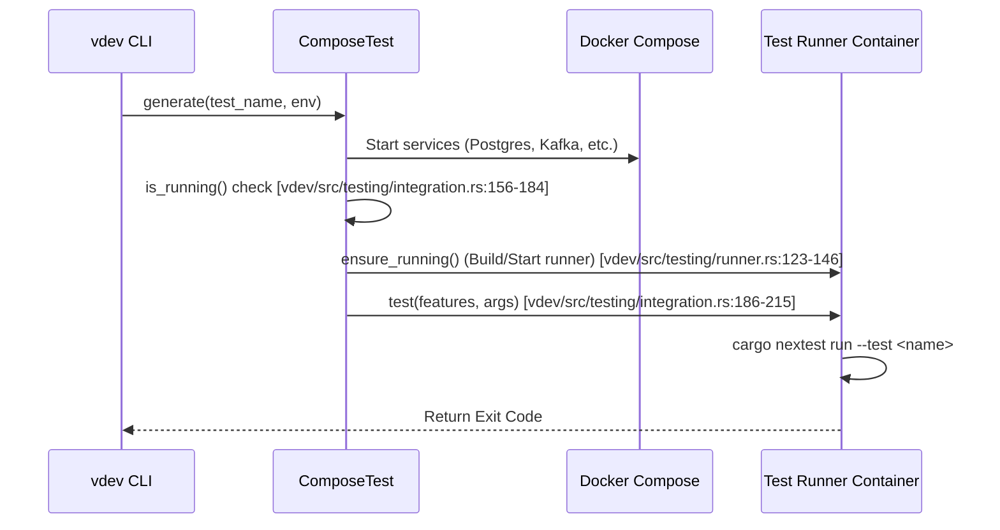

<!-- source: DeepWiki mcp.deepwiki.com · repo vectordotdev/vector · page 8.2 Testing Infrastructure · fetched 2026-10-29 -->

# Testing Infrastructure

Relevant source files

The following files were used as context for generating this wiki page:

- [CHANGELOG.md](CHANGELOG.md)
- [RELEASES.md](RELEASES.md)
- [VERSIONING.md](VERSIONING.md)
- [docs/DEVELOPING.md](docs/DEVELOPING.md)
- [docs/DOCUMENTING.md](docs/DOCUMENTING.md)
- [docs/README.md](docs/README.md)
- [lib/k8s-e2e-tests/src/lib.rs](lib/k8s-e2e-tests/src/lib.rs)
- [lib/k8s-e2e-tests/src/metrics.rs](lib/k8s-e2e-tests/src/metrics.rs)
- [lib/k8s-e2e-tests/tests/vector-agent.rs](lib/k8s-e2e-tests/tests/vector-agent.rs)
- [lib/k8s-e2e-tests/tests/vector-aggregator.rs](lib/k8s-e2e-tests/tests/vector-aggregator.rs)
- [lib/k8s-e2e-tests/tests/vector-dd-agent-aggregator.rs](lib/k8s-e2e-tests/tests/vector-dd-agent-aggregator.rs)
- [lib/k8s-e2e-tests/tests/vector.rs](lib/k8s-e2e-tests/tests/vector.rs)
- [lib/k8s-test-framework/src/framework.rs](lib/k8s-test-framework/src/framework.rs)
- [lib/k8s-test-framework/src/lib.rs](lib/k8s-test-framework/src/lib.rs)
- [lib/k8s-test-framework/src/pod.rs](lib/k8s-test-framework/src/pod.rs)
- [lib/k8s-test-framework/src/restart_rollout.rs](lib/k8s-test-framework/src/restart_rollout.rs)
- [lib/k8s-test-framework/src/vector.rs](lib/k8s-test-framework/src/vector.rs)
- [rfcs/2020-10-15-3480-file-source-rework.md](rfcs/2020-10-15-3480-file-source-rework.md)
- [scripts/build.sh](scripts/build.sh)
- [scripts/ci-setup-minikube.sh](scripts/ci-setup-minikube.sh)
- [scripts/cue.sh](scripts/cue.sh)
- [scripts/deploy-chart-test.sh](scripts/deploy-chart-test.sh)
- [scripts/package-archive.sh](scripts/package-archive.sh)
- [src/components/validation/mod.rs](src/components/validation/mod.rs)
- [src/components/validation/resources/event.rs](src/components/validation/resources/event.rs)
- [src/components/validation/resources/http.rs](src/components/validation/resources/http.rs)
- [src/components/validation/resources/mod.rs](src/components/validation/resources/mod.rs)
- [src/components/validation/runner/config.rs](src/components/validation/runner/config.rs)
- [src/components/validation/runner/mod.rs](src/components/validation/runner/mod.rs)
- [src/components/validation/runner/telemetry.rs](src/components/validation/runner/telemetry.rs)
- [src/components/validation/validators/component_spec/mod.rs](src/components/validation/validators/component_spec/mod.rs)
- [src/components/validation/validators/mod.rs](src/components/validation/validators/mod.rs)
- [tests/validation/components/sinks/http.yaml](tests/validation/components/sinks/http.yaml)
- [tests/validation/components/sources/http_client.yaml](tests/validation/components/sources/http_client.yaml)
- [tests/validation/components/sources/http_server.yaml](tests/validation/components/sources/http_server.yaml)
- [vdev/src/commands/compose_tests/show.rs](vdev/src/commands/compose_tests/show.rs)
- [vdev/src/commands/compose_tests/start.rs](vdev/src/commands/compose_tests/start.rs)
- [vdev/src/commands/compose_tests/stop.rs](vdev/src/commands/compose_tests/stop.rs)
- [vdev/src/commands/compose_tests/test.rs](vdev/src/commands/compose_tests/test.rs)
- [vdev/src/commands/e2e/show.rs](vdev/src/commands/e2e/show.rs)
- [vdev/src/commands/e2e/start.rs](vdev/src/commands/e2e/start.rs)
- [vdev/src/commands/e2e/stop.rs](vdev/src/commands/e2e/stop.rs)
- [vdev/src/commands/e2e/test.rs](vdev/src/commands/e2e/test.rs)
- [vdev/src/commands/integration/show.rs](vdev/src/commands/integration/show.rs)
- [vdev/src/commands/integration/start.rs](vdev/src/commands/integration/start.rs)
- [vdev/src/commands/integration/stop.rs](vdev/src/commands/integration/stop.rs)
- [vdev/src/commands/integration/test.rs](vdev/src/commands/integration/test.rs)
- [vdev/src/commands/test.rs](vdev/src/commands/test.rs)
- [vdev/src/testing/config.rs](vdev/src/testing/config.rs)
- [vdev/src/testing/integration.rs](vdev/src/testing/integration.rs)
- [vdev/src/testing/runner.rs](vdev/src/testing/runner.rs)

## Purpose and Scope

Vector's testing infrastructure is a multi-layered system designed to ensure reliability across 93+ crates and dozens of integrations. It spans from low-level unit tests and Criterion-based benchmarks to high-level Kubernetes E2E tests and Docker-orchestrated integration suites. This page documents the implementation of these frameworks, focusing on the `vdev` orchestration tool, the integration test runner, and the component validation systems.

---

## Test Categories and Code Entities

Vector employs a multi-layered testing strategy to ensure reliability across its sources, transforms, and sinks. The following diagram maps high-level testing concepts to the specific code entities and directories that implement them.

### Mapping Concepts to Code

Sources: [vdev/src/testing/integration.rs:78-88](), [vdev/src/testing/runner.rs:61-73](), [vdev/src/testing/config.rs:148-169](), [src/components/validation/runner/mod.rs:159-178](), [src/components/validation/mod.rs:220-221]()

---

## Integration Testing Infrastructure

Managed by the `vdev` tool, this framework orchestrates Docker Compose environments to test Vector against 35+ external services (e.g., Kafka, ClickHouse, AWS).

### ComposeTest Architecture
The core of the integration system is the `ComposeTest` struct, which manages the lifecycle of a test environment.

| Component | File Path | Role |
|-----------|-----------|------|
| `ComposeTest` | [vdev/src/testing/integration.rs:78-88]() | Orchestrates the specific test run, including environment setup and runner execution. |
| `ComposeTestConfig` | [vdev/src/testing/config.rs:148-169]() | Deserializes `test.yaml` files which define features, args, and env vars for a test. |
| `IntegrationTestRunner` | [vdev/src/testing/runner.rs:242-246]() | A specialized runner that executes `cargo nextest` inside a containerized environment. |
| `ContainerTestRunner` | [vdev/src/testing/runner.rs:83-93]() | Trait defining operations for Docker-based runners (build, create, start, remove). |

### Integration Test Data Flow

Sources: [vdev/src/testing/integration.rs:91-144](), [vdev/src/testing/integration.rs:186-215](), [vdev/src/testing/runner.rs:123-146]()

---

## Kubernetes E2E Tests

The Kubernetes E2E suite validates Vector's Helm charts and agent/aggregator roles in a live cluster.

### Implementation Detail: `vector-agent.rs`
The `default_agent` test [lib/k8s-e2e-tests/tests/vector-agent.rs:63]() performs the following:
1.  **Helm Deployment**: Deploys Vector as an Agent using the local Helm chart and custom values [lib/k8s-e2e-tests/tests/vector-agent.rs:72-86]().
2.  **Pod Log Ingestion**: Deploys a test pod that prints a `MARKER` [lib/k8s-e2e-tests/tests/vector-agent.rs:121-129]().
3.  **Verification**: Forwards the Vector metrics port (9090) and asserts that the `MARKER` was processed by reading Vector's stdout logs [lib/k8s-e2e-tests/tests/vector-agent.rs:148-171]().
4.  **Compliance**: Asserts that `SOURCE_COMPLIANCE_METRICS` are present in the Prometheus endpoint [lib/k8s-e2e-tests/tests/vector-agent.rs:175-176]().

### Framework Utilities
*   **`Framework`**: The central entry point for interacting with the K8s cluster [lib/k8s-e2e-tests/src/lib.rs:112-115]().
*   **`make_test_pod`**: Helper to create a pod with specific commands and labels for ingestion testing [lib/k8s-e2e-tests/src/lib.rs:214-222]().
*   **`wait_for_vector_started`**: Polling utility that checks metrics to ensure Vector is ready [lib/k8s-e2e-tests/tests/vector-agent.rs:108-113]().

Sources: [lib/k8s-e2e-tests/tests/vector-agent.rs:63-183](), [lib/k8s-e2e-tests/src/lib.rs:112-222]()

---

## Validation Framework

Vector includes a validation framework in `src/components/validation/` that programmatically verifies component configurations and behaviors using mock resources.

### Runner and Resources
*   **`Runner`**: Orchestrates the execution of validation, loading test cases and managing the lifecycle of the component under test [src/components/validation/runner/mod.rs:159-178]().
*   **`RunnerInput` / `RunnerOutput`**: Mechanisms for pushing data to or capturing data from components. They support both "controlled" internal edges and "external" resources like HTTP [src/components/validation/runner/mod.rs:40-127]().
*   **`HttpResourceConfig`**: Defines mock HTTP resources that can act as push/pull inputs or outputs for sources and sinks [src/components/validation/resources/http.rs:41-89]().
*   **`assert_source_compliance`**: While not explicitly detailed in the provided snippets, compliance is checked via `SOURCE_COMPLIANCE_METRICS` in E2E tests [lib/k8s-e2e-tests/tests/vector-agent.rs:175-176]().

Sources: [src/components/validation/runner/mod.rs:40-209](), [src/components/validation/resources/http.rs:41-89]()

---

## Benchmarking and Performance

Vector uses **Criterion** for statistical benchmarking of components and VRL functions.

### Benchmark Infrastructure
*   **Criterion Integration**: Benchmarks are located in `/benches` and can be run via `cargo bench` or `make bench` [docs/DEVELOPING.md:25-93]().
*   **Single Machine Performance (SMP)**: CI tracks performance regressions using SMP benchmarks to ensure code changes do not degrade throughput or increase latency [docs/DEVELOPING.md:25]().

Sources: [docs/DEVELOPING.md:25-93]()

---

## Antithesis Fault Injection

Vector utilizes **Antithesis** for autonomous, deterministic fault injection testing. This system explores the state space of Vector to find edge-case bugs like race conditions or data corruption under resource exhaustion.

---

## Code Coverage

Coverage is aggregated across unit, integration, and E2E tests using `cargo-llvm-cov`.

### Coverage Pipeline
1.  **Instrumentation**: Tests are run with the `coverage` flag set to `true` in `vdev` commands [vdev/src/commands/integration/test.rs:29-43]().
2.  **Artifact Collection**: `cargo-llvm-cov` produces coverage data which is saved to `target/coverage` [vdev/src/testing/runner.rs:41-48]().
3.  **Reporting**: The `vdev` tool generates `lcov.info` files for individual environments [vdev/src/testing/runner.rs:75-81]().

Sources: [vdev/src/testing/runner.rs:33-48](), [vdev/src/commands/integration/test.rs:27-44]()

---

