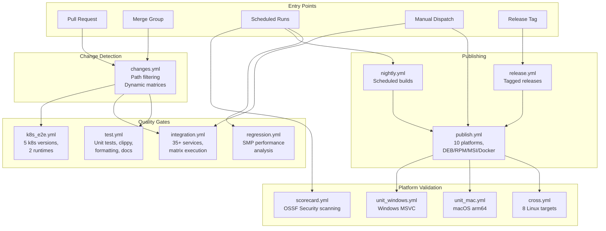
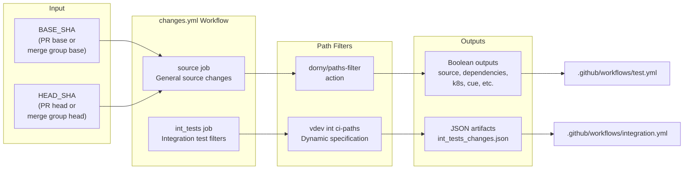
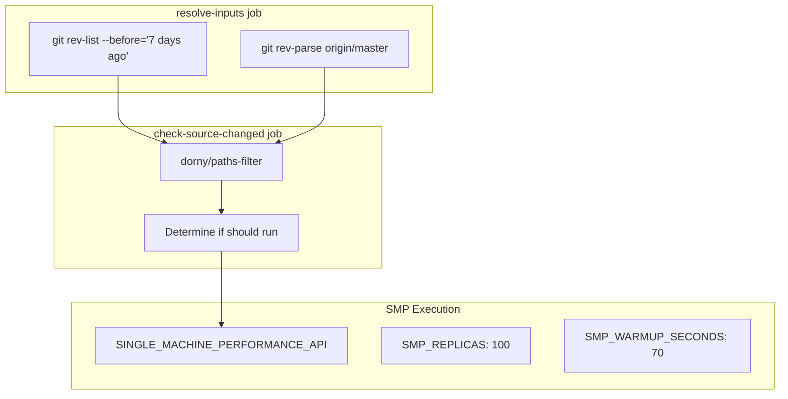
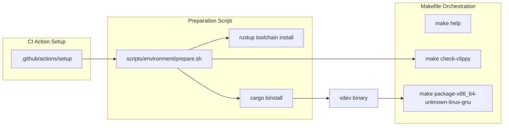

<!-- source: DeepWiki mcp.deepwiki.com · repo vectordotdev/vector · page 8.3 CI/CD Pipeline · fetched 2026-10-29 -->

# CI/CD Pipeline

Relevant source files

The following files were used as context for generating this wiki page:

- [.github/CODEOWNERS](.github/CODEOWNERS)
- [.github/actions/setup/action.yml](.github/actions/setup/action.yml)
- [.github/labeler.yml](.github/labeler.yml)
- [.github/workflows/add_docs_review_label.yml](.github/workflows/add_docs_review_label.yml)
- [.github/workflows/build_preview_sites.yml](.github/workflows/build_preview_sites.yml)
- [.github/workflows/changes.yml](.github/workflows/changes.yml)
- [.github/workflows/check_docs_review.yml](.github/workflows/check_docs_review.yml)
- [.github/workflows/check_generated_vrl_docs_comment.yml](.github/workflows/check_generated_vrl_docs_comment.yml)
- [.github/workflows/ci-integration-review.yml](.github/workflows/ci-integration-review.yml)
- [.github/workflows/ci-review-trigger.yml](.github/workflows/ci-review-trigger.yml)
- [.github/workflows/component_features.yml](.github/workflows/component_features.yml)
- [.github/workflows/coverage.yml](.github/workflows/coverage.yml)
- [.github/workflows/create_preview_sites.yml](.github/workflows/create_preview_sites.yml)
- [.github/workflows/cross.yml](.github/workflows/cross.yml)
- [.github/workflows/deprecation.yaml](.github/workflows/deprecation.yaml)
- [.github/workflows/install-sh.yml](.github/workflows/install-sh.yml)
- [.github/workflows/integration-test.yml](.github/workflows/integration-test.yml)
- [.github/workflows/integration.yml](.github/workflows/integration.yml)
- [.github/workflows/k8s_e2e.yml](.github/workflows/k8s_e2e.yml)
- [.github/workflows/labeler.yml](.github/workflows/labeler.yml)
- [.github/workflows/master_merge_queue.yml](.github/workflows/master_merge_queue.yml)
- [.github/workflows/msrv.yml](.github/workflows/msrv.yml)
- [.github/workflows/nightly.yml](.github/workflows/nightly.yml)
- [.github/workflows/preview_site_trigger.yml](.github/workflows/preview_site_trigger.yml)
- [.github/workflows/publish.yml](.github/workflows/publish.yml)
- [.github/workflows/regression.yml](.github/workflows/regression.yml)
- [.github/workflows/release.yml](.github/workflows/release.yml)
- [.github/workflows/remove_docs_review_label.yml](.github/workflows/remove_docs_review_label.yml)
- [.github/workflows/scorecard.yml](.github/workflows/scorecard.yml)
- [.github/workflows/test-make-command.yml](.github/workflows/test-make-command.yml)
- [.github/workflows/test.yml](.github/workflows/test.yml)
- [.github/workflows/unit-tests.yml](.github/workflows/unit-tests.yml)
- [.github/workflows/unit_mac.yml](.github/workflows/unit_mac.yml)
- [.github/workflows/unit_windows.yml](.github/workflows/unit_windows.yml)
- [AI_POLICY.md](AI_POLICY.md)
- [Makefile](Makefile)
- [deprecation.d/README.md](deprecation.d/README.md)
- [deprecation.d/azure-monitor-logs-sink.md](deprecation.d/azure-monitor-logs-sink.md)
- [deprecation.d/bool-or-vector-compression.md](deprecation.d/bool-or-vector-compression.md)
- [deprecation.d/buffer-bytes-events-metrics.md](deprecation.d/buffer-bytes-events-metrics.md)
- [deprecation.d/datadog-metrics-series-v1.md](deprecation.d/datadog-metrics-series-v1.md)
- [scripts/environment/prepare.sh](scripts/environment/prepare.sh)

This document covers Vector's GitHub Actions-based CI/CD infrastructure, including test orchestration, change detection, build automation, and release workflows. For local development workflow, see [Environment Setup](#8.1). For details on the testing infrastructure itself, see [Testing Infrastructure](#8.2). For build artifacts and distribution, see [Build and Release](#8.4).

## Overview

Vector's CI/CD pipeline is implemented entirely using GitHub Actions, consisting of over 15 distinct workflows that collectively validate code changes, run comprehensive test suites, detect performance regressions, and publish release artifacts. The system is designed for efficiency through intelligent change detection and parallel execution across multiple platforms.

Sources: [.github/workflows/test.yml:1-224](), [.github/workflows/integration.yml:1-207](), [.github/workflows/publish.yml:1-210]()

## Workflow Architecture

Title: Vector CI/CD Workflow Data Flow

**Workflow Orchestration**: The CI/CD system uses a hierarchical structure where `changes.yml` acts as a gate, determining which downstream workflows execute based on file path changes. The `test.yml` workflow serves as the primary quality gate for pull requests [[.github/workflows/test.yml:25-67]()], while `integration.yml` [[.github/workflows/integration.yml:53-60]()] and `k8s_e2e.yml` [[.github/workflows/k8s_e2e.yml:59-72]()] provide comprehensive validation in the merge queue. Release workflows (`publish.yml`, `nightly.yml`, `release.yml`) handle artifact generation and distribution.

Sources: [.github/workflows/test.yml:25-67](), [.github/workflows/integration.yml:53-60](), [.github/workflows/changes.yml:1-30](), [.github/workflows/publish.yml:44-65]()

## Smart Change Detection System

Title: Path Filtering and Change Detection Logic

**Change Detection Workflow**: The `changes.yml` workflow [[.github/workflows/changes.yml:1-192]()] is invoked as a reusable workflow from `test.yml`, `integration.yml`, and other workflows. It uses the `dorny/paths-filter` action to compare file paths between the base and head SHAs [[.github/workflows/changes.yml:162-163]()], generating boolean outputs for each category of changes.

**Path Filter Rules**:
*   **Source**: Tracks changes in `.cargo/**`, `lib/**`, `src/**`, `tests/**`, and `Cargo.*` files [[.github/workflows/changes.yml:172]()].
*   **Dependencies**: Monitors `Cargo.toml`, `Cargo.lock`, and `rust-toolchain.toml` [[.github/workflows/changes.yml:173]()].
*   **Kubernetes**: Specifically monitors `src/sources/kubernetes_logs/**` and K8s-related test files [[.github/workflows/changes.yml:182]()].
*   **CUE**: Monitors changes to the documentation system in `website/cue/**` [[.github/workflows/changes.yml:177]()].

**Integration Test Filters**: Each integration test declares its dependencies. The `vdev int ci-paths` command generates a YAML filter specification dynamically, which produces per-service boolean outputs (e.g., `amqp`, `aws`, `kafka`) indicating whether each integration test should run. These are exported as JSON artifacts [[.github/workflows/integration.yml:140-145]()].

Sources: [.github/workflows/changes.yml:167-192](), [.github/workflows/integration.yml:140-145]()

## Test Suite Workflows

### Primary Test Workflow
The `test.yml` workflow [[.github/workflows/test.yml:1-227]()] runs on pull requests and merge group events. It invokes `changes.yml` as a reusable workflow [[.github/workflows/test.yml:26-28]()] to determine which checks should run.

| Job | Responsibility | Implementation |
| :--- | :--- | :--- |
| `check-fmt` | Code formatting | `make check-fmt` [[.github/workflows/test.yml:41]()] |
| `check-clippy` | Rust lints | `make check-clippy` [[.github/workflows/test.yml:56]()] |
| `test` | Unit & Component tests | Calls `unit-tests.yml` [[.github/workflows/test.yml:64]()] |
| `check-scripts` | Shell script linting | `make check-scripts` [[.github/workflows/test.yml:81]()] |
| `check-licenses` | License compliance | `make check-licenses` [[.github/workflows/test.yml:108]()] |
| `check-docs` | CUE schema validation | `make check-docs` [[.github/workflows/test.yml:121]()] |
| `test-vrl` | VRL specific tests | `make test-vrl` [[.github/workflows/test.yml:182]()] |

**Final Aggregation**: The `all-checks` job [[.github/workflows/test.yml:200-227]()] acts as a final gate. It fails if any upstream job failed or was cancelled, providing a single status check for PR merging.

Sources: [.github/workflows/test.yml:198-224]()

### Integration Test Workflow
The `integration.yml` workflow [[.github/workflows/integration.yml:1-207]()] executes 35+ service tests in parallel using a matrix strategy [[.github/workflows/integration.yml:98-136]()].

**Execution Flow**:
1.  **Build Runner**: Builds a Docker image containing all test dependencies [[.github/workflows/integration.yml:80-84]()].
2.  **Download JSON**: Matrix jobs download `int_tests_changes.json` [[.github/workflows/integration.yml:139-143]()].
3.  **Check should_run**: A shell script evaluates if the specific service (e.g., `clickhouse`, `kafka`) requires testing based on the JSON or event type [[.github/workflows/integration.yml:147-161]()].
4.  **Execute**: Runs `vdev integration run` [[.github/workflows/integration.yml:192]()] with a retry logic (3 attempts) [[.github/workflows/integration.yml:188-192]()].

Sources: [.github/workflows/integration.yml:85-138](), [.github/workflows/integration.yml:188-194]()

### Kubernetes E2E Tests
The `k8s_e2e.yml` workflow [[.github/workflows/k8s_e2e.yml:1-223]()] tests Vector across multiple K8s versions and container runtimes.

*   **Dynamic Matrix**: The `compute-k8s-test-plan` job [[.github/workflows/k8s_e2e.yml:105-159]()] uses a JavaScript script to determine the K8s versions to test. Nightly runs test all versions [[.github/workflows/k8s_e2e.yml:143]()], while PRs test only "essential" latest versions.
*   **Build**: Builds a DEB package for x86_64-unknown-linux-gnu before starting the cluster [[.github/workflows/k8s_e2e.yml:92]()].
*   **Setup**: Sets up Minikube with specific versions and runtimes (Docker/containerd) [[.github/workflows/k8s_e2e.yml:120-153]()].

Sources: [.github/workflows/k8s_e2e.yml:105-159](), [.github/workflows/k8s_e2e.yml:160-172]()

## Performance Regression Detection

The `regression.yml` workflow [[.github/workflows/regression.yml:1-180]()] performs relative evaluations between a **Baseline SHA** and a **Comparison SHA** using the Single Machine Performance (SMP) framework.

Title: Regression Detection Implementation

**Implementation Details**:
*   **SHA Resolution**: If not provided via `workflow_dispatch`, it defaults to `origin/master` as the comparison and the commit from 7 days ago as the baseline [[.github/workflows/regression.yml:83-104]()].
*   **Conservative Filtering**: It ignores changes to `.github`, `.gitignore`, `docs`, and `website` but triggers for any other source code change [[.github/workflows/regression.yml:143-159]()].
*   **SMP Configuration**: Executes experiments with high statistical significance, using 100 replicas [[.github/workflows/regression.yml:59]()] and 70-second warmups [[.github/workflows/regression.yml:58]()].

Sources: [.github/workflows/regression.yml:62-115](), [.github/workflows/regression.yml:124-175]()

## Build and Publish Pipeline

The `publish.yml` workflow [[.github/workflows/publish.yml:1-210]()] handles the distribution of Vector across multiple platforms.

**Platform Support**:
*   **Linux Native**: GNU builds for x86_64 and aarch64 on Almalinux 8 [[.github/workflows/publish.yml:66-89]()].
*   **Linux Cross**: MUSL and GNU targets for x86_64, aarch64, armv7, and arm [[.github/workflows/publish.yml:137-154]()].
*   **macOS**: Builds for x86_64 and aarch64 apple-darwin [[.github/workflows/publish.yml:180-182]()].

**Build Steps**:
1.  **Metadata**: Generates versioning info via `make ci-generate-publish-metadata` [[.github/workflows/publish.yml:64]()].
2.  **Package**: Uses `make package-${{ matrix.target }}-all` [[.github/workflows/publish.yml:130](), [.github/workflows/publish.yml:173]()] to generate `.tar.gz`, `.deb`, and `.rpm`.
3.  **Release Channels**: Supports `release` [[.github/workflows/release.yml:20]()], `nightly` [[.github/workflows/nightly.yml:19]()], and `custom` channels [[.github/workflows/publish.yml:13-16]()].

Sources: [.github/workflows/publish.yml:45-65](), [.github/workflows/publish.yml:66-136](), [.github/workflows/publish.yml:137-179]()

## Makefile and Environment Preparation

The `Makefile` [[Makefile:1-175]()] and `scripts/environment/prepare.sh` [[scripts/environment/prepare.sh:1-210]()] abstract CI complexity into consistent targets and setup routines.

Title: Environment Setup and Tooling Data Flow

*   **Tool Setup**: `prepare.sh` manages installation of critical tools like `cargo-nextest`, `cross`, `vdev`, and `wasm-pack` [[scripts/environment/prepare.sh:31-58]()]. It uses `cargo binstall` for efficiency and falls back to building from source if necessary [[scripts/environment/prepare.sh:168-171]()].
*   **Makefile OS Detection**: Automatically detects the operating system and sets the `RUST_TARGET` accordingly [[Makefile:13-21]()].
*   **Test Runners**: Configures `cargo-nextest` or `cargo-llvm-cov` based on the `COVERAGE` flag [[Makefile:27-31]()].
*   **VDEV**: Preserves prebuilt `vdev` binaries if supplied by CI setup actions, otherwise recompiles from the workspace [[Makefile:52-54]()].

Sources: [Makefile:1-63](), [Makefile:88-124](), [scripts/environment/prepare.sh:1-210]()

---

